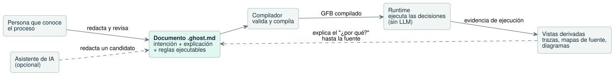
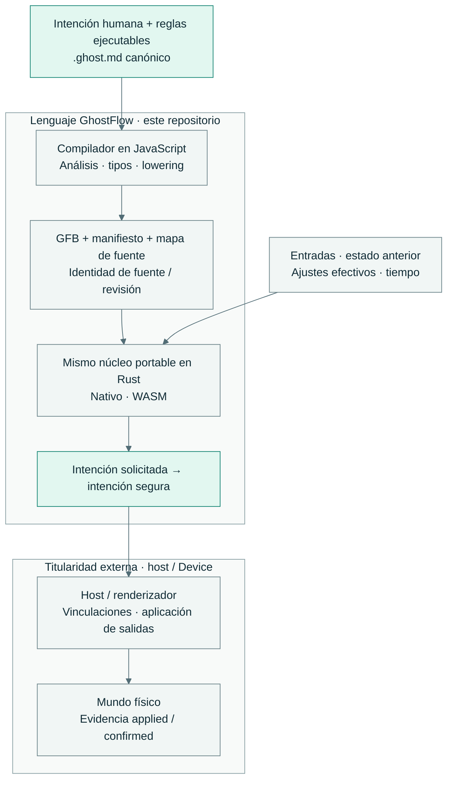

<!-- translation-source: README.md -->
[Original en inglés](README.md)

<p align="center">
  
</p>

<div align="center">

# Un control fiel a la intención.

</div>

<p align="center">Un lenguaje de control que mantiene juntos, en una sola fuente legible, la intención humana, las reglas ejecutables y las decisiones explicables.</p>

[English](README.md) · [한국어](README.ko.md) · **Español**

<p align="center">
  <a href="https://github.com/callin2/ghostflow-language/actions/workflows/verified-wasm.yml"></a>
  · <a href="LICENSE">Licencia MIT</a>
</p>

## Nuestra visión

Las personas que entienden un proceso deberían poder hacer tres cosas: describir
cómo debería funcionar, comprobar cómo se comporta y entender por qué actuó de
cierta manera. Nuestra visión es mantener viva esa comprensión durante toda la
vida de un programa de control, desde un sencillo sistema de riego hasta una
automatización más amplia.

**¿Qué es GhostFlow?** GhostFlow es un lenguaje de control. Cada programa es un
**documento `.ghost.md`** legible por humanos (un archivo Markdown de fuente
literaria, *literate*) que contiene, uno junto a otro, la intención, su
explicación y las reglas ejecutables. El código compilado, los diagramas y las
trazas son *vistas derivadas* de esa única fuente.

**¿Cómo funciona?**

1. Una persona que conoce el proceso escribe el documento. Un asistente de IA
   puede ayudar a redactar un documento candidato.
2. El compilador valida el programa y lo compila.
3. El runtime lo ejecuta **sin un LLM**.
4. Las trazas y los mapas de fuente remiten cada decisión al documento.

El diagrama siguiente muestra este ciclo, desde la redacción hasta la explicación.



<table>
  <tr>
    <td width="33%" valign="top">
      <br>
      <strong>Intención preservada</strong><br>
      Lea el motivo justo al lado de la regla. Mantenga la intención confirmada separada de los supuestos.
    </td>
    <td width="33%" valign="top">
      <br>
      <strong>Decisiones reproducibles</strong><br>
      Vuelva a ejecutar una decisión con las mismas entradas, el mismo estado anterior, los mismos ajustes efectivos y el mismo tiempo.
    </td>
    <td width="33%" valign="top">
      <br>
      <strong>Motivos rastreables</strong><br>
      Siga los mapas de fuente y la evidencia de ejecución hasta el documento y su revisión.
    </td>
  </tr>
</table>

**Vea la idea en el código fuente:** [un latch de arranque/paro](examples/tutorial/01-latch.ghost.es.md)
muestra una regla de control conocida escrita como documento de fuente literaria.
[La filosofía del lenguaje](docs/LANGUAGE-REFERENCE.es.md#filosofía-de-diseño)
explica el diseño que hay detrás.

## Una fuente. Un núcleo de ejecución.

GhostFlow tiene una fuente y un núcleo de ejecución:

- **Una fuente.** Un compilador en JavaScript analiza, comprueba los tipos y
  reduce (lowering) el documento canónico `.ghost.md` a GFB (bytecode de
  GhostFlow), además de un manifiesto y un mapa de fuente.
- **Un núcleo de ejecución.** El mismo núcleo portable en Rust ejecuta ese GFB
  tanto en destinos nativos como WASM.

El diagrama muestra lo que es titularidad de este repositorio y lo que queda
fuera de él.



El lenguaje calcula las intenciones *solicitada* (requested) y *segura* (safe). El
host y su renderizador aplican los efectos físicos. **Una intención no es la
confirmación de que un relé se movió.** La reproducción (replay) comprueba solo
decisiones virtuales; la confirmación física requiere evidencia independiente del
dispositivo.

Otros módulos son titulares de todo lo que queda fuera del lenguaje:

| Módulo | Es titular de |
| --- | --- |
| API | Redacción con LLM, contexto de la instalación, almacenamiento del código fuente, orquestación del despliegue |
| Frontend | Interacción y visualización |
| Firmware del Device | Mapeos de la placa y E/S física |

Estos módulos se construyen y publican por separado. Consulte
[los límites de la implementación](docs/IMPLEMENTATION.es.md) y
[la arquitectura de la cadena de herramientas](docs/LLM-TOOLCHAIN-ARCHITECTURE.es.md).

## Pruébelo en local

Necesita **Node.js 22+**, npm y una cadena de herramientas de Rust cuyo Cargo
admita lockfile v4. El tutorial se ejecuta en macOS o Linux. La configuración
puede descargar dependencias.

Instale las dependencias y ejecute la verificación completa en el host:

```sh
npm ci --ignore-scripts
rustup component add rustfmt
rustup target add wasm32-unknown-unknown
npm test
```

Luego compile y ejecute el ejemplo de riego:

```sh
npm run compile:example
npm run tutorial
```

Qué hace `npm test`:

- Genera el fixture de Rust que necesitan las pruebas y luego construye los
  runners nativo y WASM.
- Verifica la cadena de herramientas del host y escribe `build/verification.json`
  junto con un registro de ejecución único.
- Sus controles de Cargo usan `--locked --offline` y el directorio local
  `target/`.

Los resultados en el host no demuestran el comportamiento de la E/S física.

## Aprender y explorar

| Empiece aquí | Qué encontrará |
| --- | --- |
| [Referencia del lenguaje](docs/LANGUAGE-REFERENCE.es.md) | Filosofía, sintaxis, semántica y fundamento de las funcionalidades |
| [Tutorial](docs/TUTORIAL.es.md) · [ejemplos canónicos](examples/) | Reglas de control que puede leer y ejecutar |
| [FAQ de programación](docs/language_faq.es.md) | Orientación de programación centrada en tareas |
| [Estado de las funcionalidades de la referencia](docs/REFERENCE-FEATURE-STATUS.es.md) | Madurez actual, titularidad y evidencia ejecutable |
| [Documentación en English / 한국어](docs/DOCUMENTATION.es.md) | El catálogo de documentos bilingüe |

## Alcance actual y contribuciones

GhostFlow está en fase **previa a 1.0**. La Referencia del lenguaje describe tanto
la semántica implementada como el diseño futuro. Para comprobar qué tiene
evidencia de aceptación hoy, use la página de estado de las funcionalidades y la
[guía de verificación](docs/VERIFICATION.es.md).

Antes de hacer cambios, lea la [guía de contribución para agentes de codificación](CONTRIBUTING.es.md).

<details>
<summary><strong>Puntos de entrada del compilador, paquetes y comprobaciones específicas</strong></summary>

- **Puntos de entrada del compilador.** `tools/browser-toolchain.mjs` expone el
  compilador a navegadores y Workers sin E/S de Node. `tools/toolchain.mjs`
  envuelve el mismo compilador para la E/S de artefactos en Node. Ambos reciben
  el documento canónico `.ghost.md` completo y una identidad de fuente inmutable.
- **Paquetes.** `tools/portable-package.mjs` produce un paquete firmado. El
  paquete preserva la fuente, el GFB, el manifiesto, el mapa de fuente y la
  identidad de compatibilidad con el host. Los consumidores del navegador y del
  Device comparten el mismo contrato de verificación. Consulte
  [Paquete GFB portable v1](docs/PORTABLE-PACKAGE.es.md).
- **Runtime.** `crates/ghostflow-core` es titular de la ejecución, las señales y
  el arbitraje de estaciones. `runtimes/wasm` y `runtimes/node/ledger.mjs` son
  adaptadores de host de referencia. Los artefactos generados son proyecciones.
  Los archivos históricos `.ghost` situados junto a sus documentos `.ghost.md` son
  evidencia no ejecutable, no entradas de fuente admitidas.
- **Comprobaciones específicas.** `npm run test:compiler` comprueba el
  comportamiento del compilador sin construir WASM. `npm run test:node` usa un
  artefacto WASM ya construido y registra evidencia parcial del host.
  `npm run test:contract` comprueba los contratos de identidad de integración y de
  evidencia. Las comprobaciones parciales no sustituyen a `npm test`.
- **Versiones.** Los consumidores de versiones preservan los hashes exactos de la
  fuente, del bytecode y del manifiesto, la revisión del compilador/núcleo y el
  perfil/ABI admitido. Este checkout no contiene evidencia de compilaciones
  anteriores, firmware, conectores de modelos en vivo, datos de instalaciones ni
  archivos privados de chats.

</details>

Siga el [flujo de trabajo de desarrollo](docs/DEVELOPMENT-WORKFLOW.es.md) y las
[reglas de titularidad del repositorio](AGENTS.es.md). Mantenga sincronizadas la
documentación en inglés y en coreano. La automatización comprueba la vigencia de
las traducciones, la paridad de los bloques ejecutables y los índices de
documentos. Después de un lote de documentación, ejecute `npm run docs:index` y
luego `npm run docs:check`. Los controles del compilador y del host también
ejecutan los ejemplos ejecutables de la FAQ y de programación mediante
`tests/docs-runnable-examples.test.mjs`.

Publicado bajo la [Licencia MIT](LICENSE).

<!-- windows-dev-restoration-20261014 -->
Recuperación del trabajo local en Windows: [código fuente, documentos y referencias exactas de restauración preservados](history/windows-20261014/DEV-RESTORATION.txt). Son referencias históricas inactivas; el código actual y los pines de dependencias siguen siendo los que tienen autoridad.
