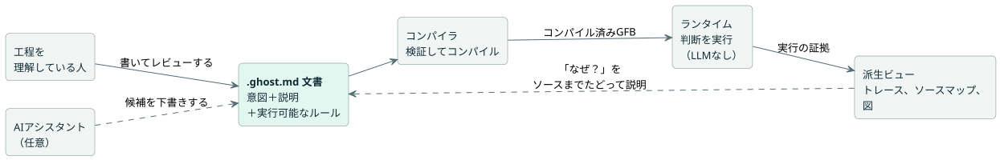
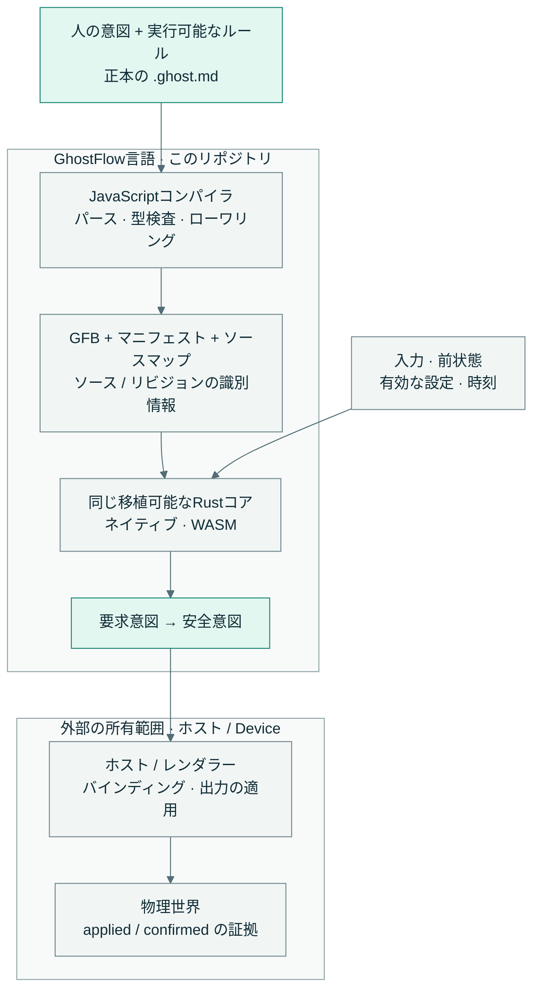

<!-- translation-source: README.md -->
[英語の原文](README.md)

<p align="center">
  
</p>

<div align="center">

# 意図に忠実であり続ける制御。

</div>

<p align="center">人の意図、実行可能なルール、説明できる判断を、1つの読みやすいソースにまとめて保つ制御言語です。</p>

[English](README.md) · [한국어](README.ko.md) · **日本語**

<p align="center">
  <a href="https://github.com/callin2/ghostflow-language/actions/workflows/verified-wasm.yml"></a>
  · <a href="LICENSE">MITライセンス</a>
</p>

## 私たちのビジョン

工程を理解している人は、次の3つのことができるべきです。それがどう動くべきかを記述すること、それがどう振る舞うかを確かめること、そしてなぜそう動いたのかを理解することです。私たちのビジョンは、シンプルな灌水システムからより広い自動化まで、制御プログラムの全生涯を通じてその理解を生かし続けることです。

**GhostFlowとは？** GhostFlowは制御言語です。すべてのプログラムは人が読める**`.ghost.md`ドキュメント**（文芸的なMarkdownファイル）であり、意図、その説明、実行可能なルールを並べて保持します。コンパイル済みのコード、図、トレースは、その1つのソースの*派生ビュー*です。

**どのように動くのか？**

1. 工程を理解している人がドキュメントを書きます。AIアシスタントが候補ドキュメントの下書きを手伝ってもかまいません。
2. コンパイラがプログラムを検証し、コンパイルします。
3. ランタイムがそれを**LLMなしで**実行します。
4. トレースとソースマップが、あらゆる判断をドキュメントまでたどれるようにします。

次の図は、作成から説明までのこのループを示しています。



<table>
  <tr>
    <td width="33%" valign="top">
      <br>
      <strong>意図を保存</strong><br>
      ルールのすぐ隣で理由を読めます。確認された意図と仮定を分けて保ちます。
    </td>
    <td width="33%" valign="top">
      <br>
      <strong>判断をリプレイ可能</strong><br>
      同じ入力、前状態、有効な設定、時刻で判断を再実行できます。
    </td>
    <td width="33%" valign="top">
      <br>
      <strong>理由をたどれる</strong><br>
      ソースマップと実行の証拠をたどって、ドキュメントとそのリビジョンまで戻れます。
    </td>
  </tr>
</table>

**ソースでアイデアを見る：** [起動／停止の自己保持](examples/tutorial/01-latch.ghost.ja.md)は、おなじみの制御ルールを文芸的ドキュメントとして書いた例です。その背後にある設計は[言語の設計思想](docs/LANGUAGE-REFERENCE.ja.md)で説明しています。

## 1つのソース。1つの実行コア。

GhostFlowには、1つのソースと1つの実行コアがあります。

- **1つのソース。** JavaScriptのコンパイラが、正本の`.ghost.md`ドキュメントをパースし、型検査し、GFB（GhostFlowバイトコード）にローワリングします。あわせてマニフェストとソースマップも生成します。
- **1つの実行コア。** 同じ移植可能なRustコアが、ネイティブとWASMの両方のターゲットでそのGFBを実行します。

次の図は、このリポジトリが所有するものと、その外側にあるものを示しています。



言語が計算するのは*要求意図（requested）*と*安全意図（safe）*です。物理的な効果を適用するのは、ホストとそのレンダラーです。**意図は、リレーが動いたことの確認ではありません。** リプレイが確かめるのは仮想的な判断だけです。物理的な確認には、別途デバイスの証拠が必要です。

言語の外側にあるものは、すべて他のモジュールが所有します。

| モジュール | 所有するもの |
| --- | --- |
| API | LLMによる作成、設置コンテキスト、ソースの保存、デプロイのオーケストレーション |
| フロントエンド | 操作と可視化 |
| Deviceファームウェア | ボードのマッピングと物理I/O |

これらのモジュールは、別々にビルドしてリリースされます。[実装の境界](docs/IMPLEMENTATION.ja.md)と[ツールチェーンのアーキテクチャ](docs/LLM-TOOLCHAIN-ARCHITECTURE.ja.md)を参照してください。

## ローカルで試す

**Node.js 22以上**、npm、そしてCargoがlockfile v4をサポートしているRustツールチェーンが必要です。チュートリアルはmacOSまたはLinuxで動きます。セットアップ中に依存関係がダウンロードされることがあります。

依存関係をインストールし、ホストの完全な検証を実行します。

```sh
npm ci --ignore-scripts
rustup component add rustfmt
rustup target add wasm32-unknown-unknown
npm test
```

続けて、灌水の例をコンパイルして実行します。

```sh
npm run compile:example
npm run tutorial
```

`npm test`が行うこと：

- テストに必要なRustのフィクスチャを生成し、ネイティブとWASMのランナーをビルドします。
- ホストのツールチェーンを検証し、`build/verification.json`と一意の実行記録を書き出します。
- Cargoのゲートは`--locked --offline`とローカルの`target/`ディレクトリを使います。

ホストでの結果は、物理I/Oの振る舞いを証明しません。

## 学ぶ・探る

| ここから始める | 内容 |
| --- | --- |
| [Language Reference](docs/LANGUAGE-REFERENCE.ja.md) | 設計思想、構文、意味論、機能の根拠 |
| [チュートリアル](docs/TUTORIAL.ja.md) · [正本の例](examples/) | 読んで実行できる制御ルール |
| [コーディングFAQ](docs/language_faq.ja.md) | タスク別のプログラミングガイド |
| [リファレンス機能ステータス](docs/REFERENCE-FEATURE-STATUS.ja.md) | 現在の成熟度、所有範囲、実行可能な証拠 |
| [English / 한국어 ドキュメント](docs/DOCUMENTATION.ja.md) | 2言語のドキュメントカタログ |

## 現在の範囲とコントリビューション

GhostFlowは**1.0以前**です。Language Referenceは、実装済みの意味論と将来の設計の両方を記述しています。現時点で受け入れの証拠があるものを確認するには、機能ステータスのページと[検証ガイド](docs/VERIFICATION.ja.md)を使ってください。

変更を加える前に、[コーディングエージェント向けコントリビューションガイド](CONTRIBUTING.ja.md)を読んでください。

<details>
<summary><strong>コンパイラのエントリポイント、パッケージ、対象を絞ったチェック</strong></summary>

- **コンパイラのエントリポイント。** `tools/browser-toolchain.mjs`は、Node I/Oなしでブラウザとワーカーにコンパイラを公開します。`tools/toolchain.mjs`は、同じコンパイラをNodeの成果物I/O用にラップします。どちらも、完全な正本の`.ghost.md`ドキュメントと、不変のソース識別情報を受け取ります。
- **パッケージ。** `tools/portable-package.mjs`は署名付きパッケージを生成します。パッケージは、ソース、GFB、マニフェスト、ソースマップ、ホスト互換性の識別情報を保持します。ブラウザとDeviceの利用者は、同じ検証契約を共有します。[Portable GFB package v1](docs/PORTABLE-PACKAGE.ja.md)を参照してください。
- **ランタイム。** `crates/ghostflow-core`は、実行、信号、ステーションの調停を所有します。`runtimes/wasm`と`runtimes/node/ledger.mjs`はリファレンスホストアダプタです。生成された成果物は投影です。`.ghost.md`ドキュメントの隣にある過去の`.ghost`ファイルは実行不可能な証拠であり、サポートされたソース入力ではありません。
- **対象を絞ったチェック。** `npm run test:compiler`は、WASMをビルドせずにコンパイラの振る舞いを確認します。`npm run test:node`は、ビルド済みのWASM成果物を使い、部分的なホストの証拠を記録します。`npm run test:contract`は、統合の識別情報と証拠の契約を確認します。部分的なチェックは`npm test`の代わりにはなりません。
- **リリース。** リリースの利用者は、ソース、バイトコード、マニフェストの正確なハッシュ、コンパイラ／コアのリビジョン、サポートされるプロファイル／ABIを保持します。このチェックアウトには、以前のビルドの証拠、ファームウェア、稼働中のモデルコネクタ、現場データ、非公開のチャットアーカイブは含まれていません。

</details>

[開発ワークフロー](docs/DEVELOPMENT-WORKFLOW.ja.md)と[リポジトリの所有範囲のルール](AGENTS.ja.md)に従ってください。英語と韓国語のドキュメントは足並みをそろえて保ちます。自動化によって、翻訳の鮮度、実行可能なフェンスの一致、ドキュメントのインデックスが確認されます。ドキュメントのバッチの後は、`npm run docs:index`を実行し、続けて`npm run docs:check`を実行します。コンパイラとホストのゲートは、実行可能なFAQとプログラミングのサンプルも`tests/docs-runnable-examples.test.mjs`で実行します。

[MITライセンス](LICENSE)のもとで公開されています。

<!-- windows-dev-restoration-20261014 -->
Windowsでのローカル作業の復旧：[保存されたソース、ドキュメント、正確な復元参照](history/windows-20261014/DEV-RESTORATION.txt)。これらは無効な過去の参照です。現在のコードと依存関係の固定が優先されます。
