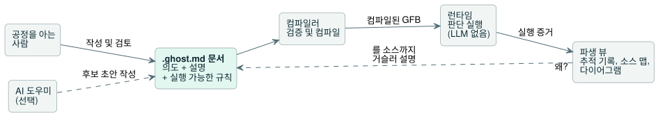
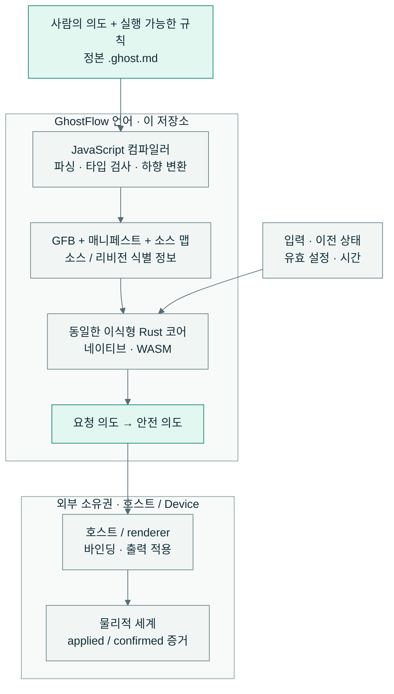

<!-- translation-source: README.md -->
<p align="center">
  
</p>

<div align="center">

# 의도를 잃지 않는 제어.

</div>

<p align="center">사람의 의도, 실행 가능한 규칙, 설명 가능한 판단을 하나의 읽기 쉬운 소스에 함께 담는 제어 언어입니다.</p>

[English](README.md) · **한국어**

<p align="center">
  <a href="https://github.com/callin2/ghostflow-language/actions/workflows/verified-wasm.yml"></a>
  · <a href="LICENSE">MIT License</a>
</p>

## 우리의 비전

공정을 이해하는 사람은 세 가지를 할 수 있어야 합니다. 공정이 어떻게 동작해야
하는지 설명하고, 실제로 어떻게 동작하는지 확인하고, 왜 그렇게 동작했는지
이해하는 것입니다. 단순한 물 주기 시스템부터 더 넓은 자동화까지, 제어 프로그램의
전체 수명 동안 그 이해를 살려 두는 것이 우리의 비전입니다.

**GhostFlow란?** GhostFlow는 제어 언어입니다. 모든 프로그램은 사람이 읽을 수 있는
**`.ghost.md` 문서**(문서형 Markdown 파일)이며, 의도와 그 설명, 실행 가능한 규칙을
나란히 담습니다. 컴파일된 코드, 다이어그램, 추적 기록은 모두 이 하나의 소스에서
*파생된 뷰*입니다.

**어떻게 동작하나요?**

1. 공정을 아는 사람이 문서를 작성합니다. AI 도우미가 후보 문서 초안 작성을 도울
   수 있습니다.
2. 컴파일러가 프로그램을 검증하고 컴파일합니다.
3. 런타임이 **LLM 없이** 프로그램을 실행합니다.
4. 추적 기록과 소스 맵이 모든 판단을 문서로 거슬러 연결합니다.

아래 다이어그램은 작성에서 설명까지 이어지는 이 순환을 보여 줍니다.



<table>
  <tr>
    <td width="33%" valign="top">
      <br>
      <strong>의도 보존</strong><br>
      규칙 바로 옆에서 이유를 읽습니다. 확인된 의도와 가정을 구분해 둡니다.
    </td>
    <td width="33%" valign="top">
      <br>
      <strong>판단 재생</strong><br>
      같은 입력, 이전 상태, 유효 설정, 시간으로 판단을 다시 실행합니다.
    </td>
    <td width="33%" valign="top">
      <br>
      <strong>근거 추적</strong><br>
      소스 맵과 실행 증거를 따라 문서와 그 리비전까지 거슬러 올라갑니다.
    </td>
  </tr>
</table>

**소스에서 아이디어 확인하기:** [시작/정지 래치](examples/tutorial/01-latch.ghost.md)는
익숙한 제어 규칙을 문서형 소스로 작성한 예입니다.
[언어 철학](docs/LANGUAGE-REFERENCE.md#설계-철학)에서 그 설계 배경을 설명합니다.

## 하나의 소스. 하나의 실행 코어.

GhostFlow에는 하나의 소스와 하나의 실행 코어가 있습니다.

- **하나의 소스.** JavaScript 컴파일러가 정본 `.ghost.md` 문서를 파싱하고, 타입을
  검사하고, GFB(GhostFlow 바이트코드)와 매니페스트, 소스 맵으로 하향 변환합니다.
- **하나의 실행 코어.** 동일한 이식형 Rust 코어가 네이티브와 WASM 대상 모두에서
  그 GFB를 실행합니다.

다이어그램은 이 저장소가 소유하는 것과 저장소 밖에 남는 것을 보여 줍니다.



언어는 *요청* 의도와 *안전* 의도를 계산합니다. 물리적 효과는 호스트와 그
renderer가 적용합니다. **의도는 릴레이가 움직였다는 확인이 아닙니다.** 재생(replay)은
가상 판단만 확인합니다. 물리적 확인에는 별도의 장치 증거가 필요합니다.

언어 밖의 모든 것은 다른 모듈이 소유합니다.

| 모듈 | 소유 범위 |
| --- | --- |
| API | LLM을 통한 작성, 설치 맥락, 소스 저장, 배포 오케스트레이션 |
| 프런트엔드 | 상호작용과 시각화 |
| Device 펌웨어 | 보드 매핑과 물리 I/O |

이 모듈들은 별도로 빌드하고 릴리스합니다.
[구현 경계](docs/IMPLEMENTATION.ko.md)와
[도구 체인 아키텍처](docs/LLM-TOOLCHAIN-ARCHITECTURE.ko.md)를 참조하세요.

## 로컬에서 실행하기

**Node.js 22 이상**, npm, 그리고 Cargo가 잠금 파일 v4를 지원하는 Rust 도구 체인이
필요합니다. 튜토리얼은 macOS 또는 Linux에서 실행됩니다. 설정 중에 의존성을
내려받을 수 있습니다.

의존성을 설치하고 전체 호스트 검증을 실행합니다.

```sh
npm ci --ignore-scripts
rustup component add rustfmt
rustup target add wasm32-unknown-unknown
npm test
```

그다음 물 주기 예제를 컴파일하고 실행합니다.

```sh
npm run compile:example
npm run tutorial
```

`npm test`가 하는 일:

- 테스트에 필요한 Rust 픽스처를 생성한 뒤 네이티브 및 WASM 러너를 빌드합니다.
- 호스트 도구 체인을 검증하고 `build/verification.json`과 고유한 실행 기록을
  씁니다.
- Cargo 게이트는 `--locked --offline`과 로컬 `target/` 디렉터리를 사용합니다.

호스트 결과는 물리 I/O 동작을 입증하지 않습니다.

## 학습과 탐색

| 시작점 | 내용 |
| --- | --- |
| [언어 참조](docs/LANGUAGE-REFERENCE.md) | 철학, 문법, 의미, 기능의 근거 |
| [튜토리얼](docs/TUTORIAL.ko.md) · [정본 예제](examples/) | 읽고 실행할 수 있는 제어 규칙 |
| [코딩 FAQ](docs/language_faq.md) | 작업 중심 프로그래밍 안내 |
| [참조 기능 상태](docs/REFERENCE-FEATURE-STATUS.md) | 현재 성숙도, 소유권, 실행 증거 |
| [English / 한국어 문서](docs/DOCUMENTATION.ko.md) | 이중 언어 문서 목록 |

## 현재 범위와 기여

GhostFlow는 **1.0 이전** 단계입니다. 언어 참조는 구현된 의미와 미래 설계를 함께
설명합니다. 오늘 시점에 수용 증거가 있는 항목은 기능 상태 페이지와
[검증 안내](docs/VERIFICATION.ko.md)에서 확인하세요.

변경을 시작하기 전에 [코딩 에이전트 기여 안내](CONTRIBUTING.ko.md)를 읽으세요.

<details>
<summary><strong>컴파일러 진입점, 패키지, 집중 검사</strong></summary>

- **컴파일러 진입점.** `tools/browser-toolchain.mjs`는 Node I/O 없이 브라우저와
  Worker에 컴파일러를 제공합니다. `tools/toolchain.mjs`는 같은 컴파일러를 감싸
  Node 아티팩트 I/O를 처리합니다. 두 진입점 모두 완전한 정본 `.ghost.md` 문서와
  변경 불가능한 소스 식별 정보를 받습니다.
- **패키지.** `tools/portable-package.mjs`는 서명된 패키지를 만듭니다. 이 패키지는
  소스, GFB, 매니페스트, 소스 맵, 호스트 호환성 식별 정보를 보존합니다. 브라우저와
  Device 소비자는 같은 검증기 계약을 공유합니다.
  [Portable GFB package v1](docs/PORTABLE-PACKAGE.ko.md)을 참조하세요.
- **런타임.** `crates/ghostflow-core`는 실행, 신호, 스테이션 중재를 소유합니다.
  `runtimes/wasm`과 `runtimes/node/ledger.mjs`는 참조 호스트 어댑터입니다. 생성
  아티팩트는 투영본입니다. `.ghost.md` 문서 옆에 있는 과거 `.ghost` 파일은 실행되지
  않는 증거이며, 지원하는 소스 입력이 아닙니다.
- **집중 검사.** `npm run test:compiler`는 WASM을 빌드하지 않고 컴파일러 동작을
  확인합니다. `npm run test:node`는 이미 빌드된 WASM 아티팩트를 사용해 부분적인
  호스트 증거를 기록합니다. `npm run test:contract`는 통합 식별 정보와 증거 계약을
  확인합니다. 부분 검사는 `npm test`를 대신하지 않습니다.
- **릴리스.** 릴리스 소비자는 정확한 소스, 바이트코드, 매니페스트 해시와
  컴파일러/코어 리비전, 지원 프로필/ABI를 보존합니다. 이 체크아웃에는 이전 빌드
  증거, 펌웨어, 라이브 모델 연결기, 현장 데이터, 비공개 채팅 기록이 들어 있지
  않습니다.

</details>

[개발 작업 흐름](docs/DEVELOPMENT-WORKFLOW.ko.md)과
[저장소 소유권 규칙](AGENTS.ko.md)을 따르세요. 영어와 한국어 문서를 함께 맞춰
유지하세요. 자동화가 번역 최신성, 실행 가능한 코드 펜스의 일치, 문서 인덱스를
확인합니다. 문서 편집 묶음이 끝나면 `npm run docs:index`를 실행한 뒤
`npm run docs:check`를 실행하세요. 컴파일러와 호스트 게이트는 실행 가능한 FAQ와
프로그래밍 샘플도 `tests/docs-runnable-examples.test.mjs`로 실행합니다.

[MIT License](LICENSE)로 배포됩니다.

<!-- windows-dev-restoration-20261014 -->
Windows 로컬 작업 복원: [보존된 소스, 문서와 정확한 복원 참조](history/windows-20261014/DEV-RESTORATION.txt). 이 항목은 비활성 과거 참조이며, 현재 코드와 의존성 pin이 기준입니다.
