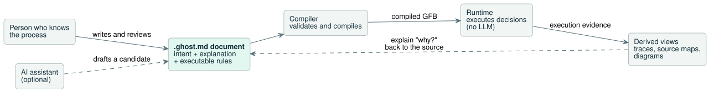
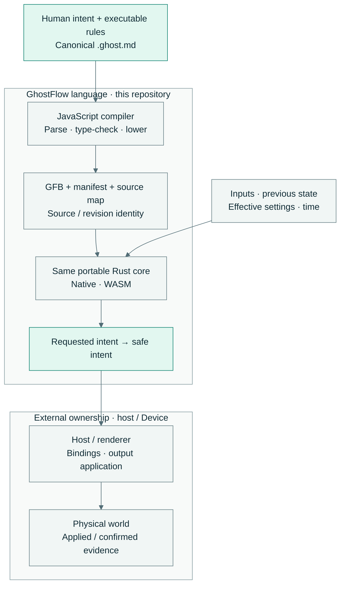

<p align="center">
  
</p>

<div align="center">

# Control that stays true to intent.

</div>

<p align="center">A control language that keeps human intent, executable rules, and explainable decisions together in one readable source.</p>

**English** · [한국어](README.ko.md)

<p align="center">
  <a href="https://github.com/callin2/ghostflow-language/actions/workflows/verified-wasm.yml"></a>
  · <a href="LICENSE">MIT License</a>
</p>

## Our vision

The people who understand a process should be able to do three things:
describe how it ought to work, check how it behaves, and understand why it acted.
Our vision is to keep that understanding alive for the whole life of a control
program, from a simple watering system to wider automation.

**What is GhostFlow?** GhostFlow is a control language. Every program is a
human-readable **`.ghost.md` document** (a literate Markdown file) that holds the
intent, its explanation, and the executable rules side by side. Compiled code,
diagrams, and traces are *derived views* of that one source.

**How does it work?**

1. A person who knows the process writes the document. An AI assistant may help
   draft a candidate document.
2. The compiler validates the program and compiles it.
3. The runtime executes it **without an LLM**.
4. Traces and source maps lead every decision back to the document.

The diagram below shows this loop from authoring to explanation.



<table>
  <tr>
    <td width="33%" valign="top">
      <br>
      <strong>Intent preserved</strong><br>
      Read the reason right beside the rule. Keep confirmed intent separate from assumptions.
    </td>
    <td width="33%" valign="top">
      <br>
      <strong>Decisions replayable</strong><br>
      Re-run a decision with the same inputs, previous state, effective settings, and time.
    </td>
    <td width="33%" valign="top">
      <br>
      <strong>Reasons traceable</strong><br>
      Follow source maps and execution evidence back to the document and its revision.
    </td>
  </tr>
</table>

**See the idea in source:** [a start/stop latch](examples/tutorial/01-latch.ghost.md)
shows a familiar control rule written as a literate document.
[The language philosophy](docs/LANGUAGE-REFERENCE.en.md#design-philosophy)
explains the design behind it.

## One source. One execution core.

GhostFlow has one source and one execution core:

- **One source.** A JavaScript compiler parses, type-checks, and lowers the
  canonical `.ghost.md` document into GFB (GhostFlow bytecode), plus a manifest
  and a source map.
- **One execution core.** The same portable Rust core executes that GFB on both
  native and WASM targets.

The diagram shows what this repository owns and what stays outside it.



The language computes *requested* and *safe* intents. The host and its renderer
apply the physical effects. **An intent is not confirmation that a relay moved.**
Replay checks virtual decisions only; physical confirmation needs separate
device evidence.

Other modules own everything outside the language:

| Module | Owns |
| --- | --- |
| API | LLM authoring, installation context, source storage, deployment orchestration |
| Frontend | Interaction and visualization |
| Device firmware | Board mappings and physical I/O |

These modules build and release separately. See
[implementation boundaries](docs/IMPLEMENTATION.md) and
[the toolchain architecture](docs/LLM-TOOLCHAIN-ARCHITECTURE.md).

## Try it locally

You need **Node.js 22+**, npm, and a Rust toolchain whose Cargo supports
lockfile v4. The tutorial runs on macOS or Linux. Setup may download
dependencies.

Install the dependencies and run the full host verification:

```sh
npm ci --ignore-scripts
rustup component add rustfmt
rustup target add wasm32-unknown-unknown
npm test
```

Then compile and run the watering example:

```sh
npm run compile:example
npm run tutorial
```

What `npm test` does:

- It generates the Rust fixture that the tests need, then builds the native and
  WASM runners.
- It verifies the host toolchain and writes `build/verification.json` plus a
  unique run record.
- Its Cargo gates use `--locked --offline` and the local `target/` directory.

Host results do not prove physical I/O behavior.

## Learn & explore

| Start here | What you will find |
| --- | --- |
| [Language Reference](docs/LANGUAGE-REFERENCE.en.md) | Philosophy, syntax, semantics, and feature rationale |
| [Tutorial](docs/TUTORIAL.md) · [canonical examples](examples/) | Control rules you can read and run |
| [Coding FAQ](docs/language_faq.en.md) | Task-oriented programming guidance |
| [Reference feature status](docs/REFERENCE-FEATURE-STATUS.md) | Current maturity, ownership, and executable evidence |
| [English / 한국어 documentation](docs/DOCUMENTATION.md) | The bilingual document catalog |

## Current scope & contributing

GhostFlow is **pre-1.0**. The Language Reference describes both implemented
semantics and future design. To check what has acceptance evidence today, use
the feature status page and the [verification guide](docs/VERIFICATION.md).

Before you make changes, read the [coding-agent contribution guide](CONTRIBUTING.md).

<details>
<summary><strong>Compiler entry points, packages, and focused checks</strong></summary>

- **Compiler entry points.** `tools/browser-toolchain.mjs` exposes the compiler
  to browsers and Workers without Node I/O. `tools/toolchain.mjs` wraps the same
  compiler for Node artifact I/O. Both take the complete canonical `.ghost.md`
  document and an immutable source identity.
- **Packages.** `tools/portable-package.mjs` produces a signed package. The
  package preserves the source, GFB, manifest, source map, and host-compatibility
  identity. Browser and Device consumers share the same verifier contract. See
  [Portable GFB package v1](docs/PORTABLE-PACKAGE.md).
- **Runtime.** `crates/ghostflow-core` owns execution, signals, and station
  arbitration. `runtimes/wasm` and `runtimes/node/ledger.mjs` are reference host
  adapters. Generated artifacts are projections. Historical `.ghost` files that sit
  next to their `.ghost.md` documents are non-executable evidence, not supported
  source inputs.
- **Focused checks.** `npm run test:compiler` checks compiler behavior without
  building WASM. `npm run test:node` uses an already-built WASM artifact and
  records partial host evidence. `npm run test:contract` checks the integration
  identity and evidence contracts. Partial checks do not replace `npm test`.
- **Releases.** Release consumers preserve the exact source, bytecode, and
  manifest hashes, the compiler/core revision, and the supported profile/ABI.
  This checkout carries no prior build evidence, firmware, live model connector,
  site data, or private chat archive.

</details>

Follow the [development workflow](docs/DEVELOPMENT-WORKFLOW.md) and the
[repository ownership rules](AGENTS.md). Keep the English and Korean
documentation in step. Automation checks translation freshness, executable-fence
parity, and the document indexes. After a documentation batch, run
`npm run docs:index`, then `npm run docs:check`. The compiler and host gates also
run the runnable FAQ and programming samples through
`tests/docs-runnable-examples.test.mjs`.

Released under the [MIT License](LICENSE).

<!-- windows-dev-restoration-20261014 -->
Windows local-work recovery: [preserved source, documents and exact restoration refs](history/windows-20261014/DEV-RESTORATION.txt). These are inactive historical references; current code and dependency pins remain authoritative.
