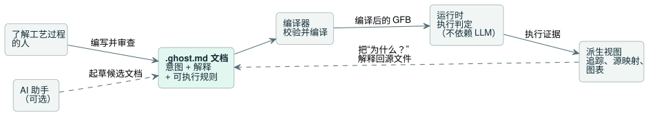
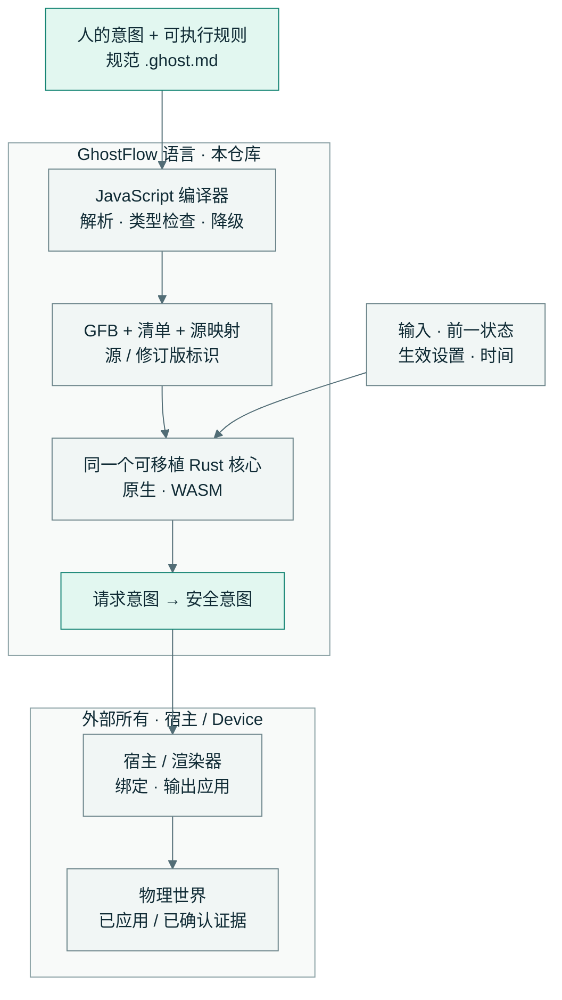

<!-- translation-source: README.md -->
[英文原文](README.md)

<p align="center">
  
</p>

<div align="center">

# 忠于意图的控制。

</div>

<p align="center">一种控制语言：把人的意图、可执行规则和可解释的判定放在同一份可读的源文件中。</p>

[English](README.md) · [한국어](README.ko.md) · **简体中文**

<p align="center">
  <a href="https://github.com/callin2/ghostflow-language/actions/workflows/verified-wasm.yml"></a>
  · <a href="LICENSE">MIT 许可证</a>
</p>

## 我们的愿景

理解一个工艺过程的人，应当能够做到三件事：描述它应该如何运作，检查它实际如何表现，并理解它为什么这样动作。我们的愿景是在控制程序的整个生命周期中保持这种理解，从简单的浇水系统到更广泛的自动化。

**GhostFlow 是什么？** GhostFlow 是一种控制语言。每个程序都是一份人类可读的 **`.ghost.md` 文档**（一个文学式（literate）Markdown 文件），把意图、对意图的解释和可执行规则并排放在一起。编译后的代码、图表和追踪都是这一份源的*派生视图*。

**它如何工作？**

1. 了解工艺过程的人编写文档。AI 助手可以帮助起草候选文档。
2. 编译器校验并编译程序。
3. 运行时**不依赖 LLM** 执行程序。
4. 追踪和源映射（source map）把每一个判定都追溯回文档。

下图展示了从编写到解释的这一循环。



<table>
  <tr>
    <td width="33%" valign="top">
      <br>
      <strong>意图得以保留</strong><br>
      在规则旁边直接读到原因。把已确认的意图与假设分开。
    </td>
    <td width="33%" valign="top">
      <br>
      <strong>判定可以重放</strong><br>
      用相同的输入、前一状态、生效设置和时间重新执行一次判定。
    </td>
    <td width="33%" valign="top">
      <br>
      <strong>原因可以追溯</strong><br>
      沿着源映射和执行证据回到文档及其修订版。
    </td>
  </tr>
</table>

**在源文件中看这一理念：**[启动/停止锁存](examples/tutorial/01-latch.ghost.zh.md)展示了一条熟悉的控制规则如何写成文学式文档。[语言理念](docs/LANGUAGE-REFERENCE.en.md#design-philosophy)解释了其背后的设计。

## 一份源。一个执行核心。

GhostFlow 只有一份源和一个执行核心：

- **一份源。** JavaScript 编译器对规范的 `.ghost.md` 文档进行解析、类型检查和降级（lowering），生成 GFB（GhostFlow 字节码），以及一份清单（manifest）和一份源映射。
- **一个执行核心。** 同一个可移植的 Rust 核心在原生和 WASM 两种目标上执行这份 GFB。

下图展示了本仓库负责的内容以及位于其外部的内容。



语言计算*请求意图*（requested）和*安全意图*（safe）。宿主及其渲染器负责施加物理效果。**意图并不能证明继电器已经动作。**重放只检查虚拟判定；物理层面的确认需要单独的设备证据。

语言之外的一切由其他模块负责：

| 模块 | 负责 |
| --- | --- |
| API | LLM 编写、安装上下文、源存储、部署编排 |
| 前端 | 交互与可视化 |
| Device 固件 | 板卡映射与物理 I/O |

这些模块分别构建和发布。参见[实现边界](docs/IMPLEMENTATION.zh.md)和[工具链架构](docs/LLM-TOOLCHAIN-ARCHITECTURE.zh.md)。

## 在本地试用

你需要 **Node.js 22+**、npm，以及一个其 Cargo 支持 lockfile v4 的 Rust 工具链。教程可在 macOS 或 Linux 上运行。安装过程可能会下载依赖。

安装依赖并运行完整的宿主验证：

```sh
npm ci --ignore-scripts
rustup component add rustfmt
rustup target add wasm32-unknown-unknown
npm test
```

然后编译并运行浇水示例：

```sh
npm run compile:example
npm run tutorial
```

`npm test` 做了什么：

- 它生成测试所需的 Rust fixture，然后构建原生和 WASM runner。
- 它验证宿主工具链，并写入 `build/verification.json` 以及一条唯一的运行记录。
- 它的 Cargo 检查关卡使用 `--locked --offline` 和本地 `target/` 目录。

宿主结果并不能证明物理 I/O 行为。

## 学习与探索

| 从这里开始 | 你会找到什么 |
| --- | --- |
| [语言参考](docs/LANGUAGE-REFERENCE.zh.md) | 理念、语法、语义和特性设计依据 |
| [教程](docs/TUTORIAL.zh.md) · [规范示例](examples/) | 可以阅读和运行的控制规则 |
| [编程 FAQ](docs/language_faq.zh.md) | 面向任务的编程指导 |
| [参考特性状态](docs/REFERENCE-FEATURE-STATUS.zh.md) | 当前成熟度、所有权和可执行证据 |
| [English / 한국어 文档](docs/DOCUMENTATION.zh.md) | 双语文档目录 |

## 当前范围与贡献

GhostFlow 处于 **1.0 之前**阶段。语言参考既描述已实现的语义，也描述未来的设计。要查看哪些内容目前已有验收证据，请使用特性状态页面和[验证指南](docs/VERIFICATION.zh.md)。

在进行修改之前，请阅读[编码代理贡献指南](CONTRIBUTING.zh.md)。

<details>
<summary><strong>编译器入口、包与专门检查</strong></summary>

- **编译器入口。** `tools/browser-toolchain.mjs` 在不使用 Node I/O 的情况下向浏览器和 Worker 提供编译器。`tools/toolchain.mjs` 为 Node 产物 I/O 封装同一个编译器。两者都接收完整的规范 `.ghost.md` 文档和一个不可变的源标识。
- **包。** `tools/portable-package.mjs` 生成签名包。该包保留源、GFB、清单、源映射以及宿主兼容性标识。浏览器和 Device 使用方共享同一份验证器契约。参见[可移植 GFB 包 v1](docs/PORTABLE-PACKAGE.zh.md)。
- **运行时。** `crates/ghostflow-core` 负责执行、信号和 station 仲裁。`runtimes/wasm` 和 `runtimes/node/ledger.mjs` 是参考宿主适配器。生成的产物是投影。位于对应 `.ghost.md` 文档旁边的历史 `.ghost` 文件是不可执行的证据，不是受支持的源输入。
- **专门检查。** `npm run test:compiler` 在不构建 WASM 的情况下检查编译器行为。`npm run test:node` 使用已构建的 WASM 产物，并记录部分宿主证据。`npm run test:contract` 检查集成标识和证据契约。部分检查不能替代 `npm test`。
- **发布。** 发布的使用方要保留确切的源、字节码和清单哈希值、编译器/核心修订版，以及受支持的 profile/ABI。此检出不包含任何先前的构建证据、固件、实时模型连接器、现场数据或私有聊天存档。

</details>

请遵循[开发工作流](docs/DEVELOPMENT-WORKFLOW.zh.md)和[仓库所有权规则](AGENTS.zh.md)。保持英文和韩文文档同步。自动化会检查译文新鲜度、可执行代码围栏的一致性以及文档索引。完成一批文档修改后，先运行 `npm run docs:index`，再运行 `npm run docs:check`。编译器和宿主检查关卡还会通过 `tests/docs-runnable-examples.test.mjs` 运行可运行的 FAQ 和编程示例。

基于 [MIT 许可证](LICENSE)发布。

<!-- windows-dev-restoration-20261014 -->
Windows 本地工作恢复：[保留的源、文档和确切的恢复引用](history/windows-20261014/DEV-RESTORATION.txt)。这些是不再使用的历史参考；当前代码和依赖固定版本仍以现行内容为准。
