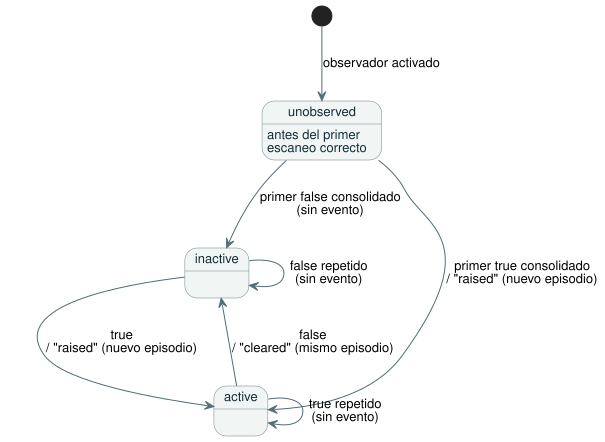

<!-- translation-source: contracts/alarm-v1/README.md -->
[Original en inglés](README.md)

# Observación de alarmas v1

[English](README.md) · [한국어](README.ko.md)

Este contrato define el productor de alarmas acotado adoptado para
[#287](https://github.com/callin2/ghostflow-language/issues/287), REF-05-027.
Registra observaciones de software de estados Bool definidos por el autor
mediante el `ScanDriver` de Rust.

**No** implementa el futuro ciclo de vida de los comandos ni el
[diseño completo del flujo de interacción](../../docs/INTERACTION-STREAM-CONTRACT.es.md).

En este documento:

- **Fuente y descriptor**: cómo un estado del programa se convierte en una alarma
  y cómo el paquete validado por el compilador llega a Rust.
- **Runtime y registros**: dónde se ejecuta el observador, cómo se registran los
  episodios y los eventos, el formato del informe y la retención.
- **Verificación específica**: los comandos de compilación y de prueba.

## Fuente y descriptor

**El programa.** [El ejemplo canónico](examples/temperature.ghost.es.md) calcula
un estado Bool a partir de una entrada que tiene en cuenta la calidad. Su rama
explícita de fallo (`fault`) conserva la condición anterior.

**El descriptor.** Un descriptor externo convierte ese estado en una alarma.
Asocia `state.hot` a una alarma y proporciona:

- los significados de activación (raised) y de despeje (cleared);
- un código de severidad con su definición.

Ni el nombre de un estado ni su valor Bool lo convierten implícitamente en una
alarma. No hay ninguna palabra clave nueva del lenguaje ni ninguna expresión
ejecutable en el descriptor.

**Perfil aceptado.** Este perfil acepta:

- un único módulo GFB escalar independiente (versiones 1–4);
- el esquema de interacción 0.3;
- de 1 a 16 condiciones de estado Bool únicas, definidas por el autor, con
  `activeWhen: true`.

Los demás perfiles fallan de forma explícita.

**Esquema del descriptor y preparación.** El
[esquema del descriptor](descriptor.schema.json), cerrado, es
`GhostFlow/alarm-descriptor-v1`, con `version: 1` numérico. Para preparar un
observador:

1. Compile de forma canónica con `interactionSourceIdentity`.
2. Llame a `prepareAlarmObservation(compilation, descriptor)` de
   `tools/alarm-observation.mjs`.

La preparación reproduce la fuente canónica y usa el validador existente de
esquema/procedencia de interacción. Aplica estas reglas:

- El esquema, la fuente y el módulo deben coincidir exactamente.
- Los IDs de nodo y las anclas de intención ordenadas deben coincidir con el
  estado seleccionado.
- Los significados contienen de 1 a 512 bytes UTF-8. Cada estado tiene de 1 a 32
  anclas.
- `parseAlarmDescriptor` acepta solo JSON canónico estricto. Rechaza claves
  duplicadas y representaciones desconocidas o no canónicas.
- La entrada programática se comprueba con las mismas reglas de JSON canónico y
  conjuntos de campos exactos.
- La preparación posee una copia inmutable, incluida toda la procedencia anidada.

**Vinculación y frontera de confianza.** `bind({runId, streamId})` produce bytes
GFAL versión 1 y su SHA-256. El paquete validado por el compilador y el digest
esperado cruzan juntos la frontera de activación de confianza. A continuación,
Rust comprueba:

- el digest;
- el SHA-256/FNV/nombre de módulo exactos de los bytes GFB originales cargados;
- la existencia y el tipo Bool de cada slot de estado.

Rust no analiza Markdown ni demuestra las anclas de la fuente a partir de los
bytes ejecutables. Un llamador que reemplace tanto el paquete como el digest
esperado elude la frontera de confianza del compilador: el digest es una
vinculación de integridad, no una firma de autenticación. Ningún envoltorio ni
ninguna nueva versión de GFB cambia la identidad del módulo ejecutado.

## Runtime y registros

**Dónde reside el observador.** Se consideraron dos ubicaciones en el núcleo:

| Opción | Qué ve | Qué le falta |
| --- | --- | --- |
| `Runtime::tick_at` | Estado aceptado | Identidad de escaneo/ejecución con tramas |
| `ScanDriver` | Tramas completas, orden de escaneo y rechazo | — |

`ScanDriver` es el titular de este observador. Como resultado, sus eventos y su
instantánea actual comparten exactamente la misma frontera de escaneo completado.

**APIs de activación y de consulta.**

- JavaScript:
  `AlarmObservationRuntime.instantiate(wasmBytes, compilation, descriptor, identity)`
  carga el programa original y activa el observador una sola vez, antes de
  cualquier escaneo.
- Nativo: `ScanDriver::activate_alarms(packet, expected_sha256)` y
  `query_alarms(packet)`.
- ABI con tramas (framed): añade las exportaciones `gf_frame_alarm_activate` y
  `gf_frame_alarm_query`, además de exportaciones de puntero/longitud del informe.

Una activación no válida del observador deja el runtime sin cambios y sigue
permitiendo los escaneos de control ordinarios. Las consultas GFAQ versión 1
llevan las identidades de vinculación, ejecución y flujo, además de un cursor de
secuencia exclusivo opcional. Las consultas no pueden inyectar eventos ni hacer
avanzar un escaneo. Las APIs con tramas existentes y las instantáneas v0
conservan su formato.

**Cuándo se registran las condiciones.** Rust registra la condición después de
cada escaneo escalar correcto, antes de devolver el resultado a cualquier
consumidor. Una evaluación fallida, un ID de escaneo obsoleto o un tiempo lógico
en retroceso dejan sin cambios el estado actual, la secuencia y el historial.

**Episodios.** Un *episodio* es un intervalo desde la activación (raised) hasta
el despeje (cleared) de una alarma. El diagrama muestra cómo cambia el estado de
cada alarma después de los escaneos correctos.



- Antes del primer escaneo correcto, todas las condiciones están en `unobserved`,
  con escaneo/tiempo nulos.
- El primer true consolidado activa un episodio. Un true repetido no añade nada.
- Un false despeja ese mismo episodio. Un true posterior crea un episodio nuevo.
- Las marcas de tiempo iguales reciben, aun así, números de secuencia distintos.
- La identidad de un episodio es la vinculación, la ejecución, el flujo, el ID de
  alarma y su `episodeSequence` (la secuencia de activación).

**El informe.** El [esquema del informe](report.schema.json), cerrado, es
`GhostFlow/alarm-report-v1`, con `version: 1` numérico. Un informe contiene:

- los digests exactos de la fuente, el módulo, el esquema y el descriptor;
- el estado actual en el último escaneo completado;
- los eventos ordenados;
- un cursor de vinculación/ejecución/flujo;
- la cobertura de retención.

El estado actual está separado del historial de eventos, y los registros JS
devueltos son copias. Por ejemplo, un consumidor que consulta solo después de
false→true→false recibe un estado actual inactivo *y* ambos eventos, el de
activación y el de despeje. El digest del descriptor del informe enlaza con los
metadatos explícitos de severidad y significado; los valores de los registros
nunca infieren esos significados.

**Retención y cursores.**

- La retención guarda de 1 a 1024 eventos, más un estado fijo para todas las
  alarmas declaradas.
- El desbordamiento expulsa los eventos más antiguos. Nunca bloquea un escaneo y
  nunca renumera los eventos.
- Una consulta a la que le falta historial retenido devuelve una brecha exacta e
  inclusiva `retention-overflow`. El estado actual y la secuencia más reciente
  siguen disponibles.
- Las lecturas con cursor devuelven solo los eventos posteriores a esa secuencia.
  Una vinculación/ejecución/flujo incorrecta o un cursor adelantado fallan.

**Duración de la ejecución.**

- El límite de entero seguro de la secuencia se comprueba antes de la evaluación.
  Su agotamiento requiere una ejecución nueva.
- Esta fachada no proporciona ninguna API de reinicio, recarga ni recuperación
  persistida.
- Los hosts deben emitir identidades nuevas de ejecución/flujo cuando recrean un
  titular o un proceso. La unicidad entre procesos independientes es
  responsabilidad del host.
- Reconectarse al mismo titular en vivo preserva el estado y el historial.

**Qué demuestran estos registros.** Estos registros demuestran transiciones de
condición en software. No demuestran el accionamiento físico. La evidencia de
salida requested, safe, applied y confirmada por retroalimentación (confirmed)
sigue siendo independiente. La aceptación, el inicio, la finalización, la
cancelación y el acuse físico de los comandos quedan fuera de este formato
exclusivo de alarmas.

## Verificación específica

Construya los titulares nativo y WASM reales a partir de este checkout y luego
ejecute:

```sh
cargo build --offline --release -p ghostflow-core --example alarm_tape
cargo build --offline --release -p ghostflow-wasm --target wasm32-unknown-unknown
node --test tests/alarm-observation.test.mjs
```

Los selectores de prueba son `GF-TEST-alarm-provenance`,
`GF-TEST-alarm-short-episode`, `GF-TEST-alarm-history`,
`GF-TEST-alarm-atomicity`, `GF-TEST-alarm-initial-condition`,
`GF-TEST-alarm-activation`, `GF-TEST-alarm-consumer` y
`GF-TEST-alarm-schema`.

Las pruebas comparan resultados e informes completos, nativos y WASM, producidos
a partir de la misma fuente, el mismo descriptor y las mismas tramas. Cubren:

- episodios cortos, true repetidos y episodios nuevos;
- marcas de tiempo iguales;
- primeros escaneos y escaneos posteriores fallidos;
- brechas de retención e identidad del cursor;
- resultados inmutables;
- procedencia manipulada y módulo/tipo incorrectos;
- ejecución del control después de una activación rechazada.
