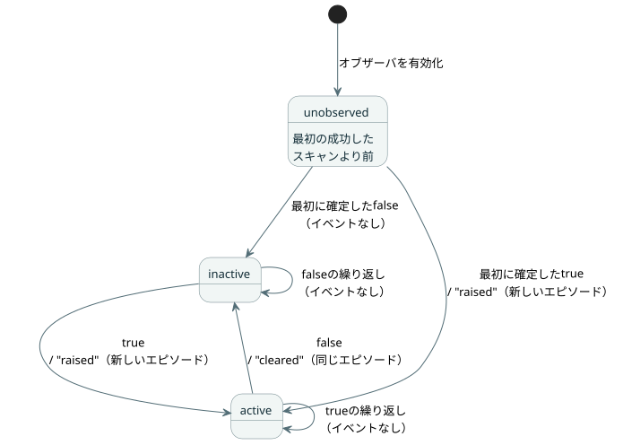

<!-- translation-source: contracts/alarm-v1/README.md -->
[英語の原文](README.md)

# アラーム観測 v1

[한국어](README.ko.md)

この契約は、[#287](https://github.com/callin2/ghostflow-language/issues/287)、REF-05-027のために採用された、範囲を限定したアラームプロデューサを定義します。これは、作成者が記述したBool状態のソフトウェア上の観測を、Rustの`ScanDriver`を通じて記録します。

将来のコマンドのライフサイクルや、完全な[インタラクションストリーム設計](../../docs/INTERACTION-STREAM-CONTRACT.ja.md)は実装し**ません**。

このドキュメントの内容：

- **ソースとディスクリプタ** — プログラムの状態がどのようにアラームになるか、そしてコンパイラが検証したパケットがどのようにRustに届くか。
- **ランタイムと記録** — オブザーバがどこで動くか、エピソードとイベントがどのように記録されるか、レポートの形式、保持。
- **対象を絞った検証** — ビルドとテストのコマンド。

## ソースとディスクリプタ

**プログラム。** [正本の例](examples/temperature.ghost.ja.md)は、品質を考慮した入力からBool状態を計算します。その明示的な故障（fault）分岐は、前の条件を保持します。

**ディスクリプタ。** 外部のディスクリプタが、その状態をアラームに変えます。ディスクリプタは`state.hot`をアラームにマッピングし、次を提供します。

- 発生（raised）と解除（cleared）の意味
- 定義付きの重大度コード

状態の名前やそのBool値が、暗黙のうちにそれをアラームにすることはありません。新しい言語キーワードも、実行可能なディスクリプタの式もありません。

**受け付けるプロファイル。** このプロファイルが受け付けるのは次のものです。

- スタンドアロンのスカラーGFBモジュール1つ（バージョン1〜4）
- インタラクションスキーマ0.3
- `activeWhen: true`を持つ、作成者が記述した一意のBool状態条件1〜16個

それ以外のプロファイルは、明示的に失敗します。

**ディスクリプタのスキーマと準備。** 閉じた[ディスクリプタスキーマ](descriptor.schema.json)は`GhostFlow/alarm-descriptor-v1`で、数値は`version: 1`です。オブザーバを準備するには、次のようにします。

1. `interactionSourceIdentity`を指定して正本どおりにコンパイルします。
2. `tools/alarm-observation.mjs`の`prepareAlarmObservation(compilation, descriptor)`を呼び出します。

準備では、正本のソースをリプレイし、既存のインタラクションスキーマ／来歴のバリデータを使います。次のルールを強制します。

- スキーマ、ソース、モジュールは完全に一致しなければなりません。
- ノードIDと、順序付きの意図アンカーは、選択された状態と一致しなければなりません。
- 意味は1〜512 UTF-8バイトです。各状態には1〜32個のアンカーがあります。
- `parseAlarmDescriptor`は、厳密な正準JSONだけを受け付けます。重複したキーや、未知／非正準の表現は拒否します。
- プログラムからの入力も、同じ正準JSONのルールと正確なフィールドセットで確認されます。
- 準備は、入れ子になった来歴をすべて含む不変のコピーを所有します。

**バインディングと信頼境界。** `bind({runId, streamId})`は、GFALバージョン1のバイト列とそのSHA-256を生成します。コンパイラが検証したパケットと期待されるダイジェストは、一緒に信頼されたアクティベーション境界を越えます。その後、Rustが次を確認します。

- ダイジェスト
- 読み込まれた元のGFBバイト列の、正確なSHA-256／FNV／モジュール名
- すべての状態スロットの存在とBool型

RustはMarkdownをパースせず、実行可能なバイト列からソースアンカーを証明することもありません。パケットと期待されるダイジェストの両方を置き換える呼び出し元は、コンパイラの信頼境界を迂回します。ダイジェストは完全性の結び付けであり、認証の署名ではありません。どのラッパーや新しいGFBバージョンも、実行されるモジュールの識別情報を変えることはありません。

## ランタイムと記録

**オブザーバの置き場所。** コアの中で2つの配置を検討しました。

| 選択肢 | 見えるもの | 欠けているもの |
| --- | --- | --- |
| `Runtime::tick_at` | 受け入れられた状態 | framedなスキャン／実行の識別情報 |
| `ScanDriver` | 完全なフレーム、スキャンの順序、拒否 | — |

このオブザーバは`ScanDriver`が所有します。その結果、そのイベントと現在のスナップショットは、まったく同じ完了済みスキャンの境界を共有します。

**アクティベーションと照会のAPI。**

- JavaScript：
  `AlarmObservationRuntime.instantiate(wasmBytes, compilation, descriptor, identity)`
  は、元のプログラムを読み込み、どのスキャンよりも前に一度だけオブザーバを有効化します。
- ネイティブ：`ScanDriver::activate_alarms(packet, expected_sha256)`と`query_alarms(packet)`。
- Framed ABI：`gf_frame_alarm_activate`と`gf_frame_alarm_query`のエクスポートに加え、レポートのポインタ／長さのエクスポートを追加します。

無効なオブザーバのアクティベーションはランタイムを変更せず、通常の制御スキャンは引き続き可能です。GFAQバージョン1の照会は、バインディング、実行、ストリームの識別情報と、任意の排他的なシーケンスカーソルを運びます。照会によってイベントを注入したり、スキャンを進めたりすることはできません。既存のframed APIとv0スナップショットは、形式を維持します。

**条件が記録されるタイミング。** Rustは、スカラースキャンが成功するたびに、その結果をいずれかの利用者に返す前に条件を記録します。評価の失敗、古いスキャンID、または逆行する論理時間は、現在の状態、シーケンス、履歴を変更しません。

**エピソード。** *エピソード*とは、1つのアラームが発生してから解除されるまでの1つの区間です。次の図は、成功したスキャンの後に各アラームの状態がどう変わるかを示しています。



- 最初の成功したスキャンより前は、すべての条件が`unobserved`で、スキャン／時刻はnullです。
- 最初に確定したtrueで、エピソードが1つ発生します。trueが繰り返されても何も追加されません。
- falseで、その同じエピソードが解除されます。その後のtrueは新しいエピソードを作ります。
- タイムスタンプが等しくても、異なるシーケンス番号が付きます。
- エピソードの識別情報は、バインディング、実行、ストリーム、アラームID、そしてその`episodeSequence`（発生時のシーケンス）です。

**レポート。** 閉じた[レポートスキーマ](report.schema.json)は`GhostFlow/alarm-report-v1`で、数値は`version: 1`です。レポートには次が含まれます。

- ソース、モジュール、スキーマ、ディスクリプタの正確なダイジェスト
- 最後に完了したスキャン時点の現在の状態
- 順序付きのイベント
- バインディング／実行／ストリームのカーソル
- 保持のカバレッジ

現在の状態はイベント履歴とは別であり、返されるJSの記録はコピーです。たとえば、false→true→falseの後に初めて照会した利用者は、非アクティブな現在の状態*と*、発生と解除の両方のイベントを受け取ります。レポートのディスクリプタダイジェストは、明示的な重大度と意味のメタデータに結び付きます。記録の値からそれらの意味が推論されることは決してありません。

**保持とカーソル。**

- 保持できるのは1〜1024個のイベントと、宣言されたすべてのアラームの固定された状態です。
- あふれた場合は、最も古いイベントが追い出されます。スキャンをブロックすることも、イベントの番号を振り直すことも決してありません。
- 保持された履歴が欠けている照会は、正確な両端を含む`retention-overflow`ギャップを返します。現在の状態と最新のシーケンスは引き続き利用できます。
- カーソルによる読み取りは、そのシーケンスより後のイベントだけを返します。バインディング／実行／ストリームが誤っている場合や、カーソルが先に進みすぎている場合は失敗します。

**実行の寿命。**

- シーケンスの安全な整数の上限は、評価の前に確認されます。上限に達した場合は、新しい実行が必要です。
- このファサードは、リセット、再読み込み、永続化された復旧のAPIを提供しません。
- ホストは、所有者やプロセスを作り直すときに、新しい実行／ストリームの識別情報を発行しなければなりません。独立したプロセス間での一意性は、ホストの責任です。
- 同じ稼働中の所有者に再接続した場合は、状態と履歴が保持されます。

**これらの記録が証明すること。** これらの記録が証明するのは、ソフトウェア上の条件の遷移です。物理的な作動を証明するものではありません。requested、safe、applied、フィードバックによるconfirmedの出力の証拠は、引き続き別々です。コマンドの受け付け、開始、完了、取り消し、物理的な応答確認は、このアラーム専用の形式の範囲外です。

## 対象を絞った検証

このチェックアウトから実際のネイティブとWASMの所有者をビルドし、次を実行します。

```sh
cargo build --offline --release -p ghostflow-core --example alarm_tape
cargo build --offline --release -p ghostflow-wasm --target wasm32-unknown-unknown
node --test tests/alarm-observation.test.mjs
```

テストのセレクタは、`GF-TEST-alarm-provenance`、`GF-TEST-alarm-short-episode`、`GF-TEST-alarm-history`、`GF-TEST-alarm-atomicity`、`GF-TEST-alarm-initial-condition`、`GF-TEST-alarm-activation`、`GF-TEST-alarm-consumer`、`GF-TEST-alarm-schema`です。

テストは、同じソース、ディスクリプタ、フレームから生成された、ネイティブとWASMの完全な結果とレポートを比較します。次をカバーします。

- 短いエピソード、trueの繰り返し、新しいエピソード
- 同じタイムスタンプ
- 最初のスキャンとその後のスキャンの失敗
- 保持のギャップとカーソルの識別情報
- 不変の結果
- 改ざんされた来歴と、誤ったモジュール／型
- アクティベーションが拒否された後の制御の実行
