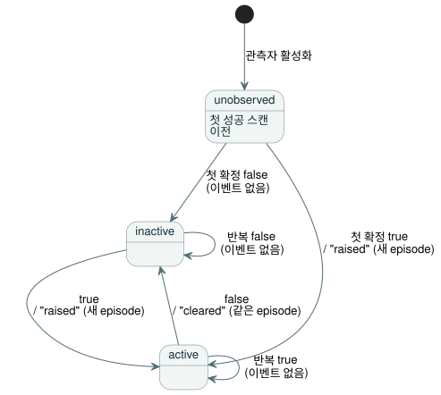

<!-- translation-source: contracts/alarm-v1/README.md -->
[영문 원문](README.md)

# 알람 관측 v1

이 계약은 [#287](https://github.com/callin2/ghostflow-language/issues/287),
REF-05-027을 위해 채택한 범위가 제한된 알람 생산자를 정의합니다. 이 생산자는
Rust `ScanDriver`를 통해 작성된 Bool 상태의 소프트웨어 관측을 기록합니다.

향후의 명령 수명 주기나 전체
[interaction 스트림 설계](../../docs/INTERACTION-STREAM-CONTRACT.ko.md)는 구현하지
**않습니다**.

이 문서의 내용:

- **소스와 descriptor** — 프로그램 상태가 어떻게 알람이 되는지, 그리고 컴파일러가
  검증한 패킷이 어떻게 Rust에 도달하는지 설명합니다.
- **런타임과 레코드** — 관측자가 어디에서 실행되는지, episode와 이벤트가 어떻게
  기록되는지, 보고서 형식과 보존 방식을 설명합니다.
- **집중 검증** — 빌드 및 테스트 명령을 설명합니다.

## 소스와 descriptor

**프로그램.** [정본 예제](examples/temperature.ghost.md)는 품질 정보를 가진
입력으로 Bool 상태를 계산합니다. 명시적인 `fault` 분기는 이전 조건을 유지합니다.

**Descriptor.** 외부 descriptor가 그 상태를 알람으로 만듭니다. descriptor는
`state.hot`을 알람에 대응시키고 다음을 제공합니다.

- 발생(raised)과 해제(cleared)의 의미
- 정의가 포함된 severity 코드

상태 이름이나 그 Bool 값만으로는 알람이 되지 않습니다. 새 언어 키워드도, 실행
가능한 descriptor 식도 없습니다.

**수용하는 프로필.** 이 프로필은 다음을 수용합니다.

- 독립된 단일 scalar GFB 모듈 하나(버전 1–4)
- interaction schema 0.3
- `activeWhen: true`인, 서로 다른 작성된 Bool 상태 조건 1–16개

다른 프로필은 명시적으로 실패합니다.

**Descriptor schema와 준비.** 닫힌 필드 집합의
[descriptor schema](descriptor.schema.json)는 `GhostFlow/alarm-descriptor-v1`이며
숫자 `version: 1`입니다. 관측자를 준비하려면 다음을 수행합니다.

1. `interactionSourceIdentity`를 지정해 정본 방식으로 컴파일합니다.
2. `tools/alarm-observation.mjs`의
   `prepareAlarmObservation(compilation, descriptor)`를 호출합니다.

준비 과정은 정본 소스를 다시 처리하고 기존 interaction schema/provenance 검증기를
사용합니다. 다음 규칙을 강제합니다.

- schema, source, module은 정확히 일치해야 합니다.
- node ID와 순서 있는 의도 앵커는 선택한 상태와 일치해야 합니다.
- 의미 텍스트는 UTF-8 1–512바이트입니다. 각 상태는 앵커 1–32개를 가집니다.
- `parseAlarmDescriptor`는 엄격한 정본 JSON만 수용합니다. 중복 키와 알 수 없거나
  정본이 아닌 표현은 거부합니다.
- 프로그래밍 방식으로 전달한 입력도 같은 정본 JSON 규칙과 정확한 필드 집합으로
  검사합니다.
- 준비 결과는 중첩된 provenance를 포함한 불변 복사본을 소유합니다.

**바인딩과 신뢰 경계.** `bind({runId, streamId})`는 GFAL 버전 1 바이트와 그
SHA-256을 만듭니다. 컴파일러가 검증한 패킷과 기대 digest는 신뢰하는 활성화 경계를
함께 통과합니다. 그다음 Rust는 다음을 확인합니다.

- digest
- 실제로 로드한 원본 GFB 바이트의 정확한 SHA-256/FNV/모듈 이름
- 모든 상태 슬롯의 존재와 Bool 타입

Rust는 Markdown을 파싱하지 않으며, 실행 바이트만으로 소스 앵커를 증명하지도
않습니다. 패킷과 기대 digest를 모두 바꾸는 호출자는 컴파일러 신뢰 경계를
우회합니다. digest는 무결성 결속이지 인증 서명이 아닙니다. 어떤 wrapper나 새 GFB
버전도 실행되는 모듈 식별 정보를 바꾸지 않습니다.

## 런타임과 레코드

**관측자의 위치.** 코어 안의 두 가지 배치를 검토했습니다.

| 선택지 | 볼 수 있는 것 | 없는 것 |
| --- | --- | --- |
| `Runtime::tick_at` | 수락된 상태 | framed scan/run 식별 정보 |
| `ScanDriver` | 완전한 frame, 스캔 순서와 거부 | — |

`ScanDriver`가 이 관측자를 소유합니다. 그 결과 이벤트와 현재 snapshot은 정확히
같은 완료 스캔 경계를 공유합니다.

**활성화 및 조회 API.**

- JavaScript:
  `AlarmObservationRuntime.instantiate(wasmBytes, compilation, descriptor, identity)`는
  원본 프로그램을 로드하고 첫 스캔 전에 관측자를 한 번 활성화합니다.
- Native: `ScanDriver::activate_alarms(packet, expected_sha256)`와
  `query_alarms(packet)`입니다.
- Framed ABI: `gf_frame_alarm_activate`와 `gf_frame_alarm_query` export, 그리고
  report pointer/length export를 추가합니다.

잘못된 관측자 활성화는 런타임을 바꾸지 않으며, 일반 제어 스캔은 계속 허용합니다.
GFAQ 버전 1 조회는 binding, run, stream 식별 정보와 선택적인 배타적 sequence
cursor를 전달합니다. 조회는 이벤트를 주입하거나 스캔을 진행시킬 수 없습니다. 기존
framed API와 v0 snapshot은 형식을 유지합니다.

**조건이 기록되는 시점.** Rust는 scalar 스캔이 성공할 때마다, 결과를 소비자에게
반환하기 전에 조건을 기록합니다. 평가 실패, 오래된 scan ID, 역행하는 논리 시간은
현재 상태, sequence, 이력을 바꾸지 않습니다.

**Episode.** *episode*는 한 알람이 발생해서 해제될 때까지의 구간 하나입니다.
다이어그램은 성공한 스캔 뒤에 각 알람의 상태가 어떻게 바뀌는지 보여 줍니다.



- 첫 성공 스캔 전에는 모든 조건이 `unobserved`이며 scan/time은 null입니다.
- 처음 확정된 true는 episode 하나를 발생시킵니다. 반복된 true는 아무것도 추가하지
  않습니다.
- false는 같은 episode를 해제합니다. 이후의 true는 새 episode를 만듭니다.
- 타임스탬프가 같아도 sequence 번호는 서로 다릅니다.
- episode의 식별 정보는 binding, run, stream, alarm ID와 그
  `episodeSequence`(발생 sequence)입니다.

**보고서.** 닫힌 필드 집합의 [report schema](report.schema.json)는
`GhostFlow/alarm-report-v1`이며 숫자 `version: 1`입니다. 보고서에는 다음이
들어 있습니다.

- 정확한 source, module, schema, descriptor digest
- 마지막 완료 스캔 시점의 현재 상태
- 순서 있는 이벤트
- binding/run/stream cursor
- 보존 범위

현재 상태는 이벤트 이력과 분리되어 있으며, 반환되는 JS 레코드는 복사본입니다. 예를
들어 false→true→false 이후에만 조회하는 소비자는 inactive인 현재 상태 *그리고*
발생 이벤트와 해제 이벤트 둘 다를 받습니다. 보고서의 descriptor digest는 명시적인
severity와 의미 메타데이터에 연결됩니다. 레코드 값에서 그 의미를 추론하는 일은
절대 없습니다.

**보존과 cursor.**

- 보존 영역은 이벤트 1–1024개와, 선언된 모든 알람의 고정 상태를 유지합니다.
- 넘치면 가장 오래된 이벤트를 제거합니다. 스캔을 막거나 이벤트 번호를 다시 매기는
  일은 절대 없습니다.
- 보존된 이력이 빠진 조회는 양끝을 포함하는 정확한 `retention-overflow` gap을
  반환합니다. 현재 상태와 최신 sequence는 계속 제공됩니다.
- cursor 조회는 해당 sequence 이후의 이벤트만 반환합니다. 잘못된
  binding/run/stream이나 앞서 나간 cursor는 실패합니다.

**Run 수명.**

- sequence의 안전한 정수 한계는 평가 전에 확인합니다. 한계가 소진되면 새 run이
  필요합니다.
- 이 facade는 reset, reload, 영속 복구 API를 제공하지 않습니다.
- 호스트는 소유자나 프로세스를 다시 만들 때 새 run/stream 식별 정보를 발급해야
  합니다. 독립된 프로세스 사이의 유일성은 호스트 책임입니다.
- 같은 live 소유자에 다시 연결하면 상태와 이력이 보존됩니다.

**이 레코드가 증명하는 것.** 이 레코드는 소프트웨어 조건 전이를 증명합니다. 물리
구동은 증명하지 않습니다. requested, safe, applied, 피드백으로 confirmed된 출력
증거는 계속 구별됩니다. 명령의 수락, 시작, 완료, 취소, 물리적 확인 응답은 이
알람 전용 형식의 범위 밖입니다.

## 집중 검증

이 체크아웃에서 실제 native 및 WASM 소유자를 빌드한 뒤 다음을 실행합니다.

```sh
cargo build --offline --release -p ghostflow-core --example alarm_tape
cargo build --offline --release -p ghostflow-wasm --target wasm32-unknown-unknown
node --test tests/alarm-observation.test.mjs
```

테스트 선택자는 `GF-TEST-alarm-provenance`,
`GF-TEST-alarm-short-episode`, `GF-TEST-alarm-history`,
`GF-TEST-alarm-atomicity`, `GF-TEST-alarm-initial-condition`,
`GF-TEST-alarm-activation`, `GF-TEST-alarm-consumer`,
`GF-TEST-alarm-schema`입니다.

테스트는 같은 소스, descriptor, frame에서 만든 native와 WASM의 전체 결과와
보고서를 비교합니다. 다루는 범위는 다음과 같습니다.

- 짧은 episode, 반복된 true, 새 episode
- 같은 타임스탬프
- 첫 스캔과 이후 스캔의 실패
- 보존 gap과 cursor 식별 정보
- 불변 결과
- 변조된 provenance와 잘못된 모듈/타입
- 거부된 활성화 이후의 제어 실행
