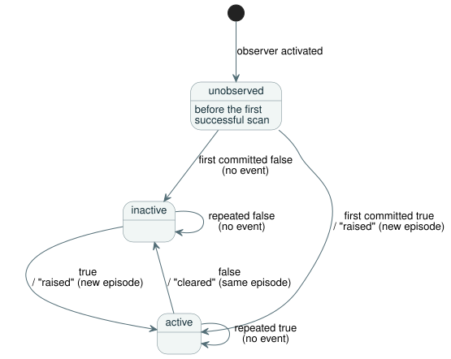

# Alarm observation v1

[한국어](README.ko.md)

This contract defines the bounded alarm producer adopted for
[#287](https://github.com/callin2/ghostflow-language/issues/287), REF-05-027.
It records software observations of authored Bool states through the Rust
`ScanDriver`.

It does **not** implement the future command lifecycle or the full
[interaction stream design](../../docs/INTERACTION-STREAM-CONTRACT.md).

In this document:

- **Source and descriptor** — how a program state becomes an alarm, and how the
  compiler-validated packet reaches Rust.
- **Runtime and records** — where the observer runs, how episodes and events are
  recorded, the report format, and retention.
- **Focused verification** — the build and test commands.

## Source and descriptor

**The program.** [The canonical example](examples/temperature.ghost.md) computes
a Bool state from a quality-aware input. Its explicit fault branch retains the
previous condition.

**The descriptor.** An external descriptor turns that state into an alarm. It
maps `state.hot` to an alarm and supplies:

- the raised and cleared meanings;
- a severity code with its definition.

Neither a state name nor its Bool value implicitly makes it an alarm. There is
no new language keyword and no executable descriptor expression.

**Accepted profile.** This profile accepts:

- one standalone scalar GFB module (versions 1–4);
- interaction schema 0.3;
- 1–16 unique authored Bool state conditions with `activeWhen: true`.

Other profiles fail explicitly.

**Descriptor schema and preparation.** The closed
[descriptor schema](descriptor.schema.json) is `GhostFlow/alarm-descriptor-v1`,
numeric `version: 1`. To prepare an observer:

1. Compile canonically with `interactionSourceIdentity`.
2. Call `prepareAlarmObservation(compilation, descriptor)` from
   `tools/alarm-observation.mjs`.

Preparation replays the canonical source and uses the existing interaction
schema/provenance validator. It enforces these rules:

- Schema, source and module must match exactly.
- Node IDs and ordered intent anchors must match the selected state.
- Meanings contain 1–512 UTF-8 bytes. Each state has 1–32 anchors.
- `parseAlarmDescriptor` accepts strict canonical JSON only. It rejects
  duplicate keys and unknown/noncanonical representations.
- Programmatic input is checked with the same canonical JSON rules and exact
  field sets.
- Preparation owns an immutable copy, including all nested provenance.

**Binding and the trust boundary.** `bind({runId, streamId})` produces GFAL
version 1 bytes and their SHA-256. The compiler-validated packet and the
expected digest cross the trusted activation boundary together. Rust then
checks:

- the digest;
- the exact SHA-256/FNV/module name of the loaded original GFB bytes;
- the existence and Bool type of every state slot.

Rust does not parse Markdown or prove source anchors from executable bytes. A
caller that replaces both the packet and the expected digest bypasses the
compiler trust boundary: the digest is an integrity binding, not an
authentication signature. No wrapper or new GFB version changes the executed
module identity.

## Runtime and records

**Where the observer lives.** Two placements in the core were considered:

| Option | What it sees | Missing |
| --- | --- | --- |
| `Runtime::tick_at` | Accepted state | Framed scan/run identity |
| `ScanDriver` | Complete frames, scan order and rejection | — |

`ScanDriver` owns this observer. As a result, its events and its current
snapshot share the exact same completed-scan boundary.

**Activation and query APIs.**

- JavaScript:
  `AlarmObservationRuntime.instantiate(wasmBytes, compilation, descriptor, identity)`
  loads the original program and activates the observer once, before any scan.
- Native: `ScanDriver::activate_alarms(packet, expected_sha256)` and
  `query_alarms(packet)`.
- Framed ABI: adds the `gf_frame_alarm_activate` and `gf_frame_alarm_query`
  exports, plus report pointer/length exports.

An invalid observer activation leaves the runtime unchanged and still permits
ordinary control scans. GFAQ version 1 queries carry the binding, run and stream
identities plus an optional exclusive sequence cursor. Queries cannot inject
events or advance a scan. Existing framed APIs and v0 snapshots keep their
format.

**When conditions are recorded.** Rust records the condition after each
successful scalar scan, before it returns the outcome to any consumer. A failed
evaluation, a stale scan ID or reverse logical time leaves the current state,
sequence and history unchanged.

**Episodes.** An *episode* is one raised-to-cleared span of an alarm. The
diagram shows how each alarm's state changes after successful scans.



- Before the first successful scan, every condition is `unobserved`, with null
  scan/time.
- The first committed true raises one episode. Repeated true adds nothing.
- False clears that same episode. A later true creates a new episode.
- Equal timestamps still get distinct sequence numbers.
- An episode's identity is the binding, run, stream, alarm ID and its
  `episodeSequence` (the raise sequence).

**The report.** The closed [report schema](report.schema.json) is
`GhostFlow/alarm-report-v1`, numeric `version: 1`. A report contains:

- the exact source, module, schema and descriptor digests;
- the current state at the last completed scan;
- the ordered events;
- a binding/run/stream cursor;
- the retention coverage.

Current state is separate from event history, and returned JS records are
copies. For example, a consumer that queries only after false→true→false
receives an inactive current state *and* both the raised and cleared events.
The report's descriptor digest links to the explicit severity and meaning
metadata; record values never infer those meanings.

**Retention and cursors.**

- Retention holds 1–1024 events plus fixed state for all declared alarms.
- Overflow evicts the oldest events. It never blocks a scan and never renumbers
  events.
- A query that is missing retained history returns an exact inclusive
  `retention-overflow` gap. The current state and the latest sequence remain
  available.
- Cursor reads return only events after that sequence. A wrong
  binding/run/stream or a cursor that is ahead fails.

**Run lifetime.**

- The sequence safe-integer limit is checked before evaluation. Exhaustion
  requires a fresh run.
- This facade provides no reset, reload or persisted recovery API.
- Hosts must issue fresh run/stream identities when they recreate an owner or
  process. Uniqueness across independent processes is a host responsibility.
- Reconnecting to the same live owner preserves state and history.

**What these records prove.** These records prove software condition
transitions. They do not prove physical actuation. Requested, safe, applied and
feedback-confirmed output evidence remain separate. Command acceptance, start,
completion, cancellation and physical acknowledgement are outside this
alarm-only format.

## Focused verification

Build the actual native and WASM owners from this checkout, then run:

```sh
cargo build --offline --release -p ghostflow-core --example alarm_tape
cargo build --offline --release -p ghostflow-wasm --target wasm32-unknown-unknown
node --test tests/alarm-observation.test.mjs
```

The test selectors are `GF-TEST-alarm-provenance`,
`GF-TEST-alarm-short-episode`, `GF-TEST-alarm-history`,
`GF-TEST-alarm-atomicity`, `GF-TEST-alarm-initial-condition`,
`GF-TEST-alarm-activation`, `GF-TEST-alarm-consumer` and
`GF-TEST-alarm-schema`.

The tests compare complete native and WASM outcomes and reports produced from
the same source, descriptor and frames. They cover:

- short episodes, repeated true and new episodes;
- same timestamps;
- failed first and later scans;
- retention gaps and cursor identity;
- immutable results;
- tampered provenance and wrong module/type;
- control execution after a rejected activation.
