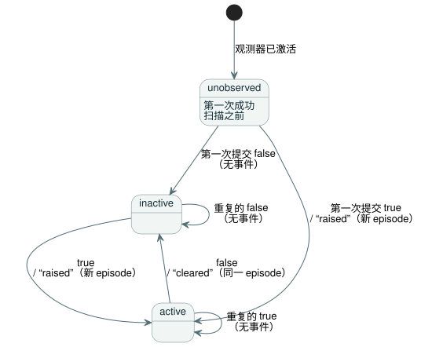

<!-- translation-source: contracts/alarm-v1/README.md -->
[英文原文](README.md)

# 报警观测 v1

[English](README.md) · [한국어](README.ko.md)

本契约定义了为 [#287](https://github.com/callin2/ghostflow-language/issues/287)（REF-05-027）采纳的有界报警生产者。它通过 Rust `ScanDriver` 记录对编写的 Bool 状态的软件观测。

它**不**实现未来的命令生命周期，也不实现完整的[交互流设计](../../docs/INTERACTION-STREAM-CONTRACT.zh.md)。

本文内容：

- **源与描述符** —— 程序状态如何成为报警，以及经编译器校验的数据包如何到达 Rust。
- **运行时与记录** —— 观测器在哪里运行，episode 和事件如何记录，报告格式，以及保留策略。
- **专门验证** —— 构建和测试命令。

## 源与描述符

**程序。** [规范示例](examples/temperature.ghost.zh.md)根据一个感知质量的输入计算一个 Bool 状态。它的显式 fault 分支保留前一个条件。

**描述符。** 一个外部描述符（descriptor）把该状态变成报警。它把 `state.hot` 映射为一个报警，并提供：

- 触发（raised）和解除（cleared）的含义；
- 一个严重性代码及其定义。

状态名及其 Bool 值都不会隐式地使它成为报警。没有新增语言关键字，也没有可执行的描述符表达式。

**接受的 profile。** 此 profile 接受：

- 一个独立的标量 GFB 模块（版本 1–4）；
- 交互 schema 0.3；
- 1–16 个唯一的、编写的、带 `activeWhen: true` 的 Bool 状态条件。

其他 profile 会显式失败。

**描述符 schema 与准备。** 封闭的[描述符 schema](descriptor.schema.json) 为 `GhostFlow/alarm-descriptor-v1`，数值 `version: 1`。准备观测器的步骤：

1. 使用 `interactionSourceIdentity` 进行规范编译。
2. 调用 `tools/alarm-observation.mjs` 中的 `prepareAlarmObservation(compilation, descriptor)`。

准备过程会重放规范源，并使用现有的交互 schema/来源校验器。它强制执行以下规则：

- schema、源和模块必须完全匹配。
- 节点 ID 和有序的意图锚点必须与所选状态匹配。
- 含义包含 1–512 个 UTF-8 字节。每个状态有 1–32 个锚点。
- `parseAlarmDescriptor` 只接受严格的规范 JSON。它拒绝重复键以及未知/非规范的表示。
- 以编程方式提供的输入，使用相同的规范 JSON 规则和精确的字段集合进行检查。
- 准备过程持有一份不可变副本，包括所有嵌套的来源信息。

**绑定与信任边界。** `bind({runId, streamId})` 生成 GFAL 版本 1 字节及其 SHA-256。经编译器校验的数据包与预期摘要一起跨越受信任的激活边界。随后 Rust 检查：

- 摘要；
- 已加载的原始 GFB 字节的确切 SHA-256/FNV/模块名；
- 每个状态槽的存在性及其 Bool 类型。

Rust 不解析 Markdown，也不从可执行字节中证明源锚点。同时替换数据包和预期摘要的调用方会绕过编译器信任边界：摘要是完整性绑定，而不是认证签名。任何包装器或新的 GFB 版本都不会改变被执行的模块标识。

## 运行时与记录

**观测器的位置。** 曾考虑过核心中的两个放置位置：

| 选项 | 能看到什么 | 缺少什么 |
| --- | --- | --- |
| `Runtime::tick_at` | 已接受的状态 | 帧化的扫描/运行标识 |
| `ScanDriver` | 完整的帧、扫描顺序和拒绝 | — |

`ScanDriver` 拥有这个观测器。因此，它的事件与它的当前快照共享完全相同的已完成扫描边界。

**激活与查询 API。**

- JavaScript：
  `AlarmObservationRuntime.instantiate(wasmBytes, compilation, descriptor, identity)`
  加载原始程序，并在任何扫描之前激活观测器一次。
- 原生：`ScanDriver::activate_alarms(packet, expected_sha256)` 和
  `query_alarms(packet)`。
- 帧化 ABI：新增 `gf_frame_alarm_activate` 和 `gf_frame_alarm_query` 导出，以及报告指针/长度导出。

无效的观测器激活不会改变运行时，并且仍然允许普通的控制扫描。GFAQ 版本 1 查询携带绑定、运行和流的标识，以及一个可选的排他性序号游标。查询不能注入事件，也不能推进扫描。现有的帧化 API 和 v0 快照保持其格式不变。

**何时记录条件。** Rust 在每次成功的标量扫描之后、把结果返回给任何使用方之前记录条件。求值失败、过期的扫描 ID 或倒退的逻辑时间，都不会改变当前状态、序号和历史。

**Episode。** 一个 *episode* 是一个报警从触发到解除的一段区间。下图展示了每个报警的状态在成功扫描之后如何变化。



- 在第一次成功扫描之前，每个条件都是 `unobserved`，扫描/时间为 null。
- 第一次提交的 true 触发一个 episode。重复的 true 不增加任何内容。
- false 解除同一个 episode。之后的 true 会创建一个新的 episode。
- 时间戳相同时仍会得到不同的序号。
- episode 的标识由绑定、运行、流、报警 ID 及其 `episodeSequence`（触发时的序号）构成。

**报告。** 封闭的[报告 schema](report.schema.json) 为 `GhostFlow/alarm-report-v1`，数值 `version: 1`。报告包含：

- 确切的源、模块、schema 和描述符摘要；
- 最后一次已完成扫描时的当前状态；
- 有序的事件；
- 一个绑定/运行/流游标；
- 保留覆盖范围。

当前状态与事件历史是分开的，返回的 JS 记录是副本。例如，一个仅在 false→true→false 之后才查询的使用方，会收到不活动的当前状态，*以及*触发和解除这两个事件。报告的描述符摘要关联到显式的严重性和含义元数据；记录值绝不会推断出这些含义。

**保留与游标。**

- 保留区可容纳 1–1024 个事件，外加所有已声明报警的固定状态。
- 溢出时淘汰最旧的事件。它绝不会阻塞扫描，也绝不会重新编号事件。
- 缺少已保留历史的查询会返回一个精确的闭区间 `retention-overflow` 间隙。当前状态和最新序号仍然可用。
- 游标读取只返回该序号之后的事件。绑定/运行/流不正确，或游标超前，都会失败。

**运行的生命周期。**

- 序号的安全整数上限在求值之前检查。耗尽后需要一次新的运行。
- 这一外观层不提供重置、重新加载或持久化恢复 API。
- 宿主在重新创建所有者或进程时，必须签发新的运行/流标识。跨独立进程的唯一性由宿主负责。
- 重新连接到同一个仍在运行的所有者时，会保留状态和历史。

**这些记录能证明什么。** 这些记录证明的是软件层面的条件转换，并不证明物理动作。请求意图（requested）、安全意图（safe）、已应用（applied）和经反馈已确认（confirmed）的输出证据仍然彼此分开。命令的接受、启动、完成、取消和物理确认应答，都不在这个仅限报警的格式范围之内。

## 专门验证

从此检出构建实际的原生和 WASM 所有者，然后运行：

```sh
cargo build --offline --release -p ghostflow-core --example alarm_tape
cargo build --offline --release -p ghostflow-wasm --target wasm32-unknown-unknown
node --test tests/alarm-observation.test.mjs
```

测试选择器为 `GF-TEST-alarm-provenance`、
`GF-TEST-alarm-short-episode`、`GF-TEST-alarm-history`、
`GF-TEST-alarm-atomicity`、`GF-TEST-alarm-initial-condition`、
`GF-TEST-alarm-activation`、`GF-TEST-alarm-consumer` 和
`GF-TEST-alarm-schema`。

这些测试比较由相同的源、描述符和帧生成的完整原生与 WASM 结果和报告。它们覆盖：

- 短 episode、重复的 true 和新的 episode；
- 相同的时间戳；
- 第一次及后续扫描失败；
- 保留间隙和游标标识；
- 不可变的结果；
- 被篡改的来源信息以及错误的模块/类型；
- 激活被拒绝后的控制执行。
