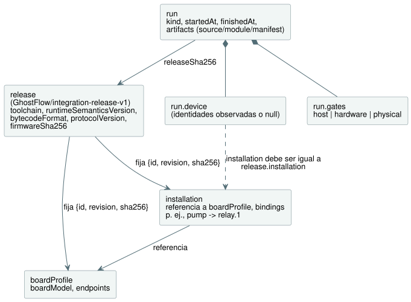
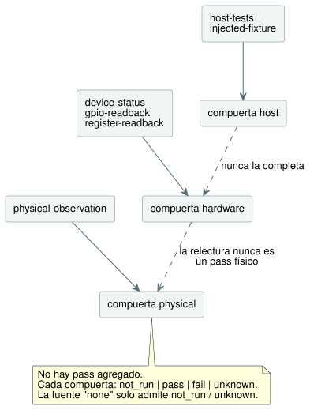

<!-- translation-source: contracts/integration-v1/README.md -->
[Original en inglés](README.md)

# Contrato de integración v1

Este es un pequeño contrato de compatibilidad y evidencia para TASK32. Vincula
tres cosas:

- una **versión publicada** (release) fijada del lenguaje, el runtime y el
  dispositivo;
- una **instalación** con nombre (el cableado lógico del sitio);
- **ejecuciones** (runs) individuales de un programa.

La implementación es `tools/integration-contract.mjs`. Su única dependencia es
la implementación SHA-256 integrada de Node. No realiza operaciones de
archivos, red, compilador, LLM, runtime, puerto serie ni GPIO.

**Qué significa `valid: true`.** Los registros suministrados son
estructuralmente coherentes, y las identidades y los hashes comprobados
concuerdan. Nada más. **No** significa que:

- una compuerta (gate) haya pasado;
- se haya contactado con un dispositivo;
- el programa se comporte correctamente;
- la asignación de pines sea eléctricamente segura;
- se haya suministrado agua.

Una ejecución que registró `fail` puede seguir siendo un registro válido.

**Admisión de la instalación (`assessInstallation`).** Esta función otorga una
admisión basada solo en metadatos para `InstalledControlHost` y
`ProgramReplacementHost`. Devuelve tres campos:

- `metadata`: el resultado de validación `{valid, errors}` sin cambios;
- `identity`: la identidad de una declaración válida. Fija el digest de la
  release y los digests exactos del código fuente, el módulo y el manifiesto. La
  release, a su vez, fija el perfil y el mapeo de la instalación. Los metadatos
  no válidos tienen `identity: null` y no pueden admitirse;
- `physical`: una evaluación con la forma de compuerta existente.

Antes de la validación y del cálculo de identidad, la evaluación captura (copia)
los cuatro registros de entrada y los bytes del módulo. Dentro de esos
registros, los accesores, las claves de símbolo, los campos no enumerables, los
ciclos y los objetos no planos producen un error de metadatos `shape`. Los
campos adicionales ordinarios siguen sujetos a las comprobaciones existentes de
campos exactos.

La compuerta física siempre tiene `status: "unknown"`, tipo de fuente `none` y
una referencia nula. Su alcance (scope) explica que la polaridad declarada y
`safeLevel` no establecen el comportamiento eléctrico, la idoneidad a prueba de
fallos (fail-safe), la compatibilidad de la carga ni el cableado. Una salida
Bool cuyo tipo y dirección coinciden tampoco puede establecer esos hechos. Esta
evaluación no acepta ninguna observación física y nunca puede emitir un pass
físico. Con metadatos válidos, no bloquea la compilación, la simulación ni la
ejecución en el host. La evidencia de ejecución suministrada de forma
independiente (véase más abajo) conserva su propio contrato de validación.

El [host de vinculación de sensores instalados](../../docs/INSTALLED-SENSOR-BINDING.es.md)
documenta la capacidad de entrada `board-profile-v2`, versionada por separado,
y su admisión de reemplazo ejecutable. Los registros v1 existentes conservan el
contrato que se describe a continuación.

**Los drivers y los renderizadores son roles.** Un **driver** de entrada
produce entradas lógicas. Un **renderizador** (renderer) de salida aplica la
intención de salida lógica a relés, motores, lámparas o pantallas. Son roles,
no clases de dispositivo mutuamente excluyentes. Un joystick USB con
retroalimentación de fuerza tiene tanto un driver de entrada como un
renderizador de salida; un codificador EC11 con pantalla TFT combina
igualmente roles de entrada y de salida. Estos ejemplos describen límites, no
implementaciones. La titularidad se reparte así:

- El código fuente de drivers y renderizadores pertenece a
  `farm-device-drivers`.
- Device es responsable de la integración host/placa, las vinculaciones, los
  relojes, los watchdogs y la política de arranque/fallo.
- La interfaz de operador del gabinete es `@ghostflow/cabinet-view`. Es
  distinta de un renderizador de salida.

`ScanDriver`, los identificadores de la ABI del host y los campos `driver` del
perfil existentes conservan sus nombres y contratos.

## Registros y titularidad

Una **release** no contiene hash del código fuente del programa, ID de
arranque, marca de tiempo ni resultado de pruebas. Esos datos pertenecen a una
**ejecución** (run). Un programa nuevo o un reinicio del dispositivo puede crear
una ejecución nueva conservando la misma identidad de release. Cambiar un
componente fijado, el perfil o el mapeo de la instalación requiere un nuevo
digest de release.

El diagrama siguiente muestra cómo se referencian los registros entre sí.



| Registro / campo | Responsable y significado |
| --- | --- |
| `release.schema` | Mantenedor del contrato; exactamente `GhostFlow/integration-release-v1`. |
| `release.toolchain.version`, `.sha256` | Responsable de la release del lenguaje; versión y hash exacto de la distribución/artefacto, incluidas las dependencias del compilador necesarias para reproducirlo. |
| `release.runtimeSemanticsVersion` | Responsables del lenguaje/runtime; identificador de la semántica de ejecución admitida tanto por el compilador como por el runtime. |
| `release.bytecodeFormat` | Responsables del lenguaje/runtime; identificador del formato de bytecode compartido. |
| `release.protocolVersion` | Responsables de API/transporte y de firmware; identificador explícito del protocolo compartido. |
| `release.device.firmwareSha256` | Responsable de la release del firmware; SHA-256 de la imagen de firmware exacta, con independencia del módulo del programa. |
| `release.device.boardProfile` | Integrador de la placa; `{id, revision, sha256}` del perfil de placa aprobado. |
| `release.installation` | Responsable del sitio/instalación; `{id, revision, sha256}` del mapeo lógico aprobado. |
| `boardProfile.boardModel`, `.endpoints` | Integrador de la placa; placa/revisión específica y definiciones de canales revisadas, basadas en la documentación de la placa y en comprobaciones físicas independientes. |
| `installation.boardProfile`, `.bindings` | Responsable del sitio; referencia al perfil aprobado y diccionario explícito de nombre lógico a ID de endpoint. |
| `run.releaseSha256`, `.artifacts` | Ejecutor de la integración; digest de la release y digests exactos de fuente/módulo/manifiesto usados en esa ejecución. |
| `run.kind` | Productor de la evidencia; `recorded-evidence` o `fictional-fixture`. La etiqueta de fixture debe conservarse al compartir ejemplos. |
| `run.startedAt`, `.finishedAt` | Productor de la evidencia; marcas de tiempo ISO canónicas en UTC con milisegundos. |
| `run.device` | Adaptador de observación del dispositivo; ID de arranque observado, marca de tiempo de la observación, identidades de firmware/perfil/instalación/runtime/protocolo y hashes de fuente/módulo, o `null` cuando no están disponibles. |
| `run.device.installation` | Adaptador de observación del dispositivo; `{id, revision, sha256}` del mapeo realmente instalado, obligatorio siempre que `run.device` no sea nulo y comparado con `release.installation`. |
| `run.gates.host`, `.hardware`, `.physical` | Responsable de la prueba u observación correspondiente; estado independiente, fuente/referencia de la evidencia y alcance exacto del resultado. |

**Identificadores y hashes.** Los ID y las revisiones del perfil y de la
instalación son cadenas no vacías. La release fija sus digests además de sus
nombres. Todo campo SHA-256 consta de 64 caracteres hexadecimales en
minúsculas. Los identificadores de versión se comparan de forma exacta: el
validador nunca deduce la compatibilidad a partir de rangos semver ni de
nombres de familias de placas.

**Endpoints de la placa.** Cada endpoint tiene estos campos:

- `direction`: `input` u `output`;
- `type`: el tipo semántico del manifiesto;
- `driver` y `address`: identificadores explícitos que pertenecen al perfil. Se
  rechazan los pares `driver`/`address` duplicados;
- `activeLevel`: `high` o `low`;
- `safeLevel`: el valor numérico `0` o `1`.

Este perfil v1 admite endpoints eléctricos digitales y endpoints lógicos
explícitos para entradas de software. No modela circuitos analógicos. Los pines
reservados no deberían aparecer como endpoints utilizables. Las cadenas de
dirección son opacas para este validador; su significado sigue siendo
responsabilidad del integrador del perfil.

**Vinculaciones.** Las vinculaciones (bindings) son un diccionario como
`{ "pump": "relay.1" }`, nunca un arreglo ni una asignación de pin en línea. Las
reglas son:

- Cada entrada de `manifest.inputs`/`manifest.outputs` necesita una vinculación
  con el nombre exacto, una dirección coincidente y un tipo semántico
  coincidente.
- El orden de declaración no tiene efecto.
- Las vinculaciones adicionales del sitio pueden quedar sin usar por un
  programa.
- En v1 se rechaza asignar un mismo endpoint a varios nombres lógicos (alias).
- Los relojes generados, los sensores y otras entradas proporcionadas por el
  runtime siguen siendo responsabilidad del runtime. El validador no deriva
  entradas nuevas ni genera lógica de control.

**Las entradas de software no necesitan un canal físico.** No toda entrada
declarada necesita un canal DI (entrada digital) físico. Por ejemplo, una
entrada de software `start` puede vincularse al ID de endpoint explícito
`command.start`, declarado en el perfil fijado como `{direction: "input", type:
"Bool", driver: "software-input", address: "commands/start", activeLevel:
"high", safeLevel: 0}`. Aquí `driver` y `address` identifican una entrada
lógica. `activeLevel` y `safeLevel` describen su convención booleana y su valor
predeterminado, no un pin eléctrico ni una configuración de pull. El adaptador
del runtime determina cómo se suministra la entrada de software. Este mapeo
sigue necesitando nombres explícitos, tipos y direcciones coincidentes, y
digests de perfil/instalación. El validador nunca le asigna un pin DI.

**Qué detectan las comprobaciones de metadatos y qué no pueden detectar.**

- Reemplazar `relay.1` por un `GPIO7` no declarado falla.
- Cambiar un endpoint del perfil de un canal de expansor a un GPIO genérico
  cambia el digest del perfil, por lo que falla frente a la release fijada.
- Un perfil que es erróneo de forma coherente aún puede superar estas
  comprobaciones de metadatos. La revisión del perfil y las pruebas eléctricas
  siguen siendo compuertas independientes, y la relectura por software no
  puede establecer que una carga instalada sea correcta.

## Reglas de evidencia

Cada compuerta tiene exactamente la forma `{status, source: {type, reference}, scope}`.
Las tres compuertas (`host`, `hardware`, `physical`) son obligatorias e
independientes. No existe un pass agregado de placa ni físico.

| Estado | Significado |
| --- | --- |
| `not_run` | No se realizó ninguna prueba; la fuente debe ser `none` y la referencia `null`. |
| `pass` | El alcance indicado se superó según su fuente de evidencia explícita. |
| `fail` | El alcance indicado falló según su fuente de evidencia explícita. |
| `unknown` | La información disponible no permite establecer el resultado; no se convierte en pass. |

| Compuerta | Tipos de fuente permitidos además de `none` |
| --- | --- |
| `host` | `host-tests`, `injected-fixture` |
| `hardware` | `device-status`, `gpio-readback`, `register-readback` |
| `physical` | `physical-observation` |

Cada compuerta acepta solo sus propios tipos de fuente, y la evidencia nunca
fluye de una compuerta a otra, como muestra el diagrama.



**Reglas de las compuertas.**

- `pass` y `fail` requieren una fuente y una referencia de registro no vacía.
- La fuente `none` solo permite `not_run` y `unknown`.
- Siempre se requiere un `scope` no vacío.
- Un `pass` de hardware o físico también requiere una observación del
  dispositivo vinculada a la release y a los artefactos.
- Puede existir evidencia de desconexión o de fallo con una identidad de
  dispositivo nula y un estado de hardware `fail`/`unknown`.
- La referencia es un ID o una ruta de registro propiedad del productor. Este
  módulo no la abre ni autentica su contenido.

**Sin promoción entre compuertas.**

- Un pass del host nunca completa los estados de hardware ni físicos.
- La relectura de GPIO, de registros o del dispositivo nunca puede ser la
  fuente de un pass físico.
- Una observación física debe indicar qué se observó. La tensión en bornes, el
  estado de un LED, el estado de un contacto y el agua suministrada son
  afirmaciones distintas.
- Incluso un registro `physical-observation` aceptado es aquí solo una
  declaración. Este validador no puede verificar que sea verdadero ni inferir
  un comportamiento más amplio.
- En canales activos en nivel bajo, la salida lógica y el nivel eléctrico no
  deben compararse como si fueran el mismo valor.

**Observación del dispositivo.** La observación del dispositivo lleva `bootId`,
`observedAt`, `firmwareSha256`, `boardProfile: {id, revision, sha256}`,
`installation: {id, revision, sha256}`, `runtimeSemanticsVersion`,
`bytecodeFormat`, `protocolVersion`, `sourceSha256` y `moduleSha256`. Sus
reglas son:

- Su marca de tiempo debe estar dentro de la ejecución.
- La identidad de la instalación es obligatoria siempre que exista el registro
  del dispositivo, independientemente de los estados de las compuertas.
- Los tres campos de la instalación deben coincidir con
  `release.installation`. Que los hashes de firmware, perfil y programa no
  cambien no puede ocultar un mapeo instalado distinto.
- Las comparaciones de identidad usan los valores observados que suministra el
  adaptador. No deben copiarse de los valores esperados de la release y
  presentarse como observados.

Es posible que el protocolo POC actual necesite un adaptador explícito o una
extensión de capacidades antes de poder proporcionar todos los campos. Las
observaciones ausentes nunca se adivinan. Este contrato no modifica ese
protocolo ni implementa la atestación del firmware.

## Hashes y API pura

El contrato usa dos funciones auxiliares de hash.

**`sha256(textOrBytes)`** calcula el hash del texto fuente UTF-8 exacto o de
los bytes de un `Uint8Array`/`Buffer`. Nunca añade un salto de línea ni
normaliza Unicode ni los finales de línea. El `moduleSha256` de la ejecución es
el mismo hash que el compilador actual y el protocolo serie llaman
`bytecodeSha256`. El `bytecodeSha256` del manifiesto suministrado debe
coincidir con los bytes del módulo.

**`jsonSha256(json)`** ordena recursivamente las claves de los objetos,
conserva el orden de los arreglos y el contenido de las cadenas, y calcula el
hash de JSON compacto codificado en UTF-8. Solo acepta datos JSON finitos; se
rechazan los valores indefinidos y los ciclos. Use esta codificación local del
contrato para los digests de metadatos de perfil, mapeo, manifiesto y release.
Los hashes de los artefactos de fuente, módulo, firmware y toolchain siempre
usan los bytes exactos del artefacto.

```js
import {
  validateReleaseIdentity, validateRunEvidence, validateIntegration,
} from './tools/integration-contract.mjs';

const artifacts = { source, module: compiled.bytes, manifest: compiled.manifest };
const releaseCheck = validateReleaseIdentity(release, { boardProfile, installation });
const runCheck = validateRunEvidence(runEvidence, { release, artifacts });
const allChecks = validateIntegration({
  release, boardProfile, installation, artifacts, runEvidence,
});
// Each result: { valid: boolean, errors: [{ path, code, message }] }
```

Los tres validadores se reparten el trabajo:

| Función | Qué comprueba |
| --- | --- |
| `validateReleaseIdentity` | El contenido del perfil/mapeo suministrado y sus referencias fijadas. |
| `validateRunEvidence` | Las declaraciones de la ejecución y los bytes de los artefactos frente a una release suministrada. Supone que el contenido del perfil/mapeo se comprueba por separado. |
| `validateIntegration` | Ambas comprobaciones anteriores, más las vinculaciones de nombres del manifiesto. Omita `runEvidence` (o pase null) para validar solo metadatos/artefactos. |

Los validadores no crean valores predeterminados de compuertas, no resuelven
canales físicos ni devuelven afirmaciones sobre la ejecución. No modifican sus
entradas. Los errores de validación se devuelven en un orden determinista. Las
funciones auxiliares de hash lanzan `TypeError` ante entradas no admitidas; los
validadores, en cambio, devuelven registros de error.

**Qué no hace este contrato.** El `compileSource` existente es responsable del
análisis sintáctico del lenguaje, la semántica, la generación de módulos y la
generación de manifiestos. Las implementaciones del runtime son responsables de
la ejecución, los temporizadores, las programaciones y las pruebas de
comportamiento. Este contrato solo calcula el hash de sus salidas y compara
identidades declaradas. No:

- recompila el código fuente para demostrar que fuente y módulo se
  corresponden;
- inspecciona binarios de firmware;
- infiere GPIO;
- duplica el comportamiento del runtime;
- despliega vinculaciones.

Un adaptador futuro debe consumir explícitamente el mapeo validado y registrar
la vinculación realmente instalada.

Las versiones de compilación del frontend/API pueden añadirse mediante una BOM
(lista de materiales) de integración externa que haga referencia al digest de
la release. No es necesario que sean campos obligatorios en este contrato de
lenguaje/dispositivo. Trasladar estos archivos al repositorio del lenguaje solo
requiere el validador, este directorio y su prueba dedicada; no se necesitan
importaciones del POC ni submódulos.

## Ejemplo ficticio y pruebas de regresión

`examples/fictional-fixture.json` es un conjunto completo y ficticio de
registros vinculados. Los bytes del módulo y el código fuente no son
ejecutables a propósito. Los hashes de toolchain y firmware son
identificadores ilustrativos, mientras que los digests de metadatos, fuente y
módulo son coherentes entre sí. Cuando use la API, decodifique
`artifacts.moduleHex` a bytes y páselo como `artifacts.module` (el hexadecimal
es solo la codificación del fixture JSON).

Las pruebas usan únicamente este fixture. No llaman a ninguna placa, LLM,
compilador ni servicio HTTP en vivo, y no generan archivos de evidencia.
Ejecute solo:

```sh
node --test tests/integration-contract.test.mjs
```

Las pruebas cubren:

- placas y perfiles incorrectos;
- sustitución por un GPIO genérico;
- deriva del mapeo;
- independencia del orden de declaración;
- artefactos que no coinciden;
- identidades observadas que no coinciden;
- la prohibición de promover evidencia del host o de relectura a un pass
  físico.

Estas pruebas establecen únicamente el comportamiento del contrato.
