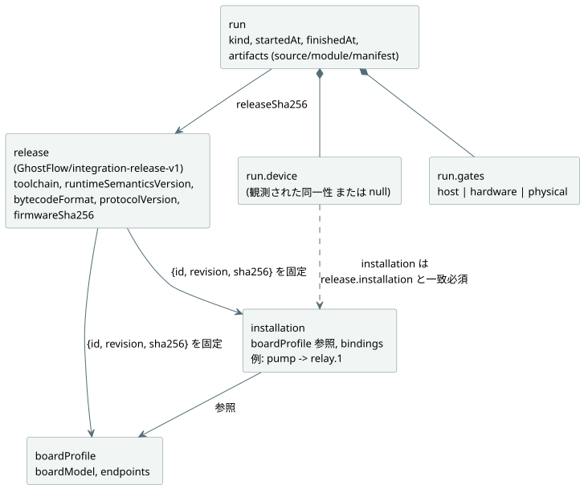
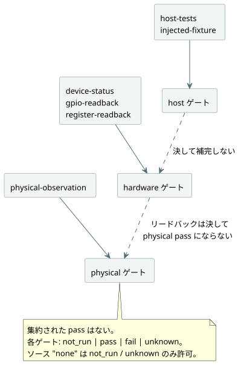

<!-- translation-source: contracts/integration-v1/README.md -->
[英語の原文](README.md)

# 統合契約 v1

これは TASK32 のための小さな互換性・証拠（エビデンス）契約です。次の 3 つを結び付けます。

- 言語、ランタイム、デバイスを固定した **release**（リリース）
- 名前の付いた **installation**（設置。現場の論理配線）
- プログラムの個々の **run**（実行）

実装は `tools/integration-contract.mjs` です。依存しているのは Node 組み込みの SHA-256 実装だけです。ファイル、ネットワーク、コンパイラ、LLM、ランタイム、シリアル、GPIO の操作は一切行いません。

**`valid: true` の意味。** 与えられたレコードが構造的に一貫しており、検査した同一性とハッシュが一致している、ということです。それ以上の意味はありません。次のことは**意味しません**。

- ゲートが合格したこと
- デバイスと通信したこと
- プログラムが正しく動作すること
- ピン配置が電気的に安全であること
- 水が実際に供給されたこと

`fail` を記録した run であっても、有効なレコードになり得ます。

**installation の受け入れ（`assessInstallation`）。** この関数は、`InstalledControlHost` と `ProgramReplacementHost` に対してメタデータのみに基づく受け入れ（アドミッション）を行います。返すフィールドは 3 つです。

- `metadata`：変更されていない `{valid, errors}` の検証結果
- `identity`：有効な宣言の同一性。release のダイジェストと、正確な source・module・manifest のダイジェストを固定します。release はさらにプロファイルと installation のマッピングを固定します。メタデータが無効な場合は `identity: null` となり、受け入れられません。
- `physical`：既存のゲート形状による評価

検証と同一性の計算の前に、この評価は 4 つの入力レコードとモジュールのバイト列を取り込み（コピーし）ます。これらのレコード内にあるアクセサ、シンボルキー、列挙不可能なフィールド、循環参照、プレーンでないオブジェクトは、メタデータの `shape` エラーになります。通常の余分なフィールドは、引き続き既存の厳密なフィールド検査の対象です。

physical ゲートは常に `status: "unknown"`、ソース種別 `none`、null の参照を持ちます。その scope では、宣言された極性と `safeLevel` が電気的な挙動、フェイルセーフとしての適性、負荷の互換性、配線を立証しないことを説明しています。型と方向が一致する Bool 出力であっても、これらの事実は立証できません。この評価は物理的な観測を一切受け付けず、physical の pass を発行することは決してありません。メタデータが有効であれば、コンパイル、シミュレーション、ホスト実行を妨げません。別途提供される run の証拠（後述）は、それ自身の検証契約に従います。

[設置済みセンサのバインディングホスト](../../docs/INSTALLED-SENSOR-BINDING.ja.md)は、別にバージョン管理される `board-profile-v2` の入力ケイパビリティと、その実行可能な置換の受け入れを文書化しています。既存の v1 レコードは、以下の契約をそのまま維持します。

**ドライバとレンダラーは役割です。** 入力**ドライバ**は論理入力を生成します。出力**レンダラー**は、論理的な出力意図をリレー、モーター、ランプ、画面に適用します。これらは役割であり、互いに排他的なデバイス分類ではありません。USB のフォースフィードバック・ジョイスティックは入力ドライバと出力レンダラーの両方を持ちます。TFT 画面付きの EC11 エンコーダも同様に入力と出力の役割を兼ねます。これらの例は境界を説明するものであり、実装ではありません。所有権は次のように分かれています。

- ドライバとレンダラーのソースは `farm-device-drivers` に属します。
- Device は、ホスト/ボードの統合、バインディング、クロック、ウォッチドッグ、起動/障害時のポリシーを所有します。
- キャビネットのオペレーター UI は `@ghostflow/cabinet-view` です。これは出力レンダラーとは別物です。

既存の `ScanDriver`、ホスト ABI の識別子、プロファイルの `driver` フィールドは、名前と契約を維持します。

## レコードと所有者

**release** には、プログラムのソースハッシュ、ブート ID、タイムスタンプ、テスト結果は含まれません。これらは **run** に属します。新しいプログラムやデバイスの再起動によって、同じ release の同一性を保ったまま新しい run が生まれることがあります。固定されたコンポーネント、プロファイル、installation のマッピングを変更するには、新しい release ダイジェストが必要です。

次の図は、レコード同士がどのように参照し合うかを示しています。



| レコード / フィールド | 所有者と意味 |
| --- | --- |
| `release.schema` | 契約の保守者。正確に `GhostFlow/integration-release-v1`。 |
| `release.toolchain.version`, `.sha256` | 言語リリースの所有者。バージョンと、再現に必要なコンパイラの依存関係を含む、正確な配布物/成果物のハッシュ。 |
| `release.runtimeSemanticsVersion` | 言語/ランタイムの所有者。コンパイラとランタイムの両方がサポートする実行セマンティクスの識別子。 |
| `release.bytecodeFormat` | 言語/ランタイムの所有者。共有バイトコード形式の識別子。 |
| `release.protocolVersion` | API/トランスポートとファームウェアの所有者。明示的な共有プロトコルの識別子。 |
| `release.device.firmwareSha256` | ファームウェアリリースの所有者。プログラムモジュールとは独立した、正確なファームウェアイメージの SHA-256。 |
| `release.device.boardProfile` | ボードインテグレーター。承認されたボードプロファイルの `{id, revision, sha256}`。 |
| `release.installation` | 現場/設置の所有者。承認された論理マッピングの `{id, revision, sha256}`。 |
| `boardProfile.boardModel`, `.endpoints` | ボードインテグレーター。ボードの資料と別途の物理的確認に基づく、特定のボード/リビジョンとレビュー済みのチャネル定義。 |
| `installation.boardProfile`, `.bindings` | 現場の所有者。承認されたプロファイルの参照と、論理名からエンドポイント ID への明示的な辞書。 |
| `run.releaseSha256`, `.artifacts` | 統合ランナー。その run で使用した release ダイジェストと、正確な source/module/manifest のダイジェスト。 |
| `run.kind` | 証拠の生成者。`recorded-evidence` または `fictional-fixture`。例を共有するときはフィクスチャのラベルを保持しなければなりません。 |
| `run.startedAt`, `.finishedAt` | 証拠の生成者。ミリ秒を含む正準形式の UTC ISO タイムスタンプ。 |
| `run.device` | デバイス観測アダプタ。観測されたブート ID、観測時刻、ファームウェア/プロファイル/installation/ランタイム/プロトコルの同一性と source/module のハッシュ。取得できない場合は `null`。 |
| `run.device.installation` | デバイス観測アダプタ。実際に設置されているマッピングの `{id, revision, sha256}`。`run.device` が null でない場合は常に必須で、`release.installation` と比較されます。 |
| `run.gates.host`, `.hardware`, `.physical` | それぞれのテストまたは観測の所有者。独立したステータス、証拠のソース/参照、結果の正確なスコープ。 |

**識別子とハッシュ。** プロファイルと installation の ID およびリビジョンは空でない文字列です。release は、それらの名前だけでなくダイジェストも固定します。すべての SHA-256 フィールドは 64 文字の小文字 16 進数です。バージョン識別子は厳密に比較されます。バリデータが semver の範囲やボードファミリー名から互換性を推測することは決してありません。

**ボードのエンドポイント。** 各エンドポイントは次のフィールドを持ちます。

- `direction`：`input` または `output`
- `type`：manifest のセマンティック型
- `driver` と `address`：プロファイルが所有する明示的な識別子。`driver`/`address` の組が重複すると拒否されます。
- `activeLevel`：`high` または `low`
- `safeLevel`：数値の `0` または `1`

この v1 プロファイルは、デジタルの電気的エンドポイントと、ソフトウェア入力のための明示的な論理エンドポイントをサポートします。アナログ回路はモデル化しません。予約済みのピンは、使用可能なエンドポイントとして現れるべきではありません。アドレス文字列はこのバリデータにとって不透明であり、その意味はプロファイルインテグレーターの責任です。

**バインディング。** バインディングは `{ "pump": "relay.1" }` のような辞書です。配列やインラインのピン割り当てであってはなりません。ルールは次のとおりです。

- すべての `manifest.inputs`/`manifest.outputs` のエントリには、名前が完全に一致し、方向とセマンティック型が一致するバインディングが必要です。
- 宣言の順序は影響しません。
- 現場の余分なバインディングは、プログラムで使われないままでもかまいません。
- v1 では、1 つのエンドポイントを複数の論理名で別名にすることは拒否されます。
- 生成されたクロック、センサ、その他ランタイムが提供する入力は、引き続きランタイムの責任です。バリデータは新しい入力を導出せず、制御ロジックも生成しません。

**ソフトウェア入力に物理チャネルは不要です。** 宣言されたすべての入力が物理的な DI（デジタル入力）チャネルを必要とするわけではありません。たとえば、ソフトウェアの `start` 入力は明示的なエンドポイント ID `command.start` にバインドできます。これは固定されたプロファイル内で `{direction: "input", type: "Bool", driver: "software-input", address:
"commands/start", activeLevel: "high", safeLevel: 0}` として宣言されます。ここで `driver` と `address` は論理入力を識別します。`activeLevel` と `safeLevel` はその Boolean の規約と既定値を表すものであり、電気的なピンやプル設定ではありません。ソフトウェア入力をどのように供給するかは、ランタイムアダプタが所有します。このマッピングにも、明示的な名前、一致する型と方向、プロファイル/installation のダイジェストが必要です。バリデータがこれに DI ピンを割り当てることは決してありません。

**メタデータ検査で検出できること、できないこと。**

- `relay.1` を未宣言の `GPIO7` に置き換えると失敗します。
- プロファイルのエンドポイントをエキスパンダのチャネルから汎用 GPIO に変更すると、プロファイルのダイジェストが変わるため、固定された release に対して失敗します。
- 一貫して誤っているプロファイルは、これらのメタデータ検査を通過し得ます。プロファイルのレビューと電気的なテストは独立したゲートのままであり、ソフトウェアのリードバックでは設置された負荷が正しいことを立証できません。

## 証拠のルール

各ゲートは正確に `{status, source: {type, reference}, scope}` の形を持ちます。3 つのゲート（`host`、`hardware`、`physical`）は必須で、互いに独立しています。ボード全体や物理面を集約した pass はありません。

| ステータス | 意味 |
| --- | --- |
| `not_run` | テストを実施していない。source は `none`、reference は `null` でなければならない。 |
| `pass` | 明示された証拠ソースによれば、記載されたスコープは合格した。 |
| `fail` | 明示された証拠ソースによれば、記載されたスコープは不合格だった。 |
| `unknown` | 利用可能な情報では結果を立証できない。pass への変換はない。 |

| ゲート | `none` 以外に許可されるソース種別 |
| --- | --- |
| `host` | `host-tests`, `injected-fixture` |
| `hardware` | `device-status`, `gpio-readback`, `register-readback` |
| `physical` | `physical-observation` |

図に示すとおり、各ゲートは自身のソース種別だけを受け付け、証拠があるゲートから別のゲートへ流れることは決してありません。



**ゲートのルール。**

- `pass` と `fail` には、ソースと空でないレコード参照が必要です。
- ソース `none` が許可するのは `not_run` と `unknown` のみです。
- 空でない `scope` は常に必須です。
- hardware または physical の `pass` には、さらに release と成果物に結び付いたデバイス観測が必要です。
- 切断や障害の証拠は、null のデバイス同一性と、`fail`/`unknown` の hardware ステータスとともに存在してもかまいません。
- 参照は、生成者が所有するレコード ID またはパスです。このモジュールはそれを開くことも、内容を認証することもしません。

**ゲート間の昇格はありません。**

- host の pass が hardware や physical のステータスを補完することは決してありません。
- GPIO、レジスタ、デバイスのリードバックが physical pass のソースになることは決してありません。
- 物理的な観測は、何を観測したかを述べなければなりません。端子電圧、LED の状態、接点の状態、供給された水は、それぞれ別の主張です。
- 受け入れられた `physical-observation` レコードであっても、ここでは宣言にすぎません。このバリデータは、それが真であることを検証したり、より広い挙動を推論したりすることはできません。
- アクティブローのチャネルでは、論理出力と電気レベルを同じ値であるかのように比較してはなりません。

**デバイス観測。** デバイス観測は `bootId`、`observedAt`、`firmwareSha256`、`boardProfile: {id, revision, sha256}`、`installation: {id, revision, sha256}`、`runtimeSemanticsVersion`、`bytecodeFormat`、`protocolVersion`、`sourceSha256`、`moduleSha256` を持ちます。ルールは次のとおりです。

- そのタイムスタンプは run の期間内になければなりません。
- デバイスレコードが存在する場合、ゲートのステータスにかかわらず、installation の同一性は必須です。
- installation の 3 つのフィールドはすべて `release.installation` と一致しなければなりません。ファームウェア、プロファイル、プログラムのハッシュが変わっていなくても、異なる設置マッピングを隠すことはできません。
- 同一性の比較には、アダプタが提供する観測値を使います。期待される release の値からコピーして、観測値として提示してはなりません。

現在の POC プロトコルでは、すべてのフィールドを提供する前に、明示的なアダプタまたはケイパビリティの拡張が必要になる場合があります。欠けている観測値が推測されることは決してありません。この契約はそのプロトコルを変更せず、ファームウェアの真正性証明（アテステーション）も実装しません。

## ハッシュと純粋 API

この契約は 2 つのハッシュヘルパーを使います。

**`sha256(textOrBytes)`** は、正確な UTF-8 のソーステキスト、または `Uint8Array`/`Buffer` のバイト列をハッシュします。改行を付け加えたり、Unicode や改行コードを正規化したりすることは決してありません。run の `moduleSha256` は、現在のコンパイラとシリアルプロトコルが `bytecodeSha256` と呼んでいるものと同じハッシュです。与えられた manifest の `bytecodeSha256` は、モジュールのバイト列と一致しなければなりません。

**`jsonSha256(json)`** は、オブジェクトのキーを再帰的にソートし、配列の順序と文字列の内容を保ったまま、UTF-8 でエンコードしたコンパクトな JSON をハッシュします。受け付けるのは有限の JSON データだけで、undefined の値と循環参照は拒否されます。プロファイル、マッピング、manifest、release のメタデータのダイジェストには、この契約ローカルのエンコーディングを使ってください。source、module、ファームウェア、ツールチェーン成果物のハッシュには、常に成果物の正確なバイト列を使います。

```js
import {
  validateReleaseIdentity, validateRunEvidence, validateIntegration,
} from './tools/integration-contract.mjs';

const artifacts = { source, module: compiled.bytes, manifest: compiled.manifest };
const releaseCheck = validateReleaseIdentity(release, { boardProfile, installation });
const runCheck = validateRunEvidence(runEvidence, { release, artifacts });
const allChecks = validateIntegration({
  release, boardProfile, installation, artifacts, runEvidence,
});
// Each result: { valid: boolean, errors: [{ path, code, message }] }
```

3 つのバリデータは次のように役割を分担します。

| 関数 | 検査内容 |
| --- | --- |
| `validateReleaseIdentity` | 与えられたプロファイル/マッピングの内容と、それらを固定する参照。 |
| `validateRunEvidence` | 与えられた release に対する run の宣言と成果物のバイト列。プロファイル/マッピングの内容は別途検査されている前提です。 |
| `validateIntegration` | 上記の両方に加えて、manifest の名前バインディング。メタデータ/成果物のみを検証するには、`runEvidence` を省略（または null を渡）します。 |

バリデータはゲートの既定値を作らず、物理チャネルを解決せず、実行に関する主張を返しません。入力を変更することもありません。検証エラーは決定的な順序で返されます。ハッシュヘルパーはサポートされていない入力に対して `TypeError` を投げますが、バリデータは代わりにエラーレコードを返します。

**この契約が行わないこと。** 言語の構文解析、意味論、モジュール生成、manifest 生成は既存の `compileSource` が所有します。実行、タイマー、スケジュール、動作テストはランタイム実装が所有します。この契約は、それらの出力をハッシュし、宣言された同一性を比較するだけです。次のことは行いません。

- source と module の対応を証明するための再コンパイル
- ファームウェアバイナリの検査
- GPIO の推測
- ランタイムの挙動の重複実装
- バインディングのデプロイ

将来のアダプタは、検証済みのマッピングを明示的に受け取り、実際に設置されたバインディングを記録しなければなりません。

フロントエンド/API のビルドバージョンは、release ダイジェストを参照する外側の統合 BOM（部品表）で追加できます。この言語/デバイス契約の必須フィールドにする必要はありません。これらのファイルを言語リポジトリへ移すのに必要なのは、バリデータ、このディレクトリ、専用のテストだけです。POC のインポートやサブモジュールは不要です。

## 架空の例と回帰テスト

`examples/fictional-fixture.json` は、相互にリンクされたレコードの完全な架空のセットです。モジュールのバイト列とソースは、意図的に実行不可能にしてあります。ツールチェーンとファームウェアのハッシュは説明用の識別子ですが、メタデータ、source、module のダイジェストは内部的に一貫しています。API を使う際は、`artifacts.moduleHex` をバイト列にデコードし、`artifacts.module` として渡してください（16 進数は JSON フィクスチャのためのエンコーディングにすぎません）。

テストはこのフィクスチャだけを使います。ボード、LLM、コンパイラ、稼働中の HTTP サービスを呼び出さず、証拠ファイルも生成しません。次のコマンドだけを実行してください。

```sh
node --test tests/integration-contract.test.mjs
```

テストは次の内容をカバーします。

- 誤ったボードとプロファイル
- 汎用 GPIO への置き換え
- マッピングのずれ
- 宣言順序への非依存
- 一致しない成果物
- 一致しない観測された同一性
- host やリードバックの証拠を physical pass に昇格させることの禁止

これらのテストが立証するのは、契約の挙動だけです。
