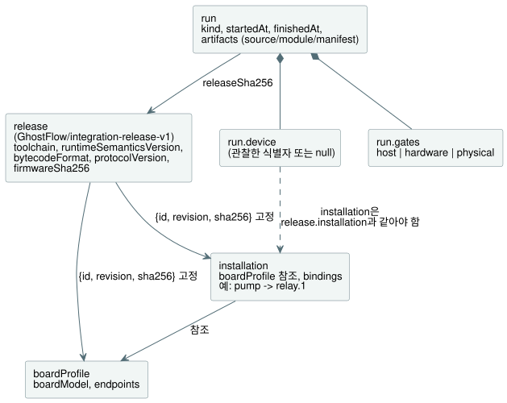
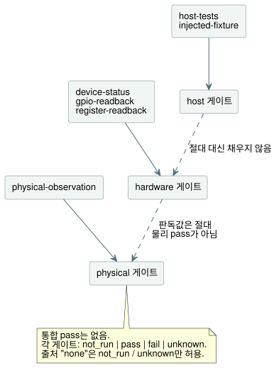

<!-- translation-source: contracts/integration-v1/README.md -->
[영문 원문](README.md)

# 통합 계약 v1

이 문서는 TASK32를 위한 작은 호환성 및 증거 계약입니다. 다음 세 가지를
서로 연결합니다.

- 언어, 런타임, 장치를 고정한 **릴리스(release)**
- 이름이 붙은 **설치(installation)**(현장의 논리 배선)
- 프로그램의 개별 **실행(run)**

구현은 `tools/integration-contract.mjs`입니다. 의존성은 Node 내장 SHA-256
구현 하나뿐입니다. 파일, 네트워크, 컴파일러, LLM, 런타임, 직렬 포트, GPIO
작업은 전혀 수행하지 않습니다.

**`valid: true`의 의미.** 제공된 레코드의 구조가 일관되고, 검사한 식별자와
해시가 서로 일치한다는 뜻입니다. 그 이상은 아닙니다. 다음을 뜻하지는
**않습니다**.

- 게이트를 통과했다.
- 장치와 통신했다.
- 프로그램이 올바르게 동작한다.
- 핀 배치가 전기적으로 안전하다.
- 물이 공급되었다.

`fail`을 기록한 실행도 유효한 레코드일 수 있습니다.

**설치 admission(`assessInstallation`).** 이 함수는 `InstalledControlHost`와
`ProgramReplacementHost`에 대해 선언 정보(metadata)만으로 admission(수용)
판정을 내립니다. 세 필드를 반환합니다.

- `metadata`: 기존 그대로의 `{valid, errors}` 검증 결과입니다.
- `identity`: 유효한 선언의 식별자입니다. 릴리스 다이제스트와 정확한 source,
  module, manifest 다이제스트를 고정합니다. 릴리스는 다시 프로필과 설치 매핑을
  고정합니다. 선언 정보가 유효하지 않으면 `identity: null`이며 수용할 수
  없습니다.
- `physical`: 기존 게이트 형태의 평가입니다.

평가는 검증과 식별자 계산 전에 네 입력 레코드와 module 바이트를 캡처(복사)합니다.
이 레코드 안의 accessor, symbol 키, 열거 불가능한 필드, 순환 참조, plain
object가 아닌 객체는 metadata `shape` 오류를 만듭니다. 일반적인 추가 필드는
기존의 정확한 필드 검사를 그대로 받습니다.

물리 게이트는 항상 `status: "unknown"`, 출처 유형 `none`, null 참조를 가집니다.
그 scope(범위)는 선언된 극성과 `safeLevel`이 전기적 동작, 페일세이프 적합성,
부하 호환성, 배선을 입증하지 않는다고 설명합니다. 타입과 방향이 일치하는 Bool
출력도 이런 사실을 입증할 수 없습니다. 이 평가는 물리 관측을 입력받지 않으며
물리 pass를 절대 발행할 수 없습니다. 선언 정보가 유효하면 컴파일, 시뮬레이션,
호스트 실행을 막지 않습니다. 독립적으로 제공된 실행 증거(아래 참조)는 자체 검증
계약을 그대로 유지합니다.

[설치형 센서 바인딩 호스트](../../docs/INSTALLED-SENSOR-BINDING.ko.md)
문서는 별도 버전인 `board-profile-v2`의 입력 capability와 그 실행 가능한 교체
admission을 설명합니다. 기존 v1 레코드는 아래 계약을 그대로 따릅니다.

**드라이버와 렌더러는 역할입니다.** 입력 **드라이버(driver)**는 논리 입력을
만듭니다. 출력 **렌더러(renderer)**는 논리 출력 의도를 릴레이, 모터, 램프, 화면에
적용합니다. 이 둘은 서로 배타적인 장치 종류가 아니라 역할입니다. USB
force-feedback 조이스틱은 입력 드라이버와 출력 렌더러를 함께 가지며, TFT 화면이
달린 EC11 인코더도 입력과 출력 역할을 함께 가집니다. 이 예시는 경계를 설명할
뿐 구현이 아닙니다. 소유권은 다음과 같이 나뉩니다.

- 드라이버와 렌더러 소스는 `farm-device-drivers`에 속합니다.
- Device는 호스트/보드 통합, 바인딩, 시계, watchdog, 부팅·장애 정책을
  소유합니다.
- 캐비닛 운영자 UI는 `@ghostflow/cabinet-view`입니다. 출력 렌더러와는
  구분됩니다.

기존 `ScanDriver`, 호스트 ABI 식별자, 프로필의 `driver` 필드는 이름과 계약을
그대로 유지합니다.

## 레코드와 소유권

**릴리스**에는 프로그램 소스 해시, 부팅 ID, 타임스탬프, 테스트 결과가 들어가지
않습니다. 이들은 **실행**에 속합니다. 새 프로그램이나 장치 재부팅은 같은 릴리스
식별자를 유지한 채 새 실행을 만들 수 있습니다. 고정된 구성 요소, 프로필, 설치
매핑을 바꾸려면 새 릴리스 다이제스트가 필요합니다.

아래 다이어그램은 레코드들이 서로를 어떻게 참조하는지 보여 줍니다.



| 레코드 / 필드 | 소유자와 의미 |
| --- | --- |
| `release.schema` | 계약 관리자. 정확히 `GhostFlow/integration-release-v1`입니다. |
| `release.toolchain.version`, `.sha256` | 언어 릴리스 소유자. 버전과 정확한 배포물/아티팩트 해시이며, 재현에 필요한 컴파일러 의존성을 포함합니다. |
| `release.runtimeSemanticsVersion` | 언어/런타임 소유자. 컴파일러와 런타임이 함께 지원하는 실행 의미의 식별자입니다. |
| `release.bytecodeFormat` | 언어/런타임 소유자. 공유 바이트코드 형식 식별자입니다. |
| `release.protocolVersion` | API/전송 및 펌웨어 소유자. 명시적인 공유 프로토콜 식별자입니다. |
| `release.device.firmwareSha256` | 펌웨어 릴리스 소유자. 프로그램 모듈과 별개인, 정확한 펌웨어 이미지의 SHA-256입니다. |
| `release.device.boardProfile` | 보드 통합자. 승인된 보드 프로필의 `{id, revision, sha256}`입니다. |
| `release.installation` | 현장/설치 소유자. 승인된 논리 매핑의 `{id, revision, sha256}`입니다. |
| `boardProfile.boardModel`, `.endpoints` | 보드 통합자. 특정 보드/리비전과 검토된 채널 정의이며, 보드 문서와 별도의 물리 점검에 근거합니다. |
| `installation.boardProfile`, `.bindings` | 현장 소유자. 승인된 프로필 참조와, 논리 이름에서 엔드포인트 ID로 가는 명시적 사전입니다. |
| `run.releaseSha256`, `.artifacts` | 통합 실행기. 릴리스 다이제스트와, 해당 실행에 사용한 정확한 source/module/manifest 다이제스트입니다. |
| `run.kind` | 증거 생성자. `recorded-evidence` 또는 `fictional-fixture`입니다. 예제를 공유할 때 픽스처 표기를 유지해야 합니다. |
| `run.startedAt`, `.finishedAt` | 증거 생성자. 밀리초가 있는 정규 UTC ISO 타임스탬프입니다. |
| `run.device` | 장치 관측 어댑터. 관측한 부팅 ID, 관측 시각, 펌웨어/프로필/설치/런타임/프로토콜 식별자와 source/module 해시입니다. 얻을 수 없으면 `null`입니다. |
| `run.device.installation` | 장치 관측 어댑터. 실제로 설치된 매핑의 `{id, revision, sha256}`입니다. `run.device`가 null이 아니면 항상 필요하며 `release.installation`과 비교합니다. |
| `run.gates.host`, `.hardware`, `.physical` | 각 테스트 또는 관측 소유자. 독립적인 상태, 증거 출처/참조, 결과의 정확한 범위입니다. |

**식별자와 해시.** 프로필과 설치의 ID와 리비전은 비어 있지 않은 문자열입니다.
릴리스는 이름뿐 아니라 다이제스트도 고정합니다. 모든 SHA-256 필드는 소문자
16진수 64자입니다. 버전 식별자는 정확히 비교합니다. 검증기는 semver 범위나 보드
계열 이름으로 호환성을 절대 추측하지 않습니다.

**보드 엔드포인트.** 각 엔드포인트에는 다음 필드가 있습니다.

- `direction`: `input` 또는 `output`
- `type`: manifest의 의미 타입
- `driver`와 `address`: 프로필이 소유하는 명시적 식별자입니다. 중복된
  `driver`/`address` 쌍은 거부됩니다.
- `activeLevel`: `high` 또는 `low`
- `safeLevel`: 숫자 `0` 또는 `1`

이 v1 프로필은 디지털 전기 엔드포인트와, 소프트웨어 입력을 위한 명시적 논리
엔드포인트를 지원합니다. 아날로그 회로는 모델링하지 않습니다. 예약된 핀은 사용
가능한 엔드포인트로 나타나지 않는 것이 좋습니다. 주소 문자열은 이 검증기에
불투명한 값이며, 그 의미는 계속 프로필 통합자의 책임입니다.

**바인딩.** 바인딩은 `{ "pump": "relay.1" }` 같은 사전입니다. 배열이나 인라인
핀 할당은 절대 아닙니다. 규칙은 다음과 같습니다.

- 모든 `manifest.inputs`/`manifest.outputs` 항목에는 이름이 정확히 같고,
  방향과 의미 타입이 일치하는 바인딩이 필요합니다.
- 선언 순서는 영향을 주지 않습니다.
- 프로그램이 쓰지 않는 추가 현장 바인딩은 남아 있어도 됩니다.
- v1에서는 엔드포인트 하나를 여러 논리 이름으로 별칭 지정하는 것을 거부합니다.
- 생성된 시계, 센서, 그 밖에 런타임이 제공하는 입력은 계속 런타임의
  책임입니다. 검증기는 새 입력을 도출하지 않으며 제어 로직을 생성하지 않습니다.

**소프트웨어 입력에는 물리 채널이 필요 없습니다.** 선언된 모든 입력에 물리 DI
(디지털 입력) 채널이 필요한 것은 아닙니다. 예를 들어 소프트웨어 `start` 입력은
명시적 엔드포인트 ID `command.start`에 바인딩할 수 있습니다. 이 엔드포인트는
고정된 프로필에 `{direction: "input", type: "Bool", driver: "software-input",
address: "commands/start", activeLevel: "high", safeLevel: 0}`으로 선언됩니다.
여기서 `driver`와 `address`는 논리 입력을 식별합니다. `activeLevel`과
`safeLevel`은 불리언 규약과 기본값을 나타낼 뿐, 전기 핀이나 풀업/풀다운 설정이
아닙니다. 소프트웨어 입력을 어떻게 공급할지는 런타임 어댑터가 소유합니다. 이
매핑에도 명시적 이름, 일치하는 타입과 방향, 프로필/설치 다이제스트가
필요합니다. 검증기는 여기에 DI 핀을 절대 할당하지 않습니다.

**메타데이터 검사가 잡아내는 것과 잡아낼 수 없는 것.**

- `relay.1`을 선언되지 않은 `GPIO7`로 바꾸면 실패합니다.
- 프로필 엔드포인트를 확장기 채널에서 일반 GPIO로 바꾸면 프로필 다이제스트가
  바뀌므로, 고정된 릴리스와 대조할 때 실패합니다.
- 일관되게 잘못된 프로필은 이 메타데이터 검사를 여전히 통과할 수 있습니다.
  프로필 검토와 전기 테스트는 독립된 게이트로 남으며, 소프트웨어 판독값으로는
  설치된 부하가 올바른지 입증할 수 없습니다.

## 증거 규칙

각 게이트는 정확히 `{status, source: {type, reference}, scope}` 형태입니다.
세 게이트(`host`, `hardware`, `physical`)는 모두 필수이며 서로 독립적입니다.
보드나 물리에 대한 통합 pass는 없습니다.

| 상태 | 의미 |
| --- | --- |
| `not_run` | 테스트를 수행하지 않았습니다. source는 `none`, reference는 `null`이어야 합니다. |
| `pass` | 명시된 범위가 명시적 증거 출처에 따라 통과했습니다. |
| `fail` | 명시된 범위가 명시적 증거 출처에 따라 실패했습니다. |
| `unknown` | 사용 가능한 정보로 결과를 확정할 수 없습니다. pass로 바꾸지 않습니다. |

| 게이트 | `none` 외에 허용되는 출처 유형 |
| --- | --- |
| `host` | `host-tests`, `injected-fixture` |
| `hardware` | `device-status`, `gpio-readback`, `register-readback` |
| `physical` | `physical-observation` |

다이어그램에서 보듯이 각 게이트는 자기 출처 유형만 받으며, 증거가 한 게이트에서
다른 게이트로 흘러가는 일은 절대 없습니다.



**게이트 규칙.**

- `pass`와 `fail`에는 출처와 비어 있지 않은 레코드 참조가 필요합니다.
- 출처 `none`은 `not_run`과 `unknown`만 허용합니다.
- 비어 있지 않은 `scope`는 항상 필요합니다.
- 하드웨어 또는 물리 `pass`에는 릴리스 및 아티팩트에 연결된 장치 관측도
  필요합니다.
- 연결 끊김이나 실패 증거는 null 장치 식별자와 `fail`/`unknown` 하드웨어
  상태로 존재할 수 있습니다.
- 참조는 생성자가 소유하는 레코드 ID 또는 경로입니다. 이 모듈은 이를 열지도
  않고 내용의 진위를 인증하지도 않습니다.

**게이트 간 승격 금지.**

- 호스트 pass는 하드웨어나 물리 상태를 절대 대신 채우지 않습니다.
- GPIO, 레지스터, 장치 판독값은 절대 물리 pass의 출처가 될 수 없습니다.
- 물리 관측은 무엇을 관측했는지 밝혀야 합니다. 단자 전압, LED 상태, 접점
  상태, 공급된 물은 서로 다른 주장입니다.
- 수용된 `physical-observation` 레코드라도 여기서는 선언일 뿐입니다. 이
  검증기는 그것이 사실인지 확인하거나 더 넓은 동작을 추론할 수 없습니다.
- active-low 채널에서는 논리 출력과 전기 레벨을 같은 값인 것처럼 비교해서는
  안 됩니다.

**장치 관측.** 장치 관측에는 `bootId`, `observedAt`, `firmwareSha256`,
`boardProfile: {id, revision, sha256}`,
`installation: {id, revision, sha256}`, `runtimeSemanticsVersion`,
`bytecodeFormat`, `protocolVersion`, `sourceSha256`, `moduleSha256`가 들어갑니다.
규칙은 다음과 같습니다.

- 타임스탬프는 실행 구간 안에 있어야 합니다.
- 장치 레코드가 있으면 게이트 상태와 관계없이 설치 식별자는 필수입니다.
- 설치의 세 필드는 모두 `release.installation`과 일치해야 합니다. 펌웨어,
  프로필, 프로그램 해시가 그대로여도 다르게 설치된 매핑을 감출 수 없습니다.
- 식별자 비교에는 어댑터가 제공한 관측값을 사용합니다. 예상 릴리스 값을 복사해
  관측값인 것처럼 제시해서는 안 됩니다.

현재 POC 프로토콜은 모든 필드를 제공하기 전에 명시적인 어댑터나 capability
확장이 필요할 수 있습니다. 누락된 관측값은 절대 추측하지 않습니다. 이 계약은 그
프로토콜을 수정하지 않으며 펌웨어 증명(attestation)도 구현하지 않습니다.

## 해시와 순수 API

이 계약은 두 가지 해시 도우미를 사용합니다.

**`sha256(textOrBytes)`**는 정확한 UTF-8 소스 텍스트나 `Uint8Array`/`Buffer`
바이트를 해시합니다. 개행을 덧붙이거나 유니코드 또는 줄바꿈을 정규화하는 일은
절대 없습니다. 실행의 `moduleSha256`은 현재 컴파일러와 직렬 프로토콜이
`bytecodeSha256`이라고 부르는 것과 같은 해시입니다. 제공된 manifest의
`bytecodeSha256`은 module 바이트와 일치해야 합니다.

**`jsonSha256(json)`**은 객체 키를 재귀적으로 정렬하고, 배열 순서와 문자열
내용은 유지한 뒤, UTF-8로 인코딩한 간결한 JSON을 해시합니다. 유한한 JSON
데이터만 받으며, undefined 값과 순환 참조는 거부합니다. 프로필, 매핑,
manifest, 릴리스 메타데이터 다이제스트에는 이 계약 전용 인코딩을 사용합니다.
source, module, 펌웨어, 툴체인 아티팩트 해시는 항상 정확한 아티팩트 바이트를
사용합니다.

```js
import {
  validateReleaseIdentity, validateRunEvidence, validateIntegration,
} from './tools/integration-contract.mjs';

const artifacts = { source, module: compiled.bytes, manifest: compiled.manifest };
const releaseCheck = validateReleaseIdentity(release, { boardProfile, installation });
const runCheck = validateRunEvidence(runEvidence, { release, artifacts });
const allChecks = validateIntegration({
  release, boardProfile, installation, artifacts, runEvidence,
});
// Each result: { valid: boolean, errors: [{ path, code, message }] }
```

세 검증기는 다음과 같이 일을 나눕니다.

| 함수 | 검사하는 내용 |
| --- | --- |
| `validateReleaseIdentity` | 제공된 프로필/매핑 내용과 그 고정 참조. |
| `validateRunEvidence` | 제공된 릴리스에 대한 실행 선언과 아티팩트 바이트. 프로필/매핑 내용은 별도로 검사된다고 가정합니다. |
| `validateIntegration` | 위 두 가지 모두와 manifest 이름 바인딩. 메타데이터/아티팩트만 검증하려면 `runEvidence`를 생략(또는 null 전달)합니다. |

검증기는 게이트 기본값을 만들지 않고, 물리 채널을 해석하지 않으며, 실행에 관한
주장을 반환하지 않습니다. 입력을 변경하지도 않습니다. 검증 오류는 결정적인
순서로 나옵니다. 해시 도우미는 지원하지 않는 입력에 `TypeError`를 던지고,
검증기는 대신 오류 레코드를 반환합니다.

**이 계약이 하지 않는 일.** 기존 `compileSource`가 언어 파싱, 의미 분석, 모듈
생성, manifest 생성을 소유합니다. 런타임 구현은 실행, 타이머, 예약, 동작
테스트를 소유합니다. 이 계약은 그 출력을 해시하고 선언된 식별자를 비교할
뿐입니다. 다음은 하지 않습니다.

- source와 module의 대응을 입증하려고 소스를 다시 컴파일하기
- 펌웨어 바이너리 조사하기
- GPIO 추론하기
- 런타임 동작 복제하기
- 바인딩 배포하기

향후 어댑터는 검증된 매핑을 명시적으로 사용하고, 실제로 설치한 바인딩을
기록해야 합니다.

프론트엔드/API 빌드 버전은 릴리스 다이제스트를 참조하는 외부 통합 BOM(bill of
materials, 자재 명세서)에 추가할 수 있습니다. 이 언어/장치 계약의 필수 필드일
필요는 없습니다. 이 파일들을 언어 저장소로 옮길 때 필요한 것은 검증기, 이
디렉터리, 전용 테스트뿐이며 POC import나 서브모듈은 필요하지 않습니다.

## 가상 예제와 회귀 테스트

`examples/fictional-fixture.json`은 서로 연결된 레코드의 완전한 가상 세트입니다.
module 바이트와 소스는 의도적으로 실행할 수 없게 만들었습니다. 툴체인과 펌웨어
해시는 설명용 식별자이고, 메타데이터·source·module 다이제스트는 내부적으로
일관됩니다. API를 사용할 때는 `artifacts.moduleHex`를 바이트로 디코딩해
`artifacts.module`로 전달합니다(hex는 JSON 픽스처의 인코딩일 뿐입니다).

테스트는 이 픽스처만 사용합니다. 보드, LLM, 컴파일러, 실제 HTTP 서비스를
호출하지 않으며 증거 파일도 생성하지 않습니다. 다음 명령만 실행합니다.

```sh
node --test tests/integration-contract.test.mjs
```

테스트가 다루는 내용은 다음과 같습니다.

- 잘못된 보드와 프로필
- 일반 GPIO로의 대체
- 매핑 변경(drift)
- 선언 순서 독립성
- 일치하지 않는 아티팩트
- 일치하지 않는 관측 식별자
- 호스트 또는 판독 증거를 물리 pass로 승격하는 것의 금지

이 테스트가 입증하는 것은 계약 동작뿐입니다.
