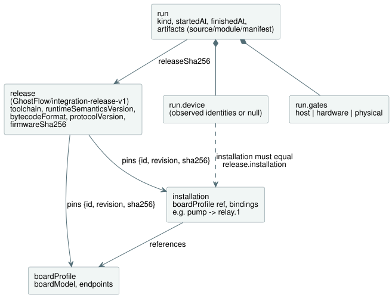
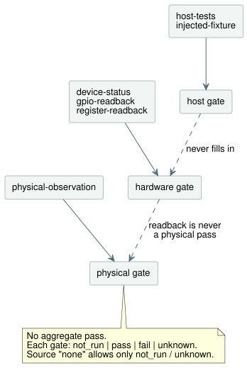

# Integration contract v1

This is a small compatibility and evidence contract for TASK32. It links three
things:

- a pinned **release** of the language, runtime, and device;
- a named **installation** (the site's logical wiring);
- individual **runs** of a program.

The implementation is `tools/integration-contract.mjs`. Its only dependency is
Node's built-in SHA-256 implementation. It performs no file, network, compiler,
LLM, runtime, serial, or GPIO operations.

**What `valid: true` means.** The supplied records are structurally consistent,
and the checked identities and hashes agree. Nothing more. It does **not** mean
that:

- a gate passed;
- a device was contacted;
- the program behaves correctly;
- the pinout is electrically safe;
- water was delivered.

A run that recorded `fail` can still be a valid record.

**Installation admission (`assessInstallation`).** This function gives
metadata-only admission for `InstalledControlHost` and
`ProgramReplacementHost`. It returns three fields:

- `metadata`: the unchanged `{valid, errors}` validation result;
- `identity`: the identity of a valid declaration. It pins the release digest
  and the exact source, module, and manifest digests. The release in turn pins
  the profile and the installation mapping. Invalid metadata has
  `identity: null` and cannot be admitted;
- `physical`: an assessment in the existing gate shape.

Before validation and identity calculation, the assessment captures (copies)
the four input records and the module bytes. Inside those records, accessors,
symbol keys, non-enumerable fields, cycles, and non-plain objects produce a
metadata `shape` error. Ordinary extra fields remain subject to the existing
exact-field checks.

The physical gate always has `status: "unknown"`, source type `none`, and a null
reference. Its scope explains that declared polarity and `safeLevel` do not
establish electrical behavior, fail-safe suitability, load compatibility, or
wiring. A Bool output whose type and direction match cannot establish those
facts either. This assessment accepts no physical observation and can never
issue a physical pass. With valid metadata, it does not block compilation,
simulation, or host execution. Independently supplied run evidence (below)
keeps its own validation contract.

The [installed sensor binding host](../../docs/INSTALLED-SENSOR-BINDING.md)
documents the separately versioned `board-profile-v2` input capability and its
executable replacement admission. Existing v1 records keep the contract below.

**Drivers and renderers are roles.** An input **driver** produces logical
inputs. An output **renderer** applies logical output intent to relays, motors,
lamps, or screens. These are roles, not mutually exclusive device classes. A
USB force-feedback joystick has both an input driver and an output renderer; an
EC11 encoder with a TFT screen likewise combines input and output roles. These
examples describe boundaries, not implementations. Ownership is split as
follows:

- Driver and renderer source belongs in `farm-device-drivers`.
- Device owns host/board integration, bindings, clocks, watchdogs, and
  boot/failure policy.
- The cabinet operator UI is `@ghostflow/cabinet-view`. It is distinct from an
  output renderer.

Existing `ScanDriver`, host ABI identifiers, and profile `driver` fields keep
their names and contracts.

## Records and ownership

A **release** contains no program source hash, boot ID, timestamp, or test
result. Those belong to a **run**. A new program or a device reboot can create a
new run while keeping the same release identity. Changing a pinned component,
the profile, or the installation mapping requires a new release digest.

The diagram below shows how the records refer to each other.



| Record / field | Owner and meaning |
| --- | --- |
| `release.schema` | Contract maintainer; exactly `GhostFlow/integration-release-v1`. |
| `release.toolchain.version`, `.sha256` | Language release owner; version and exact distribution/artifact hash, including the compiler dependencies needed to reproduce it. |
| `release.runtimeSemanticsVersion` | Language/runtime owners; identifier of the execution semantics supported by both compiler and runtime. |
| `release.bytecodeFormat` | Language/runtime owners; shared bytecode format identifier. |
| `release.protocolVersion` | API/transport and firmware owners; explicit shared protocol identifier. |
| `release.device.firmwareSha256` | Firmware release owner; SHA-256 of the exact firmware image, independently of the program module. |
| `release.device.boardProfile` | Board integrator; `{id, revision, sha256}` of the approved board profile. |
| `release.installation` | Site/installation owner; `{id, revision, sha256}` of the approved logical mapping. |
| `boardProfile.boardModel`, `.endpoints` | Board integrator; specific board/revision and reviewed channel definitions, based on board documentation and separate physical checks. |
| `installation.boardProfile`, `.bindings` | Site owner; approved profile reference and explicit logical-name-to-endpoint-ID dictionary. |
| `run.releaseSha256`, `.artifacts` | Integration runner; release digest and the exact source/module/manifest digests used for that run. |
| `run.kind` | Evidence producer; `recorded-evidence` or `fictional-fixture`. A fixture label must be retained when sharing examples. |
| `run.startedAt`, `.finishedAt` | Evidence producer; canonical UTC ISO timestamps with milliseconds. |
| `run.device` | Device observation adapter; observed boot ID, observation timestamp, firmware/profile/installation/runtime/protocol identities and source/module hashes, or `null` when unavailable. |
| `run.device.installation` | Device observation adapter; `{id, revision, sha256}` of the mapping actually installed, required whenever `run.device` is non-null and compared to `release.installation`. |
| `run.gates.host`, `.hardware`, `.physical` | Respective test or observation owner; independent status, evidence source/reference, and exact scope of the result. |

**Identifiers and hashes.** Profile and installation IDs and revisions are
nonempty strings. The release pins their digests as well as their names. Every
SHA-256 field is 64 lowercase hex characters. Version identifiers are compared
exactly: the validator never guesses compatibility from semver ranges or board
family names.

**Board endpoints.** Each endpoint has these fields:

- `direction`: `input` or `output`;
- `type`: the manifest's semantic type;
- `driver` and `address`: explicit, profile-owned identifiers. Duplicate
  `driver`/`address` pairs are rejected;
- `activeLevel`: `high` or `low`;
- `safeLevel`: numeric `0` or `1`.

This v1 profile supports digital electrical endpoints and explicit logical
endpoints for software inputs. It does not model analog circuitry. Reserved pins
should not appear as usable endpoints. Address strings are opaque to this
validator; their meaning remains the profile integrator's responsibility.

**Bindings.** Bindings are a dictionary such as `{ "pump": "relay.1" }` — never
an array or an inline pin assignment. The rules are:

- Every `manifest.inputs`/`manifest.outputs` entry needs a binding with the
  exact name, a matching direction, and a matching semantic type.
- Declaration order has no effect.
- Extra site bindings may stay unused by a program.
- Aliasing one endpoint under several logical names is rejected in v1.
- Generated clocks, sensors, and other runtime-provided inputs remain the
  runtime's responsibility. The validator derives no new inputs and generates no
  control logic.

**Software inputs need no physical channel.** Not every declared input needs a
physical DI (digital input) channel. For example, a software `start` input can
bind to the explicit endpoint ID `command.start`, declared in the pinned profile
as `{direction: "input", type: "Bool", driver: "software-input", address:
"commands/start", activeLevel: "high", safeLevel: 0}`. Here `driver` and
`address` identify a logical input. `activeLevel` and `safeLevel` describe its
Boolean convention and default — not an electrical pin or pull configuration.
The runtime adapter owns how the software input is supplied. This mapping still
needs explicit names, matching types and directions, and profile/installation
digests. The validator never assigns a DI pin to it.

**What the metadata checks catch, and what they cannot.**

- Replacing `relay.1` with an undeclared `GPIO7` fails.
- Changing a profile endpoint from an expander channel to a generic GPIO changes
  the profile digest, so it fails against the pinned release.
- A profile that is consistently wrong can still pass these metadata checks.
  Profile review and electrical testing remain independent gates, and software
  readback cannot establish that an installed load is correct.

## Evidence rules

Each gate has exactly the shape `{status, source: {type, reference}, scope}`.
The three gates (`host`, `hardware`, `physical`) are mandatory and independent.
There is no aggregate board or physical pass.

| Status | Meaning |
| --- | --- |
| `not_run` | No test was performed; source must be `none`, reference `null`. |
| `pass` | The stated scope passed according to its explicit evidence source. |
| `fail` | The stated scope failed according to its explicit evidence source. |
| `unknown` | Available information cannot establish the result; no conversion to pass. |

| Gate | Permitted source types besides `none` |
| --- | --- |
| `host` | `host-tests`, `injected-fixture` |
| `hardware` | `device-status`, `gpio-readback`, `register-readback` |
| `physical` | `physical-observation` |

Each gate accepts only its own source types, and evidence never flows from one
gate into another, as the diagram shows.



**Gate rules.**

- `pass` and `fail` require a source and a nonempty record reference.
- Source `none` permits only `not_run` and `unknown`.
- A nonempty `scope` is always required.
- A hardware or physical `pass` also requires a device observation linked to the
  release and artifacts.
- Disconnect or failure evidence may exist with a null device identity and a
  `fail`/`unknown` hardware status.
- The reference is a producer-owned record ID or path. This module neither opens
  it nor authenticates its contents.

**No promotion between gates.**

- A host pass never fills in hardware or physical statuses.
- GPIO, register, or device readback can never be the source of a physical
  pass.
- A physical observation must say what was observed. Terminal voltage, LED
  state, contact state, and delivered water are distinct claims.
- Even an accepted `physical-observation` record is only a declaration here.
  This validator cannot verify that it is true or infer wider behavior.
- On active-low channels, logical output and electrical level must not be
  compared as if they were the same value.

**Device observation.** The device observation carries `bootId`, `observedAt`,
`firmwareSha256`, `boardProfile: {id, revision, sha256}`,
`installation: {id, revision, sha256}`, `runtimeSemanticsVersion`,
`bytecodeFormat`, `protocolVersion`, `sourceSha256`, and `moduleSha256`. Its
rules are:

- Its timestamp must lie within the run.
- Installation identity is mandatory whenever the device record exists,
  regardless of gate statuses.
- All three installation fields must match `release.installation`. Unchanged
  firmware, profile, and program hashes cannot hide a different installed
  mapping.
- Identity comparisons use observed values supplied by the adapter. They must
  not be copied from the expected release values and presented as observed.

The current POC protocol may need an explicit adapter or capability extension
before it can provide every field. Missing observations are never guessed. This
contract does not modify that protocol or implement firmware attestation.

## Hashes and pure API

The contract uses two hash helpers.

**`sha256(textOrBytes)`** hashes exact UTF-8 source text or
`Uint8Array`/`Buffer` bytes. It never appends a newline or normalizes Unicode or
line endings. The run's `moduleSha256` is the same hash that the current
compiler and serial protocol call `bytecodeSha256`. The supplied manifest's
`bytecodeSha256` must match the module bytes.

**`jsonSha256(json)`** sorts object keys recursively, keeps array order and
string contents, and hashes compact JSON encoded as UTF-8. It accepts only
finite JSON data; undefined values and cycles are rejected. Use this
contract-local encoding for profile, mapping, manifest, and release metadata
digests. Source, module, firmware, and toolchain artifact hashes always use the
exact artifact bytes.

```js
import {
  validateReleaseIdentity, validateRunEvidence, validateIntegration,
} from './tools/integration-contract.mjs';

const artifacts = { source, module: compiled.bytes, manifest: compiled.manifest };
const releaseCheck = validateReleaseIdentity(release, { boardProfile, installation });
const runCheck = validateRunEvidence(runEvidence, { release, artifacts });
const allChecks = validateIntegration({
  release, boardProfile, installation, artifacts, runEvidence,
});
// Each result: { valid: boolean, errors: [{ path, code, message }] }
```

The three validators divide the work:

| Function | What it checks |
| --- | --- |
| `validateReleaseIdentity` | The supplied profile/mapping content and their pinned references. |
| `validateRunEvidence` | Run declarations and artifact bytes against a supplied release. It assumes the profile/mapping contents are checked separately. |
| `validateIntegration` | Both of the above, plus the manifest name bindings. Omit `runEvidence` (or pass null) for metadata/artifact-only validation. |

The validators create no gate defaults, resolve no physical channels, and return
no execution claims. They do not mutate their inputs. Validation errors come in
a deterministic order. The hash helpers throw `TypeError` for unsupported
inputs; the validators return error records instead.

**What this contract does not do.** The existing `compileSource` owns language
parsing, semantics, module generation, and manifest generation. Runtime
implementations own execution, timers, schedules, and behavior tests. This
contract only hashes their outputs and compares declared identities. It does
not:

- recompile source to prove that source and module correspond;
- inspect firmware binaries;
- infer GPIOs;
- duplicate runtime behavior;
- deploy bindings.

A future adapter must explicitly consume the validated mapping and record the
binding actually installed.

Frontend/API build versions can be added by an outer integration BOM (bill of
materials) that references the release digest. They need not be mandatory
fields in this language/device contract. Moving these files into the language
repository requires only the validator, this directory, and its dedicated test;
no POC imports or submodules are needed.

## Fictional example and regression tests

`examples/fictional-fixture.json` is a complete, fictional set of linked
records. The module bytes and source are deliberately non-executable. Toolchain
and firmware hashes are illustrative identifiers, while the metadata, source,
and module digests are internally consistent. When you use the API, decode
`artifacts.moduleHex` to bytes and pass it as `artifacts.module` (hex is only
the JSON fixture encoding).

The tests use only this fixture. They call no board, LLM, compiler, or live HTTP
service, and they generate no evidence files. Run only:

```sh
node --test tests/integration-contract.test.mjs
```

The tests cover:

- wrong boards and profiles;
- generic GPIO substitution;
- mapping drift;
- declaration-order independence;
- mismatched artifacts;
- mismatched observed identities;
- the prohibition on promoting host or readback evidence into a physical pass.

These tests establish contract behavior only.
