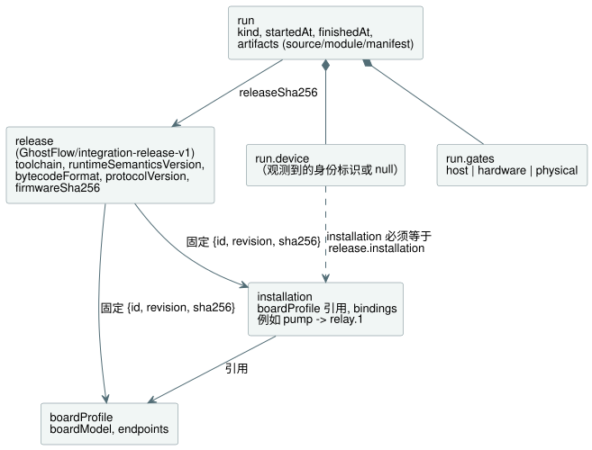
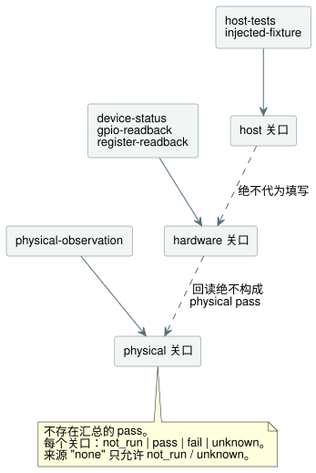

<!-- translation-source: contracts/integration-v1/README.md -->
[英文原文](README.md)

# 集成契约 v1

这是为 TASK32 制定的一份小型兼容性与证据契约。它把以下三者关联起来：

- 语言、运行时和设备的一个固定（pinned）**release**；
- 一个具名的 **installation**（现场的逻辑接线）；
- 某个程序的各次**运行（run）**。

实现位于 `tools/integration-contract.mjs`。它唯一的依赖是 Node 内置的 SHA-256 实现。它不执行任何文件、网络、编译器、LLM、运行时、串口或 GPIO 操作。

**`valid: true` 的含义。** 所提供的记录在结构上一致，且被检查的身份标识与哈希相互吻合。仅此而已。它**并不**意味着：

- 某个关口（gate）已通过；
- 已经连接过某台设备；
- 程序行为正确；
- 引脚分配在电气上是安全的；
- 水确实已经送达。

记录了 `fail` 的运行仍然可以是一条有效的记录。

**installation 准入（`assessInstallation`）。** 该函数为 `InstalledControlHost` 和 `ProgramReplacementHost` 提供仅基于元数据的准入。它返回三个字段：

- `metadata`：未经改动的 `{valid, errors}` 校验结果；
- `identity`：有效声明的身份标识。它固定 release 摘要以及确切的 source、module 和 manifest 摘要；release 又进一步固定 profile 和 installation 映射。无效的元数据其 `identity: null`，不能被准入；
- `physical`：采用现有关口结构的一项评估。

在校验和计算身份标识之前，评估会捕获（复制）四条输入记录和模块字节。在这些记录内部，访问器（accessor）、symbol 键、不可枚举字段、循环引用以及非普通对象都会产生元数据 `shape` 错误。普通的多余字段仍受现有的精确字段检查约束。

physical 关口始终为 `status: "unknown"`、来源类型 `none`，引用为 null。其 scope 说明：声明的极性和 `safeLevel` 并不能确立电气行为、故障安全适用性、负载兼容性或接线。类型和方向都匹配的 Bool 输出同样无法确立这些事实。该评估不接受任何物理观测，永远不会给出 physical pass。在元数据有效时，它不会阻止编译、仿真或宿主执行。独立提供的运行证据（见下文）保持其自身的校验契约。

[已安装传感器绑定宿主](../../docs/INSTALLED-SENSOR-BINDING.zh.md)记录了单独版本化的 `board-profile-v2` 输入能力及其可执行替换准入。现有的 v1 记录仍遵循下文的契约。

**驱动程序和渲染器是角色。** 输入**驱动程序（driver）**产生逻辑输入。输出**渲染器（renderer）**把逻辑输出意图施加到继电器、电机、指示灯或屏幕上。它们是角色，而不是互斥的设备类别。USB 力反馈摇杆同时具有输入驱动程序和输出渲染器；带 TFT 屏幕的 EC11 编码器同样兼具输入和输出两种角色。这些例子描述的是边界，而不是实现。职责划分如下：

- 驱动程序和渲染器的源码属于 `farm-device-drivers`。
- Device 负责宿主/板卡集成、绑定、时钟、看门狗以及启动/故障策略。
- 控制柜操作员 UI 是 `@ghostflow/cabinet-view`，它不同于输出渲染器。

现有的 `ScanDriver`、宿主 ABI 标识符以及 profile 中的 `driver` 字段保持原有名称和契约。

## 记录与归属

**release** 不包含程序源码哈希、启动 ID、时间戳或测试结果，这些属于 **run**。新的程序或设备重启可以产生新的 run，同时保持相同的 release 身份标识。更改某个固定的组件、profile 或 installation 映射则需要新的 release 摘要。

下图展示了各记录之间的引用关系。



| 记录 / 字段 | 归属方与含义 |
| --- | --- |
| `release.schema` | 契约维护者；必须恰好为 `GhostFlow/integration-release-v1`。 |
| `release.toolchain.version`, `.sha256` | 语言发布负责人；版本号以及确切的发行包/制品哈希，包括复现所需的编译器依赖。 |
| `release.runtimeSemanticsVersion` | 语言/运行时负责人；编译器和运行时共同支持的执行语义标识符。 |
| `release.bytecodeFormat` | 语言/运行时负责人；共享的字节码格式标识符。 |
| `release.protocolVersion` | API/传输层和固件负责人；明确的共享协议标识符。 |
| `release.device.firmwareSha256` | 固件发布负责人；确切固件镜像的 SHA-256，与程序模块无关。 |
| `release.device.boardProfile` | 板卡集成方；已批准板卡 profile 的 `{id, revision, sha256}`。 |
| `release.installation` | 现场/installation 负责人；已批准逻辑映射的 `{id, revision, sha256}`。 |
| `boardProfile.boardModel`, `.endpoints` | 板卡集成方；具体的板卡/硬件版本以及经过审查的通道定义，依据板卡文档和单独的物理检查。 |
| `installation.boardProfile`, `.bindings` | 现场负责人；已批准的 profile 引用，以及显式的“逻辑名称 → 端点 ID”字典。 |
| `run.releaseSha256`, `.artifacts` | 集成执行方；release 摘要，以及该次运行所用的确切 source/module/manifest 摘要。 |
| `run.kind` | 证据产生方；`recorded-evidence` 或 `fictional-fixture`。分享示例时必须保留 fixture 标签。 |
| `run.startedAt`, `.finishedAt` | 证据产生方；带毫秒的规范 UTC ISO 时间戳。 |
| `run.device` | 设备观测适配器；观测到的启动 ID、观测时间戳、固件/profile/installation/运行时/协议身份标识以及 source/module 哈希；不可用时为 `null`。 |
| `run.device.installation` | 设备观测适配器；实际安装的映射的 `{id, revision, sha256}`。只要 `run.device` 非 null 就必须提供，并与 `release.installation` 比较。 |
| `run.gates.host`, `.hardware`, `.physical` | 各自的测试或观测负责人；独立的状态、证据来源/引用，以及结果的确切范围。 |

**标识符与哈希。** profile 和 installation 的 ID 与修订版都是非空字符串。release 除固定它们的名称外，也固定它们的摘要。每个 SHA-256 字段都是 64 个小写十六进制字符。版本标识符按精确值比较：校验器绝不会根据 semver 范围或板卡系列名称猜测兼容性。

**板卡端点。** 每个端点具有以下字段：

- `direction`：`input` 或 `output`；
- `type`：manifest 中的语义类型；
- `driver` 和 `address`：由 profile 拥有的显式标识符。重复的 `driver`/`address` 组合会被拒绝；
- `activeLevel`：`high` 或 `low`；
- `safeLevel`：数值 `0` 或 `1`。

这一 v1 profile 支持数字电气端点，以及用于软件输入的显式逻辑端点。它不对模拟电路建模。保留引脚不应作为可用端点出现。地址字符串对本校验器而言是不透明的，其含义仍由 profile 集成方负责。

**绑定。** 绑定是一个字典，例如 `{ "pump": "relay.1" }`——绝不是数组或内联引脚分配。规则如下：

- 每个 `manifest.inputs`/`manifest.outputs` 条目都需要一个名称完全相同、方向匹配且语义类型匹配的绑定。
- 声明顺序没有影响。
- 现场的额外绑定可以不被程序使用。
- 在 v1 中，用多个逻辑名称为同一端点起别名会被拒绝。
- 生成的时钟、传感器以及其他由运行时提供的输入仍由运行时负责。校验器不会推导新的输入，也不会生成控制逻辑。

**软件输入不需要物理通道。** 并非每个声明的输入都需要物理 DI（数字输入）通道。例如，软件 `start` 输入可以绑定到显式端点 ID `command.start`，该端点在固定的 profile 中声明为 `{direction: "input", type: "Bool", driver: "software-input", address:
"commands/start", activeLevel: "high", safeLevel: 0}`。这里的 `driver` 和 `address` 标识一个逻辑输入；`activeLevel` 和 `safeLevel` 描述其布尔约定和默认值——而不是电气引脚或上拉/下拉配置。如何提供该软件输入由运行时适配器负责。这种映射仍然需要显式名称、匹配的类型和方向，以及 profile/installation 摘要。校验器绝不会为它分配 DI 引脚。

**元数据检查能发现什么，不能发现什么。**

- 把 `relay.1` 替换为未声明的 `GPIO7` 会失败。
- 把某个 profile 端点从扩展板通道改为通用 GPIO 会改变 profile 摘要，因此与固定的 release 比对时会失败。
- 一个始终如一地错误的 profile 仍可能通过这些元数据检查。profile 审查和电气测试仍是独立的关口，软件回读也无法确立所安装的负载是否正确。

## 证据规则

每个关口的结构恰好为 `{status, source: {type, reference}, scope}`。三个关口（`host`、`hardware`、`physical`）都是必需的，且相互独立。不存在汇总的板卡 pass 或 physical pass。

| 状态 | 含义 |
| --- | --- |
| `not_run` | 未执行测试；source 必须为 `none`，reference 为 `null`。 |
| `pass` | 按其显式证据来源，所述范围已通过。 |
| `fail` | 按其显式证据来源，所述范围未通过。 |
| `unknown` | 现有信息无法确立结果；不会被转换为 pass。 |

| 关口 | 除 `none` 外允许的来源类型 |
| --- | --- |
| `host` | `host-tests`, `injected-fixture` |
| `hardware` | `device-status`, `gpio-readback`, `register-readback` |
| `physical` | `physical-observation` |

如下图所示，每个关口只接受自己的来源类型，证据绝不会从一个关口流入另一个关口。



**关口规则。**

- `pass` 和 `fail` 需要一个来源和一个非空的记录引用。
- 来源 `none` 只允许 `not_run` 和 `unknown`。
- 始终需要非空的 `scope`。
- hardware 或 physical 的 `pass` 还需要一条与 release 和制品相关联的设备观测。
- 断连或故障证据可以在设备身份标识为 null、hardware 状态为 `fail`/`unknown` 的情况下存在。
- reference 是由证据产生方拥有的记录 ID 或路径。本模块既不打开它，也不验证其内容的真实性。

**关口之间不得升级。**

- host pass 绝不会代为填写 hardware 或 physical 状态。
- GPIO、寄存器或设备回读永远不能作为 physical pass 的来源。
- 物理观测必须说明观测到了什么。端子电压、LED 状态、触点状态和送达的水是不同的声明。
- 即便是被接受的 `physical-observation` 记录，在这里也只是一项声明。本校验器无法验证其真实性，也无法推断更广泛的行为。
- 在低电平有效的通道上，不得把逻辑输出和电气电平当作同一个值来比较。

**设备观测。** 设备观测携带 `bootId`、`observedAt`、`firmwareSha256`、`boardProfile: {id, revision, sha256}`、`installation: {id, revision, sha256}`、`runtimeSemanticsVersion`、`bytecodeFormat`、`protocolVersion`、`sourceSha256` 和 `moduleSha256`。其规则为：

- 其时间戳必须落在该次运行的时间范围内。
- 只要设备记录存在，installation 身份标识就是必需的，与各关口状态无关。
- installation 的三个字段都必须与 `release.installation` 一致。固件、profile 和程序哈希不变，也无法掩盖一个不同的已安装映射。
- 身份标识比较使用适配器提供的观测值。不得从预期的 release 值中复制并冒充为观测值。

当前的 POC 协议可能需要显式的适配器或能力扩展，才能提供全部字段。缺失的观测绝不会被猜测。本契约不修改该协议，也不实现固件证明（attestation）。

## 哈希与纯 API

本契约使用两个哈希辅助函数。

**`sha256(textOrBytes)`** 对确切的 UTF-8 源文本或 `Uint8Array`/`Buffer` 字节求哈希。它绝不追加换行符，也不规范化 Unicode 或行尾。run 的 `moduleSha256` 与当前编译器和串口协议所称的 `bytecodeSha256` 是同一个哈希。所提供 manifest 的 `bytecodeSha256` 必须与模块字节一致。

**`jsonSha256(json)`** 递归地对对象键排序，保留数组顺序和字符串内容，并对以 UTF-8 编码的紧凑 JSON 求哈希。它只接受有限的 JSON 数据；undefined 值和循环引用会被拒绝。profile、映射、manifest 和 release 元数据的摘要使用这种契约内的编码。source、module、固件和工具链制品的哈希始终使用确切的制品字节。

```js
import {
  validateReleaseIdentity, validateRunEvidence, validateIntegration,
} from './tools/integration-contract.mjs';

const artifacts = { source, module: compiled.bytes, manifest: compiled.manifest };
const releaseCheck = validateReleaseIdentity(release, { boardProfile, installation });
const runCheck = validateRunEvidence(runEvidence, { release, artifacts });
const allChecks = validateIntegration({
  release, boardProfile, installation, artifacts, runEvidence,
});
// Each result: { valid: boolean, errors: [{ path, code, message }] }
```

三个校验器的分工如下：

| 函数 | 检查内容 |
| --- | --- |
| `validateReleaseIdentity` | 所提供的 profile/映射内容及其固定引用。 |
| `validateRunEvidence` | 对照所提供的 release，检查运行声明和制品字节。它假定 profile/映射内容已另行检查。 |
| `validateIntegration` | 以上两者，再加上 manifest 名称绑定。若只做元数据/制品校验，可省略 `runEvidence`（或传入 null）。 |

这些校验器不创建关口默认值、不解析物理通道，也不返回任何执行声明。它们不会修改输入。校验错误按确定的顺序给出。哈希辅助函数对不支持的输入抛出 `TypeError`；校验器则改为返回错误记录。

**本契约不做什么。** 现有的 `compileSource` 负责语言解析、语义、模块生成和 manifest 生成。运行时实现负责执行、定时器、调度计划和行为测试。本契约只对它们的输出求哈希并比较声明的身份标识。它不会：

- 重新编译源码来证明源码与模块相对应；
- 检查固件二进制文件；
- 推断 GPIO；
- 重复实现运行时行为；
- 部署绑定。

将来的适配器必须显式地使用经过校验的映射，并记录实际安装的绑定。

前端/API 的构建版本可以由引用 release 摘要的外层集成 BOM（物料清单）添加，不必成为本语言/设备契约中的必需字段。把这些文件迁移到语言仓库只需要校验器、本目录及其专用测试；不需要任何 POC 导入或子模块。

## 虚构示例与回归测试

`examples/fictional-fixture.json` 是一组完整的、虚构的关联记录。其中的模块字节和源码被刻意设计为不可执行。工具链和固件哈希只是示意性标识符，而元数据、source 和 module 摘要在内部是一致的。使用 API 时，请把 `artifacts.moduleHex` 解码为字节，并作为 `artifacts.module` 传入（十六进制只是 JSON fixture 的编码方式）。

测试只使用这个 fixture。它们不调用任何板卡、LLM、编译器或在线 HTTP 服务，也不生成证据文件。只需运行：

```sh
node --test tests/integration-contract.test.mjs
```

测试覆盖：

- 错误的板卡和 profile；
- 通用 GPIO 替换；
- 映射漂移；
- 与声明顺序无关；
- 不匹配的制品；
- 不匹配的观测身份标识；
- 禁止把 host 证据或回读证据升级为 physical pass。

这些测试只确立契约行为。
