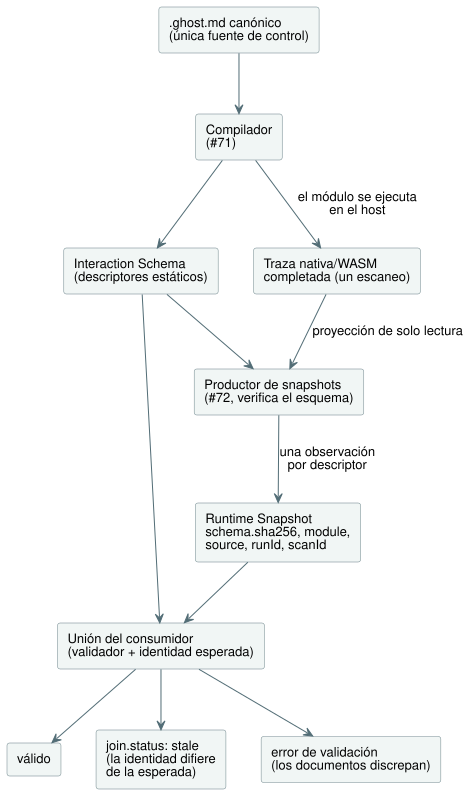

<!-- translation-source: contracts/interaction-v0/README.md -->
[Original en inglés](README.md)

# Interaction Schema y Runtime Snapshot v0

Este contrato es un límite de **software del host** para `GF-IR-1`/TASK-121.1.
Es neutral respecto de cualquier vista de gabinete (cabinet view). Define dos
documentos separados:

- el **Interaction Schema**: descriptores semánticos estáticos de los valores
  observables de un control compilado;
- el **Runtime Snapshot**: una observación completada en tiempo de ejecución de
  esos valores.

La emisión del esquema por parte del compilador está implementada en #71. #72
proyecta en snapshots únicamente trazas nativas o WASM ya completadas, mediante
`tools/interaction-runtime-snapshot.mjs`. Ese adaptador nunca evalúa un
escaneo, no realiza E/S ni cambia las salidas solicitadas (requested) ni las
seguras (safe).

El diagrama siguiente muestra de dónde proviene cada documento y cómo los une
un consumidor.



**Formatos y versiones.** `GhostFlow/interaction-schema-v0` y
`GhostFlow/runtime-snapshot-v0` llevan cada uno su propia `version`. Una
versión es una etiqueta de compatibilidad, no la identidad de una instancia
exacta del esquema. Para eso, un snapshot también lleva, en
`snapshot.schema.sha256`, el SHA-256 del JSON canónico del esquema estático.
Los consumidores deben unir ese digest, el formato y la versión con el
documento estático que recibieron.

**El digest del esquema.** El digest es el SHA-256 de los bytes UTF-8
producidos por
`canonicalJson(schema, {rejectSparseArrays: true, rejectUnsafeIntegers: true})`
de este repositorio. En concreto, la codificación:

- ordena recursivamente las claves de cada objeto plano según el orden de
  unidades de código UTF-16 de ECMAScript;
- conserva el orden de los elementos de los arreglos;
- codifica las cadenas con `JSON.stringify` de ECMAScript, tras rechazar el
  Unicode mal formado;
- codifica los booleanos y null como sus literales JSON;
- codifica los números IEEE-754 finitos con la grafía de `JSON.stringify` de
  ECMAScript (incluido `-0` como `0`), rechazando los enteros no seguros;
- no emite espacios en blanco;
- rechaza los arreglos dispersos, los objetos no planos, los números no finitos
  y un anidamiento de más de 64 niveles.

Los consumidores comparan el digest suministrado. Un productor escrito en otro
lenguaje debe reproducir exactamente estos bytes antes de poder emitir un
snapshot coincidente. No basta con que coincida la versión del formato.

## Esquema estático

**Identidades fijadas.** El esquema fija una identidad de `module` y una
identidad del documento fuente:

| Campo | Significado |
| --- | --- |
| `module.id` | La identidad pública del módulo de control. |
| `module.moduleFingerprint` | La huella de traza estable de 16 caracteres hexadecimales del módulo compilado, generada por el compilador. |
| `module.bytecodeSha256` | El SHA-256 en minúsculas del bytecode del manifiesto emitido. |
| `source.documentId` | Una identidad pública opaca, estable entre revisiones de un mismo documento escrito. |
| `source.revisionId` | Una identidad opaca e inmutable de una revisión canónica almacenada. |
| `source.format`, `source.kind` | El formato y el tipo de la fuente (véase más abajo). |
| `source.sha256` | El SHA-256 en minúsculas de los bytes de fuente UTF-8 de esa revisión. |

La huella y el digest del artefacto son distintos, y ambos son obligatorios.
Ninguna de las identidades de la fuente es una ruta, por lo que también admiten
documentos guardados en una conversación o en un almacenamiento de revisiones.
La ruta del fixture en el repositorio pertenece solo a su arnés de pruebas.

**Solo fuente literaria.** `source.kind` es exactamente `literate`. La fuente
canónica de GhostFlow, escrita, revisada y versionada, es el documento
literario (literate). La entrada del producto y del compilador es únicamente
`.ghost.md` canónico. El código plano se rechaza; no puede ser una alternativa
admitida de autoría, importación, artefacto ni Interaction Schema.

**Descriptores.** Todo descriptor tiene:

- un `id` y un `name` públicos, estables y definidos por el autor;
- un `kind` semántico;
- un `sourceType` semántico del compilador/fuente;
- un `access` explícito;
- procedencia.

v0 permite los tipos `state`, `timer` y `counter`, y, en el perfil de ajustes
descrito más abajo, `setting`. Todos los tipos tienen exactamente el acceso
`["read"]`: todos son valores solo de observación. Los comandos, las entradas,
los eventos, las alarmas y las explicaciones son trabajo posterior a cargo de
#70. Este contrato no concede acceso `write` ni `execute` antes de que existan
esos diseños.

Un **contador** (counter) es un estado `Int` definido por el autor cuyo enlace
literario existente lleva `meaning=counter`. El significado de contador nunca
se deduce de un `Int` sin anotar, de un `Number` arbitrario, de un valor de
runtime con aspecto de entero ni de un nombre. Por ello, la procedencia de un
contador conserva el tipo de nodo fuente `state` definido por el autor.

**Tipos de fuente.** `sourceType` lleva un tipo `builtin` (`Bool`, `Int`,
`Number` o `Duration`) o un tipo `nominal` con nombre y su unidad semántica. La
grafía JSON del runtime nunca selecciona el tipo: `0` es un `Number` o una
`Duration` solo porque el descriptor estático indica cuál.

**Enumeraciones.** Para una enumeración (enum) declarada en el compilador, el
`sourceType` nominal también lleva la tabla exacta
`enumMembers: [{"name":"Idle","value":0}, ...]`, en orden de declaración. El
ordinal es explícito, único y empieza en cero. Los demás tipos nominales no
tienen `enumMembers`. Una observación de enumeración lista (ready) debe
coincidir con un ordinal declarado; un valor desconocido es un error, nunca un
nombre adivinado. La tabla forma parte del digest del esquema y de la unión de
identidad fuente/revisión. La versión `0.2` del esquema añade este campo; el
runtime snapshot se mantiene en la versión `0.1`.

**Etiquetas de visualización de enumeraciones.** La versión `0.3` del esquema
añade a cada miembro de la enumeración un `displayLabel` opcional en texto
plano. Se define en el bloque de control del `.ghost.md` canónico:

```ghost
type Phase = Idle { label = "대기"; } | Running;
```

El primer miembro emitido es `{"name":"Idle","value":0,"displayLabel":"대기"}`.
Los miembros sin etiqueta omiten `displayLabel`; los consumidores muestran
`displayLabel ?? name`. Las reglas de las etiquetas son:

- Una etiqueta es metadato de presentación para consumidores web, HMI y
  móviles. No cambia la identidad de la enumeración, el ordinal, el significado
  del control, los bytes GFB ni la ABI de la VM.
- Las etiquetas usan las reglas existentes de escape de cadenas JSON y admiten
  Unicode.
- Las etiquetas vacías o formadas solo por espacios en blanco, las entradas
  `label` duplicadas y otras opciones de miembro son errores del compilador.
- Los consumidores representan las etiquetas como texto, nunca como marcado.
- Las etiquetas forman parte del digest exacto del esquema, por lo que editar
  una etiqueta requiere una revisión de fuente y una identidad de snapshot
  coincidentes.
- La versión del runtime snapshot sigue siendo `0.1`; los valores de
  observación en tiempo de ejecución siguen siendo ordinales numéricos.
- La composición de enumeraciones importadas sigue sin admitirse y conserva su
  diagnóstico existente.

**Controles sin estado.** Un control sin estado válido tiene un esquema
identificado con `descriptors: []`. Esto significa que la revisión literaria
exacta y el módulo compilado no tienen ningún estado ni temporizador público
que observar. No significa que falte el esquema, la identidad de la fuente ni
la identidad del módulo. El snapshot completado correspondiente tiene
`observations: []` y sigue llevando el digest exacto del esquema y las
identidades de módulo, fuente, ejecución y escaneo completado. Los productores
no deben inventar un estado booleano ni un temporizador solo para que un
control directo de entrada a salida sea observable.

**Enlaces de procedencia.** Todo descriptor también nombra su ID de nodo
positivo del mapa de fuentes del compilador y al menos un ancla de intención
literaria. Los ID y nombres de descriptores y los ID de anclas son públicos, y
rechazan el prefijo reservado `__gf_`. Los ID de nodo del mapa de fuentes son
procedencia numérica del compilador, nunca nombres generados de ranuras de la
VM. La prueba del fixture verifica que cada enlace de nodo/tipo y de ancla
registrado existe para esta revisión exacta de la fuente. La emisión de
descriptores por parte del compilador está implementada en #71. Antes de emitir
un snapshot público, la proyección en tiempo de ejecución reconstruye y
verifica ese esquema exacto a partir del artefacto literario canónico
compilado.

**Temporizadores de tiempo transcurrido.** `timer.age` representa
`elapsed(watering)` como:

```json
{"kind":"elapsed_since_change","subjectId":"state.watering"}
```

- Para un sujeto Bool como `watering`, es el tiempo transcurrido desde el
  último cambio del Bool, **no** la duración acumulada activa/encendida. Un
  control que usa el temporizador solo mientras el Bool es verdadero puede
  interpretar esa antigüedad como una duración activa, pero el temporizador en
  sí mide la antigüedad desde cualquiera de las dos transiciones.
- Para un sujeto de enumeración nominal como `Phase`, `elapsed(phase)` es la
  antigüedad de la fase. Se reinicia cada vez que cambia el valor de la
  enumeración y sigue avanzando sea cual sea la fase actual.
  `examples/enum-phase-age.ghost.md` y sus pruebas específicas de
  compilador/WASM muestran que el estado sigue siendo el nominal `Phase`,
  mientras que el temporizador es una `Duration` cuyo sujeto es `state.phase`.

**Sin política de presentación.** El esquema no tiene campos de widget,
diseño, visibilidad, color, coordenadas ni política de cabinet-view. Una vista
de gabinete puede, por ejemplo, mostrar los temporizadores y ocultar los
estados booleanos de forma predeterminada, pero esa política no forma parte de
esta IR.

### Perfil compuesto 0.5

Un Interaction Schema solicitado explícitamente usa la versión `0.5` cuando el
cierre de fuentes canónico contiene instancias; la versión de su snapshot es
`0.3`. Las formas del esquema independiente `0.3`/`0.4` y del snapshot
`0.1`/`0.2` no cambian.

**Identidad de la composición.** Ambos documentos compuestos llevan
`composition.sourceClosureSha256` y `composition.instances`. Cada entrada de
instancia vincula una ruta de instancia definida por el autor con el
`filename`, la `revision` y el `sha256` de su definición. El digest del cierre
cubre el JSON exacto del cierre canónico, incluidos los documentos de
dependencias fijados y las instancias.

**Direccionamiento.** Un descriptor se direcciona mediante el par
`(instance, id)`:

- `instance` es una ruta definida por el autor, como `east.cell`, o `null` para
  la raíz.
- `id` y `name` conservan su grafía local definida por el autor, de modo que
  tanto `east` como `west` pueden exponer `setting.duration`.
- Las observaciones llevan la misma `instance` junto con el `descriptorId`
  local.
- `provenance.sourceNode` conserva el `id` aplanado del compilador, el
  `definitionNodeId` original, el `kind` de la declaración y el intervalo
  `source` del documento original (`filename`, `line`, `column`, `endLine`,
  `endColumn`).
- `provenance.intentAnchors` contiene referencias `{instance, anchorId}`. Los
  ID de ancla idénticos en definiciones o instancias distintas siguen siendo
  distintos.
- Los temporizadores de tiempo transcurrido usan
  `operation.subject: {instance, descriptorId}`; los temporizadores continuos
  conservan su `subjectNodeId` aplanado.
- Los nombres del compilador y las ranuras de almacenamiento de los
  temporizadores son privados.

**Verificación y ajustes.** La emisión y la restauración recompilan el cierre
canónico exacto antes de aceptar su mapa de fuentes, sus metadatos de traza, su
manifiesto o la procedencia de sus descriptores. El productor de runtime posee
copias de esas entradas verificadas. La unión de identidad de un consumidor
incluye el digest del cierre, además de las identidades de esquema, módulo,
fuente y ejecución. Todo snapshot compuesto lleva `settingsRevision` (cero
cuando no hay ajustes). Los ajustes conservan la semántica existente de Rust
para `defaultValue`, `emissionRevision`, `applicationPosition`, `override` y el
Result de éxito/fallo. No hay un contador de revisiones separado por instancia.

**Integración con el host.** `TemporarySettingsHost` prepara un productor para
un artefacto que contiene un Interaction Schema.

- Cada paso aceptado publica `observation: {snapshot, error}` a partir de su
  propio resultado completado en tiempo de ejecución y de los ajustes efectivos
  de Rust.
- `interactionSnapshot()` lee una copia de la observación más reciente. Nunca
  ejecuta un tick.
- `interactionIdentity` devuelve la identidad de unión esperada del host.
- En la entrada heredada `framed: false`, una proyección usa como `scanId` la
  posición existente de paso aceptado del host menos uno, y el tiempo del
  paquete aceptado capturado. La entrada con tramas (framed) usa la identidad
  de trama completada del runtime.
- Si la proyección falla después del despacho, el paso sigue aceptado y el
  host registra `completed-scan-observation-failed` con un snapshot de
  observación nulo. Esto no deshace el historial de ajustes ni hace que el
  evento pueda reintentarse.

El adaptador de bajo nivel de trazas completadas sigue confiando en que quien lo
llama suministre un único registro coincidente de ejecución/escaneo/ajustes. La
validación del contenido no puede autenticar la titularidad real del runtime.

**Corpus y límites.** `examples/composed-v0.5.json` es el corpus versionado de
fuente/cierre/esquema/snapshot. `verifyComposedInteractionCorpus` reconstruye
su procedencia estática, y `tests/composed-interaction.test.mjs` reproduce sus
escaneos en el host real. Este perfil no añade titularidad de
instalación/vinculación ni explicaciones de salidas compuestas; el adaptador de
explicaciones conserva su protección explícita de no admitido.
Véanse [#290](https://github.com/callin2/ghostflow-language/issues/290) y
[#302](https://github.com/callin2/ghostflow-language/issues/302).

## Runtime snapshot completado y estados

**Qué es un snapshot.** Un snapshot describe exactamente un `completed-scan`.

- `runId` es una época pública opaca que pertenece a la instancia de
  host/runtime. Debe cambiar al reiniciar o al iniciar una nueva ejecución,
  porque la misma fuente puede reiniciarse en `scanId: 0`.
- `completion` indica un `scanId` no negativo y el tiempo lógico en
  milisegundos.
- Un snapshot debe tener exactamente una observación por cada descriptor.
  Cuando no existe ningún valor, lleva una observación `unavailable` explícita;
  omitir la observación no es válido. Por tanto, un esquema sin descriptores
  tiene exactamente cero observaciones.
- v0 no define una identidad de tick separada. El host con tramas es el
  responsable de la identidad de finalización.
- Un control con temporizador también tiene en su traza completada el reloj
  privado generado por el compilador, y el productor exige que ese reloj sea
  igual a `completion.logicalTimeMs`. Un control con solo estado no recibe un
  reloj de temporizador generado únicamente para la observación: basta con su
  trama completada, y no se inventa ningún temporizador público ni privado.

**Producción de un flujo de snapshots.** Para un flujo repetido de escaneos
completados, llame a `prepareCompletedScanSnapshot({ compilation, schema?, runId })`
una vez por artefacto compilado y época de ejecución. Devuelve un productor
congelado `{ schema, expected, emit({ completion, trace, settingsState? }) }`.

- La preparación copia las entradas estáticas del artefacto antes de verificar
  el esquema exacto.
- El esquema devuelto es profundamente inmutable; los metadatos de traza y los
  descriptores de configuración son copias privadas inmutables. Los búferes de
  fuente y de bytes usados solo para la verificación se descartan.
- Las mutaciones posteriores de quien llama, o las ediciones de un snapshot
  anterior, no pueden afectar a emisiones posteriores.
- `expected` se calcula una sola vez, para
  `joinRuntimeSnapshot(schema, snapshot, expected)`.
- Cada `emit` sigue comprobando la finalización, el reloj lógico, la identidad
  del módulo de la traza, los ajustes actuales de Rust, los tipos de las
  observaciones, el contrato de Interaction y la exclusión de nombres
  generados.
- Para recompilar o reiniciar, prepare un nuevo productor con el nuevo ID de
  ejecución.
- Mantenga el productor dentro de su Worker o host; las funciones no son
  contenido transportable.

`emitCompletedScanSnapshot` sigue siendo la forma de un solo uso de la misma
ruta verificada.

**Estados de observación.** Los estados del contenido por observación son
intencionadamente mínimos:

| Estado | Dónde se decide | Campo obligatorio | Significado |
| --- | --- | --- | --- |
| `ready` | productor de snapshots de confianza tras la finalización | `value` | Un valor del tipo semántico del descriptor estático. `false` y `0` son valores, no ausencia. |
| `unavailable` | productor de confianza | `reason` | Esta observación completada no tiene valor. |
| `error` | productor de confianza | `error` | Este descriptor no pudo observarse. |
| `stale` | unión validadora del consumidor | motivos derivados | El snapshot estructuralmente válido difiere de la identidad de esquema, módulo, fuente o ejecución esperada por el consumidor. Nunca se acepta como estado de observación autodeclarado. |

**Versiones del perfil de ajustes.** Los ajustes usan un perfil actualizado de
forma explícita:

| ¿El esquema contiene un descriptor `setting`? | Versión del esquema | Versión del snapshot |
| --- | --- | --- |
| Sí | `0.4` | `0.2` |
| No | `0.3` (exactamente) | `0.1` (exactamente) |

Los snapshots de ajustes anteriores nunca se reinterpretan silenciosamente como
el nuevo perfil.

**Observaciones de ajustes.** Cuando hay observaciones `setting`, el snapshot
también lleva un `settingsRevision` global. Cada observación de ajuste requiere
`defaultValue`, `emissionRevision` y `applicationPosition`; una observación
`ready` también lleva `override`.

- `defaultValue` es el literal estático de la fuente, no un respaldo
  (fallback).
- `emissionRevision` y `applicationPosition` son la revisión de emisión
  aceptada real y la posición del evento para ese ajuste.
- Una observación inicial de la fuente usa la revisión `0`,
  `applicationPosition: null` y `override: false`, y su valor actual debe ser
  igual a `defaultValue`.
- Cualquier emisión correcta aceptada posteriormente, incluso una igual al
  valor predeterminado, usa su revisión/posición posterior y `override: true`.
- Un fallo de ajustes aceptado conserva el fallo como Result actual. Lleva los
  mismos campos de procedencia excepto `override`, que es exclusivo de `ready`.
  No expone un `value` correcto anterior ni sintetiza el valor predeterminado
  como valor efectivo.

Los descriptores que no son de ajustes conservan los campos de estado mínimos
originales.

**La unión stale.** El validador informa `join.status: "stale"`, con los
motivos exactos de obsolescencia, solo cuando se suministra una identidad
esperada opcional. La unión esperada puede comparar:

- formato, versión y digest del esquema;
- ID, huella y SHA del bytecode del módulo;
- ID del documento fuente, ID de revisión y SHA;
- ID de ejecución.

`scanId` se excluye deliberadamente: es solo una coordenada de orden dentro de
una ejecución. Una discrepancia entre esquema y snapshot dentro de los propios
documentos es un `error` de validación, no datos obsoletos. Esta distinción
impide que un contenido no confiable se etiquete a sí mismo como stale para
ocultar un fallo de identidad.

## Fixtures y validación

`examples/five-minute-watering.ghost.md` es un fixture literario de riego de
cinco minutos. Sus ejemplos JSON estáticos y dinámicos contienen valores reales
`false` y `0`. Los valores Number y `Percent` se representan mediante
descriptores de estado definidos por el autor (en el segundo programa del
corpus, `examples/multiple-values.ghost.md`; véase más abajo), sin añadir una
representación exacta de contador/`Int`.

`validate.mjs` realiza comprobaciones estrictas de:

- campos desconocidos;
- identidades públicas;
- procedencia;
- tipos semánticos;
- el digest exacto del esquema;
- la identidad estática;
- la finalización;
- la cobertura de descriptores.

Solo valida registros. No hace ninguna afirmación sobre dispositivos, el mundo
físico, el frontend, la emisión del compilador ni la recopilación en tiempo de
ejecución.

## Corpus de conformidad compartido

**Programas.** `examples/corpus.json` fija la revisión canónica de la fuente y
la identidad del módulo compilado para cada caso de prueba.

- El primer caso es el control canónico de riego de cinco minutos. Su intención
  original, el mapeo lógico de equipos y el límite de evidencia solo de
  software están registrados en su `.ghost.md`.
- `examples/multiple-values.ghost.md` es el segundo programa canónico. Tiene dos
  estados Bool definidos por el autor con temporizadores de tiempo
  transcurrido, un estado Number y un estado nominal `Percent`.

Ambos usan sintaxis que el compilador actual acepta; no implican ningún tipo de
descriptor nuevo.

**Cintas de escaneo.** Cada `.scan-tape.json` junto al corpus es un estímulo de
prueba versionado y neutral respecto de cabinet-view.

- Cada trama registra un escaneo completado, el tiempo lógico y cada entrada
  declarada con nombre, en el orden del manifiesto compilado.
- Las ejecuciones tienen valores `runId` distintos y usan valores `scanId`
  contiguos a partir de cero.
- El digest de la cinta es el SHA-256 del JSON canónico estricto del objeto de
  cinta completo, omitiendo el miembro `digest`. Usa el `canonicalJson` de este
  repositorio con rechazo de arreglos dispersos y de enteros no seguros.

Una cinta de entradas es un dato de prueba mantenido, no otra fuente de control
de GhostFlow.

**Verificación del corpus.** `observationExpectations` puede describir un caso
`unavailable` exclusivo del validador. No afirma ninguna observación en tiempo
de ejecución y no se copia al snapshot registrado en el repositorio. El
verificador del corpus:

- compila los bytes exactos del `.ghost.md`;
- comprueba las identidades de fuente, módulo y artefacto;
- valida entradas completas, ID de escaneo contiguos locales a la ejecución y
  un tiempo lógico no decreciente;
- comprueba las proyecciones existentes de esquema/snapshot.

Ejecútelo con `node contracts/interaction-v0/verify-corpus.mjs` o
`node --test tests/interaction-corpus.test.mjs`.

El esquema y el snapshot registrados para el riego de cinco minutos, y
cualquier archivo posterior de esquema, snapshot o GFB, son proyecciones
derivadas. El documento literario sigue siendo la única fuente de control
canónica. El segundo programa no tiene intencionadamente un equivalente
`.ghost` plano mantenido a mano ni un runtime snapshot fabricado.

**Paridad nativo/WASM.** `tests/interaction-runtime-snapshot.test.mjs`
reproduce cada fuente y cinta exactas del corpus mediante el ejecutor nativo
con tramas de release y la ABI WASM con tramas real. Proyecta ambas trazas
completadas y exige snapshots públicos idénticos byte a byte, incluidos los
valores del reloj lógico de los temporizadores. También compara ejecuciones con
la observación desactivada, con lectura en cada escaneo y con lectura por parte
de un consumidor retrasado: la observación no debe alterar el estado
consolidado, las salidas solicitadas ni las salidas seguras. Esto es solo
evidencia nativo/WASM del lado del host. No afirma nada sobre la aceptación en
el navegador, la ejecución en firmware ni el comportamiento de dispositivos
físicos.

**Alternativa rechazada.** v0 rechaza colocar `stale` junto a `ready` en una
observación no confiable. Eso permitiría que la afirmación de un productor
sustituyera la unión de identidad del consumidor. Derivar `stale` durante la
validación mantiene pequeño el documento y hace explícitos los reinicios y las
discrepancias de revisión.

## Validación de la procedencia de los ajustes

**Reglas de valor predeterminado y revisión.** El descriptor de ajuste `0.4`
incluye el `defaultValue` de su fuente canónica.

- El productor compara los valores predeterminados del runtime con el literal
  de configuración compilado, y el validador vincula cada valor predeterminado
  dinámico a ese descriptor estático.
- El `emissionRevision` de una fila no puede superar el `settingsRevision`
  global, y la última revisión global aceptada debe aparecer en al menos una
  fila.
- Las filas de una misma revisión atómica comparten un `applicationPosition`.
- La revisión cero significa el valor inicial correcto de la fuente, nunca un
  fallo ni un historial modificado.
- Las posiciones son locales a la ejecución y no necesitan aumentar tras una
  restauración desde un punto de control (checkpoint).
- La versión 4 del checkpoint de contexto persiste estos campos. Rechaza
  correlaciones incoherentes de valores, historial, asignador y revisiones
  antes de cambiar el nuevo propietario.

**Documentos heredados.** Los documentos de ajustes heredados explícitos con
esquema `0.3` / snapshot `0.1` siguen validándose con sus campos y digest
originales. No hacen nuevas afirmaciones de procedencia y nunca se
reinterpretan como `0.4` / `0.2`; los productores de ajustes nuevos usan el
nuevo perfil. Los documentos que no son de ajustes y los digests históricos
fijados permanecen intactos.

**Pruebas y alcance.** Las pruebas de REF-05-012 usan ejecución nativa real y
ejecución WASM con tramas. Comprueban la paridad completa de
resultado/ajustes/checkpoint, las transacciones rechazadas de permisos y de la
VM, los valores predeterminados de fuente falsificados y la corrupción de la
restauración semántica reparada mediante suma de comprobación. Este es un
contrato de observación de ajustes. No es vinculación ejecutable de
descriptores, autorización de mutaciones, emisión de identidades de
publicación ni adopción por parte de Device.
