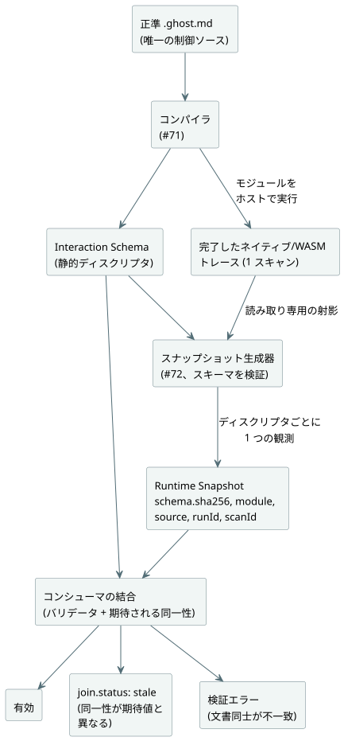

<!-- translation-source: contracts/interaction-v0/README.md -->
[英語の原文](README.md)

# Interaction Schema と Runtime Snapshot v0

この契約は、`GF-IR-1`/TASK-121.1 のための**ホストソフトウェア**の境界です。どのキャビネットビューに対しても中立です。この契約は 2 つの別々の文書を定義します。

- **Interaction Schema**：コンパイル済みの control の観測可能な値についての、静的な意味ディスクリプタ
- **Runtime Snapshot**：それらの値についての、完了したランタイム観測 1 回分

スキーマのコンパイラによる出力は #71 で実装されています。#72 は、すでに完了したネイティブまたは WASM のトレースだけを、`tools/interaction-runtime-snapshot.mjs` を通じてスナップショットへ射影します。このアダプタがスキャンを評価したり、I/O を行ったり、要求出力や安全出力を変更したりすることは決してありません。

次の図は、各文書がどこから来て、コンシューマがそれらをどのように結合するかを示しています。



**形式とバージョン。** `GhostFlow/interaction-schema-v0` と `GhostFlow/runtime-snapshot-v0` は、それぞれ独自の `version` を持ちます。バージョンは互換性のラベルであり、特定のスキーマインスタンスの同一性ではありません。そのためにスナップショットは、正準の静的スキーマ JSON の SHA-256 を `snapshot.schema.sha256` にも持ちます。コンシューマは、そのダイジェスト、形式、バージョンを、自分に与えられた静的文書と結合しなければなりません。

**スキーマのダイジェスト。** ダイジェストは、このリポジトリの `canonicalJson(schema, {rejectSparseArrays: true, rejectUnsafeIntegers: true})` が生成する UTF-8 バイト列の SHA-256 です。正確には、このエンコーディングは次のように動作します。

- 各プレーンオブジェクトのキーを、ECMAScript の UTF-16 コードユニット順で再帰的にソートします。
- 配列要素の順序を保ちます。
- 不正な Unicode を拒否したうえで、文字列を ECMAScript の `JSON.stringify` でエンコードします。
- ブール値と null を JSON リテラルとしてエンコードします。
- 有限の IEEE-754 数値を ECMAScript の `JSON.stringify` の表記（`-0` を `0` とすることを含む）でエンコードし、安全でない整数は拒否します。
- 空白を出力しません。
- 疎な配列、プレーンでないオブジェクト、有限でない数値、64 を超える深さのネストを拒否します。

コンシューマは与えられたダイジェストを比較します。別の言語で書かれた生成器は、一致するスナップショットを発行する前に、まさにこのバイト列を再現しなければなりません。形式のバージョンが一致するだけでは不十分です。

## 静的スキーマ

**固定される同一性。** スキーマは `module` の同一性と、ソース文書の同一性を固定します。

| フィールド | 意味 |
| --- | --- |
| `module.id` | 公開される control モジュールの同一性。 |
| `module.moduleFingerprint` | コンパイル済みモジュールについてコンパイラが出力する、安定した 16 桁 16 進数のトレースフィンガープリント。 |
| `module.bytecodeSha256` | 出力された manifest のバイトコードの、小文字の SHA-256。 |
| `source.documentId` | 不透明な公開同一性。1 つの作成済み文書のリビジョン間で安定しています。 |
| `source.revisionId` | 保存された 1 つの正準リビジョンを表す、不透明で不変な同一性。 |
| `source.format`, `source.kind` | ソースの形式と種類（後述）。 |
| `source.sha256` | そのリビジョンの UTF-8 ソースバイト列の、小文字の SHA-256。 |

フィンガープリントと成果物のダイジェストは別物であり、両方とも必須です。どちらのソース同一性もパスではないため、会話やリビジョンストレージに保持された文書にも対応できます。フィクスチャのリポジトリパスは、そのテストハーネスにのみ属します。

**文芸的ソースのみ。** `source.kind` は正確に `literate` です。GhostFlow の作成・レビュー・バージョン管理の対象となる正準ソースは、文芸的文書です。製品とコンパイラの入力は正準の `.ghost.md` だけです。プレーンなコードは拒否されます。それはサポートされる作成形式、インポート、成果物、Interaction Schema のフォールバックのいずれにもなり得ません。

**ディスクリプタ。** すべてのディスクリプタは次のものを持ちます。

- 公開され、安定した、作成者が付けた `id` と `name`
- 意味上の `kind`
- コンパイラ/ソース上の意味型 `sourceType`
- 明示的な `access`
- 来歴（provenance）

v0 で許可される kind は `state`、`timer`、`counter`、そして後述の設定プロファイルにおける `setting` です。すべての kind の access は正確に `["read"]` です。いずれも観測専用の値です。コマンド、入力、イベント、アラーム、説明は、#70 が所有する今後の作業です。この契約は、それらの設計が存在する前に `write` や `execute` のアクセスを付与することはありません。

**カウンタ**とは、既存の文芸的リンクに `meaning=counter` を持つ、作成者が書いた `Int` の state です。注釈のない `Int`、任意の `Number`、整数に見えるランタイム値、名前からカウンタの意味が暗黙に導かれることは決してありません。したがって、カウンタの来歴は、作成されたソースノードの種類 `state` を保持します。

**ソース型。** `sourceType` は、`builtin` 型（`Bool`、`Int`、`Number`、`Duration`）か、意味上の単位を持つ名前付きの `nominal` 型のどちらかを保持します。ランタイムの JSON 表記が型を選ぶことは決してありません。`0` が `Number` なのか `Duration` なのかは、静的ディスクリプタがそう示しているからこそ決まります。

**列挙型（enum）。** コンパイラが宣言した enum では、nominal の `sourceType` が正確な `enumMembers: [{"name":"Idle","value":0}, ...]` の表も、宣言順で保持します。序数は明示的で一意であり、0 から始まります。その他の nominal 型は `enumMembers` を持ちません。ready の enum 観測は、宣言された序数のいずれかと一致しなければなりません。未知の値はエラーであり、名前が推測されることは決してありません。この表はスキーマのダイジェストと、ソース/リビジョンの同一性結合の一部です。スキーマのバージョン `0.2` でこのフィールドが追加されました。ランタイムスナップショットはバージョン `0.1` のままです。

**enum の表示ラベル。** スキーマのバージョン `0.3` では、各 enum メンバーに任意のプレーンテキスト `displayLabel` が追加されます。正準の `.ghost.md` の control ブロック内で記述します。

```ghost
type Phase = Idle { label = "대기"; } | Running;
```

出力される最初のメンバーは `{"name":"Idle","value":0,"displayLabel":"대기"}` です。ラベルのないメンバーは `displayLabel` を省略し、コンシューマは `displayLabel ?? name` を表示します。ラベルのルールは次のとおりです。

- ラベルは、Web、HMI、モバイルのコンシューマ向けの表示用メタデータです。enum の同一性、序数、制御上の意味、GFB のバイト列、VM ABI のいずれも変えません。
- ラベルは既存の JSON 文字列エスケープ規則に従い、Unicode をサポートします。
- 空または空白のみのラベル、重複した `label` エントリ、その他のメンバーオプションはコンパイラエラーです。
- コンシューマはラベルをテキストとして描画し、マークアップとして扱ってはなりません。
- ラベルは厳密なスキーマダイジェストの一部であるため、ラベルを編集すると、対応するソースリビジョンとスナップショットの同一性が必要になります。
- ランタイムスナップショットのバージョンは `0.1` のままです。ランタイムの観測値は引き続き数値の序数です。
- インポートした enum の合成は引き続きサポートされておらず、既存の診断を維持します。

**状態を持たない control。** 有効な状態を持たない control は、`descriptors: []` を持つ識別されたスキーマを持ちます。これは、その正確な文芸的リビジョンとコンパイル済みモジュールに、観測すべき公開の state や timer がないことを意味します。スキーマ、ソースの同一性、モジュールの同一性が欠けていることを意味するわけではありません。対応する完了スナップショットは `observations: []` を持ち、引き続き正確なスキーマダイジェストと、module、source、run、完了スキャンの同一性を持ちます。入力から出力への直接的な control を観測可能にするためだけに、生成器が Boolean の state や timer をでっち上げてはなりません。

**来歴リンク。** すべてのディスクリプタは、正のコンパイラソースマップノード ID と、少なくとも 1 つの文芸的な意図アンカーも指定します。ディスクリプタの ID と名前、アンカー ID は公開されるものであり、予約済みの `__gf_` 接頭辞を拒否します。ソースマップノード ID は数値のコンパイラ来歴であり、生成された VM スロット名では決してありません。フィクスチャテストは、記録された各ノード/kind とアンカーのリンクが、この正確なソースリビジョンに存在することを検証します。ディスクリプタのコンパイラによる出力は #71 で実装されています。公開スナップショットを出力する前に、ランタイムの射影は、コンパイル済みの正準文芸的成果物からその正確なスキーマを再構築して検証します。

**経過時間タイマー。** `timer.age` は `elapsed(watering)` を次のように表します。

```json
{"kind":"elapsed_since_change","subjectId":"state.watering"}
```

- `watering` のような Bool の対象では、これは Bool が最後に変化してからの時間であり、累積のアクティブ/ON 継続時間では**ありません**。Bool が真の間だけタイマーを使う control は、その経過時間をアクティブ継続時間として解釈してもかまいませんが、タイマー自体はどちらの遷移からの経過時間も測ります。
- `Phase` のような nominal な enum の対象では、`elapsed(phase)` はフェーズの経過時間です。enum の値が変わるたびにリセットされ、現在どのフェーズであっても進み続けます。`examples/enum-phase-age.ghost.md` と、それに焦点を当てたコンパイラ/WASM テストは、state が nominal な `Phase` のままであり、timer は対象が `state.phase` である `Duration` であることを示しています。

**表示ポリシーはありません。** スキーマには、ウィジェット、レイアウト、可視性、色、座標、キャビネットビューのポリシーのフィールドはありません。たとえばキャビネットビューは、既定でタイマーを表示して Boolean の state を隠すことができますが、そのポリシーはこの IR の一部ではありません。

### 合成プロファイル 0.5

正準ソースのクロージャにインスタンスが含まれる場合、明示的に要求された Interaction Schema はバージョン `0.5` を使い、そのスナップショットのバージョンは `0.3` です。単独のスキーマ `0.3`/`0.4` とスナップショット `0.1`/`0.2` の形は変わりません。

**合成の同一性。** 合成された両方の文書は、`composition.sourceClosureSha256` と `composition.instances` を持ちます。各インスタンスのエントリは、作成されたインスタンスパスを、その定義の `filename`、`revision`、`sha256` に結び付けます。クロージャのダイジェストは、固定された依存文書とインスタンスを含む、正確な正準クロージャ JSON を対象とします。

**アドレス指定。** ディスクリプタは `(instance, id)` の組でアドレス指定されます。

- `instance` は `east.cell` のような作成されたパス、またはルートを表す `null` です。
- `id` と `name` はローカルで作成されたときの表記を保つため、`east` と `west` の両方が `setting.duration` を公開できます。
- 観測は、同じ `instance` とローカルの `descriptorId` を持ちます。
- `provenance.sourceNode` は、平坦化されたコンパイラの `id`、元の `definitionNodeId`、宣言の `kind`、元の文書の `source` 範囲（`filename`、`line`、`column`、`endLine`、`endColumn`）を保持します。
- `provenance.intentAnchors` は `{instance, anchorId}` の参照を含みます。異なる定義やインスタンスにある同一のアンカー ID は区別されたままです。
- 経過時間タイマーは `operation.subject: {instance, descriptorId}` を使います。連続タイマーは平坦化された `subjectNodeId` を保持します。
- コンパイラの名前とタイマーのストレージスロットは非公開です。

**検証と設定。** 出力と復元では、ソースマップ、トレースメタデータ、manifest、ディスクリプタの来歴を受け入れる前に、正確な正準クロージャを再コンパイルします。ランタイムの生成器は、それらの検証済み入力のコピーを所有します。コンシューマの同一性結合には、スキーマ、module、source、run の同一性に加えて、クロージャのダイジェストも含まれます。合成されたすべてのスナップショットは `settingsRevision`（設定がない場合は 0）を持ちます。設定は、既存の Rust の `defaultValue`、`emissionRevision`、`applicationPosition`、`override`、および成功/故障の Result のセマンティクスを維持します。インスタンスごとの別個のリビジョンカウンタはありません。

**ホストとの統合。** `TemporarySettingsHost` は、Interaction Schema を含む成果物のための生成器を準備します。

- 受け入れられた各ステップは、自身の完了したランタイム結果と有効な Rust 設定から `observation: {snapshot, error}` を公開します。
- `interactionSnapshot()` は最新の観測のコピーを読み取ります。tick を進めることは決してありません。
- `interactionIdentity` は、ホストが期待する結合用の同一性を返します。
- レガシーの `framed: false` エントリでは、射影はホストの既存の受け入れ済みステップ位置から 1 を引いた値を `scanId` として使い、取り込まれた受け入れ済みパケットの時刻を使います。framed エントリでは、ランタイムの完了したフレームの同一性を使います。
- ディスパッチ後に射影が失敗した場合、ステップは受け入れられたままとなり、ホストは null の観測スナップショットとともに `completed-scan-observation-failed` を記録します。これによって設定履歴が取り消されることはなく、イベントが再試行可能になることもありません。

低レベルの完了トレースアダプタは、引き続き呼び出し元が一致する run/スキャン/設定のレコードを 1 つ提供することを信頼します。ペイロードの検証では、実際のランタイムの所有権を認証できません。

**コーパスと制限。** `examples/composed-v0.5.json` は、バージョン管理された source/クロージャ/スキーマ/スナップショットのコーパスです。`verifyComposedInteractionCorpus` はその静的な来歴を再構築し、`tests/composed-interaction.test.mjs` はそのスキャンを実際のホスト上でリプレイします。このプロファイルは、installation/バインディングの所有権も、合成された出力の説明も追加しません。説明アダプタは、明示的な未サポートのガードを維持します。[#290](https://github.com/callin2/ghostflow-language/issues/290) と [#302](https://github.com/callin2/ghostflow-language/issues/302) を参照してください。

## 完了したランタイムスナップショットとステータス

**スナップショットとは何か。** スナップショットは、ちょうど 1 つの `completed-scan` を記述します。

- `runId` は、ホスト/ランタイムのインスタンスが所有する、不透明な公開エポックです。同じソースが `scanId: 0` から再開し得るため、リセット時や新しい run では変わらなければなりません。
- `completion` は、負でない `scanId` と、ミリ秒単位の論理時間を与えます。
- スナップショットは、すべてのディスクリプタについてちょうど 1 つの観測を持たなければなりません。値が存在しない場合は、明示的な `unavailable` の観測を持ちます。観測を省略することは無効です。したがって、ディスクリプタのないスキーマの観測はちょうど 0 個です。
- v0 は、別個の tick の同一性を定義しません。完了の同一性は framed ホストが所有します。
- timer を持つ control は、完了したトレースにコンパイラが生成した非公開のクロックも持ち、生成器はそのクロックが `completion.logicalTimeMs` と等しいことを要求します。state だけを持つ control には、観測のためだけにタイマークロックが生成されることはありません。完了したフレームだけで十分であり、公開・非公開のどちらの timer もでっち上げられません。

**スナップショットのストリームの生成。** 完了スキャンの繰り返しストリームでは、コンパイル済み成果物と実行エポックごとに 1 回、`prepareCompletedScanSnapshot({ compilation, schema?, runId })` を呼び出します。これはフリーズされた `{ schema, expected, emit({ completion, trace, settingsState? }) }` の生成器を返します。

- 準備では、正確なスキーマを検証する前に、静的な成果物の入力をコピーします。
- 返されるスキーマは深く不変です。トレースメタデータと config ディスクリプタは非公開の不変コピーです。検証にのみ使われたソースとバイトのバッファは破棄されます。
- 呼び出し元が後から変更したり、以前のスナップショットを編集したりしても、以降の出力には影響しません。
- `expected` は、`joinRuntimeSnapshot(schema, snapshot, expected)` のために 1 回だけ計算されます。
- 各 `emit` は、引き続き完了、論理クロック、トレースのモジュール同一性、現在の Rust 設定、観測の型、Interaction 契約、生成された名前の除外を検査します。
- 再コンパイルや再起動の際は、新しい run ID で新しい生成器を準備してください。
- 生成器はその Worker やホストの内部に保持してください。関数はトランスポートのペイロードではありません。

`emitCompletedScanSnapshot` は、同じ検証済み経路の単発版として引き続き利用できます。

**観測のステータス。** 観測ごとのペイロードのステータスは、意図的に最小限にしてあります。

| ステータス | 決定される場所 | 必須フィールド | 意味 |
| --- | --- | --- | --- |
| `ready` | 完了後の信頼された生成器 | `value` | 静的ディスクリプタの意味型に対する値。`false` と `0` は値であり、欠落ではない。 |
| `unavailable` | 信頼された生成器 | `reason` | この完了した観測には値がない。 |
| `error` | 信頼された生成器 | `error` | このディスクリプタを観測できなかった。 |
| `stale` | 検証を行うコンシューマの結合 | 導出された理由 | 構造的に有効なスナップショットが、コンシューマの期待するスキーマ、module、source、run の同一性と異なる。自己申告の観測ステータスとして受け入れられることは決してない。 |

**設定プロファイルのバージョン。** 設定は、明示的にアップグレードされたプロファイルを使います。

| スキーマに `setting` ディスクリプタがあるか | スキーマのバージョン | スナップショットのバージョン |
| --- | --- | --- |
| はい | `0.4` | `0.2` |
| いいえ | `0.3`（厳密に） | `0.1`（厳密に） |

古い設定のスナップショットが、新しいプロファイルとして暗黙に再解釈されることは決してありません。

**設定の観測。** `setting` の観測がある場合、スナップショットはグローバルな `settingsRevision` も持ちます。各設定の観測には `defaultValue`、`emissionRevision`、`applicationPosition` が必須で、`ready` の観測はさらに `override` を持ちます。

- `defaultValue` は静的なソースリテラルであり、フォールバックではありません。
- `emissionRevision` と `applicationPosition` は、その設定について実際に受け入れられた出力リビジョンとイベント位置です。
- ソースの初期観測は、リビジョン `0`、`applicationPosition: null`、`override: false` を使い、その現在値は `defaultValue` と等しくなければなりません。
- 後で受け入れられた成功した出力は、たとえ既定値と等しくても、その後のリビジョン/位置と `override: true` を使います。
- 受け入れられた設定の故障は、その故障を現在の Result として保持します。ready 専用の `override` を除き、同じ来歴フィールドを持ちます。古い成功時の `value` を公開したり、既定値を有効値として合成したりすることはありません。

設定以外のディスクリプタは、元の最小限のステータスフィールドを維持します。

**stale の結合。** バリデータが `join.status: "stale"` を正確な stale の理由とともに報告するのは、任意の期待される同一性が与えられた場合だけです。期待される結合では、次のものを比較できます。

- スキーマの形式、バージョン、ダイジェスト
- module の ID、フィンガープリント、バイトコードの SHA
- source の文書 ID、リビジョン ID、SHA
- run ID

`scanId` は意図的に除外されています。これは 1 つの run 内での順序の座標にすぎないからです。文書自体の中でのスキーマとスナップショットの不一致は検証の `error` であり、古いデータ（stale）ではありません。この区別により、信頼できないペイロードが自らを stale とラベル付けして同一性の不一致を隠すことを防ぎます。

## フィクスチャと検証

`examples/five-minute-watering.ghost.md` は、文芸的な 5 分間灌水のフィクスチャです。その静的・動的な JSON の例には、実際の `false` と `0` の値が含まれています。Number と `Percent` の値は、厳密なカウンタ/`Int` の表現を追加することなく、作成された state ディスクリプタで表現されています（2 つ目のコーパスプログラム `examples/multiple-values.ghost.md` にあります。後述）。

`validate.mjs` は次の項目を厳密に検査します。

- 未知のフィールド
- 公開の同一性
- 来歴
- 意味型
- 厳密なスキーマダイジェスト
- 静的な同一性
- 完了
- ディスクリプタの網羅

検証するのはレコードだけです。デバイス、物理、フロントエンド、コンパイラ出力、ランタイム収集に関する主張は一切行いません。

## 共有の適合性コーパス

**プログラム。** `examples/corpus.json` は、各テストケースについて正準ソースのリビジョンとコンパイル済みモジュールの同一性を固定します。

- 最初のケースは、正準の 5 分間灌水 control です。その元の意図、論理的な機器マッピング、ソフトウェアのみの証拠境界は、その `.ghost.md` に記録されています。
- `examples/multiple-values.ghost.md` は 2 つ目の正準プログラムです。経過時間タイマー付きの作成された Bool state を 2 つ、Number の state を 1 つ、nominal な `Percent` の state を 1 つ持ちます。

どちらも現在のコンパイラが受け付ける構文を使っており、新しいディスクリプタの kind を前提としていません。

**スキャンテープ。** コーパスの横にある各 `.scan-tape.json` は、バージョン管理された、キャビネットビューに中立なテスト刺激です。

- 各フレームは、完了したスキャン、論理時間、名前の付いた宣言済み入力のすべてを、コンパイル済み manifest の順序で記録します。
- run はそれぞれ異なる `runId` を持ち、0 から始まる連続した `scanId` を使います。
- テープのダイジェストは、`digest` メンバーを除いた完全なテープオブジェクトに対する、厳密な正準 JSON の SHA-256 です。疎な配列と安全でない整数を拒否する、このリポジトリの `canonicalJson` を使います。

入力テープは保守されるテストデータであり、もう 1 つの GhostFlow 制御ソースではありません。

**コーパスの検証。** `observationExpectations` は、バリデータ専用の `unavailable` ケースを記述してもかまいません。これはランタイムの観測を主張せず、チェックインされるスナップショットにはコピーされません。コーパスの検証器は次のことを行います。

- 正確な `.ghost.md` のバイト列をコンパイルします。
- source、module、成果物の同一性を検査します。
- 完全な入力、run ローカルで連続したスキャン ID、減少しない論理時間を検証します。
- 既存のスキーマ/スナップショットの射影を検査します。

`node contracts/interaction-v0/verify-corpus.mjs` または `node --test tests/interaction-corpus.test.mjs` で実行します。

チェックインされている 5 分間灌水のスキーマとスナップショット、および今後追加されるスキーマ、スナップショット、GFB ファイルは、導出された射影です。文芸的文書が唯一の正準制御ソースであり続けます。2 つ目のプログラムには、意図的に、手で保守されるプレーンな `.ghost` 版も、でっち上げたランタイムスナップショットもありません。

**ネイティブ/WASM のパリティ。** `tests/interaction-runtime-snapshot.test.mjs` は、コーパスの正確な各ソースとテープを、リリース版のネイティブ framed ランナーと実際の framed WASM ABI でリプレイします。完了した両方のトレースを射影し、タイマーの論理クロック値を含め、公開スナップショットがバイト単位で等しいことを要求します。さらに、観測を無効にした run、毎スキャン読み取る run、遅れて読み取るコンシューマの run を比較します。観測は、確定した状態、要求出力、安全出力を変えてはなりません。これはホスト側のネイティブ/WASM の証拠にすぎません。ブラウザでの受け入れ、ファームウェアでの実行、物理デバイスの挙動については何も主張しません。

**却下された代替案。** v0 は、信頼できない観測の中で `stale` を `ready` と並べて置く案を却下しています。そうすると、生成器の主張がコンシューマの同一性結合に取って代わってしまいます。検証の際に `stale` を導出することで、文書は小さく保たれ、再起動やリビジョンの不一致が明示的になります。

## 設定の来歴の検証

**既定値とリビジョンのルール。** `0.4` の設定ディスクリプタは、正準ソースの `defaultValue` を含みます。

- 生成器はランタイムの既定値をコンパイル済みの config リテラルと比較し、バリデータは各動的既定値をその静的ディスクリプタに結び付けます。
- 行の `emissionRevision` はグローバルな `settingsRevision` を超えることができず、最新の受け入れ済みグローバルリビジョンは少なくとも 1 つの行に現れなければなりません。
- 1 つのアトミックなリビジョンに属する行は、同じ `applicationPosition` を共有します。
- リビジョン 0 は、ソースの初期の成功値を意味します。故障や変更された履歴を意味することは決してありません。
- 位置は run ローカルであり、チェックポイントの復元をまたいで増加する必要はありません。
- コンテキストのチェックポイントのバージョン 4 は、これらのフィールドを永続化します。新しい所有者を変更する前に、値、履歴、アロケータ、リビジョンの対応関係が矛盾しているものを拒否します。

**レガシー文書。** 明示的なレガシーのスキーマ `0.3` / スナップショット `0.1` の設定文書は、元のフィールドとダイジェストのまま引き続き検証されます。これらは新しい来歴の主張を行わず、`0.4` / `0.2` として再解釈されることは決してありません。新しい設定の生成器は新しいプロファイルを使います。設定以外の文書と、過去に固定されたダイジェストはそのまま維持されます。

**テストと範囲。** REF-05-012 のテストは、実際のネイティブ実行と framed WASM 実行を使います。結果/設定/チェックポイントの完全なパリティ、拒否された権限と VM トランザクション、偽造されたソース既定値、チェックサムで修復された意味的な復元の破損を検査します。これは設定の観測契約です。実行可能なディスクリプタのバインディング、変更の認可、公開同一性の発行、Device による採用ではありません。
