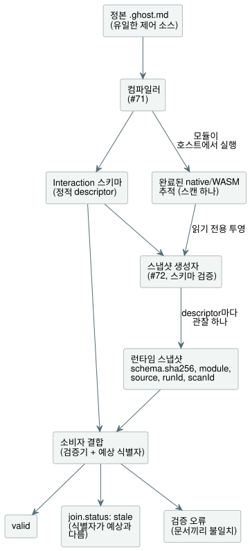

<!-- translation-source: contracts/interaction-v0/README.md -->
[영문 원문](README.md)

# Interaction 스키마와 런타임 스냅샷 v0

이 계약은 `GF-IR-1`/TASK-121.1을 위한 **호스트 소프트웨어** 경계입니다. 어떤
캐비닛 뷰에도 치우치지 않습니다. 서로 분리된 두 문서를 정의합니다.

- **Interaction 스키마(Interaction Schema)**: 컴파일된 제어가 관측 가능한 값에
  대한 정적 의미 descriptor(설명자)
- **런타임 스냅샷(Runtime Snapshot)**: 그 값들에 대한 완료된 런타임 관측 하나

스키마의 컴파일러 출력은 #71에서 구현합니다. #72는
`tools/interaction-runtime-snapshot.mjs`를 통해 이미 완료된 native 또는 WASM
추적(trace)만 스냅샷으로 투영합니다. 이 어댑터는 스캔을 평가하거나, I/O를
수행하거나, 요청 출력이나 안전 출력을 바꾸는 일을 절대 하지 않습니다.

아래 다이어그램은 각 문서가 어디서 오는지, 소비자가 이를 어떻게 결합(join)하는지
보여 줍니다.



**형식과 버전.** `GhostFlow/interaction-schema-v0`와
`GhostFlow/runtime-snapshot-v0`는 각자 자체 `version`을 가집니다. 버전은 호환성
레이블일 뿐, 정확한 스키마 인스턴스의 식별자가 아닙니다. 그래서 스냅샷은
`snapshot.schema.sha256`에 정규 정적 스키마 JSON의 SHA-256도 담습니다. 소비자는
이 다이제스트, 형식, 버전을 자신이 받은 정적 문서와 결합해야 합니다.

**스키마 다이제스트.** 다이제스트는 이 저장소의
`canonicalJson(schema, {rejectSparseArrays: true, rejectUnsafeIntegers: true})`가
만든 UTF-8 바이트의 SHA-256입니다. 정확히 말하면 이 인코딩은 다음과 같습니다.

- 각 plain object의 키를 ECMAScript UTF-16 코드 단위 순서로 재귀 정렬합니다.
- 배열 요소 순서를 유지합니다.
- 잘못된 유니코드를 거부한 뒤 문자열을 ECMAScript `JSON.stringify`로
  인코딩합니다.
- 불리언과 null은 JSON 리터럴로 인코딩합니다.
- 유한한 IEEE-754 숫자는 ECMAScript `JSON.stringify` 표기(`-0`은 `0`)로
  인코딩하며, 안전하지 않은 정수는 거부합니다.
- 공백을 출력하지 않습니다.
- 희소 배열, plain object가 아닌 객체, 유한하지 않은 숫자, 64단계보다 깊은
  중첩을 거부합니다.

소비자는 제공된 다이제스트를 비교합니다. 다른 언어로 작성된 생성자는 일치하는
스냅샷을 발행하기 전에 정확히 이 바이트를 재현해야 합니다. 형식 버전만 일치하는
것으로는 충분하지 않습니다.

## 정적 스키마

**고정된 식별자.** 스키마는 `module` 식별자와 소스 문서 식별자를 고정합니다.

| 필드 | 의미 |
| --- | --- |
| `module.id` | 공개 제어 모듈 식별자입니다. |
| `module.moduleFingerprint` | 컴파일된 모듈에 대한 컴파일러의 안정적인 16자리 16진수 추적 지문입니다. |
| `module.bytecodeSha256` | 출력된 manifest 바이트코드의 소문자 SHA-256입니다. |
| `source.documentId` | 불투명한 공개 식별자로, 작성된 한 문서의 여러 revision에 걸쳐 안정적입니다. |
| `source.revisionId` | 저장된 정본 revision 하나에 대한 불투명하고 불변인 식별자입니다. |
| `source.format`, `source.kind` | 소스 형식과 종류입니다(아래 참조). |
| `source.sha256` | 그 revision의 UTF-8 소스 바이트에 대한 소문자 SHA-256입니다. |

지문과 아티팩트 다이제스트는 서로 다르며 둘 다 필요합니다. 두 소스 식별자는 모두
경로가 아니므로, 대화나 revision 저장소에 보관된 문서도 지원합니다. 픽스처의
저장소 경로는 그 테스트 하네스에만 속합니다.

**문서형 소스만 허용.** `source.kind`는 정확히 `literate`입니다. GhostFlow에서
작성하고 검토하고 버전 관리하는 정본 소스는 문서형 소스(literate source)입니다.
제품과 컴파일러의 입력은 정본 `.ghost.md`뿐입니다. 일반 코드는 거부되며, 지원되는
작성 입력, import, 아티팩트, Interaction 스키마 fallback 어느 것도 될 수 없습니다.

**Descriptor.** 모든 descriptor는 다음을 가집니다.

- 공개적이고 안정적인, 작성자가 정한 `id`와 `name`
- 의미 `kind`
- 컴파일러/소스 의미 `sourceType`
- 명시적인 `access`
- provenance(출처)

v0은 `state`, `timer`, `counter` 종류와, 아래에서 설명하는 설정 프로필에서는
`setting` 종류를 허용합니다. 모든 종류의 접근은 정확히 `["read"]`입니다. 모두
관측 전용 값입니다. 명령, 입력, 이벤트, 알람, 설명은 #70이 소유하는 후속
작업입니다. 이 계약은 그 설계가 나오기 전에는 `write`나 `execute` 접근을
부여하지 않습니다.

**counter**는 기존 literate 링크에 `meaning=counter`가 붙은, 작성된 `Int`
상태입니다. 주석이 없는 `Int`, 임의의 `Number`, 정수처럼 보이는 런타임 값,
이름만으로는 counter 의미가 절대 생기지 않습니다. 그래서 counter의 provenance는
작성된 소스 노드 종류인 `state`를 그대로 유지합니다.

**소스 타입.** `sourceType`은 `builtin` 타입(`Bool`, `Int`, `Number`,
`Duration`) 또는 의미 단위를 가진 이름 있는 `nominal` 타입을 담습니다. 런타임
JSON 표기가 타입을 결정하는 일은 절대 없습니다. `0`이 `Number`인지 `Duration`인지는
오직 정적 descriptor가 정합니다.

**Enum.** 컴파일러가 선언한 enum의 경우, nominal `sourceType`은 선언 순서대로
정확한 `enumMembers: [{"name":"Idle","value":0}, ...]` 표도 담습니다. 서수는
명시적이고 중복이 없으며 0부터 시작합니다. 다른 nominal 타입에는 `enumMembers`가
없습니다. ready 상태의 enum 관측값은 선언된 서수 중 하나와 일치해야 합니다. 알 수
없는 값은 오류이며, 이름을 추측해 붙이는 일은 절대 없습니다. 이 표는 스키마
다이제스트와 source/revision 식별자 결합의 일부입니다. 스키마 버전 `0.2`에서 이
필드가 추가되었고, 런타임 스냅샷은 버전 `0.1`에 머뭅니다.

**Enum 표시 레이블.** 스키마 버전 `0.3`은 각 enum 멤버에 선택적인 일반 텍스트
`displayLabel`을 추가합니다. 정본 `.ghost.md`의 `control` 블록에서 다음과 같이
작성합니다.

```ghost
type Phase = Idle { label = "대기"; } | Running;
```

출력되는 첫 멤버는 `{"name":"Idle","value":0,"displayLabel":"대기"}`입니다.
레이블이 없는 멤버는 `displayLabel`을 생략하며, 소비자는 `displayLabel ?? name`을
표시합니다. 레이블 규칙은 다음과 같습니다.

- 레이블은 웹, HMI, 모바일 소비자를 위한 표시용 메타데이터입니다. enum 식별자,
  서수, 제어 의미, GFB 바이트, VM ABI 어느 것도 바꾸지 않습니다.
- 레이블은 기존 JSON 문자열 이스케이프 규칙을 따르며 유니코드를 지원합니다.
- 빈 레이블이나 공백만 있는 레이블, 중복된 `label` 항목, 그 밖의 멤버 옵션은
  컴파일 오류입니다.
- 소비자는 레이블을 마크업이 아닌 텍스트로만 렌더링합니다.
- 레이블은 정확한 스키마 다이제스트의 일부이므로, 레이블을 수정하면 그에 맞는
  소스 revision과 스냅샷 식별자가 필요합니다.
- 런타임 스냅샷 버전은 `0.1`에 머물며, 런타임 관측값은 계속 숫자 서수입니다.
- import된 enum의 조합은 여전히 지원하지 않으며 기존 진단을 유지합니다.

**상태 없는 제어.** 유효한 상태 없는 제어는 `descriptors: []`인 식별된 스키마를
가집니다. 이는 정확한 literate revision과 컴파일된 모듈에 관측할 공개 상태나
타이머가 없다는 뜻입니다. 스키마, 소스 식별자, 모듈 식별자가 없다는 뜻이
아닙니다. 이에 대응하는 완료 스냅샷은 `observations: []`를 가지면서도 정확한
스키마 다이제스트와 module, source, 실행, 완료 스캔 식별자를 그대로 담습니다.
입력이 출력으로 직접 이어지는 제어를 관측 가능하게 만들려는 목적만으로 생성자가
불리언 상태나 타이머를 지어내서는 안 됩니다.

**Provenance 링크.** 모든 descriptor는 양수인 컴파일러 소스맵 노드 ID와, 하나
이상의 literate 의도 앵커도 지정합니다. descriptor ID와 이름, 앵커 ID는 공개
값이며 예약 접두사 `__gf_`를 거부합니다. 소스맵 노드 ID는 숫자로 된 컴파일러
provenance이며, 생성된 VM 슬롯 이름이 절대 아닙니다. 픽스처 테스트는 기록된 각
노드/종류와 앵커 링크가 이 정확한 소스 revision에 존재하는지 확인합니다.
descriptor의 컴파일러 출력은 #71에서 구현합니다. 런타임 투영은 공개 스냅샷을
내보내기 전에, 컴파일된 정본 literate 아티팩트로부터 그 정확한 스키마를
재구성하고 검증합니다.

**경과 타이머.** `timer.age`는 `elapsed(watering)`을 다음과 같이 나타냅니다.

```json
{"kind":"elapsed_since_change","subjectId":"state.watering"}
```

- `watering` 같은 Bool 대상에서 이 값은 Bool이 마지막으로 바뀐 뒤의 시간입니다.
  활성/ON 상태가 누적된 시간이 **아닙니다**. Bool이 참일 때만 타이머를 쓰는
  제어는 그 경과를 활성 지속 시간으로 해석할 수 있지만, 타이머 자체는 어느 쪽
  전환이든 그 뒤로 지난 시간을 잽니다.
- `Phase` 같은 nominal enum 대상에서 `elapsed(phase)`는 단계 경과 시간입니다.
  enum 값이 바뀔 때마다 초기화되며, 현재 어느 단계든 상관없이 계속 흐릅니다.
  `examples/enum-phase-age.ghost.md`와 그에 집중한 컴파일러/WASM 테스트는 상태가
  nominal `Phase`로 남고, 타이머는 대상이 `state.phase`인 `Duration`임을 보여
  줍니다.

**표시 정책 없음.** 스키마에는 위젯, 레이아웃, 표시 여부, 색, 좌표,
cabinet-view 정책 필드가 없습니다. 예를 들어 캐비닛 뷰는 기본적으로 타이머를
보여 주고 불리언 상태를 숨길 수 있지만, 그 정책은 이 IR의 일부가 아닙니다.

### 합성 프로필 0.5

정본 소스 closure에 인스턴스가 있을 때, 명시적으로 요청된 Interaction 스키마는
버전 `0.5`를 사용하며 그 스냅샷 버전은 `0.3`입니다. 독립 실행형 스키마
`0.3`/`0.4`와 스냅샷 `0.1`/`0.2`의 형태는 바뀌지 않습니다.

**합성 식별자.** 두 합성 문서 모두 `composition.sourceClosureSha256`과
`composition.instances`를 담습니다. 각 인스턴스 항목은 작성된 인스턴스 경로를
그 정의의 `filename`, `revision`, `sha256`에 연결합니다. closure 다이제스트는
고정된 의존 문서와 인스턴스를 포함한 정확한 정규 closure JSON 전체를 대상으로
합니다.

**주소 지정.** descriptor는 `(instance, id)` 쌍으로 주소를 지정합니다.

- `instance`는 `east.cell` 같은 작성된 경로이며, 루트는 `null`입니다.
- `id`와 `name`은 작성된 지역 표기를 그대로 유지하므로, `east`와 `west`가 모두
  `setting.duration`을 노출할 수 있습니다.
- 관측값은 같은 `instance`와 지역 `descriptorId`를 함께 담습니다.
- `provenance.sourceNode`는 펼쳐진 컴파일러 `id`, 원래의 `definitionNodeId`,
  선언 `kind`, 원본 문서의 `source` 범위(`filename`, `line`, `column`,
  `endLine`, `endColumn`)를 유지합니다.
- `provenance.intentAnchors`는 `{instance, anchorId}` 참조를 담습니다. 서로 다른
  정의나 인스턴스에 있는 같은 앵커 ID는 서로 구분됩니다.
- 경과 타이머는 `operation.subject: {instance, descriptorId}`를 사용하고,
  continuous 타이머는 펼쳐진 `subjectNodeId`를 유지합니다.
- 컴파일러 이름과 타이머 저장 슬롯은 비공개입니다.

**검증과 설정.** 출력과 복원은 소스맵, 추적 메타데이터, manifest, descriptor
provenance를 받아들이기 전에 정확한 정본 closure를 다시 컴파일합니다. 런타임
생성자는 검증된 그 입력의 사본을 소유합니다. 소비자의 식별자 결합에는 스키마,
module, source, 실행 식별자와 함께 closure 다이제스트도 들어갑니다. 모든 합성
스냅샷은 `settingsRevision`을 담습니다(설정이 없으면 0). 설정은 기존 Rust의
`defaultValue`, `emissionRevision`, `applicationPosition`, `override`와 성공/fault
Result 의미를 그대로 유지합니다. 인스턴스별 revision 카운터는 따로 없습니다.

**호스트 통합.** `TemporarySettingsHost`는 Interaction 스키마가 포함된
아티팩트를 위한 생성자를 준비합니다.

- 수락된 각 스텝은 자신의 완료된 런타임 결과와 실제 적용된 Rust 설정으로
  `observation: {snapshot, error}`를 발행합니다.
- `interactionSnapshot()`은 최신 관측의 사본을 읽습니다. tick을 실행하는 일은
  절대 없습니다.
- `interactionIdentity`는 호스트가 예상하는 결합 식별자를 반환합니다.
- 기존 `framed: false` 진입점에서는, 호스트의 기존 수락 스텝 위치에서 1을 뺀 값을
  `scanId`로 사용하고, 캡처한 수락 패킷 시각을 사용해 투영합니다. framed
  진입점은 런타임의 완료 프레임 식별자를 사용합니다.
- 디스패치 후 투영이 실패하면 스텝은 수락된 상태로 남고, 호스트는 관측
  스냅샷을 null로 두고 `completed-scan-observation-failed`를 기록합니다. 이는
  설정 이력을 되돌리지도 않고 그 이벤트를 재시도 가능하게 만들지도 않습니다.

저수준 완료 추적 어댑터는 여전히 호출자가 일치하는 실행/스캔/설정 레코드 하나를
제공한다고 신뢰합니다. 페이로드 검증만으로는 실제 런타임 소유권을 인증할 수
없습니다.

**코퍼스와 한계.** `examples/composed-v0.5.json`은 버전이 붙은
source/closure/스키마/스냅샷 코퍼스입니다. `verifyComposedInteractionCorpus`는
그 정적 provenance를 재구성하고, `tests/composed-interaction.test.mjs`는 그
스캔을 실제 호스트에서 재생합니다. 이 프로필은 설치/바인딩 소유권도, 합성 출력의
설명도 추가하지 않습니다. 설명 어댑터는 명시적인 미지원 가드를 유지합니다.
[#290](https://github.com/callin2/ghostflow-language/issues/290)과
[#302](https://github.com/callin2/ghostflow-language/issues/302)를 참조하십시오.

## 완료된 런타임 스냅샷과 상태

**스냅샷이란.** 스냅샷은 정확히 하나의 `completed-scan`을 기술합니다.

- `runId`는 호스트/런타임 인스턴스가 소유하는 불투명한 공개 epoch입니다. 같은
  소스가 `scanId: 0`에서 다시 시작할 수 있으므로, 재설정이나 새 실행 때 반드시
  바뀌어야 합니다.
- `completion`은 음수가 아닌 `scanId`와 밀리초 단위 논리 시간을 제공합니다.
- 스냅샷에는 모든 descriptor마다 정확히 하나의 관측이 있어야 합니다. 값이
  없으면 명시적인 `unavailable` 관측을 담습니다. 관측을 생략하는 것은
  유효하지 않습니다. 따라서 descriptor가 없는 스키마의 관측은 정확히 0개입니다.
- v0은 별도의 tick 식별자를 정의하지 않습니다. 완료 식별자는 framed 호스트가
  소유합니다.
- 타이머가 있는 제어는 완료 추적에 컴파일러가 생성한 비공개 시계도 가지며,
  생성자는 그 시계 값이 `completion.logicalTimeMs`와 같을 것을 요구합니다. 상태만
  있는 제어는 관측만을 위해 생성된 타이머 시계를 얻지 않습니다. 완료 프레임만으로
  충분하며, 공개든 비공개든 타이머를 지어내지 않습니다.

**스냅샷 스트림 만들기.** 완료 스캔이 반복되는 스트림에서는 컴파일된 아티팩트와
실행 epoch마다 `prepareCompletedScanSnapshot({ compilation, schema?, runId })`를
한 번 호출합니다. 이 함수는 동결된
`{ schema, expected, emit({ completion, trace, settingsState? }) }` 생성자를
반환합니다.

- 준비 단계는 정확한 스키마를 검증하기 전에 정적 아티팩트 입력을 복사합니다.
- 반환된 스키마는 깊게 불변이며, 추적 메타데이터와 config descriptor는 비공개
  불변 사본입니다. 검증에만 쓰인 소스와 바이트 버퍼는 버립니다.
- 이후 호출자가 데이터를 변경하거나 이전 스냅샷을 수정해도 이후 발행에는 영향을
  줄 수 없습니다.
- `expected`는 `joinRuntimeSnapshot(schema, snapshot, expected)`를 위해 한 번만
  계산합니다.
- 각 `emit`은 여전히 완료 정보, 논리 시계, 추적 모듈 식별자, 현재 Rust 설정,
  관측 타입, Interaction 계약, 생성된 이름의 배제를 검사합니다.
- 재컴파일하거나 재시작하려면 새 실행 ID로 새 생성자를 준비합니다.
- 생성자는 자신의 Worker나 호스트 안에 둡니다. 함수는 전송 페이로드가 아닙니다.

`emitCompletedScanSnapshot`은 같은 검증 경로의 일회성 형태로 남아 있습니다.

**관측 상태.** 관측별 페이로드 상태는 의도적으로 최소한으로 두었습니다.

| 상태 | 결정 위치 | 필수 필드 | 의미 |
| --- | --- | --- | --- |
| `ready` | 완료 후 신뢰된 스냅샷 생성자 | `value` | 정적 descriptor의 의미 타입에 맞는 값입니다. `false`와 `0`은 값이지 부재가 아닙니다. |
| `unavailable` | 신뢰된 생성자 | `reason` | 이 완료 관측에는 값이 없습니다. |
| `error` | 신뢰된 생성자 | `error` | 이 descriptor를 관측할 수 없었습니다. |
| `stale` | 검증하는 소비자의 결합 | 파생된 사유 | 구조적으로 유효한 스냅샷이 소비자가 예상한 스키마, module, source, 실행 식별자와 다릅니다. 스스로 선언한 관측 상태로는 절대 받아들이지 않습니다. |

**설정 프로필 버전.** 설정은 명시적으로 업그레이드된 프로필을 사용합니다.

| 스키마에 `setting` descriptor가 있는가? | 스키마 버전 | 스냅샷 버전 |
| --- | --- | --- |
| 예 | `0.4` | `0.2` |
| 아니요 | `0.3` (정확히) | `0.1` (정확히) |

예전 설정 스냅샷을 새 프로필로 조용히 재해석하는 일은 절대 없습니다.

**설정 관측.** `setting` 관측이 있으면 스냅샷은 전역 `settingsRevision`도
담습니다. 각 설정 관측에는 `defaultValue`, `emissionRevision`,
`applicationPosition`이 필요하며, `ready` 관측은 `override`도 담습니다.

- `defaultValue`는 정적 소스 리터럴이며 fallback이 아닙니다.
- `emissionRevision`과 `applicationPosition`은 그 설정에 대해 실제로 수락된
  emission revision과 이벤트 위치입니다.
- 초기 소스 관측은 revision `0`, `applicationPosition: null`,
  `override: false`를 사용하며, 현재 값은 `defaultValue`와 같아야 합니다.
- 이후 수락된 성공 emission은 기본값과 같은 값이라도 이후의 revision/위치와
  `override: true`를 사용합니다.
- 수락된 설정 fault는 그 fault를 현재 Result로 유지합니다. ready 전용인
  `override`를 제외한 같은 provenance 필드를 담습니다. 예전의 성공 `value`를
  노출하거나 기본값을 유효값으로 합성하지 않습니다.

설정이 아닌 descriptor는 원래의 최소 상태 필드를 유지합니다.

**stale 결합.** 검증기는 선택적인 예상 식별자가 제공된 경우에만, 정확한 stale
사유와 함께 `join.status: "stale"`을 보고합니다. 예상 결합은 다음을 비교할 수
있습니다.

- 스키마 형식, 버전, 다이제스트
- 모듈 ID, 지문, 바이트코드 SHA
- 소스 문서 ID, revision ID, SHA
- 실행 ID

`scanId`는 의도적으로 제외합니다. 이는 한 실행 안에서의 순서 좌표일 뿐입니다.
문서 자체 안에서 스키마와 스냅샷이 어긋나면 stale 데이터가 아니라 검증
`error`입니다. 이 구분 덕분에 신뢰할 수 없는 페이로드가 스스로 stale이라고
표시해 식별자 실패를 숨길 수 없습니다.

## 픽스처와 검증

`examples/five-minute-watering.ghost.md`는 literate 5분 급수 픽스처입니다. 그
정적·동적 JSON 예제에는 실제 `false`와 `0` 값이 들어 있습니다. Number와
`Percent` 값은 작성된 상태 descriptor로 나타냅니다(두 번째 코퍼스 프로그램인
`examples/multiple-values.ghost.md`에 있으며, 아래 참조). 정확한 counter/`Int`
표현은 추가하지 않았습니다.

`validate.mjs`는 다음을 엄격하게 검사합니다.

- 알 수 없는 필드
- 공개 식별자
- provenance
- 의미 타입
- 정확한 스키마 다이제스트
- 정적 식별자
- 완료 정보
- descriptor 포괄 여부

이 도구는 레코드만 검증합니다. 장치, 물리 동작, 프론트엔드, 컴파일러 출력,
런타임 수집에 관해서는 아무것도 주장하지 않습니다.

## 공유 적합성 코퍼스

**프로그램.** `examples/corpus.json`은 각 테스트 사례의 정본 소스 revision과
컴파일된 모듈 식별자를 고정합니다.

- 첫 사례는 정본 5분 급수 제어입니다. 원래의 의도, 논리 장비 매핑, 소프트웨어
  전용 증거 경계는 그 `.ghost.md`에 기록되어 있습니다.
- `examples/multiple-values.ghost.md`는 두 번째 정본 프로그램입니다. 경과
  타이머가 달린 작성된 Bool 상태 두 개, Number 상태 하나, nominal `Percent`
  상태 하나를 가집니다.

둘 다 현재 컴파일러가 받아들이는 문법을 사용하며, 새로운 descriptor 종류를
암시하지 않습니다.

**스캔 테이프.** 코퍼스 옆의 각 `.scan-tape.json`은 버전이 붙은, cabinet-view에
치우치지 않는 테스트 자극입니다.

- 모든 프레임은 완료 스캔, 논리 시간, 그리고 이름 있는 모든 선언 입력을
  컴파일된 manifest 순서대로 기록합니다.
- 실행마다 서로 다른 `runId` 값을 가지며, `scanId`는 0부터 연속된 값을
  사용합니다.
- 테이프 다이제스트는 `digest` 멤버를 뺀 전체 테이프 객체에 대한 엄격한 정규
  JSON의 SHA-256입니다. 희소 배열과 안전하지 않은 정수를 거부하는 이 저장소의
  `canonicalJson`을 사용합니다.

입력 테이프는 관리되는 테스트 데이터이며, 또 하나의 GhostFlow 제어 소스가
아닙니다.

**코퍼스 검증.** `observationExpectations`는 검증기 전용 `unavailable` 사례를
기술할 수 있습니다. 이는 런타임 관측을 주장하지 않으며, 체크인된 스냅샷에
복사되지도 않습니다. 코퍼스 검증기는 다음을 수행합니다.

- 정확한 `.ghost.md` 바이트를 컴파일합니다.
- source, module, 아티팩트 식별자를 확인합니다.
- 입력이 완전한지, 실행별 스캔 ID가 연속인지, 논리 시간이 감소하지 않는지
  검증합니다.
- 기존 스키마/스냅샷 투영을 확인합니다.

`node contracts/interaction-v0/verify-corpus.mjs` 또는
`node --test tests/interaction-corpus.test.mjs`로 실행합니다.

체크인된 5분 급수의 스키마와 스냅샷, 그리고 이후의 모든 스키마, 스냅샷, GFB
파일은 파생된 투영물입니다. 문서형 소스만이 유일한 정본 제어 소스로 남습니다.
두 번째 프로그램에는 의도적으로 수동 관리되는 plain `.ghost` 대응 파일도, 지어낸
런타임 스냅샷도 없습니다.

**Native/WASM parity.** `tests/interaction-runtime-snapshot.test.mjs`는 각
정확한 코퍼스 소스와 테이프를 릴리스 native framed 실행기와 실제 framed WASM
ABI로 재생합니다. 두 완료 추적을 투영하고, 타이머 논리 시계 값을 포함해 공개
스냅샷이 바이트 단위로 같을 것을 요구합니다. 또한 관측을 끈 실행, 매 스캔 읽는
실행, 지연된 소비자가 읽는 실행을 비교합니다. 관측은 확정된 상태, 요청 출력,
안전 출력을 바꿔서는 안 됩니다. 이는 호스트 측 native/WASM 증거일 뿐입니다.
브라우저 수용, 펌웨어 실행, 물리 장치 동작에 관해서는 아무것도 주장하지
않습니다.

**거부된 대안.** v0은 신뢰할 수 없는 관측에 `ready`와 나란히 `stale`을 넣는
방식을 거부합니다. 그렇게 하면 생성자의 주장이 소비자의 식별자 결합을 대신하게
됩니다. 검증 중에 `stale`을 도출하면 문서를 작게 유지하면서 재시작과 revision
불일치를 명시적으로 드러낼 수 있습니다.

## 설정 provenance 검증

**기본값과 revision 규칙.** `0.4` setting descriptor는 정본 소스의
`defaultValue`를 포함합니다.

- 생성자는 런타임 기본값을 컴파일된 config 리터럴과 비교하고, 검증기는 각 동적
  기본값을 그 정적 descriptor에 연결합니다.
- 행의 `emissionRevision`은 전역 `settingsRevision`을 넘을 수 없으며, 가장 최근에
  수락된 전역 revision은 적어도 한 행에 나타나야 합니다.
- 하나의 원자적 revision에서 나온 행들은 같은 `applicationPosition`을
  공유합니다.
- revision 0은 초기의 성공한 소스 값을 뜻합니다. fault나 변경된 이력을 뜻하는
  일은 절대 없습니다.
- 위치는 실행별 값이며, checkpoint 복원을 거치며 증가할 필요가 없습니다.
- context checkpoint 버전 4는 이 필드들을 영속화합니다. 새 소유자를 바꾸기 전에
  값, 이력, 할당기, revision 상관관계가 일관되지 않으면 거부합니다.

**레거시 문서.** 명시적인 레거시 스키마 `0.3` / 스냅샷 `0.1` 설정 문서는 원래
필드와 다이제스트로 계속 검증됩니다. 새로운 provenance 주장을 하지 않으며
`0.4` / `0.2`로 재해석되는 일은 절대 없습니다. 새 설정 생성자는 새 프로필을
사용합니다. 설정이 아닌 문서와 과거에 고정된 다이제스트는 그대로 유지됩니다.

**테스트와 범위.** REF-05-012 테스트는 실제 native 및 framed WASM 실행을
사용합니다. 결과/설정/checkpoint의 완전한 parity, 거부된 권한과 VM 트랜잭션,
위조된 소스 기본값, 체크섬을 맞춰 놓은 의미적 복원 손상을 검사합니다. 이것은
설정 관측 계약입니다. 실행 가능한 descriptor 바인딩, 변경 권한 부여, 게시 식별자
발급, Device 채택이 아닙니다.
