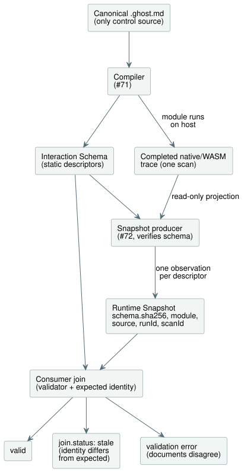

# Interaction Schema and Runtime Snapshot v0

This contract is a **host software** boundary for `GF-IR-1`/TASK-121.1. It is
neutral with respect to any cabinet view. It defines two separate documents:

- the **Interaction Schema**: static semantic descriptors of a compiled
  control's observable values;
- the **Runtime Snapshot**: one completed runtime observation of those values.

Compiler emission of the schema is implemented by #71. #72 projects only
already-completed native or WASM traces into snapshots, through
`tools/interaction-runtime-snapshot.mjs`. That adapter never evaluates a scan,
performs I/O, or changes requested or safe outputs.

The diagram below shows where each document comes from and how a consumer joins
them.



**Formats and versions.** `GhostFlow/interaction-schema-v0` and
`GhostFlow/runtime-snapshot-v0` each carry their own `version`. A version is a
compatibility label, not the identity of an exact schema instance. For that, a
snapshot also carries, in `snapshot.schema.sha256`, the SHA-256 of the
canonical static schema JSON. Consumers must join that digest, format, and
version with the static document they were given.

**The schema digest.** The digest is the SHA-256 of the UTF-8 bytes produced by
this repository's
`canonicalJson(schema, {rejectSparseArrays: true, rejectUnsafeIntegers: true})`.
Precisely, the encoding:

- recursively sorts each plain object's keys by ECMAScript UTF-16 code-unit
  order;
- keeps array element order;
- encodes strings with ECMAScript `JSON.stringify`, after rejecting malformed
  Unicode;
- encodes booleans and null as their JSON literals;
- encodes finite IEEE-754 numbers with ECMAScript `JSON.stringify` spelling
  (including `-0` as `0`), rejecting unsafe integers;
- emits no whitespace;
- rejects sparse arrays, non-plain objects, non-finite numbers, and nesting
  deeper than 64.

Consumers compare the supplied digest. A producer written in another language
must reproduce exactly these bytes before it can issue a matching snapshot. A
matching format version alone is not enough.

## Static schema

**Pinned identities.** The schema pins a `module` identity and a
source-document identity:

| Field | Meaning |
| --- | --- |
| `module.id` | The public control module identity. |
| `module.moduleFingerprint` | The compiler's stable 16-hex trace fingerprint of the compiled module. |
| `module.bytecodeSha256` | The lowercase SHA-256 of the emitted manifest bytecode. |
| `source.documentId` | An opaque public identity, stable across revisions of one authored document. |
| `source.revisionId` | An opaque, immutable identity for one stored canonical revision. |
| `source.format`, `source.kind` | The source format and kind (see below). |
| `source.sha256` | The lowercase SHA-256 of that revision's UTF-8 source bytes. |

The fingerprint and the artifact digest are distinct, and both are required.
Neither source identity is a path, so they also support documents held in
conversation or revision storage. The fixture's repository path belongs only to
its test harness.

**Literate source only.** `source.kind` is exactly `literate`. GhostFlow's
canonical authored, reviewed, and versioned source is the literate document.
Product and compiler input is canonical `.ghost.md` only. Plain code is
rejected; it cannot be a supported authoring, import, artifact, or Interaction
Schema fallback.

**Descriptors.** Every descriptor has:

- a public, stable, authored `id` and `name`;
- a semantic `kind`;
- a compiler/source semantic `sourceType`;
- an explicit `access`;
- provenance.

v0 permits the kinds `state`, `timer`, and `counter`, and — in the settings
profile described below — `setting`. Every kind has access exactly `["read"]`:
all are observation-only values. Commands, inputs, events, alarms, and
explanations are later work owned by #70. This contract grants no `write` or
`execute` access before those designs exist.

A **counter** is an authored `Int` state whose existing literate link carries
`meaning=counter`. Counter meaning is never implied by an unannotated `Int`, an
arbitrary `Number`, an integer-looking runtime value, or a name. Counter
provenance therefore keeps the authored source node kind `state`.

**Source types.** `sourceType` carries either a `builtin` type (`Bool`, `Int`,
`Number`, or `Duration`) or a named `nominal` type with its semantic unit. The
runtime JSON spelling never selects the type: `0` is a `Number` or a `Duration`
only because the static descriptor says which.

**Enums.** For a compiler-declared enum, the nominal `sourceType` also carries
the exact `enumMembers: [{"name":"Idle","value":0}, ...]` table, in declaration
order. The ordinal is explicit, unique, and starts at zero. Other nominal types
have no `enumMembers`. A ready enum observation must match one declared
ordinal; an unknown value is an error, never a guessed name. The table is part
of the schema digest and of the source/revision identity join. Schema version
`0.2` adds this field; the runtime snapshot stays at version `0.1`.

**Enum display labels.** Schema version `0.3` adds an optional plain-text
`displayLabel` to each enum member. Author it in the canonical `.ghost.md`
control block:

```ghost
type Phase = Idle { label = "대기"; } | Running;
```

The emitted first member is `{"name":"Idle","value":0,"displayLabel":"대기"}`.
Members without a label omit `displayLabel`; consumers display
`displayLabel ?? name`. The rules for labels are:

- A label is presentation metadata for web, HMI, and mobile consumers. It
  changes neither the enum identity nor the ordinal, the control meaning, the
  GFB bytes, or the VM ABI.
- Labels use the existing JSON string escaping rules and support Unicode.
- Empty or whitespace-only labels, duplicate `label` entries, and other member
  options are compiler errors.
- Consumers render labels as text, never as markup.
- Labels are part of the exact schema digest, so a label edit requires a
  matching source revision and snapshot identity.
- The runtime snapshot version stays `0.1`; runtime observation values remain
  numeric ordinals.
- Composition of imported enums remains unsupported and keeps its existing
  diagnostic.

**Stateless controls.** A valid stateless control has an identified schema with
`descriptors: []`. This means the exact literate revision and compiled module
have no public state or timer to observe. It does not mean that the schema,
source identity, or module identity is missing. The matching completed snapshot
has `observations: []` and still carries the exact schema digest and the module,
source, run, and completed-scan identities. Producers must not invent a Boolean
state or timer merely to make a direct input-to-output control observable.

**Provenance links.** Every descriptor also names its positive compiler
source-map node ID and at least one literate intent anchor. Descriptor IDs and
names and anchor IDs are public, and they reject the reserved `__gf_` prefix.
Source-map node IDs are numeric compiler provenance, never generated VM-slot
names. The fixture test verifies that each recorded node/kind and anchor link
exists for this exact source revision. Compiler emission of descriptors is
implemented by #71. Before it emits a public snapshot, runtime projection
reconstructs and verifies that exact schema from the compiled canonical
literate artifact.

**Elapsed timers.** `timer.age` represents `elapsed(watering)` as:

```json
{"kind":"elapsed_since_change","subjectId":"state.watering"}
```

- For a Bool subject such as `watering`, this is the time since the Bool last
  changed — **not** the accumulated active/ON duration. A control that uses the
  timer only while the Bool is true may interpret that age as an active
  duration, but the timer itself measures age since either transition.
- For a nominal enum subject such as `Phase`, `elapsed(phase)` is the phase
  age. It resets whenever the enum value changes and keeps running no matter
  which phase is current. `examples/enum-phase-age.ghost.md` and its focused
  compiler/WASM tests show that the state remains nominal `Phase`, while the
  timer is a `Duration` whose subject is `state.phase`.

**No presentation policy.** The schema has no widget, layout, visibility,
color, coordinate, or cabinet-view-policy fields. A cabinet view may, for
example, show timers and hide Boolean states by default, but that policy is not
part of this IR.

### Composed profile 0.5

An explicitly requested Interaction Schema uses version `0.5` when the
canonical source closure contains instances; its snapshot version is `0.3`.
Standalone schema `0.3`/`0.4` and snapshot `0.1`/`0.2` shapes are unchanged.

**Composition identity.** Both composed documents carry
`composition.sourceClosureSha256` and `composition.instances`. Each instance
entry binds an authored instance path to its definition `filename`, `revision`,
and `sha256`. The closure digest covers the exact canonical closure JSON,
including the pinned dependency documents and the instances.

**Addressing.** A descriptor is addressed by the pair `(instance, id)`:

- `instance` is an authored path such as `east.cell`, or `null` for the root.
- `id` and `name` keep their local authored spelling, so `east` and `west` may
  both expose `setting.duration`.
- Observations carry the same `instance` together with the local
  `descriptorId`.
- `provenance.sourceNode` keeps the flattened compiler `id`, the original
  `definitionNodeId`, the declaration `kind`, and the original document
  `source` span (`filename`, `line`, `column`, `endLine`, `endColumn`).
- `provenance.intentAnchors` contains `{instance, anchorId}` references.
  Identical anchor IDs in different definitions or instances stay distinct.
- Elapsed timers use `operation.subject: {instance, descriptorId}`; continuous
  timers keep their flattened `subjectNodeId`.
- Compiler names and timer storage slots are private.

**Verification and settings.** Emission and restoration recompile the exact
canonical closure before accepting its source map, trace metadata, manifest, or
descriptor provenance. The runtime producer owns copies of those verified
inputs. A consumer's identity join includes the closure digest as well as the
schema, module, source, and run identities. Every composed snapshot carries
`settingsRevision` (zero when there are no settings). Settings keep the
existing Rust `defaultValue`, `emissionRevision`, `applicationPosition`,
`override`, and success/fault Result semantics. There is no separate
per-instance revision counter.

**Host integration.** `TemporarySettingsHost` prepares a producer for an
artifact that contains an Interaction Schema.

- Each accepted step publishes `observation: {snapshot, error}` from its own
  completed runtime outcome and effective Rust settings.
- `interactionSnapshot()` reads a copy of the latest observation. It never
  ticks.
- `interactionIdentity` returns the host's expected join identity.
- On the legacy `framed: false` entry, a projection uses the host's existing
  accepted-step position minus one as `scanId`, and the captured accepted packet
  time. The framed entry uses the runtime's completed frame identity.
- If projection fails after dispatch, the step stays accepted and the host
  records `completed-scan-observation-failed` with a null observation snapshot.
  This neither undoes settings history nor makes the event retryable.

The low-level completed-trace adapter still trusts its caller to supply one
matching run/scan/settings record. Payload validation cannot authenticate
actual runtime ownership.

**Corpus and limits.** `examples/composed-v0.5.json` is the versioned
source/closure/schema/snapshot corpus. `verifyComposedInteractionCorpus`
reconstructs its static provenance, and `tests/composed-interaction.test.mjs`
replays its scans on the actual host. This profile adds neither
installation/binding ownership nor composed output explanations; the
explanation adapter keeps its explicit unsupported guard.
See [#290](https://github.com/callin2/ghostflow-language/issues/290) and
[#302](https://github.com/callin2/ghostflow-language/issues/302).

## Completed runtime snapshot and statuses

**What a snapshot is.** A snapshot describes exactly one `completed-scan`.

- `runId` is an opaque public epoch owned by the host/runtime instance. It must
  change on reset or on a new run, because the same source can restart at
  `scanId: 0`.
- `completion` gives a non-negative `scanId` and the logical time in
  milliseconds.
- A snapshot must have exactly one observation for every descriptor. When no
  value exists, it carries an explicit `unavailable` observation; omitting the
  observation is invalid. A schema with no descriptors therefore has exactly
  zero observations.
- v0 defines no separate tick identity. The framed host owns the completion
  identity.
- A control with a timer also has the compiler-generated private clock in its
  completed trace, and the producer requires that clock to equal
  `completion.logicalTimeMs`. A state-only control does not get a generated
  timer clock merely for observation: its completed frame is enough, and no
  public or private timer is invented.

**Producing a stream of snapshots.** For a repeated completed-scan stream, call
`prepareCompletedScanSnapshot({ compilation, schema?, runId })` once per
compiled artifact and execution epoch. It returns a frozen
`{ schema, expected, emit({ completion, trace, settingsState? }) }` producer.

- Preparation copies the static artifact inputs before verifying the exact
  schema.
- The returned schema is deeply immutable; trace metadata and config
  descriptors are private immutable copies. Source and byte buffers used only
  for verification are discarded.
- Later caller mutations, or edits to a previous snapshot, cannot affect later
  emissions.
- `expected` is computed once, for
  `joinRuntimeSnapshot(schema, snapshot, expected)`.
- Each `emit` still checks the completion, logical clock, trace module identity,
  current Rust settings, observation types, the Interaction contract, and the
  exclusion of generated names.
- To recompile or restart, prepare a new producer with the new run ID.
- Keep the producer inside its Worker or host; functions are not transport
  payloads.

`emitCompletedScanSnapshot` remains the one-shot form of the same verified
path.

**Observation statuses.** Per-observation payload statuses are intentionally
minimal:

| Status | Where decided | Required field | Meaning |
| --- | --- | --- | --- |
| `ready` | trusted snapshot producer after completion | `value` | A value for the static descriptor's semantic type. `false` and `0` are values, not absence. |
| `unavailable` | trusted producer | `reason` | This completed observation has no value. |
| `error` | trusted producer | `error` | This descriptor could not be observed. |
| `stale` | validating consumer join | derived reasons | The structurally valid snapshot differs from the consumer's expected schema, module, source, or run identity. It is never accepted as a self-declared observation status. |

**Settings profile versions.** Settings use an explicitly upgraded profile:

| Schema contains a `setting` descriptor? | Schema version | Snapshot version |
| --- | --- | --- |
| Yes | `0.4` | `0.2` |
| No | `0.3` (exactly) | `0.1` (exactly) |

Older settings snapshots are never silently reinterpreted as the new profile.

**Setting observations.** When there are `setting` observations, the snapshot
also carries a global `settingsRevision`. Each setting observation requires
`defaultValue`, `emissionRevision`, and `applicationPosition`; a `ready`
observation also carries `override`.

- `defaultValue` is the static source literal, not a fallback.
- `emissionRevision` and `applicationPosition` are the actual accepted emission
  revision and event position for that setting.
- An initial source observation uses revision `0`,
  `applicationPosition: null`, and `override: false`, and its current value
  must equal `defaultValue`.
- Any later accepted successful emission — even one equal to the default — uses
  its later revision/position and `override: true`.
- An accepted settings fault keeps the fault as the current Result. It carries
  the same provenance fields except the ready-only `override`. It does not
  expose an old successful `value` or synthesize the default as the effective
  value.

Non-settings descriptors keep the original minimal status fields.

**The stale join.** The validator reports `join.status: "stale"`, with the exact
stale reasons, only when an optional expected identity is supplied. The
expected join can compare:

- schema format, version, and digest;
- module ID, fingerprint, and bytecode SHA;
- source document ID, revision ID, and SHA;
- run ID.

`scanId` is deliberately left out: it is only an ordering coordinate within one
run. A schema/snapshot mismatch inside the documents themselves is a validation
`error`, not stale data. This distinction stops an untrusted payload from
labeling itself stale to hide an identity failure.

## Fixtures and validation

`examples/five-minute-watering.ghost.md` is a literate five-minute watering
fixture. Its static and dynamic JSON examples contain real `false` and `0`
values. Number and `Percent` values are represented by authored state
descriptors (in the second corpus program, `examples/multiple-values.ghost.md`;
see below), without adding an exact counter/`Int` representation.

`validate.mjs` performs strict checks of:

- unknown fields;
- public identities;
- provenance;
- semantic types;
- the exact schema digest;
- static identity;
- completion;
- descriptor coverage.

It validates records only. It makes no device, physical, frontend,
compiler-emission, or runtime-collection claim.

## Shared conformance corpus

**Programs.** `examples/corpus.json` pins the canonical source revision and the
compiled module identity for each test case.

- The first case is the canonical five-minute watering control. Its original
  intent, logical equipment mapping, and software-only evidence boundary are
  recorded in its `.ghost.md`.
- `examples/multiple-values.ghost.md` is the second canonical program. It has
  two authored Bool states with elapsed timers, one Number state, and one
  nominal `Percent` state.

Both use syntax that the current compiler accepts; no new descriptor kind is
implied.

**Scan tapes.** Each `.scan-tape.json` beside the corpus is versioned,
cabinet-view-neutral test stimulus.

- Every frame records a completed scan, the logical time, and every named
  declared input, in compiled manifest order.
- Runs have distinct `runId` values and use contiguous `scanId` values starting
  at zero.
- The tape digest is the SHA-256 of strict canonical JSON for the complete tape
  object with the `digest` member omitted. It uses this repository's
  `canonicalJson` with sparse arrays and unsafe integers rejected.

An input tape is maintained test data, not another GhostFlow control source.

**Corpus verification.** `observationExpectations` may describe a
validator-only `unavailable` case. It claims no runtime observation and is not
copied into the checked-in snapshot. The corpus verifier:

- compiles the exact `.ghost.md` bytes;
- checks the source, module, and artifact identities;
- validates complete inputs, contiguous run-local scan IDs, and nondecreasing
  logical time;
- checks the existing schema/snapshot projections.

Run it with `node contracts/interaction-v0/verify-corpus.mjs` or
`node --test tests/interaction-corpus.test.mjs`.

The checked-in schema and snapshot for five-minute watering, and any later
schema, snapshot, or GFB files, are derived projections. The literate document
remains the only canonical control source. The second program intentionally has
no hand-maintained plain `.ghost` counterpart and no fabricated runtime
snapshot.

**Native/WASM parity.** `tests/interaction-runtime-snapshot.test.mjs` replays
each exact corpus source and tape through the release native framed runner and
the actual framed WASM ABI. It projects both completed traces and requires
byte-for-byte equal public snapshots, including timer logical-clock values. It
also compares runs with observation disabled, read every scan, and read by a
delayed consumer: observation must not alter committed state, requested
outputs, or safe outputs. This is host-side native/WASM evidence only. It makes
no claim about browser acceptance, firmware execution, or physical-device
behavior.

**Rejected alternative.** v0 rejects putting `stale` beside `ready` in an
untrusted observation. That would let a producer's assertion replace a
consumer's identity join. Deriving `stale` during validation keeps the document
small and makes restart and revision mismatches explicit.

## Settings provenance validation

**Default and revision rules.** The `0.4` setting descriptor includes its
canonical source `defaultValue`.

- The producer compares runtime defaults with the compiled config literal, and
  the validator binds each dynamic default to that static descriptor.
- A row's `emissionRevision` cannot exceed the global `settingsRevision`, and
  the latest accepted global revision must appear in at least one row.
- Rows from one atomic revision share an `applicationPosition`.
- Revision zero means the initial successful source value — never a fault or
  changed history.
- Positions are run-local and need not increase across a checkpoint restore.
- Context checkpoint version 4 persists these fields. It rejects inconsistent
  values, history, allocator, and revision correlations before changing the new
  owner.

**Legacy documents.** Explicit legacy schema `0.3` / snapshot `0.1` settings
documents still validate with their original fields and digest. They make no
new provenance claims and are never reinterpreted as `0.4` / `0.2`; fresh
settings producers use the new profile. Non-settings documents and historical
pinned digests stay intact.

**Tests and scope.** REF-05-012 tests use actual native and framed WASM
execution. They check complete outcome/settings/checkpoint parity, rejected
permission and VM transactions, forged source defaults, and
checksum-repaired semantic restore corruption. This is a settings observation
contract. It is not executable descriptor binding, mutation authorization,
publishing identity issuance, or Device adoption.
