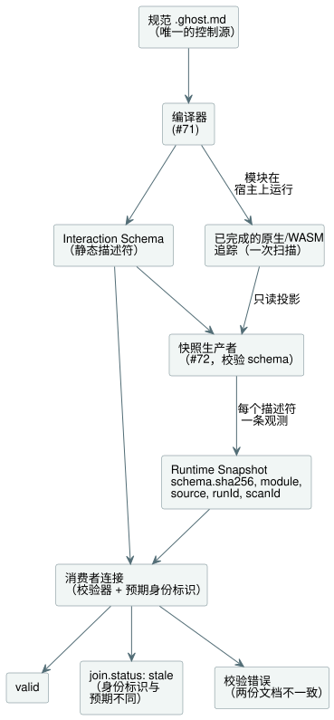

<!-- translation-source: contracts/interaction-v0/README.md -->
[英文原文](README.md)

# Interaction Schema 与 Runtime Snapshot v0

本契约是 `GF-IR-1`/TASK-121.1 的一个**宿主软件**边界，它对任何控制柜视图（cabinet view）都保持中立。它定义了两份相互独立的文档：

- **Interaction Schema**：已编译控制中可观测值的静态语义描述符；
- **Runtime Snapshot**：对这些值的一次已完成的运行时观测。

schema 的编译器输出由 #71 实现。#72 只通过 `tools/interaction-runtime-snapshot.mjs`，把已经完成的原生或 WASM 追踪投影为快照。该适配器绝不会求值扫描、执行 I/O，也不会改变请求输出或安全输出。

下图展示了每份文档的来源，以及消费者如何把它们连接（join）起来。



**格式与版本。** `GhostFlow/interaction-schema-v0` 和 `GhostFlow/runtime-snapshot-v0` 各自携带自己的 `version`。版本是兼容性标签，而不是某个确切 schema 实例的身份标识。为此，快照还在 `snapshot.schema.sha256` 中携带规范静态 schema JSON 的 SHA-256。消费者必须把该摘要、格式和版本与其收到的静态文档进行连接比对。

**schema 摘要。** 摘要是本仓库的 `canonicalJson(schema, {rejectSparseArrays: true, rejectUnsafeIntegers: true})` 所产生 UTF-8 字节的 SHA-256。确切地说，该编码：

- 按 ECMAScript UTF-16 码元顺序递归地对每个普通对象的键排序；
- 保留数组元素顺序；
- 在拒绝格式错误的 Unicode 之后，用 ECMAScript `JSON.stringify` 编码字符串；
- 把布尔值和 null 编码为其 JSON 字面量；
- 用 ECMAScript `JSON.stringify` 的写法编码有限的 IEEE-754 数字（包括把 `-0` 写作 `0`），并拒绝不安全的整数；
- 不输出任何空白；
- 拒绝稀疏数组、非普通对象、非有限数字以及嵌套深度超过 64 的数据。

消费者比较所提供的摘要。用其他语言编写的生产者必须精确地复现这些字节，才能发出相匹配的快照。仅仅格式版本匹配是不够的。

## 静态 schema

**固定的身份标识。** schema 固定一个 `module` 身份标识和一个源文档身份标识：

| 字段 | 含义 |
| --- | --- |
| `module.id` | 公开的控制模块身份标识。 |
| `module.moduleFingerprint` | 编译器为已编译模块生成的稳定的 16 位十六进制追踪指纹。 |
| `module.bytecodeSha256` | 所输出 manifest 字节码的小写 SHA-256。 |
| `source.documentId` | 一个不透明的公开身份标识，在同一份编写文档的各修订版之间保持稳定。 |
| `source.revisionId` | 一个不透明、不可变的身份标识，对应一个已存储的规范修订版。 |
| `source.format`, `source.kind` | 源格式和种类（见下文）。 |
| `source.sha256` | 该修订版 UTF-8 源字节的小写 SHA-256。 |

指纹和制品摘要是不同的东西，两者都是必需的。两个源身份标识都不是路径，因此它们也支持保存在对话或修订存储中的文档。fixture 的仓库路径只属于其测试框架。

**只接受文学式源文件。** `source.kind` 必须恰好为 `literate`。GhostFlow 规范的、经过编写、审查和版本管理的源文件就是文学式文档。产品和编译器的输入只能是规范 `.ghost.md`。纯代码会被拒绝；它不能作为受支持的编写、导入、制品或 Interaction Schema 的回退（fallback）。

**描述符。** 每个描述符都具有：

- 一个公开、稳定、由作者编写的 `id` 和 `name`；
- 一个语义 `kind`；
- 一个编译器/源码语义上的 `sourceType`；
- 一个显式的 `access`；
- 来源（provenance）。

v0 允许的种类有 `state`、`timer` 和 `counter`，以及——在下文所述的设置 profile 中——`setting`。每种 kind 的 access 都恰好为 `["read"]`：它们全都是只用于观测的值。命令、输入、事件、报警和解释属于后续工作，由 #70 负责。在这些设计出现之前，本契约不授予任何 `write` 或 `execute` 访问。

**counter（计数器）**是一个由作者编写的 `Int` 状态，其现有的文学式链接带有 `meaning=counter`。计数器的含义绝不会从未注解的 `Int`、任意 `Number`、看起来像整数的运行时值或名称中推断出来。因此，计数器的来源保持作者源节点的种类 `state`。

**源类型。** `sourceType` 携带一个 `builtin` 类型（`Bool`、`Int`、`Number` 或 `Duration`），或者一个带有语义单位的具名 `nominal` 类型。运行时的 JSON 写法从不决定类型：`0` 是 `Number` 还是 `Duration`，只取决于静态描述符怎么说。

**枚举。** 对于编译器声明的枚举，nominal `sourceType` 还按声明顺序携带确切的 `enumMembers: [{"name":"Idle","value":0}, ...]` 表。序号是显式的、唯一的，并且从零开始。其他 nominal 类型没有 `enumMembers`。处于 ready 状态的枚举观测必须匹配某个已声明的序号；未知值是一个错误，绝不会被猜测为某个名称。该表是 schema 摘要以及源/修订版身份标识连接的一部分。schema 版本 `0.2` 新增了此字段；运行时快照仍为版本 `0.1`。

**枚举显示标签。** schema 版本 `0.3` 为每个枚举成员新增了可选的纯文本 `displayLabel`。在规范 `.ghost.md` 的 control 块中编写它：

```ghost
type Phase = Idle { label = "대기"; } | Running;
```

输出的第一个成员为 `{"name":"Idle","value":0,"displayLabel":"대기"}`。没有标签的成员省略 `displayLabel`；消费者显示 `displayLabel ?? name`。标签规则如下：

- 标签是面向 Web、HMI 和移动端消费者的展示元数据。它既不改变枚举身份标识，也不改变序号、控制含义、GFB 字节或 VM ABI。
- 标签使用现有的 JSON 字符串转义规则，并支持 Unicode。
- 空标签或仅含空白的标签、重复的 `label` 条目以及其他成员选项都是编译错误。
- 消费者把标签作为文本渲染，绝不作为标记（markup）渲染。
- 标签是确切 schema 摘要的一部分，因此编辑标签需要相匹配的源修订版和快照身份标识。
- 运行时快照版本保持 `0.1`；运行时观测值仍是数字序号。
- 导入枚举的组合仍不受支持，并保留其现有诊断。

**无状态控制。** 有效的无状态控制具有一个带身份标识的 schema，其 `descriptors: []`。这表示该确切的文学式修订版和已编译模块没有可供观测的公开状态或定时器，而不表示 schema、源身份标识或模块身份标识缺失。与之匹配的已完成快照具有 `observations: []`，并仍然携带确切的 schema 摘要，以及模块、源、run 和已完成扫描的身份标识。生产者不得仅仅为了让一个从输入直接到输出的控制变得可观测，而凭空创造一个布尔状态或定时器。

**来源链接。** 每个描述符还会指明其正整数编译器源映射（source-map）节点 ID 以及至少一个文学式意图锚点。描述符 ID、名称和锚点 ID 都是公开的，并拒绝保留前缀 `__gf_`。源映射节点 ID 是数字形式的编译器来源信息，绝不是生成的 VM 槽位名称。fixture 测试会验证每个记录的节点/种类和锚点链接都存在于这一确切源修订版中。描述符的编译器输出由 #71 实现。在发出公开快照之前，运行时投影会根据已编译的规范文学式制品重建并验证这一确切的 schema。

**经过时间定时器。** `timer.age` 把 `elapsed(watering)` 表示为：

```json
{"kind":"elapsed_since_change","subjectId":"state.watering"}
```

- 对于 `watering` 这样的 Bool 主体，它表示自该 Bool 上一次变化以来的时间——**而不是**累计的激活/ON 持续时间。只在该 Bool 为真时使用定时器的控制可以把这个时长解释为激活持续时间，但定时器本身测量的是自任一方向变化以来的时长。
- 对于 `Phase` 这样的 nominal 枚举主体，`elapsed(phase)` 是阶段时长。每当枚举值变化时它就重置，并且无论当前处于哪个阶段都持续计时。`examples/enum-phase-age.ghost.md` 及其专门的编译器/WASM 测试表明，状态仍是 nominal `Phase`，而定时器是一个主体为 `state.phase` 的 `Duration`。

**没有展示策略。** schema 中没有控件、布局、可见性、颜色、坐标或控制柜视图策略等字段。例如，控制柜视图可以默认显示定时器并隐藏布尔状态，但这种策略不属于本 IR。

### 组合 profile 0.5

当规范源闭包包含实例时，显式请求的 Interaction Schema 使用版本 `0.5`；其快照版本为 `0.3`。独立的 schema `0.3`/`0.4` 和快照 `0.1`/`0.2` 结构保持不变。

**组合身份标识。** 两份组合文档都携带 `composition.sourceClosureSha256` 和 `composition.instances`。每个实例条目把一个由作者编写的实例路径绑定到其定义的 `filename`、`revision` 和 `sha256`。闭包摘要覆盖确切的规范闭包 JSON，包括固定的依赖文档和实例。

**寻址。** 描述符通过 `(instance, id)` 这一对值寻址：

- `instance` 是由作者编写的路径，例如 `east.cell`；根则为 `null`。
- `id` 和 `name` 保持其局部的编写拼写，因此 `east` 和 `west` 可以同时暴露 `setting.duration`。
- 观测携带相同的 `instance` 以及局部的 `descriptorId`。
- `provenance.sourceNode` 保留扁平化后的编译器 `id`、原始的 `definitionNodeId`、声明的 `kind`，以及原始文档的 `source` 范围（`filename`、`line`、`column`、`endLine`、`endColumn`）。
- `provenance.intentAnchors` 包含 `{instance, anchorId}` 引用。不同定义或实例中相同的锚点 ID 保持彼此区分。
- 经过时间定时器使用 `operation.subject: {instance, descriptorId}`；连续定时器保留其扁平化后的 `subjectNodeId`。
- 编译器名称和定时器存储槽位是私有的。

**验证与设置。** 输出和恢复在接受源映射、追踪元数据、manifest 或描述符来源之前，都会重新编译确切的规范闭包。运行时生产者持有这些已验证输入的副本。消费者的身份标识连接除了 schema、模块、源和 run 的身份标识外，还包括闭包摘要。每个组合快照都携带 `settingsRevision`（没有设置时为零）。设置保留现有 Rust 的 `defaultValue`、`emissionRevision`、`applicationPosition`、`override` 以及成功/故障 Result 语义。不存在单独的按实例修订计数器。

**宿主集成。** `TemporarySettingsHost` 为包含 Interaction Schema 的制品准备一个生产者。

- 每个被接受的步骤都会根据其自身已完成的运行时结果和生效的 Rust 设置，发布 `observation: {snapshot, error}`。
- `interactionSnapshot()` 读取最新观测的副本。它从不推进 tick。
- `interactionIdentity` 返回宿主预期的连接身份标识。
- 在旧版 `framed: false` 入口上，投影使用宿主现有的已接受步骤位置减一作为 `scanId`，并使用捕获的已接受数据包时间。framed 入口使用运行时已完成帧的身份标识。
- 如果投影在分派之后失败，该步骤仍保持已接受状态，宿主会记录 `completed-scan-observation-failed`，观测快照为 null。这既不会撤销设置历史，也不会使该事件可重试。

底层的已完成追踪适配器仍然信任其调用方提供一条相匹配的 run/扫描/设置记录。载荷校验无法验证实际的运行时归属。

**语料库与限制。** `examples/composed-v0.5.json` 是版本化的源/闭包/schema/快照语料库。`verifyComposedInteractionCorpus` 重建其静态来源，`tests/composed-interaction.test.mjs` 在实际宿主上重放其扫描。该 profile 既不增加 installation/绑定的归属，也不增加组合输出解释；解释适配器保留其显式的不支持保护。参见 [#290](https://github.com/callin2/ghostflow-language/issues/290) 和 [#302](https://github.com/callin2/ghostflow-language/issues/302)。

## 已完成的运行时快照与状态

**快照是什么。** 一个快照恰好描述一个 `completed-scan`。

- `runId` 是由宿主/运行时实例拥有的不透明公开纪元（epoch）。它在重置或新的运行时必须改变，因为同一源码可能从 `scanId: 0` 重新开始。
- `completion` 给出一个非负的 `scanId` 以及以毫秒为单位的逻辑时间。
- 快照必须为每个描述符恰好提供一条观测。没有值时，它携带一条显式的 `unavailable` 观测；省略观测是无效的。因此，没有描述符的 schema 恰好有零条观测。
- v0 不定义单独的 tick 身份标识。framed 宿主拥有完成身份标识。
- 带有定时器的控制在其已完成追踪中还包含编译器生成的私有时钟，生产者要求该时钟等于 `completion.logicalTimeMs`。只有状态的控制不会仅仅为了观测而获得一个生成的定时器时钟：它的已完成帧就足够了，不会凭空创造公开或私有的定时器。

**生成快照流。** 对于重复的已完成扫描流，每个已编译制品和执行纪元调用一次 `prepareCompletedScanSnapshot({ compilation, schema?, runId })`。它返回一个冻结的 `{ schema, expected, emit({ completion, trace, settingsState? }) }` 生产者。

- 准备阶段会先复制静态制品输入，然后再验证确切的 schema。
- 返回的 schema 是深度不可变的；追踪元数据和 config 描述符是私有的不可变副本。仅用于验证的源码和字节缓冲区会被丢弃。
- 之后调用方的修改，或对先前快照的编辑，都不会影响后续的输出。
- `expected` 只为 `joinRuntimeSnapshot(schema, snapshot, expected)` 计算一次。
- 每次 `emit` 仍然会检查完成信息、逻辑时钟、追踪的模块身份标识、当前 Rust 设置、观测类型、Interaction 契约，以及对生成名称的排除。
- 要重新编译或重启，请用新的 run ID 准备一个新的生产者。
- 把生产者保留在其 Worker 或宿主内部；函数不是传输载荷。

`emitCompletedScanSnapshot` 仍然是同一已验证路径的一次性形式。

**观测状态。** 每条观测的载荷状态有意保持最少：

| 状态 | 在哪里决定 | 必需字段 | 含义 |
| --- | --- | --- | --- |
| `ready` | 完成后由受信任的快照生产者决定 | `value` | 静态描述符语义类型的一个值。`false` 和 `0` 是值，不表示缺失。 |
| `unavailable` | 受信任的生产者 | `reason` | 这次已完成的观测没有值。 |
| `error` | 受信任的生产者 | `error` | 该描述符无法被观测。 |
| `stale` | 进行校验的消费者连接 | 推导出的原因 | 结构上有效的快照与消费者预期的 schema、模块、源或 run 身份标识不同。它绝不会作为自行声明的观测状态被接受。 |

**设置 profile 版本。** 设置使用一个显式升级的 profile：

| schema 是否包含 `setting` 描述符？ | schema 版本 | 快照版本 |
| --- | --- | --- |
| 是 | `0.4` | `0.2` |
| 否 | `0.3`（恰好） | `0.1`（恰好） |

较旧的设置快照绝不会被静默地重新解释为新的 profile。

**设置观测。** 存在 `setting` 观测时，快照还携带全局的 `settingsRevision`。每条设置观测都需要 `defaultValue`、`emissionRevision` 和 `applicationPosition`；`ready` 观测还携带 `override`。

- `defaultValue` 是静态源字面量，而不是回退值。
- `emissionRevision` 和 `applicationPosition` 是该设置实际被接受的输出修订版和事件位置。
- 初始的源观测使用修订版 `0`、`applicationPosition: null` 和 `override: false`，其当前值必须等于 `defaultValue`。
- 之后任何被接受的成功输出——即使与默认值相同——都使用其之后的修订版/位置，以及 `override: true`。
- 被接受的设置故障会把该故障保留为当前的 Result。它携带相同的来源字段，但不含仅用于 ready 的 `override`。它不会暴露旧的成功 `value`，也不会把默认值合成为生效值。

非设置描述符保留原有的最少状态字段。

**stale 连接。** 只有在提供了可选的预期身份标识时，校验器才会报告 `join.status: "stale"` 及确切的 stale 原因。预期连接可以比较：

- schema 格式、版本和摘要；
- 模块 ID、指纹和字节码 SHA；
- 源文档 ID、修订版 ID 和 SHA；
- run ID。

`scanId` 被有意排除在外：它只是一次运行内部的排序坐标。文档本身内部的 schema/快照不匹配是校验 `error`，而不是陈旧数据。这一区分可以防止不受信任的载荷把自己标记为 stale 来掩盖身份标识失败。

## Fixture 与校验

`examples/five-minute-watering.ghost.md` 是一个文学式的五分钟浇水 fixture。其静态和动态 JSON 示例包含真实的 `false` 和 `0` 值。Number 和 `Percent` 值由作者编写的状态描述符表示（在第二个语料库程序 `examples/multiple-values.ghost.md` 中；见下文），而没有增加精确的计数器/`Int` 表示。

`validate.mjs` 对以下内容进行严格检查：

- 未知字段；
- 公开身份标识；
- 来源；
- 语义类型；
- 确切的 schema 摘要；
- 静态身份标识；
- 完成信息；
- 描述符覆盖。

它只校验记录，不对设备、物理、前端、编译器输出或运行时采集作出任何声明。

## 共享一致性语料库

**程序。** `examples/corpus.json` 为每个测试用例固定规范源修订版和已编译模块身份标识。

- 第一个用例是规范的五分钟浇水控制。其原始意图、逻辑设备映射以及仅限软件的证据边界都记录在其 `.ghost.md` 中。
- `examples/multiple-values.ghost.md` 是第二个规范程序。它有两个带经过时间定时器的作者编写的 Bool 状态、一个 Number 状态和一个 nominal `Percent` 状态。

两者都使用当前编译器接受的语法；不隐含任何新的描述符种类。

**扫描带（scan tape）。** 语料库旁的每个 `.scan-tape.json` 都是版本化的、与控制柜视图无关的测试激励。

- 每一帧都按已编译 manifest 的顺序记录一次已完成的扫描、逻辑时间以及每个具名声明的输入。
- 各次运行具有不同的 `runId` 值，并使用从零开始的连续 `scanId` 值。
- 扫描带摘要是省略 `digest` 成员后完整扫描带对象的严格规范 JSON 的 SHA-256。它使用本仓库的 `canonicalJson`，并拒绝稀疏数组和不安全整数。

输入扫描带是维护中的测试数据，而不是另一个 GhostFlow 控制源。

**语料库验证。** `observationExpectations` 可以描述一个仅供校验器使用的 `unavailable` 用例。它不声明任何运行时观测，也不会被复制到签入的快照中。语料库验证器会：

- 编译确切的 `.ghost.md` 字节；
- 检查源、模块和制品的身份标识；
- 校验输入完整、run 内扫描 ID 连续以及逻辑时间不递减；
- 检查现有的 schema/快照投影。

用 `node contracts/interaction-v0/verify-corpus.mjs` 或 `node --test tests/interaction-corpus.test.mjs` 运行它。

签入的五分钟浇水 schema 和快照，以及之后的任何 schema、快照或 GFB 文件，都是派生投影。文学式文档仍是唯一的规范控制源。第二个程序有意没有手工维护的纯 `.ghost` 对应文件，也没有伪造的运行时快照。

**原生/WASM 一致性。** `tests/interaction-runtime-snapshot.test.mjs` 通过 release 原生 framed 运行器和实际的 framed WASM ABI，重放每个确切的语料库源码和扫描带。它投影两条已完成的追踪，并要求公开快照逐字节相等，包括定时器的逻辑时钟值。它还比较关闭观测、每次扫描都读取以及由延迟消费者读取这几种运行：观测不得改变已提交的状态、请求输出或安全输出。这只是宿主侧的原生/WASM 证据，不对浏览器验收、固件执行或物理设备行为作任何声明。

**被否决的方案。** v0 否决了在不受信任的观测中把 `stale` 与 `ready` 并列的做法。那样会让生产者的断言取代消费者的身份标识连接。在校验期间推导 `stale`，可以让文档保持精简，并使重启和修订版不匹配显式可见。

## 设置来源校验

**默认值与修订版规则。** `0.4` 设置描述符包含其规范源 `defaultValue`。

- 生产者把运行时默认值与已编译的 config 字面量进行比较，校验器则把每个动态默认值绑定到该静态描述符。
- 某行的 `emissionRevision` 不能超过全局 `settingsRevision`，且最新被接受的全局修订版必须至少出现在一行中。
- 来自同一原子修订版的各行共享同一个 `applicationPosition`。
- 修订版零表示初始的成功源值——绝不表示故障或被更改的历史。
- 位置是 run 内局部的，在检查点恢复后不必递增。
- 上下文检查点版本 4 会持久化这些字段。在更改新的所有者之前，它会拒绝不一致的值、历史、分配器和修订版关联。

**旧版文档。** 显式的旧版 schema `0.3` / 快照 `0.1` 设置文档仍按其原有字段和摘要进行校验。它们不作新的来源声明，也绝不会被重新解释为 `0.4` / `0.2`；新的设置生产者使用新的 profile。非设置文档和历史上固定的摘要保持不变。

**测试与范围。** REF-05-012 测试使用实际的原生和 framed WASM 执行。它们检查完整的结果/设置/检查点一致性、被拒绝的权限和 VM 事务、伪造的源默认值，以及经校验和修复的语义恢复损坏。这是一份设置观测契约。它不是可执行的描述符绑定、修改授权、发布身份标识签发，也不是 Device 采用。
