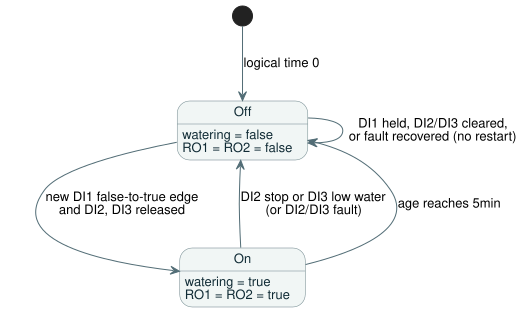

<!-- translation-source: contracts/interaction-v0/examples/five-minute-watering.ghost.md -->

# Five-minute watering fixture

[Korean canonical source](./five-minute-watering.ghost.md)

This literate GhostFlow program waters for exactly five minutes after a button press. A stop button or a low-water sensor ends watering at once. It is the canonical parser corpus input for the interaction contract.

## Execution contract

**Start state**

- At logical time 0, `watering` is false, every output is off, and `age` is 0.

**Starting a cycle**

- DI1 is a momentary watering request. Only a false-to-true edge (a new press) starts a new watering cycle.
- Holding DI1 does not restart the cycle. Releasing DI1 (a healthy false sample) arms the next press.

**Stopping**

- DI2 (stop) or DI3 (low water) immediately turns off watering and both outputs. Both stop inputs have priority over a new DI1 request.
- A cycle ended by DI2 or DI3 does not resume. Clearing DI2/DI3, or continuing to hold DI1, does not restart watering. To start a new full five-minute cycle, release DI1 and press it again.

**Outputs**

- RO1 (pump) and RO2 (watering valve) follow the accepted `watering` state together: both on when it is true, both off when it is false.
- DI4–DI8 are spare inputs. RO3–RO8 always stay off.

**Timing**

- `age = elapsed(watering)` is the time since the Boolean `watering` state last changed. It limits the cycle only while `watering` is true.
- The cycle ends at exactly five minutes. A later new DI1 edge starts a new interval.

The state diagram below summarizes these rules.



## Required capability bindings

These are logical channels the program needs from the host.

| Channel | Name | Role |
| --- | --- | --- |
| DI1 | Watering request | button |
| DI2 | Stop | button |
| DI3 | Low water | sensor |
| RO1 | Pump | pump |
| RO2 | Watering valve | valve |

## Original intent and interpretation

<!-- ghostflow:anchor id=GF-INT-FIXTURE-WATERING-V1 kind=intent status=confirmed origin=user -->
Original request (2026-09-15, callin2/ghostflow-language#81, Backlog TASK-121.8.1):
“DI1 momentary request: only a false-to-true edge starts/restarts watering;
DI2 stop and DI3 low-water each stop immediately and have priority; clearing
either condition or holding DI1 must not restart; RO1 pump and RO2 watering
valve operate in lockstep from the accepted watering state; timer age =
elapsed(watering), exact 5min cutoff.”

- In control terms, DI1 true means the button is pressed, and DI2/DI3 true means the matching stop condition is present. The original request does not specify electrical polarity, and this document does not define it.
- The table above maps software (virtual) channels only. It says nothing about Waveshare terminal numbers, polarity, or physical wiring.

## New revision with explicit input quality

This revision uses the input quality contract from #531. Each input is either `ok(value)` or `fault(...)`. A healthy false/0 reading is not a fault.

| Situation | Effect |
| --- | --- |
| DI1 fault | Blocks new starts. An existing cycle continues only while DI2 and DI3 are healthy and released. |
| DI2 or DI3 fault | Treated as an active stop: watering turns off. |
| Any input fault was observed | After recovery, DI1 must be seen as a healthy false and then as true before watering can start again. Recovery alone never starts watering. |

The previous source (before this revision) is preserved in `tests/fixtures/history/issue531/consumer-fixtures.pre-input.json`.

```ghost
control FiveMinuteWatering {
  input DI1, DI2, DI3, DI4, DI5, DI6, DI7, DI8: Bool;
  let request_good = case DI1 { ok(_) => true; fault(_) => false; };
  let stop_good = case DI2 { ok(_) => true; fault(_) => false; };
  let low_water_good = case DI3 { ok(_) => true; fault(_) => false; };
  let request = DI1 |> recover(false);
  let stop = DI2 |> recover(true);
  let low_water = DI3 |> recover(true);
  let watering_limit = 5min;
  output RO1, RO2, RO3, RO4, RO5, RO6, RO7, RO8: Bool;

  // ghostflow:link id=GF-INT-FIXTURE-WATERING-V1 relation=implements
  state request_was_high: Bool = false;
  // ghostflow:link id=GF-INT-FIXTURE-WATERING-V1 relation=implements
  state watering: Bool = false;
  // ghostflow:link id=GF-INT-FIXTURE-WATERING-V1 relation=implements
  timer age = elapsed(watering);

  request_was_high' = if !request_good || !stop_good || !low_water_good then true else request;
  watering' = !stop && !low_water
    && ((request && !request_was_high) || (watering && age < watering_limit));

  // ghostflow:link id=GF-INT-FIXTURE-WATERING-V1 relation=implements
  RO1 <- watering';
  // ghostflow:link id=GF-INT-FIXTURE-WATERING-V1 relation=implements
  RO2 <- watering';
  RO3 <- false;
  RO4 <- false;
  RO5 <- false;
  RO6 <- false;
  RO7 <- false;
  RO8 <- false;
}
```

How the code maps to the rules:

- `recover(false)` treats a faulted DI1 as "not pressed"; `recover(true)` treats a faulted DI2/DI3 as "stop".
- `request_was_high` remembers the previous request. It is forced to true whenever any of DI1–DI3 is faulted, so only a healthy false followed by true counts as a new edge.
- `watering'` is true only when no stop is active and either a new edge arrived or the current cycle is still under `watering_limit`.

## Corpus role

This literate document is the canonical parser corpus input. It does not replace imported intent or earlier history, benchmark, replay, or projection evidence.

This document and the corpus files derived from it are for software verification only. They do not test or prove firmware integration, or the behavior of a real pump, valve, relay, or contact.
