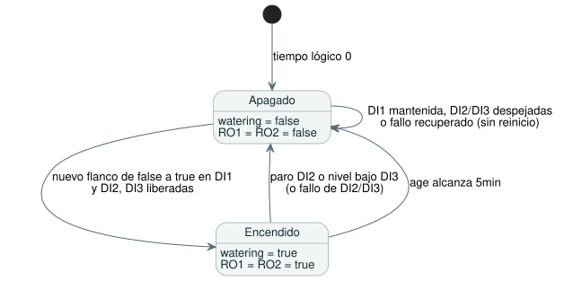

<!-- translation-source: contracts/interaction-v0/examples/five-minute-watering.ghost.en.md -->
[Original en inglés](five-minute-watering.ghost.en.md)

# Fixture de riego de cinco minutos

[Fuente canónica en coreano](./five-minute-watering.ghost.md)

Este programa literario (literate) de GhostFlow riega exactamente cinco minutos después de pulsar un botón. Un botón de paro o un sensor de nivel bajo de agua terminan el riego de inmediato. Es la entrada canónica del corpus del parser para el contrato de interacción.

## Contrato de ejecución

**Estado inicial**

- En el tiempo lógico 0, `watering` es false, todas las salidas están apagadas y `age` es 0.

**Inicio de un ciclo**

- DI1 es una solicitud de riego momentánea. Solo un flanco de false a true (una pulsación nueva) inicia un nuevo ciclo de riego.
- Mantener pulsada DI1 no reinicia el ciclo. Soltar DI1 (una muestra false sana) prepara la siguiente pulsación.

**Paro**

- DI2 (paro) o DI3 (nivel bajo de agua) apagan de inmediato el riego y ambas salidas. Ambas entradas de paro tienen prioridad sobre una nueva solicitud de DI1.
- Un ciclo terminado por DI2 o DI3 no se reanuda. Despejar DI2/DI3, o seguir manteniendo pulsada DI1, no reinicia el riego. Para iniciar un nuevo ciclo completo de cinco minutos, suelte DI1 y vuelva a pulsarla.

**Salidas**

- RO1 (bomba) y RO2 (válvula de riego) siguen juntas el estado `watering` aceptado: ambas encendidas cuando es true y ambas apagadas cuando es false.
- DI4–DI8 son entradas de reserva. RO3–RO8 permanecen siempre apagadas.

**Temporización**

- `age = elapsed(watering)` es el tiempo transcurrido desde el último cambio del estado booleano `watering`. Limita el ciclo solo mientras `watering` es true.
- El ciclo termina exactamente a los cinco minutos. Un nuevo flanco posterior de DI1 inicia un nuevo intervalo.

El siguiente diagrama de estados resume estas reglas.



## Vinculaciones de capacidades requeridas

Estos son los canales lógicos que el programa necesita del host.

| Canal | Nombre | Rol |
| --- | --- | --- |
| DI1 | Solicitud de riego | botón |
| DI2 | Paro | botón |
| DI3 | Nivel bajo de agua | sensor |
| RO1 | Bomba | bomba |
| RO2 | Válvula de riego | válvula |

## Intención original e interpretación

<!-- ghostflow:anchor id=GF-INT-FIXTURE-WATERING-V1 kind=intent status=confirmed origin=user -->
Solicitud original (2026-09-15, callin2/ghostflow-language#81, Backlog TASK-121.8.1):
“DI1 momentary request: only a false-to-true edge starts/restarts watering;
DI2 stop and DI3 low-water each stop immediately and have priority; clearing
either condition or holding DI1 must not restart; RO1 pump and RO2 watering
valve operate in lockstep from the accepted watering state; timer age =
elapsed(watering), exact 5min cutoff.”

- En términos de control, DI1 true significa que el botón está pulsado, y DI2/DI3 true significa que la condición de paro correspondiente está presente. La solicitud original no especifica la polaridad eléctrica, y este documento tampoco la define.
- La tabla anterior solo mapea canales de software (virtuales). No dice nada sobre los números de borne de Waveshare, la polaridad ni el cableado físico.

## Nueva revisión con calidad de entrada explícita

Esta revisión usa el contrato de calidad de entrada de #531. Cada entrada es `ok(value)` o `fault(...)`. Una lectura sana false/0 no es un fallo.

| Situación | Efecto |
| --- | --- |
| Fallo de DI1 | Bloquea los inicios nuevos. Un ciclo existente continúa solo mientras DI2 y DI3 estén sanas y liberadas. |
| Fallo de DI2 o DI3 | Se trata como un paro activo: el riego se apaga. |
| Se observó un fallo en alguna entrada | Tras la recuperación, DI1 debe verse primero como false sana y luego como true antes de que el riego pueda iniciarse de nuevo. La recuperación por sí sola nunca inicia el riego. |

La fuente anterior (previa a esta revisión) se conserva en `tests/fixtures/history/issue531/consumer-fixtures.pre-input.json`.

```ghost
control FiveMinuteWatering {
  input DI1, DI2, DI3, DI4, DI5, DI6, DI7, DI8: Bool;
  let request_good = case DI1 { ok(_) => true; fault(_) => false; };
  let stop_good = case DI2 { ok(_) => true; fault(_) => false; };
  let low_water_good = case DI3 { ok(_) => true; fault(_) => false; };
  let request = DI1 |> recover(false);
  let stop = DI2 |> recover(true);
  let low_water = DI3 |> recover(true);
  let watering_limit = 5min;
  output RO1, RO2, RO3, RO4, RO5, RO6, RO7, RO8: Bool;

  // ghostflow:link id=GF-INT-FIXTURE-WATERING-V1 relation=implements
  state request_was_high: Bool = false;
  // ghostflow:link id=GF-INT-FIXTURE-WATERING-V1 relation=implements
  state watering: Bool = false;
  // ghostflow:link id=GF-INT-FIXTURE-WATERING-V1 relation=implements
  timer age = elapsed(watering);

  request_was_high' = if !request_good || !stop_good || !low_water_good then true else request;
  watering' = !stop && !low_water
    && ((request && !request_was_high) || (watering && age < watering_limit));

  // ghostflow:link id=GF-INT-FIXTURE-WATERING-V1 relation=implements
  RO1 <- watering';
  // ghostflow:link id=GF-INT-FIXTURE-WATERING-V1 relation=implements
  RO2 <- watering';
  RO3 <- false;
  RO4 <- false;
  RO5 <- false;
  RO6 <- false;
  RO7 <- false;
  RO8 <- false;
}
```

Cómo se corresponde el código con las reglas:

- `recover(false)` trata una DI1 en fallo como "no pulsada"; `recover(true)` trata una DI2/DI3 en fallo como "paro".
- `request_was_high` recuerda la solicitud anterior. Se fuerza a true siempre que alguna de DI1–DI3 esté en fallo, de modo que solo un false sano seguido de true cuenta como un flanco nuevo.
- `watering'` es true solo cuando no hay ningún paro activo y, además, llegó un flanco nuevo o el ciclo actual sigue por debajo de `watering_limit`.

## Rol en el corpus

Este documento literario es la entrada canónica del corpus del parser. No reemplaza la intención importada ni la evidencia previa de historial, benchmark, reproducción (replay) o proyección.

Este documento y los archivos de corpus derivados de él sirven solo para la verificación de software. No prueban ni demuestran la integración del firmware, ni el comportamiento de una bomba, válvula, relé o contacto reales.
