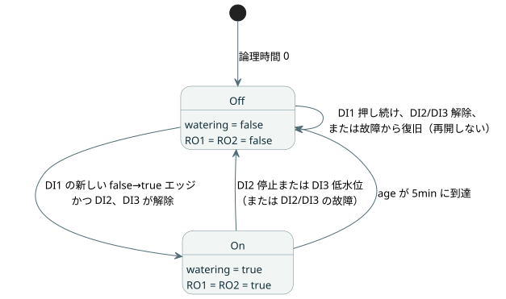

<!-- translation-source: contracts/interaction-v0/examples/five-minute-watering.ghost.en.md -->
[英語の原文](five-minute-watering.ghost.en.md)

# 5分間灌水フィクスチャ

[韓国語の正本ソース](./five-minute-watering.ghost.md)

この文芸的（literate）GhostFlow プログラムは、ボタンが押されると正確に5分間灌水します。停止ボタンまたは低水位センサが作動すると、灌水は即座に終了します。これは、インタラクション契約の正本となるパーサコーパス入力です。

## 実行契約

**初期状態**

- 論理時間 0 では、`watering` は false、すべての出力はオフ、`age` は 0 です。

**サイクルの開始**

- DI1 はモーメンタリの灌水要求です。false から true への立ち上がりエッジ（新しい押下）だけが、新しい灌水サイクルを開始します。
- DI1 を押し続けてもサイクルは再開しません。DI1 を離す（正常な false のサンプルが得られる）と、次の押下を受け付ける状態になります。

**停止**

- DI2（停止）または DI3（低水位）は、灌水と両方の出力を即座にオフにします。どちらの停止入力も、新しい DI1 要求より優先されます。
- DI2 または DI3 によって終了したサイクルは再開しません。DI2/DI3 が解除されても、DI1 を押し続けても、灌水は再開しません。新たに5分間のサイクルを開始するには、DI1 を離してから再び押します。

**出力**

- RO1（ポンプ）と RO2（灌水バルブ）は、受理された `watering` 状態に一緒に従います。true のときは両方オン、false のときは両方オフです。
- DI4〜DI8 は予備入力です。RO3〜RO8 は常にオフのままです。

**タイミング**

- `age = elapsed(watering)` は、Bool の `watering` 状態が最後に変化してからの時間です。これは `watering` が true の間だけサイクルを制限します。
- サイクルはちょうど5分で終了します。その後の新しい DI1 エッジは、新しい区間を開始します。

以下の状態図は、これらの規則をまとめたものです。



## 必要なケイパビリティのバインディング

プログラムがホストに要求する論理チャネルは次のとおりです。

| チャネル | 名前 | 役割 |
| --- | --- | --- |
| DI1 | 灌水要求 | ボタン |
| DI2 | 停止 | ボタン |
| DI3 | 低水位 | センサ |
| RO1 | ポンプ | ポンプ |
| RO2 | 灌水バルブ | バルブ |

## 元の意図と解釈

<!-- ghostflow:anchor id=GF-INT-FIXTURE-WATERING-V1 kind=intent status=confirmed origin=user -->
元の要求（2026-09-15、callin2/ghostflow-language#81、Backlog TASK-121.8.1）：
“DI1 momentary request: only a false-to-true edge starts/restarts watering;
DI2 stop and DI3 low-water each stop immediately and have priority; clearing
either condition or holding DI1 must not restart; RO1 pump and RO2 watering
valve operate in lockstep from the accepted watering state; timer age =
elapsed(watering), exact 5min cutoff.”

（訳：DI1 はモーメンタリ要求であり、false→true のエッジだけが灌水を開始・再開する。DI2 停止と DI3 低水位はそれぞれ即座に停止し、優先される。どちらかの条件が解除されても、DI1 を押し続けても再開してはならない。RO1 ポンプと RO2 灌水バルブは、受理された watering 状態から連動して動作する。タイマー age = elapsed(watering)、正確に 5min で打ち切る。）

- 制御の観点では、DI1 が true であることはボタンが押されていることを意味し、DI2/DI3 が true であることは対応する停止条件が存在することを意味します。元の要求は電気的な極性を規定しておらず、この文書でも定義しません。
- 上の表は、ソフトウェア上の（仮想）チャネルだけを対応づけています。Waveshare の端子番号、極性、物理的な配線については何も述べていません。

## 入力品質を明示した新リビジョン

このリビジョンは、#531 の入力品質契約を使用します。各入力は `ok(value)` または `fault(...)` のいずれかです。正常な false/0 の読み取り値は故障ではありません。

| 状況 | 効果 |
| --- | --- |
| DI1 の故障 | 新しい開始をブロックします。既存のサイクルは、DI2 と DI3 が正常かつ解除されている間だけ継続します。 |
| DI2 または DI3 の故障 | 作動中の停止として扱われ、灌水はオフになります。 |
| いずれかの入力で故障が観測された | 復旧後、灌水が再び開始できるようになるには、DI1 が正常な false として観測され、その後 true として観測される必要があります。復旧だけで灌水が開始されることは決してありません。 |

このリビジョン以前のソースは `tests/fixtures/history/issue531/consumer-fixtures.pre-input.json` に保存されています。

```ghost
control FiveMinuteWatering {
  input DI1, DI2, DI3, DI4, DI5, DI6, DI7, DI8: Bool;
  let request_good = case DI1 { ok(_) => true; fault(_) => false; };
  let stop_good = case DI2 { ok(_) => true; fault(_) => false; };
  let low_water_good = case DI3 { ok(_) => true; fault(_) => false; };
  let request = DI1 |> recover(false);
  let stop = DI2 |> recover(true);
  let low_water = DI3 |> recover(true);
  let watering_limit = 5min;
  output RO1, RO2, RO3, RO4, RO5, RO6, RO7, RO8: Bool;

  // ghostflow:link id=GF-INT-FIXTURE-WATERING-V1 relation=implements
  state request_was_high: Bool = false;
  // ghostflow:link id=GF-INT-FIXTURE-WATERING-V1 relation=implements
  state watering: Bool = false;
  // ghostflow:link id=GF-INT-FIXTURE-WATERING-V1 relation=implements
  timer age = elapsed(watering);

  request_was_high' = if !request_good || !stop_good || !low_water_good then true else request;
  watering' = !stop && !low_water
    && ((request && !request_was_high) || (watering && age < watering_limit));

  // ghostflow:link id=GF-INT-FIXTURE-WATERING-V1 relation=implements
  RO1 <- watering';
  // ghostflow:link id=GF-INT-FIXTURE-WATERING-V1 relation=implements
  RO2 <- watering';
  RO3 <- false;
  RO4 <- false;
  RO5 <- false;
  RO6 <- false;
  RO7 <- false;
  RO8 <- false;
}
```

コードと規則の対応は次のとおりです。

- `recover(false)` は故障した DI1 を「押されていない」として扱います。`recover(true)` は故障した DI2/DI3 を「停止」として扱います。
- `request_was_high` は前回の要求を記憶します。DI1〜DI3 のいずれかが故障しているときは常に true に強制されるため、正常な false の後に続く true だけが新しいエッジとして数えられます。
- `watering'` が true になるのは、停止が作動しておらず、かつ新しいエッジが到着したか、現在のサイクルがまだ `watering_limit` 未満である場合だけです。

## コーパスでの役割

この文芸的ドキュメントは、正本となるパーサコーパス入力です。取り込まれた意図や、以前の履歴・ベンチマーク・リプレイ・射影の証拠を置き換えるものではありません。

このドキュメントとそこから派生したコーパスファイルは、ソフトウェア検証専用です。ファームウェアとの統合や、実際のポンプ、バルブ、リレー、接点の挙動をテストまたは証明するものではありません。
