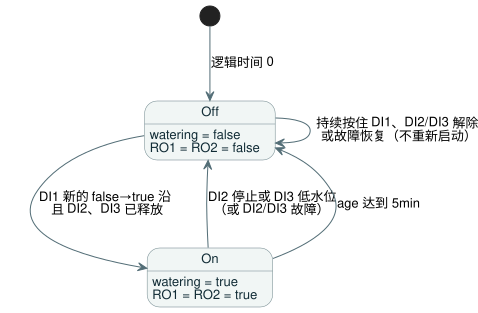

<!-- translation-source: contracts/interaction-v0/examples/five-minute-watering.ghost.en.md -->
[英文原文](five-minute-watering.ghost.en.md)

# 五分钟浇水 fixture

[韩文规范源](./five-minute-watering.ghost.md)

这个文学式（literate）GhostFlow 程序在按下按钮后精确浇水五分钟。停止按钮或低水位传感器会立即结束浇水。它是交互契约的规范解析器语料（parser corpus）输入。

## 执行契约

**初始状态**

- 在逻辑时间 0，`watering` 为 false，所有输出均关闭，`age` 为 0。

**启动一个周期**

- DI1 是瞬时（momentary）浇水请求。只有 false 到 true 的沿（一次新的按下）才会启动新的浇水周期。
- 持续按住 DI1 不会重新启动周期。松开 DI1（一个健康的 false 样本）会为下一次按下做好准备。

**停止**

- DI2（停止）或 DI3（低水位）会立即关闭浇水和两个输出。两个停止输入都优先于新的 DI1 请求。
- 被 DI2 或 DI3 结束的周期不会恢复。解除 DI2/DI3，或继续按住 DI1，都不会重新开始浇水。要启动新的完整五分钟周期，必须先松开 DI1 再重新按下。

**输出**

- RO1（泵）和 RO2（浇水阀门）一起跟随已接受的 `watering` 状态：为 true 时两者都开，为 false 时两者都关。
- DI4–DI8 是备用输入。RO3–RO8 始终保持关闭。

**时间**

- `age = elapsed(watering)` 是自布尔状态 `watering` 上次变化以来经过的时间。只有在 `watering` 为 true 时，它才用于限制周期。
- 周期在恰好五分钟时结束。之后新的 DI1 沿会开始一个新的区间。

下面的状态图总结了这些规则。



## 所需的能力绑定

以下是程序需要宿主提供的逻辑通道。

| 通道 | 名称 | 角色 |
| --- | --- | --- |
| DI1 | 浇水请求 | 按钮 |
| DI2 | 停止 | 按钮 |
| DI3 | 低水位 | 传感器 |
| RO1 | 泵 | 泵 |
| RO2 | 浇水阀门 | 阀门 |

## 原始意图与解释

<!-- ghostflow:anchor id=GF-INT-FIXTURE-WATERING-V1 kind=intent status=confirmed origin=user -->
原始请求（2026-09-15，callin2/ghostflow-language#81，Backlog TASK-121.8.1）：
“DI1 momentary request: only a false-to-true edge starts/restarts watering;
DI2 stop and DI3 low-water each stop immediately and have priority; clearing
either condition or holding DI1 must not restart; RO1 pump and RO2 watering
valve operate in lockstep from the accepted watering state; timer age =
elapsed(watering), exact 5min cutoff.”

（中文大意：DI1 为瞬时请求，只有 false 到 true 的沿才启动/重新启动浇水；DI2 停止和 DI3 低水位各自立即停止并具有优先权；解除任一条件或按住 DI1 都不得重新启动；RO1 泵和 RO2 浇水阀门依据已接受的浇水状态同步动作；定时器 age = elapsed(watering)，在 5min 处精确截止。）

- 从控制的角度看，DI1 为 true 表示按钮被按下，DI2/DI3 为 true 表示相应的停止条件存在。原始请求没有规定电气极性，本文档也不定义它。
- 上表只映射软件（虚拟）通道。它不涉及 Waveshare 端子编号、极性或物理接线。

## 带有显式输入质量的新修订版

本修订版采用 #531 的输入质量契约。每个输入要么是 `ok(value)`，要么是 `fault(...)`。健康的 false/0 读数不是故障。

| 情形 | 效果 |
| --- | --- |
| DI1 故障 | 阻止新的启动。已有周期只在 DI2 和 DI3 健康且已释放时才继续。 |
| DI2 或 DI3 故障 | 视为有效的停止：浇水关闭。 |
| 曾观测到任一输入故障 | 恢复后，必须先看到 DI1 为健康的 false，再看到 true，浇水才能再次启动。仅靠恢复本身绝不会启动浇水。 |

之前的源（本修订版之前）保存在 `tests/fixtures/history/issue531/consumer-fixtures.pre-input.json` 中。

```ghost
control FiveMinuteWatering {
  input DI1, DI2, DI3, DI4, DI5, DI6, DI7, DI8: Bool;
  let request_good = case DI1 { ok(_) => true; fault(_) => false; };
  let stop_good = case DI2 { ok(_) => true; fault(_) => false; };
  let low_water_good = case DI3 { ok(_) => true; fault(_) => false; };
  let request = DI1 |> recover(false);
  let stop = DI2 |> recover(true);
  let low_water = DI3 |> recover(true);
  let watering_limit = 5min;
  output RO1, RO2, RO3, RO4, RO5, RO6, RO7, RO8: Bool;

  // ghostflow:link id=GF-INT-FIXTURE-WATERING-V1 relation=implements
  state request_was_high: Bool = false;
  // ghostflow:link id=GF-INT-FIXTURE-WATERING-V1 relation=implements
  state watering: Bool = false;
  // ghostflow:link id=GF-INT-FIXTURE-WATERING-V1 relation=implements
  timer age = elapsed(watering);

  request_was_high' = if !request_good || !stop_good || !low_water_good then true else request;
  watering' = !stop && !low_water
    && ((request && !request_was_high) || (watering && age < watering_limit));

  // ghostflow:link id=GF-INT-FIXTURE-WATERING-V1 relation=implements
  RO1 <- watering';
  // ghostflow:link id=GF-INT-FIXTURE-WATERING-V1 relation=implements
  RO2 <- watering';
  RO3 <- false;
  RO4 <- false;
  RO5 <- false;
  RO6 <- false;
  RO7 <- false;
  RO8 <- false;
}
```

代码与规则的对应关系：

- `recover(false)` 把发生故障的 DI1 视为“未按下”；`recover(true)` 把发生故障的 DI2/DI3 视为“停止”。
- `request_was_high` 记住上一次的请求。只要 DI1–DI3 中任一个发生故障，它就被强制为 true，因此只有健康的 false 之后跟着 true 才算一个新的沿。
- 只有在没有有效停止，并且要么出现了新的沿、要么当前周期仍未达到 `watering_limit` 时，`watering'` 才为 true。

## 语料中的角色

这个文学式文档是规范解析器语料输入。它不取代导入的意图，也不取代更早的历史、基准测试、重放或投影证据。

本文档及由其派生的语料文件仅用于软件验证。它们不测试也不证明固件集成，或真实泵、阀门、继电器、触点的行为。
