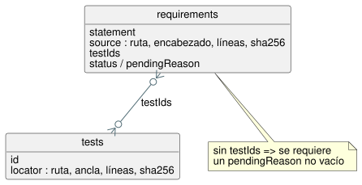

<!-- translation-source: contracts/requirements/README.md -->
[Original en inglés](README.md)

# Catálogo de requisitos

`catalog.json` es un pequeño catálogo de trazabilidad para los requisitos de
GhostFlow. Es relacional y está inspirado en SQLite: tiene dos tablas
vinculadas por ID.

- La tabla `requirements` almacena enunciados normativos. Cada fila se
  direcciona por contenido: su ID se deriva del texto exacto del enunciado.
- La tabla `tests` almacena filas de verificación. Cada fila apunta a una fuente
  real (está "respaldada por fuente", *source-backed*).
- `testIds` en una fila de requisito es la relación entre las dos tablas.

Un requisito puede no tener ninguna fila de prueba solo si tiene un
`pendingReason` no vacío. Esta regla mantiene visible la cobertura faltante. La
prosa de diseño nunca se trata en silencio como evidencia de ejecución.

El diagrama muestra las dos tablas y la relación `testIds`. Un requisito sin
pruebas debe indicar el motivo en `pendingReason`.

**ID de requisitos.** Un ID es `GF-REQ-` seguido de los primeros 16 caracteres
hexadecimales del digest SHA-256 de la cadena `statement` exacta.

**Localizadores.** Todo localizador de fuente y de prueba debe indicar:

- un archivo con ruta relativa al repositorio;
- un encabezado o un ancla de fuente;
- un rango de líneas inclusivo; y
- el digest SHA-256 del extracto normalizado de ese rango (se normalizan los
  finales de línea y los espacios en blanco).

Un encabezado Markdown debe existir y aparecer antes de su rango. Un ancla de
fuente también debe aparecer antes de su rango.

**Qué comprueba el validador.** El validador del catálogo comprueba los ID, las
filas duplicadas, los localizadores, los digests de los extractos y ambos lados
de la relación requisito/prueba. No afirma que una prueba referenciada demuestre
más de lo que describe su selector. El comportamiento pendiente del host/Driver
o el comportamiento físico quedan fuera de esta exportación del lenguaje.

## Inventario actual

El catálogo contiene actualmente 42 filas atómicas a lo largo del segmento
solicitado de la especificación de ejecución. Los vínculos de evidencia directa
se mantienen reducidos. El comportamiento no cubierto permanece `pending`; la
documentación nunca se eleva a una afirmación de aceptación. Las filas se
solapan con los documentos nombrados, pero por sí solas no catalogan cada
oración de la prosa.

Recuento por estado en el catálogo actual:

| Estado | Filas |
| --- | --- |
| `implemented` | 16 |
| `partial` | 4 |
| `pending` | 21 |
| `design-only` | 1 |

Estas filas enlazan con 24 registros de prueba respaldados por fuente. (Una fila
sin `status` explícito se cuenta como `implemented` cuando no tiene
`pendingReason`, y como `partial` cuando lo tiene).

`implemented` significa que el enunciado exacto tiene evidencia automatizada
específica en este catálogo. No es una garantía exhaustiva del lenguaje, de la
plataforma ni del comportamiento físico. El validador rechaza una fila
`implemented` que tenga un motivo pendiente sin resolver o que no tenga pruebas.

Dos filas merecen una nota:

- `GF-REQ-d9f669f061279c41` conserva la redacción del MVP sustituida, su ID y
  el hash de su extracto como evidencia histórica.
- `GF-REQ-fe719c3299fc1258` vincula la regla aceptada de estado
  anterior/siguiente explícito con las pruebas actuales.

Consulte `docs/TASK-61-CONFORMANCE.md` para la línea base fechada de TASK-61.

El catálogo no tiene filas para prosa explicativa, alternativas históricas,
ejemplos repetidos ni comportamiento físico/de API que pertenezca al consumidor.
Otros detalles del lenguaje fuera de estos segmentos finitos se excluyen
intencionadamente, sin ninguna afirmación de cobertura. Cuando dichos detalles
se cataloguen más adelante, los bocetos solo de diseño y la evidencia no
disponible deben permanecer marcados explícitamente como `pending` o
`design-only`, con un motivo.
