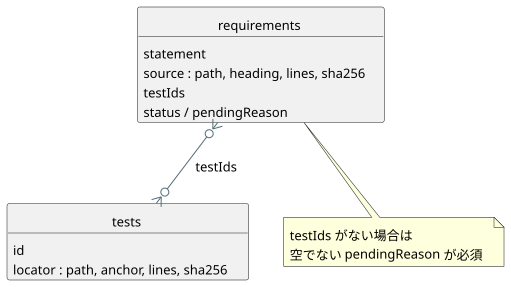

<!-- translation-source: contracts/requirements/README.md -->
[英語の原文](README.md)

# 要件カタログ

`catalog.json` は、GhostFlow の要件のための小さなトレーサビリティカタログです。SQLite に着想を得たリレーショナルな構造で、ID で結ばれた2つのテーブルを持ちます。

- `requirements` テーブルは規範的な記述を格納します。各行はコンテンツアドレス方式で、その ID は正確な記述テキストから導出されます。
- `tests` テーブルは検証用の行を格納します。各行は実在するソースを指します（「ソースに裏付けられている」）。
- 要件行の `testIds` が、2つのテーブル間の関係です。

要件がテスト行を持たなくてよいのは、空でない `pendingReason` を持つ場合だけです。この規則によって、カバレッジの不足が見える状態に保たれます。設計上の説明文が、黙って実行の証拠として扱われることは決してありません。

この図は、2つのテーブルと `testIds` の関係を示しています。テストのない要件は、その理由を `pendingReason` に記述しなければなりません。

**要件 ID。** ID は、`GF-REQ-` の後に、正確な `statement` 文字列の SHA-256 ダイジェストの先頭16桁の16進文字を続けたものです。

**ロケータ。** すべてのソースロケータとテストロケータは、次のものを指定しなければなりません。

- リポジトリ相対のファイル
- 見出しまたはソースアンカー
- 両端を含む行範囲
- その範囲の正規化された抜粋の SHA-256 ダイジェスト（改行と空白は正規化されます）

Markdown の見出しは存在し、かつその範囲より前になければなりません。ソースアンカーも、その範囲より前に出現しなければなりません。

**バリデータが検査する内容。** カタログのバリデータは、ID、重複行、ロケータ、抜粋のダイジェスト、および要件とテストの関係の両側を検査します。参照されたテストが、そのセレクタが記述する以上のことを証明するとは主張しません。保留中のホスト/ドライバの挙動や物理的な挙動は、この言語エクスポートの対象外のままです。

## 現在の内訳

カタログには現在、要求された実行仕様の範囲にわたる42件のアトミックな行が含まれています。直接の証拠リンクは少数に保たれています。カバーされていない挙動は `pending` のままであり、ドキュメントが受け入れ主張に格上げされることは決してありません。これらの行は名前の挙がったドキュメントと重なりますが、それだけで説明文のすべての文をカタログ化しているわけではありません。

現在のカタログにおけるステータス別の件数：

| ステータス | 行数 |
| --- | --- |
| `implemented` | 16 |
| `partial` | 4 |
| `pending` | 21 |
| `design-only` | 1 |

これらの行は、ソースに裏付けられた24件のテストレコードにリンクしています。（明示的な `status` を持たない行は、`pendingReason` がなければ `implemented`、あれば `partial` として数えられます。）

`implemented` は、その正確な記述に対して、このカタログ内に焦点を絞った自動化された証拠があることを意味します。言語、プラットフォーム、物理面を網羅的に保証するものではありません。バリデータは、未解決の保留理由を持つ、またはテストを持たない `implemented` 行を拒否します。

注記が必要な行が2つあります。

- `GF-REQ-d9f669f061279c41` は、置き換えられた MVP の文言、ID、抜粋ハッシュを履歴上の証拠として保持しています。
- `GF-REQ-fe719c3299fc1258` は、受理済みの「旧状態/明示的な次状態」規則を現在のテストにリンクしています。

日付付きの TASK-61 ベースラインについては `docs/TASK-61-CONFORMANCE.md` を参照してください。

カタログには、説明的な文章、過去の代替案、繰り返しの例、利用側が所有する物理/API の挙動についての行はありません。これらの有限な範囲の外にある言語の詳細は、カバレッジを主張することなく、意図的に除外されています。そのような詳細を後でカタログ化する場合、設計段階のスケッチや入手できない証拠は、理由を添えて明示的に `pending` または `design-only` とマークしたままにしなければなりません。
