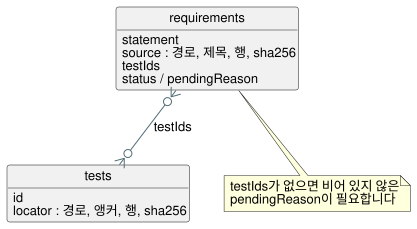

<!-- translation-source: contracts/requirements/README.md -->
[영문 원문](README.md)

# 요구 사항 카탈로그

`catalog.json`은 GhostFlow 요구 사항을 위한 작은 추적성 카탈로그입니다. SQLite에서
영감을 받은 관계형 구조이며, ID로 연결된 두 테이블로 이루어져 있습니다.

- `requirements` 테이블은 규범 문장을 저장합니다. 각 행은 콘텐츠 주소 방식입니다.
  즉, 행의 ID는 정확한 문장 텍스트에서 도출됩니다.
- `tests` 테이블은 검증 행을 저장합니다. 각 행은 실제 소스를 가리킵니다
  ("소스 근거가 있는" 행입니다).
- 요구 사항 행의 `testIds`가 두 테이블 사이의 관계입니다.

테스트 행이 없는 요구 사항은 비어 있지 않은 `pendingReason`이 있을 때만 허용됩니다.
이 규칙은 누락된 커버리지를 드러나게 합니다. 설계 산문을 실행 증거로 조용히
취급하는 일은 절대 없습니다.

이 다이어그램은 두 테이블과 `testIds` 관계를 보여 줍니다. 테스트가 없는 요구 사항은
그 이유를 `pendingReason`에 밝혀야 합니다.

**요구 사항 ID.** ID는 `GF-REQ-` 뒤에 정확한 `statement` 문자열의 SHA-256
다이제스트 중 앞 16자리 16진수를 붙인 것입니다.

**위치(locator).** 모든 소스 위치와 테스트 위치에는 다음이 있어야 합니다.

- 저장소 기준 상대 파일 경로
- 제목 또는 소스 앵커
- 양 끝을 포함하는 행 범위
- 그 범위의 정규화된 발췌(행 끝과 공백을 정규화함)에 대한 SHA-256 다이제스트

Markdown 제목은 존재해야 하며 행 범위보다 앞에 있어야 합니다. 소스 앵커도 행 범위보다
앞에 있어야 합니다.

**검증기가 확인하는 것.** 카탈로그 검증기는 ID, 중복 행, 위치, 발췌 다이제스트, 그리고
요구 사항/테스트 관계의 양쪽을 확인합니다. 참조된 테스트가 그 선택자가 설명하는 것보다
더 많은 것을 입증한다고 주장하지 않습니다. 미완료 상태인 호스트/Driver 동작이나 물리 동작은
이 언어 내보내기 범위 밖에 둡니다.

## 현재 목록

현재 카탈로그에는 요청된 실행 명세 범위에 걸쳐 원자적 행 42개가 있습니다. 직접 증거
링크는 작게 유지합니다. 커버되지 않은 동작은 `pending`으로 남겨 두며, 문서를 수용
주장으로 격상하는 일은 절대 없습니다. 행들은 지정된 문서와 겹치지만, 그 자체로 모든
산문 문장을 카탈로그화하지는 않습니다.

현재 카탈로그의 상태별 행 수:

| 상태 | 행 수 |
| --- | --- |
| `implemented` | 16 |
| `partial` | 4 |
| `pending` | 21 |
| `design-only` | 1 |

이 행들은 소스 근거가 있는 테스트 기록 24개에 연결됩니다. (명시적 `status`가 없는 행은
`pendingReason`이 없으면 `implemented`로, 있으면 `partial`로 집계합니다.)

`implemented`는 정확한 문장에 대해 이 카탈로그에 집중된 자동 증거가 있다는 뜻입니다.
언어, 플랫폼 또는 물리 동작을 빠짐없이 보증한다는 뜻은 아닙니다. 검증기는 미해결 대기
사유가 있거나 테스트가 없는 `implemented` 행을 거부합니다.

두 행은 따로 설명할 필요가 있습니다.

- `GF-REQ-d9f669f061279c41`은 대체된 MVP 문구, ID, 발췌 해시를 과거 증거로 유지합니다.
- `GF-REQ-fe719c3299fc1258`은 수용된 이전 상태/명시적 다음 상태 규칙을 현재 테스트에
  연결합니다.

날짜가 붙은 TASK-61 기준선은 `docs/TASK-61-CONFORMANCE.md`를 참조하세요.

카탈로그에는 설명 산문, 과거 대안, 반복 예제, 소비자가 소유하는 물리/API 동작에 대한
행이 없습니다. 이 유한한 범위 밖의 다른 언어 세부 사항은 커버리지 주장 없이 의도적으로
제외됩니다. 나중에 그런 세부 사항을 카탈로그에 등록할 때도, 설계 전용 초안과 사용할 수
없는 증거는 사유와 함께 `pending` 또는 `design-only`로 명시해야 합니다.
