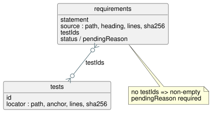

# Requirement catalog

`catalog.json` is a small traceability catalog for GhostFlow requirements. It is
relational and inspired by SQLite: it has two tables linked by IDs.

- The `requirements` table stores normative statements. Each row is
  content-addressed: its ID is derived from the exact statement text.
- The `tests` table stores verification rows. Each row points at real source
  (it is "source-backed").
- `testIds` on a requirement row is the relation between the two tables.

A requirement may have no test row only if it has a non-empty `pendingReason`.
This rule keeps missing coverage visible. Design prose is never silently
treated as execution evidence.

The diagram shows the two tables and the `testIds` relation. A requirement
without tests must state why in `pendingReason`.

**Requirement IDs.** An ID is `GF-REQ-` followed by the first 16 hexadecimal
characters of the SHA-256 digest of the exact `statement` string.

**Locators.** Every source and test locator must name:

- a repository-relative file;
- a heading or source anchor;
- an inclusive line range; and
- the SHA-256 digest of that range's normalized excerpt (line endings and
  whitespace are normalized).

A Markdown heading must exist and come before its range. A source anchor must
also occur before its range.

**What the validator checks.** The catalog validator checks IDs, duplicate
rows, locators, excerpt digests, and both sides of the requirement/test
relation. It does not claim that a referenced test proves more than its
selector describes. Pending host/Driver or physical behavior stays outside this
language export.

## Current inventory

The catalog currently contains 42 atomic rows across the requested execution
specification slice. Direct evidence links stay small. Uncovered behavior stays
`pending`; documentation is never upgraded to an acceptance claim. The rows
overlap the named documents, but they do not catalog every prose sentence on
their own.

Status counts in the current catalog:

| Status | Rows |
| --- | --- |
| `implemented` | 16 |
| `partial` | 4 |
| `pending` | 21 |
| `design-only` | 1 |

These rows link to 24 source-backed test records. (A row without an explicit
`status` is counted as `implemented` when it has no `pendingReason`, and as
`partial` when it has one.)

`implemented` means that the exact statement has focused automated evidence in
this catalog. It is not exhaustive language, platform, or physical assurance.
The validator rejects an `implemented` row that has an unresolved pending
reason or no tests.

Two rows deserve a note:

- `GF-REQ-d9f669f061279c41` keeps the superseded MVP wording, ID, and excerpt
  hash as historical evidence.
- `GF-REQ-fe719c3299fc1258` links the accepted old-state/explicit-next rule to
  current tests.

See `docs/TASK-61-CONFORMANCE.md` for the dated TASK-61 baseline.

The catalog has no rows for explanatory prose, historical alternatives,
repeated examples, or consumer-owned physical/API behavior. Other language
details outside these finite slices are intentionally excluded, with no
coverage claim. When such details are cataloged later, design-only sketches and
unavailable evidence must stay explicitly marked `pending` or `design-only`,
with a reason.
