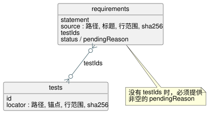

<!-- translation-source: contracts/requirements/README.md -->
[英文原文](README.md)

# 需求目录

`catalog.json` 是一个用于 GhostFlow 需求追溯的小型目录。它是关系型的，受 SQLite 启发：包含两张通过 ID 关联的表。

- `requirements` 表存储规范性陈述。每一行都按内容寻址：其 ID 由陈述的确切文本派生。
- `tests` 表存储验证行。每一行都指向真实的源（即“有源可依”，source-backed）。
- 需求行上的 `testIds` 是两张表之间的关系。

只有当某条需求带有非空的 `pendingReason` 时，它才可以没有测试行。这条规则让缺失的覆盖保持可见。设计说明文字绝不会被默默当作执行证据。

上图展示了两张表以及 `testIds` 关系。没有测试的需求必须在 `pendingReason` 中说明原因。

**需求 ID。** ID 由 `GF-REQ-` 加上确切 `statement` 字符串的 SHA-256 摘要的前 16 个十六进制字符组成。

**定位符（locator）。** 每个源定位符和测试定位符都必须给出：

- 一个相对于仓库的文件；
- 一个标题或源锚点；
- 一个闭区间的行范围；以及
- 该范围规范化摘录的 SHA-256 摘要（行尾和空白会被规范化）。

Markdown 标题必须存在，并且位于其范围之前。源锚点同样必须出现在其范围之前。

**验证器检查的内容。** 目录验证器检查 ID、重复行、定位符、摘录摘要，以及需求/测试关系的两端。它不会声称被引用的测试证明了超出其选择器所描述范围的内容。尚未完成的宿主/Driver 行为或物理行为不属于这次语言导出的范围。

## 当前清单

目前，该目录在所要求的执行规范切片中共包含 42 个原子行。直接证据链接保持精简。未覆盖的行为保持为 `pending`；文档绝不会被升级为验收声明。这些行与所列文档有重叠，但它们本身并不会为每一句说明文字都建立条目。

当前目录中的状态计数：

| 状态 | 行数 |
| --- | --- |
| `implemented` | 16 |
| `partial` | 4 |
| `pending` | 21 |
| `design-only` | 1 |

这些行链接到 24 条有源可依的测试记录。（没有显式 `status` 的行，若没有 `pendingReason` 则计为 `implemented`，若有则计为 `partial`。）

`implemented` 表示确切的陈述在本目录中有针对性的自动化证据。它并不是对语言、平台或物理层面的全面保证。验证器会拒绝带有未解决 pending 原因或没有测试的 `implemented` 行。

有两行值得特别说明：

- `GF-REQ-d9f669f061279c41` 保留已被取代的 MVP 措辞、ID 和摘录哈希，作为历史证据。
- `GF-REQ-fe719c3299fc1258` 把已接受的“旧状态/显式下一状态”规则链接到当前测试。

有关带日期的 TASK-61 基线，请参阅 `docs/TASK-61-CONFORMANCE.md`。

该目录不为解释性说明文字、历史备选方案、重复的示例或由使用方负责的物理/API 行为建立条目。这些有限切片之外的其他语言细节被有意排除，不作任何覆盖声明。今后为这些细节建立条目时，仅为设计草案的内容和无法获得的证据必须明确标记为 `pending` 或 `design-only`，并附上原因。
