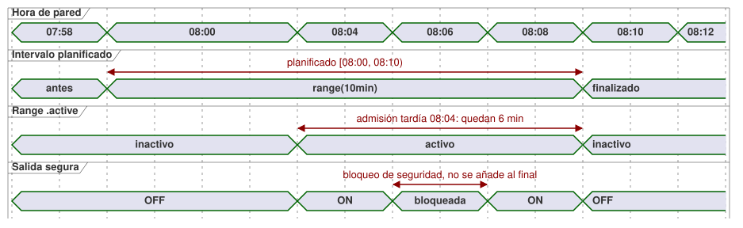

<!-- translation-source: docs/2026-09-24-fixed-planned-time-range-decision.md -->
[Original en inglés](2026-09-24-fixed-planned-time-range-decision.md)

# Decisión sobre el rango de tiempo planificado fijo — 2026-09-24

Estado: significado del lenguaje aprobado; la implementación sigue siendo un
asunto aparte. La sintaxis y el comportamiento normativos están en la
[Referencia del lenguaje §3.5](reference/03-time-and-schedules.es.md)
(traducción al inglés: [03-time-and-schedules.en.md](reference/03-time-and-schedules.en.md)).

Este registro decide cómo una programación (`schedule`) puede planificar una
salida para un intervalo de reloj **fijo** que no se desplaza cuando el
controlador arranca tarde. Términos usados a continuación:

- **Ocurrencia** (occurrence): una instancia planificada de una programación
  (por ejemplo, la franja de las 08:00 de hoy).
- **Admisión** (admission): la decisión de que una ocurrencia puede empezar a
  ejecutarse.
- **Range**: una programación cuya base es `range(duration)`.

## Intención y superficie seleccionada

Un operador puede planificar una salida para un intervalo fijo, como
08:00–08:10. Si la primera observación confiable llega a las 08:04, a la salida
le quedan seis minutos. El intervalo no debe desplazarse a 08:04–08:14.

La base de programación seleccionada es `range(duration)` con una Duration
positiva. Los campos de disparo fijan el inicio planificado de la ocurrencia.
Su intervalo es semiabierto:
`[planned start, planned start + effective duration)`.

Las demás bases conservan su significado:

| Base | Significado |
| --- | --- |
| `range(duration)` | Intervalo planificado fijo; un inicio tardío obtiene solo el tiempo restante. |
| `run(duration, within(grace))` | Permite la admisión tardía, pero mide la duración completa de la ejecución desde la admisión. |
| `window(duration)` | Una ventana de admisión, no un intervalo activo de tiempo planificado. |
| `pulse` | Admite solo en el cruce observado. |

## Admisión y progresión

- Un Range admite la ocurrencia actual cuando `when` es true y la hora actual
  confiable está dentro de su intervalo. La primera observación puede llegar
  después del arranque, de la recuperación de la confianza o de una brecha de
  observación. Las ocurrencias anteriores ya vencidas no se reproducen. En el
  final o después de él, se registra `LateStartExpired` y no se ejecuta.
- Una brecha de observación mientras el intervalo del Range sigue abierto es
  evidencia no terminal. No crea un registro terminal de omisión que haya que
  revivir más tarde. La ocurrencia todavía puede admitirse por su tiempo
  restante. Una vez pasado su final planificado, `LateStartExpired` es terminal.
- Un reloj no confiable no puede admitir de nuevo el Range. La política de reloj
  explícita `hold_trusted(...)` puede proporcionar una extrapolación confiable
  acotada, conservando su incertidumbre y su procedencia.
- La excepción de admisión tardía no puede revivir una ocurrencia que ya está
  omitida o retirada de forma terminal. Un evento de Tide marcado
  `CorrectionPastHighWater` o `EventWithdrawn` sigue siendo terminal aunque su
  intervalo revisado cubra el momento actual.
- La admisión registra el ID estable de la ocurrencia y el inicio planificado.
  Convierte el tiempo restante en un plazo monotónico. Las correcciones del
  reloj de pared por RTC/NTP durante esa ocurrencia se mantienen pendientes para
  el cálculo de su final; no pueden acortar ni alargar el intervalo activo. La
  hora de pared corregida se aplica a decisiones de ocurrencias posteriores,
  una vez que este Range se resuelve. Un retroceso del reloj de pared no puede
  admitir dos veces la misma ocurrencia.
- Un Range activo ya admitido continúa hasta su plazo monotónico aunque expire
  la confianza en el reloj de pared o una retención explícita del reloj. El
  `skip` terminal se aplica a las nuevas decisiones de admisión, no a ese plazo
  activo. Un Range pausado por una edición del inicio hacia el futuro no puede
  reingresar mientras la calidad del reloj sea Unknown. Tras la recuperación,
  puede reingresar solo si el mismo intervalo sigue abierto.
- Una restricción de seguridad global bloquea de inmediato la salida segura. El
  reloj del Range sigue corriendo. Si la restricción se despeja antes del final
  programado, la salida puede reanudarse durante el tiempo restante. El tiempo
  bloqueado nunca se añade al final. `cancel_when` termina la ocurrencia sin
  volver a armarla.
- La evidencia de salida solicitada (requested), segura (safe), aplicada
  (applied) y confirmada (confirmed) se mantiene diferenciada. `.active` de un
  Range registra el intervalo de la programación, no la operación física.

**Ejemplo práctico.** Con un inicio planificado a las 08:00 y `range(10min)`,
una admisión a las 08:04 deja seis minutos. Una admisión a las 08:10 no deja
ningún intervalo. Si la seguridad bloquea de 08:06 a 08:08, la salida puede
reanudarse solo hasta las 08:10. Una corrección del reloj de pared a las 08:07
no cambia ese plazo activo.

El siguiente diagrama de tiempos muestra la admisión de las 08:04 y el bloqueo
de seguridad de 08:06–08:08.

## Cambios en vivo del inicio y la duración

Un evento de ajuste en vivo atómico y validado puede cambiar un inicio
planificado escalar o una Duration de la ocurrencia actual, con efecto desde la
posición del evento. El intervalo se recalcula como el nuevo inicio más la
Duration efectiva, evaluado frente a la progresión estable del reloj
establecida en la admisión. Una hora de admisión tardía nunca reemplaza al
inicio planificado.

Ejemplos, con un inicio planificado a las 08:00 y admisión a las 08:04:

| Cambio | Resultado |
| --- | --- |
| A las 08:07, Duration 10 → 12 minutos | La ocurrencia termina a las 08:12. |
| A las 08:07, Duration 10 → 5 minutos | El nuevo final es 08:05, así que la misma decisión aceptada termina el Range activo. |
| Inicio editado a 08:02, Duration 10 minutos | El final se mueve a las 08:12. |

Ninguno de los dos tipos de evento de ajuste crea una ocurrencia nueva ni
reinicia su identidad o su libro mayor (ledger) de admisión.

Una entrada `TimeSlots` de `DailySlots` tiene una clave de franja opaca en
tiempo de ejecución, independiente de su `TimeOfDay` mostrado. Esto no añade
sintaxis de fuente a GhostFlow. Un evento de ajuste de reprogramación aceptado
identifica:

- su propio evento;
- la revisión base de los ajustes;
- la clave de franja existente; y
- el `TimeOfDay` de reemplazo.

Cambia los metadatos de tiempo planificado y conserva `(schedule ID, local date,
slot key, DST fold)` como identidad de la ocurrencia. El estado de ajustes
aceptado conserva esa clave tras un reinicio. Ni la posición en la lista ni la
hora mostrada son identidad.

Por lo tanto, para un ajuste `TimeSlots<1min,N>`, reprogramar una entrada
`range(10min)` de las 08:00 ya admitida a las 08:07 la pausa en la posición del
evento y reevalúa la **misma** ocurrencia a las 08:07. Si `when` es true, puede
solicitar salida hasta las 08:17. No emite un segundo `due`, no realiza una
segunda admisión y conserva el ledger. Cuando el evento y el escaneo de las
08:07 comparten una misma posición efectiva, primero se aplica el evento, y esa
decisión completada reevalúa la misma ocurrencia. Una cuadrícula más gruesa que
no contenga 08:07 rechaza el evento.

Quitar/añadir sigue siendo una operación aparte. Quitar elimina los planes
futuros de la clave de franja antigua. Añadir, incluso a la misma hora mostrada,
crea una clave nueva y aplica la regla de línea base ordinaria. Quitar/añadir no
puede usarse para reprogramar un Range admitido. Un reemplazo del valor completo
que no lleve la clave existente como una reprogramación explícita se interpreta
con estas reglas de quitar/añadir. El runtime no adivina una correspondencia a
partir del orden de la lista ni de la hora mostrada.

El orden de los eventos de ajuste y de los escaneos sigue el contrato de eventos
en vivo atómicos de
[§5.2](reference/05-settings-and-observation.es.md): el valor efectivo en la
posición de la decisión completada determina esa decisión.

## Límite

Esta decisión otorga a Range una excepción específica a la política existente
de brecha de observación y de línea base en el arranque. Pulse, Window y Run
conservan sus reglas existentes de omisión (skip) y admisión. Range nunca se
pone al día después de su final planificado.

Si una edición en vivo del inicio mueve al futuro el nuevo inicio de una
ocurrencia admitida, la decisión aceptada en la posición del evento establece
`.active = false` de inmediato. En el nuevo inicio y después, se reevalúa si la
**misma** ocurrencia está dentro del intervalo semiabierto modificado. Si `when`
es true, la salida solicitada puede reanudarse solo hasta su final planificado
actual. La salida segura se reanuda solo cuando las restricciones de seguridad
lo permiten. Esto no es una segunda admisión: `.due` no vuelve a pulsar, y el ID
de la ocurrencia y el ledger no cambian. Si el final modificado ya está en la
hora actual estable o antes, la ocurrencia termina de inmediato; no se reanuda
más tarde.

## Validación de no solapamiento

Dos ocurrencias de la misma programación no pueden tener intervalos Range
semiabiertos solapados. Los intervalos adyacentes son válidos. Por ejemplo,
`DailySlots` con `selected = [08:00, 08:15]` y `basis = range(30min)` es un
error de compilación: 08:00–08:30 se solapa con 08:15–08:45. No existe arbitraje
en tiempo de ejecución entre esas dos ocurrencias.

El compilador acepta `range` solo para disparadores cuyo espaciado entre
ocurrencias pueda demostrarse a partir de la definición y de los ajustes
efectivos. Si una recurrencia dinámica o un proveedor no puede aportar un
espaciado demostrable, la compilación rechaza la declaración `range` con un
diagnóstico.

El solapamiento se comprueba en cada punto donde los ajustes pueden entrar en
vigor:

- **Los valores predeterminados estáticos** se comprueban en tiempo de
  compilación.
- **Los ajustes efectivos restaurados** se comprueban antes de la activación;
  un solapamiento rechaza la activación.
- **Un evento de ajuste en vivo** que crearía un solapamiento se rechaza de
  forma atómica, incluido el solapamiento con el intervalo admitido actual. Esto
  también se aplica a las ediciones de `DailySlots`.

Una reprogramación valida la hora mostrada propuesta sin asignar una clave de
franja nueva. Un rechazo conserva la hora mostrada antigua, la clave de franja,
la revisión de los ajustes, la ocurrencia activa y el ledger. Quitar/añadir
conserva sus propias reglas de identidad y de línea base.
