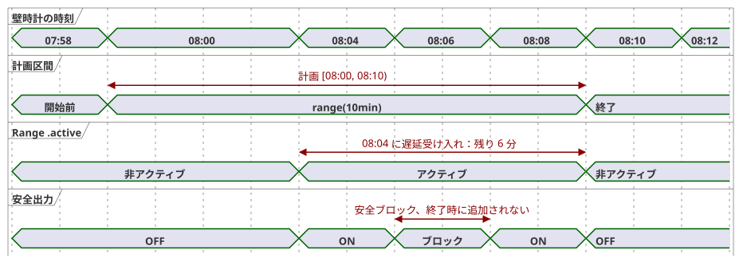

<!-- translation-source: docs/2026-09-24-fixed-planned-time-range-decision.md -->
[英語の原文](2026-09-24-fixed-planned-time-range-decision.md)

# 固定された計画時間 Range の決定 — 2026-09-24

ステータス：言語上の意味は承認済み。実装は別途行います。規範的な構文と挙動は [Language Reference §3.5](reference/03-time-and-schedules.ja.md) にあります（英語版：[03-time-and-schedules.en.md](reference/03-time-and-schedules.en.md)）。

この記録は、コントローラの起動が遅れてもずれない**固定**の時計区間に対して、スケジュールが出力を計画する方法を決定するものです。以下で使う用語：

- **発生（occurrence）**：スケジュールの1つの計画インスタンス（例：今日の08:00のスロット）。
- **受け入れ（admission）**：ある発生の実行開始を認める判断。
- **Range**：basis が `range(duration)` であるスケジュール。

## 意図と選択した表現

オペレーターは、08:00〜08:10 のような固定区間に出力を計画できます。最初の信頼できる観測が 08:04 に到着した場合、出力に残る時間は6分です。区間が 08:04〜08:14 にずれてはなりません。

選択したスケジュールの basis は、正の Duration を取る `range(duration)` です。トリガーフィールドが発生の計画開始時刻を設定します。その区間は半開区間 `[planned start, planned start + effective duration)` です。

他の basis はそれぞれの意味を保ちます。

| Basis | 意味 |
| --- | --- |
| `range(duration)` | 固定された計画区間。遅れて開始した場合は残り時間だけを得ます。 |
| `run(duration, within(grace))` | 遅延受け入れを許可しますが、実行の継続時間全体を受け入れ時点から測ります。 |
| `window(duration)` | 受け入れウィンドウであり、アクティブな計画時間区間ではありません。 |
| `pulse` | 観測された交差の時点でのみ受け入れます。 |

## 受け入れと進行

- Range は、`when` が true で、信頼できる現在時刻がその区間内にあるとき、現在の発生を受け入れます。最初の観測は、起動後、信頼の復旧後、または観測ギャップの後に来ることがあります。それ以前に期限切れとなった発生はリプレイされません。終了時刻以降であれば、`LateStartExpired` を記録し、実行しません。
- Range の区間がまだ開いている間の観測ギャップは、非終端の証拠です。後で復活させるための終端的な取りこぼし記録は作成しません。その発生は、残り時間について引き続き受け入れ可能です。計画終了時刻を過ぎると、`LateStartExpired` は終端となります。
- 信頼できないクロックは、Range を新たに受け入れることができません。明示的な `hold_trusted(...)` クロックポリシーは、不確実性と来歴を保持したまま、有界で信頼できる外挿を提供できます。
- 遅延受け入れの例外によって、すでに終端的に取りこぼされた発生や取り消された発生を復活させることはできません。`CorrectionPastHighWater` または `EventWithdrawn` とマークされた Tide イベントは、修正後の区間が現在を含んでいても終端のままです。
- 受け入れでは、安定した発生 ID と計画開始時刻を記録します。残り時間を単調なデッドラインに変換します。その発生の間に生じた RTC/NTP の壁時計の補正は、終了の計算については保留され、アクティブな区間を短縮も延長もできません。補正された壁時計の時刻は、この Range が確定した後の発生の判断に適用します。壁時計の巻き戻しによって、同じ発生が二度受け入れられることはありません。
- 受け入れられたアクティブな Range は、壁時計の信頼や明示的なクロックの保持が期限切れになっても、単調なデッドラインまで継続します。終端の `skip` は新しい受け入れの判断に適用され、そのアクティブなデッドラインには適用されません。開始時刻を未来へ編集して一時停止した Range は、クロック品質が Unknown の間は再進入できません。復旧後、同じ区間がまだ開いている場合に限り、再進入できます。
- グローバルな安全制約は、安全出力を即座にブロックします。Range のクロックは進み続けます。予定された終了時刻より前に制約が解除されれば、出力は残り時間について再開できます。ブロックされていた時間が終了時に加算されることは決してありません。`cancel_when` は、再アームせずに発生を終了させます。
- 要求（requested）、安全（safe）、適用済み（applied）、確認済み（confirmed）の出力の証拠は、互いに区別されたままです。Range の `.active` はスケジュールの区間を記録するものであり、物理的な動作を記録するものではありません。

**具体例。** 計画開始が 08:00 で `range(10min)` の場合、08:04 に受け入れると残りは6分です。08:10 に受け入れると区間は残りません。08:06 から 08:08 まで安全制約がブロックした場合、出力は 08:10 までに限り再開できます。08:07 の壁時計補正は、そのアクティブなデッドラインを変更しません。

以下のタイミング図は、08:04 の受け入れと 08:06〜08:08 の安全ブロックを示しています。

## 開始時刻と継続時間のライブ変更

検証済みのアトミックなライブ設定イベントは、現在の発生のスカラーの計画開始時刻または Duration を、そのイベント位置から有効となる形で変更できます。区間は、新しい開始時刻に有効な Duration を加えたものとして再計算し、受け入れ時に確立された安定したクロックの進行に照らして評価します。遅延受け入れの時刻が計画開始時刻を置き換えることは決してありません。

計画開始が 08:00、受け入れが 08:04 の場合の例：

| 変更 | 結果 |
| --- | --- |
| 08:07 に Duration を 10 → 12 分 | 発生は 08:12 に終了します。 |
| 08:07 に Duration を 10 → 5 分 | 新しい終了は 08:05 なので、同じ受理された判断がアクティブな Range を終了させます。 |
| 開始を 08:02 に編集、Duration 10 分 | 終了は 08:12 に移動します。 |

どちらの種類の設定イベントも、新しい発生を作成せず、その同一性や受け入れ台帳をリセットしません。

`DailySlots` の `TimeSlots` エントリは、表示される `TimeOfDay` とは独立した、不透明なランタイムのスロットキーを持ちます。これによって GhostFlow のソース構文が追加されることはありません。受理された時刻変更（retime）の設定イベントは、次のものを識別します。

- そのイベント自身
- 基準となる設定リビジョン
- 既存のスロットキー
- 置き換え後の `TimeOfDay`

このイベントは、`(schedule ID, local date, slot key, DST fold)` を発生の同一性として保ったまま、計画時間のメタデータを変更します。受理された設定状態は、そのキーを再起動をまたいで永続化します。リスト内の位置や表示時刻は同一性ではありません。

したがって、`TimeSlots<1min,N>` の設定において、受け入れ済みの 08:00 `range(10min)` エントリの時刻を 08:07 に変更すると、イベント位置でそれを一時停止し、08:07 に**同じ**発生を再評価します。`when` が true なら、08:17 まで出力を要求できます。2回目の `due` は発行されず、2回目の受け入れも行われず、台帳は保持されます。イベントと 08:07 のスキャンが同じ有効位置を共有する場合、イベントが先に適用され、その完了した判断が同じ発生を再評価します。08:07 を含まない粗いグリッドでは、このイベントは拒否されます。

削除/追加は別の操作のままです。削除は、古いスロットキーの将来の計画を消去します。追加は、表示時刻が同じであっても新しいキーを作成し、通常のベースライン規則を開始します。削除/追加を使って、受け入れ済みの Range の時刻を変更することはできません。既存のキーを明示的な時刻変更として持たない値全体の置き換えは、これらの削除/追加の規則で解釈されます。ランタイムは、リストの順序や表示時刻から一致を推測しません。

設定イベントとスキャンの順序は、[§5.2](reference/05-settings-and-observation.ja.md) のアトミックなライブイベント契約に従います。完了した判断の位置における有効値が、その判断を決定します。

## 境界

この決定は、既存の観測ギャップおよび起動時ベースラインのポリシーに対して、Range に固有の例外を与えます。Pulse、Window、Run は、既存のスキップと受け入れの規則を保ちます。Range が計画終了時刻の後に追いつくことは決してありません。

ライブでの開始時刻の編集によって、受け入れ済みの発生の新しい開始が未来へ移動した場合、イベント位置での受理された判断は直ちに `.active = false` を設定します。新しい開始時刻以降は、**同じ**発生が変更後の半開区間内にあるかどうかを再評価します。`when` が true なら、要求出力は現在の計画終了時刻までに限り再開できます。安全出力は、安全制約が許可する場合にのみ再開します。これは2回目の受け入れではありません。`.due` が再びパルスすることはなく、発生 ID と台帳も変わりません。変更後の終了が安定した現在時刻以前であれば、発生を直ちに終了し、後で再開してはなりません。

## 非重複の検証

同じスケジュールの2つの発生が、重なり合う半開の Range 区間を持つことはできません。隣接する区間は有効です。たとえば、`selected = [08:00, 08:15]` と `basis = range(30min)` を持つ `DailySlots` はコンパイルエラーです。08:00〜08:30 が 08:15〜08:45 と重なるためです。これら2つの発生の間で、ランタイムによる調停は行われません。

コンパイラは、定義と有効な設定から発生の間隔を証明できるトリガーに対してのみ `range` を受理します。動的な繰り返しやプロバイダが証明可能な間隔を提供できない場合、コンパイルは診断を出して `range` 宣言を拒否します。

重複は、設定が有効になり得るすべての時点で検査されます。

- **静的な既定値**はコンパイル時に検査されます。
- **復元された有効な設定**は有効化の前に検査されます。重複があれば有効化は拒否されます。
- 重複を生じさせる**ライブ設定イベント**は、現在受け入れられている区間との重複も含めて、アトミックに拒否されます。これは `DailySlots` の編集にも適用されます。

時刻変更は、新しいスロットキーを割り当てずに、提案された表示時刻を検証します。拒否された場合、古い表示時刻、スロットキー、設定リビジョン、アクティブな発生、台帳は保持されます。削除/追加は、独自の同一性とベースラインの規則を保ちます。
