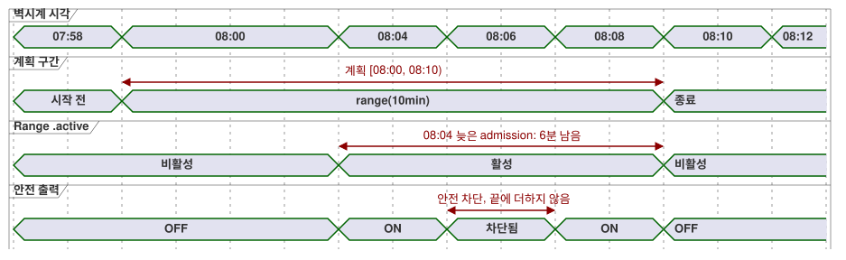

<!-- translation-source: docs/2026-09-24-fixed-planned-time-range-decision.md -->
[영문 원문](2026-09-24-fixed-planned-time-range-decision.md)

# 고정 계획 시간 구간(Range) 결정 — 2026-09-24

상태: 승인된 언어 의미이며, 구현은 별도로 진행합니다. 규범 문법과 동작은
[Language Reference §3.5](reference/03-time-and-schedules.md#35-schedule의-공통-의미)에 있습니다
(영문 번역: [03-time-and-schedules.en.md](reference/03-time-and-schedules.en.md)).

이 기록은 컨트롤러가 늦게 시작해도 밀려나지 않는 **고정된** 시계 구간에 대해 예약(schedule)이
출력을 계획하는 방법을 결정합니다. 아래에서 쓰는 용어는 다음과 같습니다.

- **발생(occurrence)**: 예약의 계획된 한 번의 실행 단위입니다(예: 오늘 08:00 슬롯).
- **admission(수용)**: 어떤 발생이 실행을 시작해도 된다는 판단입니다.
- **Range**: basis가 `range(duration)`인 예약입니다.

## 의도와 선택된 표면

운영자는 08:00–08:10 같은 고정 구간에 출력을 계획할 수 있습니다. 첫 신뢰할 수 있는(trusted)
관측이 08:04에 도착하면 출력에는 6분이 남습니다. 구간이 08:04–08:14로 밀려서는 안 됩니다.

선택된 예약 basis는 양의 Duration을 받는 `range(duration)`입니다. trigger 필드가 발생의 계획
시작점을 정합니다. 구간은 반열린 구간
`[planned start, planned start + effective duration)`입니다.

다른 basis는 기존 의미를 유지합니다.

| Basis | 의미 |
| --- | --- |
| `range(duration)` | 고정된 계획 구간입니다. 늦게 시작하면 남은 시간만 받습니다. |
| `run(duration, within(grace))` | 늦은 admission을 허용하지만, 전체 run duration을 admission 시점부터 잽니다. |
| `window(duration)` | admission window이며, 활성 계획 시간 구간이 아닙니다. |
| `pulse` | 관측된 경계 통과(crossing) 시점에만 admission합니다. |

## Admission과 진행

- Range는 `when`이 true이고 신뢰할 수 있는 현재 시각이 구간 안에 있을 때 현재 발생을
  admission합니다. 첫 관측은 부팅, 신뢰 복구, 관측 공백 이후에 올 수 있습니다. 이미 만료된
  이전 발생은 재생(replay)하지 않습니다. 구간 끝과 같거나 그 이후라면 `LateStartExpired`를
  기록하고 실행하지 않습니다.
- Range 구간이 아직 열려 있는 동안의 관측 공백은 종결되지 않은 증거입니다. 나중에 되살릴
  종결 상태의 missed 기록을 만들지 않습니다. 발생은 남은 시간에 대해 여전히 admission될 수
  있습니다. 계획 종료 시각이 지나면 `LateStartExpired`는 종결 상태입니다.
- 신뢰할 수 없는 시계는 Range를 새로 admission할 수 없습니다. 명시적인 `hold_trusted(...)`
  시계 정책은 불확실성과 provenance(출처)를 유지한 채 상한이 있는 신뢰 외삽을 제공할 수
  있습니다.
- 늦은 admission 예외는 이미 종결 상태로 missed되었거나 철회된 발생을 되살릴 수 없습니다.
  `CorrectionPastHighWater` 또는 `EventWithdrawn`으로 표시된 Tide 이벤트는 수정된 구간이
  현재 시각을 포함하더라도 종결 상태로 남습니다.
- Admission은 안정적인 발생 ID와 계획 시작점을 기록합니다. 남은 시간은 단조(monotonic)
  deadline으로 변환합니다. 그 발생 도중의 RTC/NTP 벽시계 보정은 종료 계산을 위해 보류됩니다.
  보정은 활성 구간을 줄이거나 늘릴 수 없습니다. 보정된 벽시계 시각은 이 Range가 끝난 뒤의
  후속 발생 판단에 적용합니다. 벽시계가 뒤로 돌아가도 같은 발생을 두 번 admission할 수
  없습니다.
- admission된 활성 Range는 벽시계 신뢰나 명시적 시계 hold가 만료되어도 단조 deadline까지
  계속됩니다. 종결 `skip`은 새 admission 판단에 적용되며, 그 활성 deadline에는 적용되지
  않습니다. 시작점을 미래로 옮기는 편집으로 일시 정지된 Range는 시계 품질이 Unknown인 동안
  다시 진입할 수 없습니다. 복구 후에는 같은 구간이 아직 열려 있을 때만 다시 진입할 수
  있습니다.
- 전역 안전 제약은 안전 출력을 즉시 차단합니다. Range 시계는 계속 흐릅니다. 예정된 종료
  전에 제약이 풀리면 남은 시간 동안 출력을 재개할 수 있습니다. 차단된 시간은 절대 끝에
  더하지 않습니다. `cancel_when`은 다시 준비(rearm)하지 않고 발생을 종료합니다.
- 요청(requested), 안전(safe), 적용됨(applied), 확인됨(confirmed) 출력 증거는 서로 구분됩니다.
  Range `.active`는 예약 구간을 기록하며, 물리적 동작을 기록하지 않습니다.

**예시.** 계획 시작이 08:00이고 `range(10min)`이면, 08:04 admission에는 6분이 남습니다.
08:10 admission에는 남은 구간이 없습니다. 08:06부터 08:08까지 안전 제약이 차단하면 출력은
08:10까지만 재개할 수 있습니다. 08:07의 벽시계 보정은 그 활성 deadline을 바꾸지 않습니다.

아래 타이밍 다이어그램은 08:04 admission과 08:06–08:08 안전 차단을 보여 줍니다.

## 실행 중 시작점과 Duration 변경

검증된 원자적 live 설정 이벤트는 현재 발생의 스칼라 계획 시작점이나 Duration을 바꿀 수
있으며, 변경은 그 이벤트 위치부터 유효합니다. 구간은 새 시작점 + 유효 Duration으로 다시
계산하고, admission 시점에 확립된 안정적인 시계 진행을 기준으로 평가합니다. 늦은 admission
시각이 계획 시작점을 대체하는 일은 절대 없습니다.

계획 시작 08:00, admission 08:04인 경우의 예:

| 변경 | 결과 |
| --- | --- |
| 08:07에 Duration 10 → 12분 | 발생은 08:12에 끝납니다. |
| 08:07에 Duration 10 → 5분 | 새 끝이 08:05이므로, 같은 수용된 판단이 활성 Range를 종료합니다. |
| 시작점을 08:02로 편집, Duration 10분 | 끝이 08:12로 이동합니다. |

어느 종류의 설정 이벤트도 새 발생을 만들거나, 발생의 identity나 admission ledger(원장)를
초기화하지 않습니다.

`DailySlots` `TimeSlots` 항목에는 표시되는 `TimeOfDay`와 독립적인 불투명한 런타임 슬롯 키가
있습니다. 이는 GhostFlow 소스 문법을 추가하지 않습니다. 수용된 시각 변경(retime) 설정
이벤트는 다음을 식별합니다.

- 그 이벤트 자체
- 기준 설정 revision
- 기존 슬롯 키
- 대체할 `TimeOfDay`

이 이벤트는 `(schedule ID, local date, slot key, DST fold)`를 발생 identity로 유지하면서 계획
시간 메타데이터를 바꿉니다. 수용된 설정 상태는 재시작을 거쳐도 그 키를 유지합니다. 목록 위치와
표시 시각은 identity가 아닙니다.

따라서 `TimeSlots<1min,N>` 설정에서 admission된 08:00 `range(10min)` 항목을 08:07로 retime하면,
이벤트 위치에서 일시 정지하고 08:07에 **같은** 발생을 다시 평가합니다. `when`이 true이면
08:17까지 출력을 요청할 수 있습니다. 두 번째 `due`를 내보내지 않고, 두 번째 admission도 하지
않으며, ledger를 유지합니다. 이벤트와 08:07 스캔이 같은 유효 위치를 공유하면 이벤트를 먼저
적용하고, 그 완료된 판단이 같은 발생을 다시 평가합니다. 08:07을 포함하지 않는 더 거친 격자는
이벤트를 거부합니다.

제거/추가는 별도 연산으로 남습니다. 제거는 이전 슬롯 키의 미래 계획을 삭제합니다. 추가는
표시 시각이 같더라도 새 키를 만들고 일반 기준선(baseline) 규칙을 시작합니다. 제거/추가로
admission된 Range의 시각을 바꿀 수는 없습니다. 기존 키를 명시적 retime으로 담지 않은 전체 값
교체는 이 제거/추가 규칙으로 해석합니다. 런타임은 목록 순서나 표시 시각으로 일치 여부를
추측하지 않습니다.

설정 이벤트와 스캔의 순서는
[§5.2](reference/05-settings-and-observation.md#52-소스-변경과-운영-설정-변경)의 원자적 live 이벤트
계약을 따릅니다. 완료된 판단 위치의 유효값이 그 판단을 결정합니다.

## 경계

이 결정은 기존 관측 공백 및 부팅 기준선 정책에 Range만의 예외를 부여합니다. Pulse, Window,
Run은 기존 skip 및 admission 규칙을 유지합니다. Range는 계획 종료 후에 절대 따라잡기
(catch-up)를 하지 않습니다.

실행 중 시작점 편집이 admission된 발생의 새 시작점을 미래로 옮기면, 이벤트 위치의 수용된
판단이 즉시 `.active = false`로 설정합니다. 새 시작점과 그 이후에는 **같은** 발생이 변경된
반열린 구간 안에 있는지 다시 평가합니다. `when`이 true이면 요청 출력은 현재 계획 종료
시각까지만 재개할 수 있습니다. 안전 출력은 안전 제약이 허용할 때만 재개합니다. 이는 두 번째
admission이 아닙니다. `.due`는 다시 펄스를 내지 않고, 발생 ID와 ledger도 바뀌지 않습니다.
변경된 끝이 이미 안정적인 현재 시각과 같거나 그보다 이전이면 발생을 즉시 종료하며, 나중에
재개하지 않습니다.

## 비중첩 검증

같은 예약의 두 발생은 반열린 Range 구간이 겹쳐서는 안 됩니다. 인접한 구간은 유효합니다.
예를 들어 `selected = [08:00, 08:15]`이고 `basis = range(30min)`인 `DailySlots`는 컴파일
오류입니다. 08:00–08:30이 08:15–08:45와 겹치기 때문입니다. 두 발생 사이의 런타임
중재(arbitration)는 없습니다.

컴파일러는 정의와 유효 설정에서 발생 간격을 증명할 수 있는 trigger에만 `range`를
허용합니다. 동적 반복 규칙이나 provider가 증명 가능한 간격을 제공하지 못하면, 컴파일은
진단과 함께 `range` 선언을 거부합니다.

중첩은 설정이 효력을 가질 수 있는 모든 지점에서 검사합니다.

- **정적 기본값**은 컴파일 시점에 검사합니다.
- **복원된 유효 설정**은 활성화 전에 검사하며, 중첩이 있으면 활성화를 거부합니다.
- 중첩을 만들 **live 설정 이벤트**는 현재 admission된 구간과의 중첩을 포함해 원자적으로
  거부합니다. 이는 `DailySlots` 편집에도 적용됩니다.

retime은 새 슬롯 키를 할당하지 않고 제안된 표시 시각을 검증합니다. 거부되면 이전 표시 시각,
슬롯 키, 설정 revision, 활성 발생, ledger를 보존합니다. 제거/추가는 별도의 identity 및 기준선
규칙을 유지합니다.
