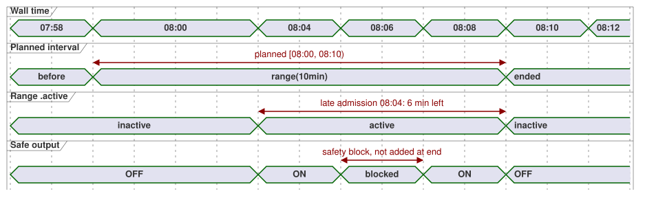

# Fixed planned-time range decision — 2026-09-24

Status: approved language meaning; implementation remains separate. The normative
syntax and behavior are in [Language Reference §3.5](reference/03-time-and-schedules.md#35-schedule의-공통-의미)
(English translation: [03-time-and-schedules.en.md](reference/03-time-and-schedules.en.md)).

This record decides how a schedule can plan output for a **fixed** clock
interval that does not slide when the controller starts late. Terms used below:

- **Occurrence**: one planned instance of a schedule (for example, today's
  08:00 slot).
- **Admission**: the decision that an occurrence may start running.
- **Range**: a schedule whose basis is `range(duration)`.

## Intent and selected surface

An operator may plan an output for a fixed interval, such as 08:00–08:10.
If the first trusted observation arrives at 08:04, the output has six minutes
left. The interval must not slide to 08:04–08:14.

The selected schedule basis is `range(duration)` with a positive Duration.
Trigger fields set the occurrence's planned start. Its interval is half-open:
`[planned start, planned start + effective duration)`.

The other bases keep their meanings:

| Basis | Meaning |
| --- | --- |
| `range(duration)` | Fixed planned interval; a late start gets only the remaining time. |
| `run(duration, within(grace))` | Permits late admission, but measures the full run duration from admission. |
| `window(duration)` | An admission window, not an active planned-time interval. |
| `pulse` | Admits only at the observed crossing. |

## Admission and progression

- A Range admits the current occurrence when `when` is true and the trusted
  current time lies inside its interval. The first observation may come after
  boot, trust recovery, or an observation gap. Earlier expired occurrences are
  not replayed. At or after the end, record `LateStartExpired` and do not run.
- An observation gap while the Range interval is still open is nonterminal
  evidence. It does not create a terminal missed record to revive later. The
  occurrence can still admit for its remaining time. Once its planned end has
  passed, `LateStartExpired` is terminal.
- An untrusted clock cannot newly admit the Range. The explicit
  `hold_trusted(...)` clock policy may supply a bounded trusted extrapolation,
  keeping its uncertainty and provenance.
- The late-admission exception cannot revive an occurrence that is already
  terminally missed or withdrawn. A Tide event marked `CorrectionPastHighWater`
  or `EventWithdrawn` stays terminal even if its revised interval covers now.
- Admission records the stable occurrence ID and the planned start. It converts
  the remaining time into a monotonic deadline. RTC/NTP wall-clock corrections
  during that occurrence are held pending for its end calculation; they cannot
  shorten or extend the active interval. Apply the corrected wall time to later
  occurrence decisions after this Range settles. A wall-clock rollback cannot
  admit the same occurrence twice.
- An admitted active Range continues to its monotonic deadline even if wall
  trust or an explicit clock hold expires. The terminal `skip` applies to new
  admission decisions, not to that active deadline. A Range paused by a start
  edit into the future cannot reenter while clock quality is Unknown. After
  recovery, it may reenter only if the same interval is still open.
- A global safety constraint blocks safe output immediately. The Range clock
  keeps running. If the constraint clears before the scheduled end, output can
  resume for the remaining time. The blocked time is never added at the end.
  `cancel_when` ends the occurrence without rearming it.
- Requested, safe, applied, and confirmed output evidence stay distinct.
  Range `.active` records the schedule's interval, not physical operation.

**Worked example.** For a planned start of 08:00 and `range(10min)`, admission
at 08:04 leaves six minutes. Admission at 08:10 leaves no interval. If safety
blocks from 08:06 to 08:08, output may resume only until 08:10. A wall
correction at 08:07 does not change that active deadline.

The timing diagram below shows the 08:04 admission and the 08:06–08:08 safety
block.

## Live start and duration changes

A validated atomic live setting event may change a scalar planned start or
Duration for the current occurrence, effective from its event position.
Recompute the interval as the new start plus the effective Duration, evaluated
against the stable clock progression established at admission. A late
admission time never replaces the planned start.

Examples, with a planned start of 08:00 and admission at 08:04:

| Change | Result |
| --- | --- |
| At 08:07, Duration 10 → 12 minutes | The occurrence ends at 08:12. |
| At 08:07, Duration 10 → 5 minutes | The new end is 08:05, so the same accepted decision ends the active Range. |
| Start edited to 08:02, Duration 10 minutes | The end moves to 08:12. |

Neither kind of setting event creates a new occurrence or resets its identity or
admission ledger.

A `DailySlots` `TimeSlots` entry has an opaque runtime slot key that is
independent of its displayed `TimeOfDay`. This adds no GhostFlow source syntax.
An accepted retime setting event identifies:

- its own event;
- the base settings revision;
- the existing slot key; and
- the replacement `TimeOfDay`.

It changes planned-time metadata while preserving `(schedule ID, local date,
slot key, DST fold)` as the occurrence identity. The accepted settings state
persists that key across restart. List position and displayed time are not
identity.

Therefore, for a `TimeSlots<1min,N>` setting, retiming an admitted 08:00
`range(10min)` entry to 08:07 pauses it at the event position and reevaluates
the **same** occurrence at 08:07. If `when` is true, it can request output until
08:17. It emits no second `due`, makes no second admission, and keeps the
ledger. When the event and the 08:07 scan share one effective position, the
event is applied first, and that completed decision reevaluates the same
occurrence. A coarser grid that does not contain 08:07 rejects the event.

Remove/add remains a separate operation. Removal deletes future plans for the
old slot key. Adding, even at the same displayed time, creates a new key and
starts the ordinary baseline rule. Remove/add cannot be used to retime an
admitted Range. A whole-value replacement that does not carry the existing key
as an explicit retime is interpreted with these remove/add rules. The runtime
does not guess a match from list order or displayed time.

The order of setting events and scans follows the atomic live event contract in
[§5.2](reference/05-settings-and-observation.md#52-소스-변경과-운영-설정-변경): the
effective value at the completed decision position determines that decision.

## Boundary

This decision gives Range a specific exception to the existing observation-gap
and boot baseline policy. Pulse, Window, and Run keep their existing skip and
admission rules. Range never catches up after its planned end.

If a live start edit moves an admitted occurrence's new start into the future,
the accepted decision at the event position sets `.active = false` immediately.
At and after the new start, reevaluate whether the **same** occurrence is inside
the changed half-open interval. If `when` is true, requested output can resume
only until its current planned end. Safe output resumes only when the safety
constraints permit it. This is not a second admission: `.due` does not pulse
again, and the occurrence ID and ledger do not change. If the changed end is
already at or before the stable current time, end the occurrence immediately;
do not resume it later.

## Nonoverlap validation

Two occurrences of the same schedule may not have overlapping half-open Range
intervals. Adjacent intervals are valid. For example, `DailySlots` with
`selected = [08:00, 08:15]` and `basis = range(30min)` is a compile error:
08:00–08:30 overlaps 08:15–08:45. There is no runtime arbitration between
those two occurrences.

The compiler accepts `range` only for triggers whose occurrence spacing can be
proved from the definition and effective settings. If a dynamic recurrence or
provider cannot supply a provable spacing, compilation rejects the `range`
declaration with a diagnostic.

Overlap is checked at every point where settings can take effect:

- **Static default values** are checked at compile time.
- **Restored effective settings** are checked before activation; overlap
  rejects activation.
- **A live setting event** that would create overlap is rejected atomically,
  including overlap with the current admitted interval. This also applies to
  `DailySlots` edits.

A retime validates the proposed displayed time without allocating a new slot
key. A rejection preserves the old displayed time, slot key, settings revision,
active occurrence, and ledger. Remove/add keeps its separate identity and
baseline rules.
