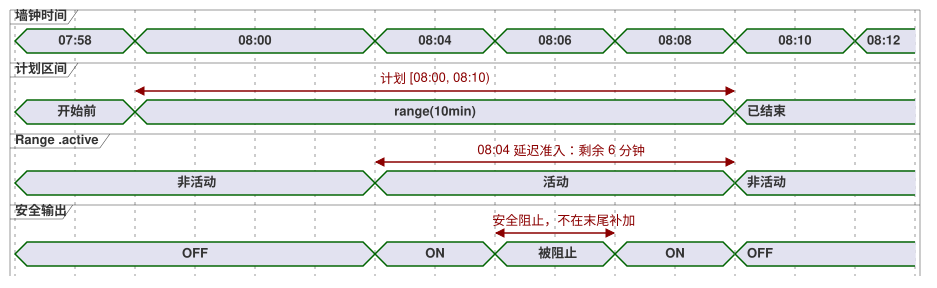

<!-- translation-source: docs/2026-09-24-fixed-planned-time-range-decision.md -->
[英文原文](2026-09-24-fixed-planned-time-range-decision.md)

# 固定计划时间 Range 决策 — 2026-09-24

状态：语言含义已批准；实现另行进行。规范性的语法和行为见 [语言参考 §3.5](reference/03-time-and-schedules.zh.md)（英文版：[03-time-and-schedules.en.md](reference/03-time-and-schedules.en.md)）。

本记录决定调度计划如何为一个**固定**的时钟区间规划输出，使该区间在控制器延迟启动时不会滑动。下文使用的术语：

- **触发实例（occurrence）**：调度计划的一个计划实例（例如今天 08:00 的时段）。
- **准入（admission）**：允许某个触发实例开始运行的决定。
- **Range**：基准（basis）为 `range(duration)` 的调度计划。

## 意图与选定的表面语法

操作员可以为一个固定区间（例如 08:00–08:10）规划输出。如果第一个可信观测在 08:04 到达，输出还剩六分钟。该区间不得滑动为 08:04–08:14。

选定的调度基准是带有正 Duration 的 `range(duration)`。触发字段设定触发实例的计划开始时间。其区间是半开区间：`[计划开始, 计划开始 + 有效持续时间)`。

其他基准保持各自的含义：

| 基准 | 含义 |
| --- | --- |
| `range(duration)` | 固定的计划区间；延迟启动只能获得剩余时间。 |
| `run(duration, within(grace))` | 允许延迟准入，但完整的运行持续时间从准入时刻开始计算。 |
| `window(duration)` | 一个准入窗口，而不是处于活动状态的计划时间区间。 |
| `pulse` | 仅在观测到的越过时刻准入。 |

## 准入与推进

- 当 `when` 为 true 且可信的当前时间位于区间内时，Range 准入当前触发实例。第一个观测可能出现在启动、信任恢复或观测间隙之后。更早已过期的触发实例不会被重放。到达或超过结束时刻时，记录 `LateStartExpired` 并且不运行。
- Range 区间仍然开放时发生的观测间隙是非终结性证据。它不会生成一条日后再被恢复的终结性 missed 记录。该触发实例仍然可以在剩余时间内准入。一旦计划结束时刻已过，`LateStartExpired` 即为终结状态。
- 不可信的时钟不能新准入 Range。显式的 `hold_trusted(...)` 时钟策略可以提供有界的可信外推，并保留其不确定性和来源。
- 延迟准入的例外不能恢复已经终结性错过或已撤回的触发实例。标记为 `CorrectionPastHighWater` 或 `EventWithdrawn` 的 Tide 事件即使修订后的区间覆盖当前时刻，也保持终结状态。
- 准入会记录稳定的触发实例 ID 和计划开始时间。它把剩余时间转换为单调截止时间。在该触发实例期间发生的 RTC/NTP 墙钟修正，会被挂起，留待计算其结束时刻；它们不能缩短或延长活动区间。在此 Range 结算之后，再把修正后的墙钟时间应用于后续触发实例的决定。墙钟回拨不能让同一个触发实例被准入两次。
- 已准入的活动 Range 会持续到其单调截止时间，即使墙钟信任或显式的时钟保持已经过期。终结性的 `skip` 适用于新的准入决定，而不适用于该活动截止时间。因开始时间被编辑到未来而暂停的 Range，在时钟质量为 Unknown 时不能重新进入。恢复之后，只有当同一区间仍然开放时，它才可以重新进入。
- 全局安全约束会立即阻止安全输出。Range 的时钟继续运行。如果约束在计划结束之前解除，输出可以在剩余时间内恢复。被阻止的时间绝不会补加到末尾。`cancel_when` 结束该触发实例且不会重新武装它。
- 请求（requested）、安全（safe）、已应用（applied）和已确认（confirmed）的输出证据彼此保持区分。Range 的 `.active` 记录的是调度计划的区间，而不是物理动作。

**完整示例。** 对于计划开始时间 08:00 和 `range(10min)`，在 08:04 准入会剩下六分钟。在 08:10 准入则没有剩余区间。如果安全约束从 08:06 阻止到 08:08，输出只能恢复到 08:10。08:07 的墙钟修正不会改变该活动截止时间。

下面的时序图展示了 08:04 的准入和 08:06–08:08 的安全阻止。

## 实时修改开始时间与持续时间

经过验证的原子实时设置事件可以修改当前触发实例的标量计划开始时间或 Duration，从该事件的位置起生效。区间重新计算为新的开始时间加上有效 Duration，并依据准入时确立的稳定时钟推进来评估。延迟的准入时间绝不会取代计划开始时间。

以下示例的计划开始时间为 08:00，准入时间为 08:04：

| 修改 | 结果 |
| --- | --- |
| 08:07 时，Duration 10 → 12 分钟 | 该触发实例在 08:12 结束。 |
| 08:07 时，Duration 10 → 5 分钟 | 新的结束时刻为 08:05，因此同一个已接受的判定就会结束活动中的 Range。 |
| 开始时间改为 08:02，Duration 10 分钟 | 结束时刻移到 08:12。 |

这两种设置事件都不会创建新的触发实例，也不会重置其身份标识或准入账本。

`DailySlots` 的 `TimeSlots` 条目带有一个不透明的运行时时段键（slot key），它独立于所显示的 `TimeOfDay`。这不会增加任何 GhostFlow 源语法。一个已接受的改时（retime）设置事件会标识：

- 它自身的事件；
- 基础设置修订版；
- 现有的时段键；以及
- 替换用的 `TimeOfDay`。

它修改计划时间元数据，同时保持 `(schedule ID, local date, slot key, DST fold)` 作为触发实例的身份标识。已接受的设置状态会在重启后保留该键。列表位置和显示的时间都不是身份标识。

因此，对于 `TimeSlots<1min,N>` 设置，把一个已准入的 08:00 `range(10min)` 条目改时到 08:07，会在事件位置将其暂停，并在 08:07 重新评估**同一个**触发实例。如果 `when` 为 true，它可以请求输出直到 08:17。它不会发出第二个 `due`，不会进行第二次准入，并保留账本。当事件与 08:07 的扫描共享同一个有效位置时，先应用事件，然后由这个已完成的判定重新评估同一个触发实例。不包含 08:07 的更粗粒度网格会拒绝该事件。

删除/添加仍然是独立的操作。删除会移除旧时段键的未来计划。添加，即使显示时间相同，也会创建一个新键并启动普通的基线规则。删除/添加不能用于给已准入的 Range 改时。没有把现有键作为显式改时携带的整值替换，按这些删除/添加规则解释。运行时不会根据列表顺序或显示时间去猜测匹配关系。

设置事件与扫描的顺序遵循 [§5.2](reference/05-settings-and-observation.zh.md) 中的原子实时事件契约：已完成判定位置上的有效值决定该判定。

## 边界

本决策在现有的观测间隙和启动基线策略之上，为 Range 规定了一个特定例外。Pulse、Window 和 Run 保持其现有的跳过和准入规则。Range 在其计划结束之后绝不追赶。

如果实时修改开始时间把已准入触发实例的新开始时间移到未来，那么在事件位置上已接受的判定会立即设置 `.active = false`。在新的开始时间及之后，重新评估**同一个**触发实例是否位于修改后的半开区间内。如果 `when` 为 true，请求的输出只能恢复到其当前的计划结束时刻。只有在安全约束允许时，安全输出才会恢复。这不是第二次准入：`.due` 不会再次产生脉冲，触发实例 ID 和账本也不会改变。如果修改后的结束时刻已经不晚于稳定的当前时间，则立即结束该触发实例；之后也不会恢复。

## 不重叠验证

同一调度计划的两个触发实例不得具有重叠的半开 Range 区间。相邻区间是有效的。例如，`selected = [08:00, 08:15]` 且 `basis = range(30min)` 的 `DailySlots` 是编译错误：08:00–08:30 与 08:15–08:45 重叠。这两个触发实例之间不存在运行时仲裁。

编译器只对那些能够根据定义和有效设置证明其触发实例间隔的触发器接受 `range`。如果动态循环规则或提供者无法给出可证明的间隔，编译会以诊断拒绝该 `range` 声明。

在设置可能生效的每一个时刻都会检查重叠：

- **静态默认值**在编译时检查。
- **恢复的有效设置**在激活前检查；重叠会拒绝激活。
- 会造成重叠的**实时设置事件**会被原子地拒绝，包括与当前已准入区间的重叠。这同样适用于 `DailySlots` 的编辑。

改时会验证提议的显示时间，而不分配新的时段键。拒绝会保留原来的显示时间、时段键、设置修订版、活动触发实例和账本。删除/添加保持其独立的身份标识和基线规则。
