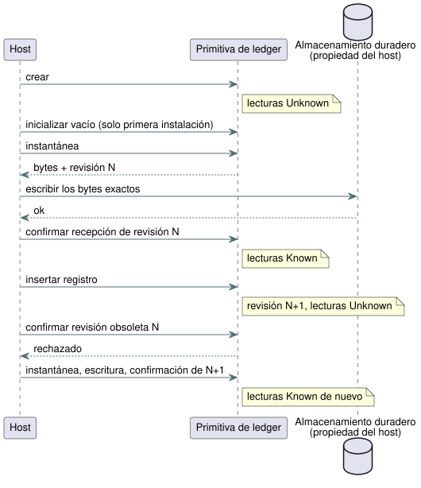

<!-- translation-source: docs/ACCOUNTING-LEDGER-ABI.md -->
[Original en inglés](ACCOUNTING-LEDGER-ABI.md)

# ABI de la primitiva de libro mayor de contabilización de uso

Este documento describe cómo un host usa el libro mayor (ledger) de
contabilización de uso (accounting) escrito en Rust a través de WebAssembly
(WASM) y del C ABI nativo. El ledger registra cuánto tiempo estuvo encendido un
recurso (`on_time`) y cuántos eventos ocurrieron (`count_events`), y admite la
admisión de reservas en ventana móvil.

Temas tratados:

- **Observación de etapa Bool propiedad del escaneo**: `StageAccountingControl`,
  donde el driver de escaneo registra él mismo el tiempo ON.
- **`AccountingRuntime`**: un ledger vinculado a la fuente para una cuenta,
  alimentado con evidencia proporcionada por quien llama.
- **Evidencia proporcionada por quien llama**, **Secuencia de persistencia** y
  **Límites actuales**: las obligaciones del host.
- **Secciones de conformidad** (REF-03-019, -022, -048, -049): casos de prueba
  fijos que fijan la aritmética y el comportamiento ante fallos.

Un término recurrente: un valor es **Known** cuando el ledger puede responder de
forma exacta, y **Unknown** cuando la evidencia falta, no está confirmada o no es
válida. Unknown siempre falla de forma cerrada (fail closed).

## Observación de etapa Bool propiedad del escaneo

`StageAccountingControl.instantiateSource` compila la fuente canónica y valida
un mapeo explícito de cada recurso a una salida Bool. Los nombres del recurso y
de la salida no tienen por qué coincidir. El compilador vinculado a la fuente
comprueba el artefacto proporcionado frente a una recompilación canónica antes
de producir el paquete de activación de Rust.

Límites del perfil:

- hasta 32 cuentas `on_time` durables;
- `maxSegments` de 1 a 4096;
- se rechazan los límites de admisión y las cuentas de eventos mixtas.

Las API existentes del ledger aplicado conservan su contrato de recibos.

`ScanDriver` es propietario del observador. El observador funciona así:

- Solo registra escaneos exitosos. Para el intervalo
  `[previous_time, current_time)` usa el valor solicitado o seguro anterior.
- Un valor false registra cobertura y aporta cero tiempo ON.
- Las consultas recortan los intervalos y exigen cobertura completa del rango
  solicitado.
- Los ID de escaneo duplicados y los relojes invertidos se rechazan sin cambiar
  la contabilización.
- Un escaneo distinto en el mismo instante cambia el valor siguiente sin
  consumir tiempo.
- Si se agota la capacidad de publicación, el escaneo de control aceptado se
  mantiene intacto y la contabilización pasa a Unknown.
- El observador nunca acepta trazas proporcionadas por quien llama, y nunca
  registra intervalos solicitados/seguros en el ledger aplicado.

`query(account, startMs, endMs, runId)` usa tiempos BigInt u64 y devuelve
`{ kind: 'Known', usedMs: BigInt }` o `{ kind: 'Unknown', reason }`.
La etapa aplicada devuelve `NoReceipt` y la etapa confirmada devuelve
`NoFeedback`: este observador no tiene ninguna vía para ingerir recibos físicos
ni retroalimentación. Quien llama selecciona el intervalo de consulta acotado.
No se añade ninguna vida útil, límite de día ni política de admisión
predeterminados. `coverageGap()` descarta el cursor del intervalo activo cuando
el host no puede atestiguar una observación continua. La cobertura posterior al
siguiente escaneo no rellena la brecha.

`persist(write)` pasa al escritor del host una copia desvinculada de la
instantánea y su revisión BigInt exacta. Solo un acuse `true` para la revisión
actual hace que el uso sea Known. Un fallo, u otro escaneo durante la escritura,
deja la persistencia pendiente. El host es propietario del almacenamiento
duradero real.

Una instantánea vincula:

- la huella del módulo y el SHA-256 de la fuente canónica;
- el mapeo cuenta/recurso/salida/etapa;
- la capacidad;
- las identidades de ejecución (run); y
- los intervalos cubiertos.

Su suma de verificación detecta la corrupción; no autentica el almacenamiento.
La restauración requiere un propietario nuevo con un ID de ejecución no usado.
Mantiene las consultas históricas bajo su ID de ejecución original y reinicia el
cursor de observación. Un reloj monotónico reiniciado puede empezar en cero;
ningún intervalo atraviesa el reinicio. El historial de instantáneas admite
como máximo 32 identidades de ejecución y falla de forma cerrada cuando esos
límites o identidades no coinciden.

`tests/stage-accounting-control.test.mjs` compara los resultados de trazas
nativos y WASM, las consultas y los bytes completos de las instantáneas. En
REF-03-021, una solicitud bloqueada de 20 s produce solicitado 20000ms, seguro
0ms, aplicado Unknown y confirmado Unknown. El comportamiento físico del Driver
y la durabilidad del almacenamiento son evidencia de aceptación aparte.

Esta ABI expone a un host el ledger de contabilización de uso de Rust a través
de WebAssembly. Los Results de conteo de GFB11 se ejecutan dentro de la VM de
control portable usando el ledger emparejado. La admisión de reservas móviles
vinculada a la fuente es una operación explícita del host de referencia; la ABI
no vincula automáticamente las salidas de control a los recursos.

`AccountingRuntime.instantiateSource(wasmBytes, document, options)` compila un
documento `.ghost.md` canónico exacto y selecciona por nombre una cuenta
declarada. Acepta una de estas dos opciones:

- `on_time` durable en la etapa `applied`, con un `resourceId` proporcionado
  por quien llama; o
- `count_events` durable sobre `local_day`, con un `eventType` proporcionado
  por quien llama.

La instancia rechaza las llamadas de registro y de consulta para otros ID y
operaciones. Su registro `source` conserva el documento fuente completo, el
SHA-256 de la fuente, los nombres de la cuenta y del objetivo seleccionados, la
etapa y el SHA-256 del artefacto.

El ID numérico proporcionado sigue necesitando una vinculación confiable del
host con el recurso físico o el Event. Una instantánea de ledger restaurada no
tiene ninguna identidad de fuente incrustada, así que el host también debe
verificar que su almacenamiento duradero pertenece a esa vinculación. El host de
referencia vinculado a la fuente puede preparar, liquidar y cancelar
explícitamente reservas móviles mediante esta primitiva. No conecta
automáticamente las decisiones de salida de la VM con la admisión de recursos,
ni certifica la evidencia de aplicación física.

Las fuentes que solo contienen contabilización de uso seleccionan el perfil
control-v10 de contabilización incluso sin expresiones que produzcan contexto.
REF-03-020 ejecuta la misma vinculación de fuente comprobada contra ledgers
nativos de Rust y WASM:

- límites ON/OFF idénticos se particionan mediante observaciones de 1 segundo y
  mediante observaciones repetidas de 7/13/9 segundos; y
- los solapamientos móviles exactos de 60 segundos coinciden en tiempos lógicos
  comunes, incluso después de restaurar una instantánea y de una reproducción
  (replay) nueva.

El ejecutor de pruebas nativo carga el módulo compilado y un manifiesto
verificado por el host; no compila la fuente por sí mismo. Son cálculos
históricos sobre intervalos aplicados validados por quien llama. No son
admisión de control, ni un corte en vivo por tiempo ON máximo, ni certificación
de recibos físicos.

## Evidencia proporcionada por quien llama

El ledger confía en quien llama para lo siguiente. Cada punto es una obligación
del host.

- Los registros ON aplicados ya vienen validados y fusionados por quien llama,
  por recurso físico estable. Cada segmento tiene un ID de recibo distinto de
  cero y un intervalo monotónico positivo. Los ID de recibo son únicos dentro de
  un recurso.
- Quien llama divide un intervalo en los límites de día local confiables y
  proporciona una clave de día entera inmutable para cada segmento. El ledger no
  resuelve zonas horarias ni fechas civiles.
- Los registros de eventos llevan un ID opaco de 16 bytes y un ID de evento
  tipado. Los ID duplicados dentro de un mismo tipo de Event son idempotentes.
  Reutilizar un ID con evidencia distinta es un error.
- Las capacidades configuradas de intervalos y de eventos son límites estrictos.
  Quien llama debe tratar una mutación rechazada como Unknown. La ABI WASM
  envenena su ledger actual tras errores de registro.

## Secuencia de persistencia

Un ledger es Known solo cuando su revisión actual está almacenada de forma
duradera y confirmada:

1. La creación empieza en Unknown.
2. En la primera instalación, el host inicializa explícitamente un ledger
   vacío.
3. El host obtiene una instantánea, la escribe de forma duradera y confirma esa
   revisión exacta.
4. Tras cada registro insertado, las lecturas devuelven Unknown hasta que el
   host toma una instantánea de la nueva revisión, la persiste y la confirma.

Se rechaza un acuse de escritura para una revisión obsoleta. Las instantáneas
válidas restauradas ya están confirmadas; las instantáneas ausentes o no válidas
permanecen Unknown.

El diagrama de secuencia anterior muestra cuándo las lecturas cambian entre
Known y Unknown.

La admisión de reservas móviles usa la misma vista duradera. Si un ledger en
memoria es conocido pero su revisión no está confirmada, la admisión se rechaza
antes de crear una reserva, avanzar la revisión o invocar la persistencia del
host. Esto cubre:

- una inicialización vacía cuya escritura falló; y
- un reintento exacto de una reserva pendiente.

Los ledgers ausentes o corruptos también fallan de forma cerrada. Recupere
explícitamente con `persistPending` después de una escritura duradera exitosa;
solo entonces un reintento exacto puede devolver `Duplicate`. Una escritura de
reserva fallida conserva su reserva pendiente y las lecturas Unknown; no fabrica
una concesión ni revierte la reserva. Esto restablece el comportamiento
protector `on_unknown = block`. Evaluar un fallo de conteo mediante
`case ... fault(_) => false` no registra ningún evento ni concede autoridad de
arranque.

El ejemplo nativo `accounting_admission_tape` enlaza el mismo C ABI de
producción a través de su módulo/rlib de Rust para un transporte de
conformidad acotado. Un host de pruebas confiable proporciona el manifiesto de
fuente comprobado y los acuses de escritura explícitos; los conteos, los fallos
y las decisiones de admisión siguen originándose dentro de la ABI de Rust. No es
una nueva ABI de decisiones proyectadas por quien llama ni una vinculación
automática VM/recurso.

La instantánea del ledger es un formato binario versionado con una comprobación
de corrupción CRC-32. El host es propietario del almacenamiento y debe
conservar los bytes exactamente. La primitiva no certifica por sí misma el
medio de almacenamiento ni la atomicidad de la escritura del host.

## Límites actuales

- Quien llama debe proporcionar marcas de tiempo monotónicas comparables con los
  intervalos almacenados. Unir esa línea de tiempo a través de un reinicio no
  forma parte de esta ABI.
- Quien llama también debe proporcionar claves de día local confiables y dividir
  los segmentos a medianoche.
- No se define ninguna política acotada de retención o poda de ID de eventos;
  agotar la capacidad de eventos configurada falla de forma cerrada.

Debido a estas decisiones, esta primitiva todavía no puede servir como una
vinculación completa del runtime del compilador para `durable`.

## Conformidad nativa de solapamiento móvil

El transporte `accounting_tape` del núcleo, solo para pruebas, acepta un
`admission` opcional en una trama histórica, con estos campos: un
`reservationId` entero distinto de cero, `limitMs`, `reserveMs` y el Booleano
`retry`. Antes de llamar al `AccountingLedger::reserve_rolling` real, valida la
ventana, el límite, la reserva y `on_unknown = block` frente al manifiesto de
fuente comprobado de la cuenta seleccionada. Los resultados conservan la
decisión nativa, la evidencia de instantánea sin cambios, un reintento duplicado
exacto opcional, el uso aplicado y el uso de reservas pendientes. Las cintas
existentes solo de observación conservan su forma de salida anterior.

REF-03-019 usa los intervalos aplicados `(0,20]` y `(30,40]`, una ventana de 60
segundos, un límite de 30 segundos y una reserva de 5 segundos:

| Tiempo | Ventana | Uso | Admisión de 5 s |
| --- | --- | --- | --- |
| 40 s | `(0,40]` | 20 + 10 = 30 s | Rechazada, sin mutación |
| 65 s | `(5,65]` | 15 + 10 = **25 s** | Cabe exactamente (quedan 5 s) |

A los 65 segundos la ventana es `(5,65]`: 15 segundos del primer intervalo más
10 segundos del segundo dan **25 segundos**, lo que deja exactamente 5 segundos
para la admisión. El total de 15 segundos que daba el caso original en ese
instante era un error aritmético. Está corregido en el caso actual, que
conserva su ID, su enlace inverso y el original histórico fijado.

La misma fuente compilada y los mismos registros finitos producen paridad
nativo/WASM para los cálculos y las admisiones conocidas. El transporte nativo
del núcleo serializa y restaura explícitamente el ledger. El adaptador WASM de
referencia demuestra además que una reserva no confirmada permanece Unknown y
bloquea los reintentos hasta un acuse explícito. La serialización nativa del
núcleo no es el acuse de persistencia de ese adaptador ni una certificación del
almacenamiento físico. Ninguno de los dos transportes de prueba vincula las
salidas de la VM a recursos físicos ni autentica recibos de aplicación.

## Perfil de presupuesto ante reinicio seleccionado (REF-03-022)

REF-03-022 selecciona el perfil aplicado durable existente con
`on_unknown = block`. El escenario:

1. Tras 28 segundos de uso aplicado, el dispositivo se reinicia sin su punto de
   control (checkpoint) durable. Esto crea un propietario Unknown. El host no
   debe usar `initializeEmpty` de primera instalación para borrar ese historial.
2. Un historial ausente o corrupto bloquea una reserva de 5 segundos sin mutar
   la revisión ni la instantánea, y sin ninguna llamada de persistencia.
3. Un checkpoint válido restaura 28 segundos, lo que sigue bloqueando esa
   reserva con un límite de 30 segundos.
4. En el tiempo monotónico comparable de 63 segundos, la ventana de 60 segundos
   conserva 25 segundos de `(0,28]`, así que la reserva de 5 segundos cabe
   exactamente.

El transporte nativo `accounting_reboot_tape` del C ABI de producción y el
adaptador WASM vinculado a la fuente coinciden en estas instantáneas completas
y en los resultados de admisión. Quien llama es responsable de la línea de
tiempo monotónica comparable a través del reinicio. Este perfil seleccionado no
adopta un reinicio automático tras el vencimiento de la ventana ni un perfil no
durable.

## Transporte de conformidad de día local (REF-03-048)

El host de pruebas acotado resuelve la medianoche de Seúl mediante los datos de
zona horaria de Intl instalados y divide allí los intervalos aplicados finales.
Vincula solicitudes lógicas independientes de bomba Automatic/Manual a una
única identidad de recurso proporcionada. Las solicitudes no demuestran la
aplicación física. El ledger cuenta una sola vez los intervalos aplicados
solapados (como una unión). Por ejemplo, 23:50–00:10 aporta diez minutos a cada
día local y veinte minutos a una consulta móvil separada de 24 horas.

El `accounting_tape` solo para pruebas admite etiquetas de día explícitas por
segmento, consultas de día acotadas y checkpoints de registros completos
opcionales. El `accounting_local_day_tape` solo para pruebas enlaza el C ABI de
producción y compara contra WASM el estado completo, los bytes de los
checkpoints, las revisiones y las consultas Known/Unknown.

- La reentrega exacta de un recibo deja sin cambios el uso y los checkpoints.
- Un intervalo aplicado no válido no muta el ledger de la primitiva, pero el C
  ABI de producción marca de forma conservadora su historial como Unknown y
  avanza su revisión.
- Un reintento requiere restaurar explícitamente el checkpoint confiable
  guardado; el uso nunca se reinicia en silencio.

Estos transportes no aportan ningún proveedor de reloj/vinculación de
producción, ni autenticación de recibos, ni certificación física del
almacenamiento o de la aplicación.

## Aceptación de reserva con retardo de paro

REF-03-049 usa la expresión finita escrita por el autor `reserve = worst_case_on + stop_delay`, con un tiempo ON máximo de 5min y un retardo de paro de 2min. La reserva resultante de 7min no cabe en los 6min que quedan.

El transporte de prueba nativo `stop_delay_reservation_tape` enlaza este C ABI de producción. Mediante una reproducción nueva, coincide con los estados, las revisiones, los bytes completos de los checkpoints y las explicaciones móviles del WASM vinculado a la fuente.

- Una reserva pendiente restaurada sigue cargada, incluso después de que los intervalos aplicados antiguos salgan de la ventana.
- La evidencia durable ausente o corrupta es Unknown. No hay reembolso por tiempo transcurrido ni liquidación sin evidencia.
- Solo un recibo aplicado correlacionado, proporcionado por separado, junto con un acuse durable explícito puede liquidar la reserva.

La identidad del recurso, la comparabilidad del tiempo monotónico, el acuse de almacenamiento y la validación de recibos son entradas del host de pruebas confiable. Este fixture no establece un corte físico, la durabilidad del almacenamiento ni la admisión automática de salidas.
