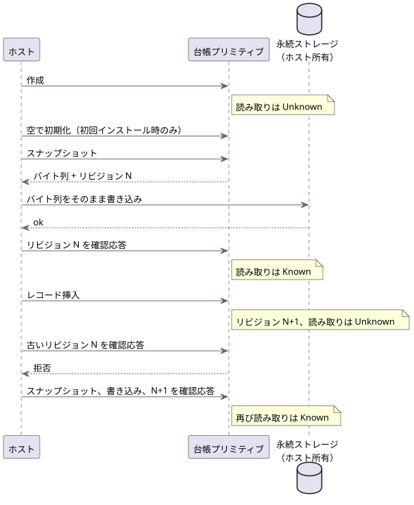

<!-- translation-source: docs/ACCOUNTING-LEDGER-ABI.md -->
[英語の原文](ACCOUNTING-LEDGER-ABI.md)

# 使用量計上台帳プリミティブの ABI

このドキュメントでは、ホストが WebAssembly（WASM）とネイティブの C ABI を通じて Rust の使用量計上（アカウンティング）台帳を使う方法を説明します。台帳は、リソースがオンだった時間（`on_time`）とイベントの発生回数（`count_events`）を追跡し、ローリングウィンドウでの予約の受け入れ（admission）をサポートします。

扱うトピック：

- **スキャンが所有する Bool ステージの観測**：`StageAccountingControl`。スキャンドライバ自身がオン時間を記録します。
- **`AccountingRuntime`**：1つのアカウントのためのソースに束縛された台帳で、呼び出し側が提供する証拠を入力とします。
- **呼び出し側が提供する証拠**、**永続化の手順**、**現在の制限**：ホストの義務。
- **適合性セクション**（REF-03-019、-022、-048、-049）：算術と失敗時の挙動を固定する、固定のテストケース。

繰り返し登場する用語：台帳が正確に答えられるとき、値は **Known** です。証拠が欠落している、確認応答されていない、または無効であるとき、値は **Unknown** です。Unknown は常にフェイルクローズ（安全側に閉じる）します。

## スキャンが所有する Bool ステージの観測

`StageAccountingControl.instantiateSource` は、正本ソースをコンパイルし、各リソースから Bool 出力への明示的なマッピングを検証します。リソース名と出力名が一致する必要はありません。ソースに束縛されたコンパイラは、Rust の有効化パケットを生成する前に、提供された成果物を正本の再コンパイル結果と照合します。

プロファイルの制限：

- 永続的な `on_time` アカウントは最大32個
- `maxSegments` は 1〜4096
- 受け入れ制限と、混在したイベントアカウントは拒否されます

既存の適用済み台帳の API は、そのレシート契約を維持します。

オブザーバは `ScanDriver` が所有します。オブザーバの動作は次のとおりです。

- 成功したスキャンだけを記録します。区間 `[previous_time, current_time)` には、前回の要求値または安全値を使います。
- false の値はカバレッジを記録し、オン時間には0を寄与します。
- クエリは区間をクリップし、要求された範囲の完全なカバレッジを必要とします。
- 重複したスキャン ID や逆行したクロックは、使用量計上を変更せずに拒否されます。
- 同じ時刻の別個のスキャンは、時間を消費せずに次の値を変更します。
- 公開の容量が尽きた場合、受理された制御スキャンはそのまま保たれ、使用量計上は Unknown になります。
- オブザーバは、呼び出し側が提供するトレースを決して受け付けず、要求/安全の区間を適用済み台帳に記録することも決してありません。

`query(account, startMs, endMs, runId)` は u64 の BigInt 時刻を使い、`{ kind: 'Known', usedMs: BigInt }` または `{ kind: 'Unknown', reason }` を返します。適用済みステージは `NoReceipt` を、確認済みステージは `NoFeedback` を返します。このオブザーバには、物理的なレシートやフィードバックを取り込む経路がないためです。有界なクエリ区間は呼び出し側が選択します。既定の有効期間、日の境界、受け入れポリシーは追加されません。ホストが継続的な観測を証明できない場合、`coverageGap()` はアクティブな区間カーソルを破棄します。次のスキャン以降のカバレッジがそのギャップを埋めることはありません。

`persist(write)` は、切り離されたスナップショットのコピーと、その正確な BigInt リビジョンをホストの書き込み関数に渡します。現在のリビジョンに対する `true` の確認応答だけが、使用量を Known にします。失敗した場合、または書き込み中に別のスキャンがあった場合、永続化は保留のままです。実際の永続ストレージはホストが所有します。

スナップショットは次のものを束縛します。

- モジュールのフィンガープリントと正本ソースの SHA-256
- アカウント/リソース/出力/ステージのマッピング
- 容量
- 実行（run）の同一性
- カバーされた区間

そのチェックサムは破損を検出しますが、ストレージを認証するものではありません。復元には、未使用の実行 ID を持つ新しい所有者が必要です。復元では、過去のクエリを元の実行 ID のもとに保ち、観測カーソルをリセットします。再起動した単調クロックは0から始まってもかまいません。再起動をまたぐ区間はありません。スナップショットの履歴がサポートする実行の同一性は最大32個で、これらの上限や同一性が一致しない場合はフェイルクローズします。

`tests/stage-accounting-control.test.mjs` は、ネイティブと WASM のトレース結果、クエリ、スナップショットの完全なバイト列を比較します。REF-03-021 では、ブロックされた20秒の要求から、要求 20000ms、安全 0ms、適用済み Unknown、確認済み Unknown が得られます。物理的なドライバの挙動とストレージの永続性は、別個の受け入れ証拠です。

この ABI は、Rust の使用量計上台帳を WebAssembly を通じてホストに公開します。GFB11 のカウント Result は、ペアになった台帳を使って、ポータブルな制御 VM の中で実行されます。ソースに束縛されたローリング予約の受け入れは、明示的なリファレンスホストの操作です。ABI が制御出力をリソースに自動的に束縛することはありません。

`AccountingRuntime.instantiateSource(wasmBytes, document, options)` は、正確な正本の `.ghost.md` ドキュメントをコンパイルし、宣言されたアカウントを名前で1つ選択します。受け付けるのは次のいずれかです。

- `applied` ステージでの永続的な `on_time`（呼び出し側が提供する `resourceId` を伴う）
- `local_day` にわたる永続的な `count_events`（呼び出し側が提供する `eventType` を伴う）

インスタンスは、他の ID や操作に対する記録およびクエリの呼び出しを拒否します。その `source` レコードは、ソースドキュメント全体、ソースの SHA-256、選択されたアカウントと対象の名前、ステージ、成果物の SHA-256 を保持します。

提供された数値 ID には、依然として物理的なリソースまたは Event への信頼できるホストのバインディングが必要です。復元された台帳スナップショットにはソースの同一性が埋め込まれていないため、ホストは自身の永続ストレージがそのバインディングに属することも検証しなければなりません。ソースに束縛されたリファレンスホストは、このプリミティブを通じて、ローリング予約を明示的に準備、精算、取り消しできます。VM の出力判断をリソースの受け入れに自動的に接続したり、物理的な適用の証拠を認証したりすることはありません。

使用量計上のみのソースは、コンテキストを生成する式がなくても、使用量計上の control-v10 プロファイルを選択します。REF-03-020 は、同じ検査済みのソースバインディングを、ネイティブの Rust 台帳と WASM 台帳に対して実行します。

- 同一のオン/オフ境界を、1秒ごとの観測と、7/13/9秒を繰り返す観測とで分割します。
- 60秒のローリングの正確な重なりが、スナップショットの復元後や新規のリプレイ後も含め、共通の論理時刻で一致します。

ネイティブのテストランナーは、コンパイル済みのモジュールと、ホストが検証したマニフェストを読み込みます。ソースを独自にコンパイルすることはありません。これらは、呼び出し側が検証した適用済み区間に対する事後的な計算です。制御の受け入れ、ライブでの最大オン時間の打ち切り、物理的なレシートの認証ではありません。

## 呼び出し側が提供する証拠

台帳は、以下について呼び出し側を信頼します。各項目はホストの義務です。

- 適用済みのオンの記録は、安定した物理リソースごとに、呼び出し側によってすでに検証・マージされています。各セグメントは0でないレシート ID と、正の単調な区間を持ちます。レシート ID はリソース内で一意です。
- 呼び出し側は、信頼できる現地の日の境界で区間を分割し、各セグメントに不変の整数の日キーを提供します。台帳はタイムゾーンや暦日を解決しません。
- イベントの記録は、不透明な16バイトの ID と型付きのイベント ID を持ちます。1つの Event 型の中で重複した ID は冪等です。異なる証拠で ID を再利用するとエラーになります。
- 設定された区間とイベントの容量は、厳格な上限です。呼び出し側は、拒否された変更を Unknown として扱わなければなりません。WASM ABI は、記録エラーの後で現在の台帳を汚染状態（poisoned）にします。

## 永続化の手順

台帳が Known になるのは、現在のリビジョンが永続的に保存され、確認応答された場合だけです。

1. 作成直後は Unknown です。
2. 初回インストール時、ホストは空の台帳を明示的に初期化します。
3. ホストはスナップショットを取得し、それを永続的に書き込み、その正確なリビジョンを確認応答します。
4. 記録を挿入するたびに、ホストが新しいリビジョンのスナップショットを取得し、永続化し、確認応答するまで、読み取りは Unknown を返します。

古いリビジョンに対する書き込みの確認応答は拒否されます。復元された有効なスナップショットはすでに確認応答済みです。欠落したスナップショットや無効なスナップショットは Unknown のままです。

上のシーケンス図は、読み取りが Known と Unknown の間で切り替わるタイミングを示しています。

ローリング予約の受け入れも、同じ永続的なビューを使います。メモリ上の台帳が既知であっても、そのリビジョンが確認応答されていなければ、予約の作成、リビジョンの前進、ホストの永続化の呼び出しの前に、受け入れは拒否されます。これには次の場合が含まれます。

- 書き込みに失敗した空の初期化
- 保留中の予約の完全一致の再試行

欠落した台帳や破損した台帳もフェイルクローズします。永続的な書き込みが成功した後、`persistPending` で明示的に復旧します。その後に限り、完全一致の再試行が `Duplicate` を返すことがあります。予約の書き込みに失敗した場合、保留中の予約と Unknown の読み取りは維持されます。許可を捏造することも、予約をロールバックすることもありません。これにより、保護的な `on_unknown = block` が回復されます。カウントの故障を `case ... fault(_) => false` で評価しても、イベントは記録されず、開始の権限も与えられません。

ネイティブの `accounting_admission_tape` の例は、有界な適合性検証のトランスポートのために、同じ本番用 C ABI をその Rust モジュール/rlib を通じてリンクします。信頼されたテストホストが、検査済みのソースマニフェストと明示的な書き込みの確認応答を提供します。カウント、故障、受け入れの判断は、依然として Rust ABI の内部で生成されます。これは、呼び出し側が判断を投影する新しい ABI でも、VM/リソースの自動バインディングでもありません。

台帳のスナップショットは、CRC-32 による破損検査を備えた、バージョン付きのバイナリ形式です。ストレージはホストが所有し、バイト列を正確に保持しなければなりません。プリミティブ自体は、記憶媒体やホストの書き込みのアトミック性を認証しません。

## 現在の制限

- 呼び出し側は、保存された区間と比較可能な単調タイムスタンプを提供しなければなりません。そのタイムラインを再起動をまたいでつなぐことは、この ABI の範囲外です。
- 呼び出し側は、信頼できる現地の日キーも提供し、真夜中でセグメントを分割しなければなりません。
- 有界なイベント ID の保持や削除のポリシーは定義されていません。設定されたイベント容量を使い果たすとフェイルクローズします。

これらの選択のため、このプリミティブはまだ完全な `durable` コンパイラランタイムのバインディングとしては機能できません。

## ネイティブのローリング重なりの適合性

テスト専用のコア `accounting_tape` トランスポートは、履歴フレームに省略可能な `admission` を受け付けます。そのフィールドは、0でない整数の `reservationId`、`limitMs`、`reserveMs`、Bool の `retry` です。実際の `AccountingLedger::reserve_rolling` を呼び出す前に、選択されたアカウントの検査済みソースマニフェストに照らして、ウィンドウ、上限、予約量、`on_unknown = block` を検証します。結果には、ネイティブの判断、スナップショットが変化していない証拠、省略可能な完全一致の重複再試行、適用済みの使用量、未精算の予約使用量が保持されます。既存の観測専用テープは、以前の出力形式を保ちます。

REF-03-019 は、適用済み区間 `(0,20]` と `(30,40]`、60秒のウィンドウ、30秒の上限、5秒の予約を使います。

| 時刻 | ウィンドウ | 使用量 | 5 s の受け入れ |
| --- | --- | --- | --- |
| 40 s | `(0,40]` | 20 + 10 = 30 s | 拒否、変更なし |
| 65 s | `(5,65]` | 15 + 10 = **25 s** | ちょうど収まる（残り 5 s） |

65秒の時点でウィンドウは `(5,65]` です。最初の区間からの15秒と2番目の区間からの10秒で**25秒**となり、受け入れにちょうど5秒が残ります。元のケースではこの時点の合計が15秒とされていましたが、これは算術の誤りでした。現在のケースで修正されており、ID、バックリンク、固定された履歴上の原本はそのまま保持されています。

同じコンパイル済みソースと有限の記録から、計算と既知の受け入れについてネイティブ/WASM のパリティが得られます。ネイティブのコアトランスポートは、台帳を明示的にシリアライズして復元します。WASM のリファレンスアダプタはさらに、確認応答されていない予約が Unknown のままであり、明示的な確認応答まで再試行をブロックすることを証明します。ネイティブのコアのシリアライズは、そのアダプタの永続化の確認応答でも、物理ストレージの認証でもありません。どちらのテストトランスポートも、VM の出力を物理リソースに束縛したり、適用済みのレシートを認証したりはしません。

## 選択された再起動予算のプロファイル（REF-03-022）

REF-03-022 は、`on_unknown = block` を持つ既存の永続的な適用済みプロファイルを選択します。シナリオは次のとおりです。

1. 28秒の適用済み使用の後、デバイスが永続的なチェックポイントなしで再起動します。これにより Unknown の所有者が生じます。ホストは、その履歴を消去するために初回インストール用の `initializeEmpty` を使ってはなりません。
2. 欠落または破損した履歴は、リビジョンやスナップショットを変更せず、永続化の呼び出しも行わずに、5秒の予約をブロックします。
3. 有効なチェックポイントは28秒を復元しますが、30秒の上限のもとでは依然としてその予約をブロックします。
4. 比較可能な単調時刻63秒の時点で、60秒のウィンドウには `(0,28]` から25秒が残るため、5秒の予約がちょうど収まります。

ネイティブの `accounting_reboot_tape` 本番用 C ABI トランスポートと、ソースに束縛された WASM アダプタは、これらの完全なスナップショットと受け入れの結果について一致します。再起動をまたぐ比較可能な単調タイムラインは、呼び出し側が所有します。この選択されたプロファイルは、ウィンドウの期限切れ後の自動リセットや、非永続的なプロファイルを採用しません。

## 現地の日の適合性トランスポート（REF-03-048）

有界なテストホストは、インストールされた Intl のタイムゾーンデータを使ってソウルの真夜中を解決し、最終的な適用済み区間をそこで分割します。独立した Automatic/Manual の論理的なポンプ要求を、提供された1つのリソースの同一性に束縛します。要求は物理的な適用を証明しません。台帳は、重なり合う適用済み区間を1回だけ（和集合として）数えます。たとえば、23:50〜00:10 は各現地日にそれぞれ10分を寄与し、別個のローリング24時間クエリには20分を寄与します。

テスト専用の `accounting_tape` は、明示的なセグメントの日タグ、有界な日のクエリ、省略可能な完全な記録のチェックポイントをサポートします。テスト専用の `accounting_local_day_tape` は本番用 C ABI をリンクし、完全なステータス、チェックポイントのバイト列、リビジョン、Known/Unknown のクエリを WASM と比較します。

- レシートを完全に同一のまま再配信しても、使用量とチェックポイントは変わりません。
- 無効な適用済み区間はプリミティブの台帳を変更しませんが、本番用 C ABI は保守的にその履歴を Unknown とマークし、リビジョンを進めます。
- 再試行には、保存された信頼できるチェックポイントを明示的に復元する必要があります。使用量が黙ってリセットされることは決してありません。

これらのトランスポートは、本番用のクロック/バインディングのプロバイダ、レシートの認証、物理的なストレージ/適用の認証を提供しません。

## 停止遅延を含む予約の受け入れ

REF-03-049 は、作成者が記述した有限の式 `reserve = worst_case_on + stop_delay` を、最大オン時間 5min、停止遅延 2min で使います。結果として得られる 7min の予約は、残りの 6min には収まりません。

ネイティブの `stop_delay_reservation_tape` テストトランスポートは、この本番用 C ABI をリンクします。新規のリプレイを通じて、ソースに束縛された WASM のステータス、リビジョン、完全なチェックポイントのバイト列、ローリングの説明と一致します。

- 復元された未精算の予約は、古い適用済み区間がウィンドウから外れた後も、引き続き計上されます。
- 欠落または破損した永続的な証拠は Unknown です。経過時間による払い戻しも、証拠のない精算もありません。
- 予約を精算できるのは、別途提供され相関づけられた適用済みのレシートと、明示的な永続化の確認応答の組み合わせだけです。

リソースの同一性、単調時間の比較可能性、ストレージの確認応答、レシートの検証は、信頼されたテストホストの入力です。このフィクスチャは、物理的な打ち切り、ストレージの永続性、自動的な出力の受け入れを確立するものではありません。
