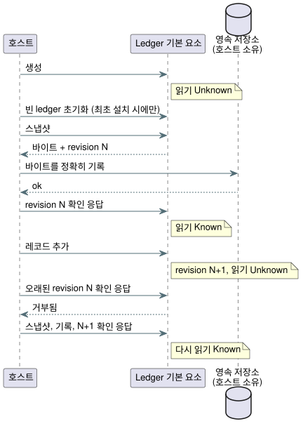

<!-- translation-source: docs/ACCOUNTING-LEDGER-ABI.md -->
[영문 원문](ACCOUNTING-LEDGER-ABI.md)

# Accounting ledger 기본 요소 ABI

이 문서는 호스트가 WebAssembly(WASM)와 native C ABI를 통해 Rust accounting(사용량 집계)
ledger(원장)를 사용하는 방법을 설명합니다. ledger는 자원이 ON이었던 시간(`on_time`)과
발생한 이벤트 수(`count_events`)를 추적하며, rolling window(이동 구간) 예약 admission(수용)을
지원합니다.

다루는 주제:

- **스캔 소유 Bool 단계 관찰**: 스캔 driver가 ON 시간을 직접 기록하는
  `StageAccountingControl`입니다.
- **`AccountingRuntime`**: 호출자가 제공한 증거를 받아 계정 하나를 다루는, 소스에 묶인
  ledger입니다.
- **호출자가 제공하는 증거**, **영속화 순서**, **현재 제한**: 호스트의 의무입니다.
- **적합성 절**(REF-03-019, -022, -048, -049): 산술과 실패 동작을 고정하는 고정 테스트
  사례입니다.

자주 나오는 용어: ledger가 정확히 답할 수 있는 값은 **Known**이고, 증거가 없거나, 확인
응답을 받지 못했거나, 유효하지 않은 값은 **Unknown**입니다. Unknown은 항상 fail closed(닫힌
쪽으로 실패) 처리합니다.

## 스캔 소유 Bool 단계 관찰

`StageAccountingControl.instantiateSource`는 정본 소스를 컴파일하고, 각 자원에서 Bool 출력으로
가는 명시적 매핑을 검증합니다. 자원 이름과 출력 이름은 같을 필요가 없습니다. 소스에 묶인
컴파일러는 Rust activation packet을 만들기 전에, 제공된 artifact가 정본 재컴파일 결과와
일치하는지 검사합니다.

프로필 제한:

- durable `on_time` 계정 최대 32개
- `maxSegments`는 1부터 4096까지
- admission 한도와 이벤트 계정 혼합은 거부합니다.

기존 applied ledger API는 receipt 계약을 그대로 유지합니다.

`ScanDriver`가 관찰자를 소유합니다. 관찰자는 다음과 같이 동작합니다.

- 성공한 스캔만 기록합니다. 구간 `[previous_time, current_time)`에는 직전의 requested 값
  또는 safe 값을 사용합니다.
- false 값도 관측 범위(coverage)로 기록되며, ON 시간에는 0을 더합니다.
- 질의는 구간을 잘라 계산하며, 요청한 범위 전체가 관측 범위로 덮여 있어야 합니다.
- 중복된 스캔 ID와 거꾸로 가는 시계는 집계를 바꾸지 않고 거부합니다.
- 같은 시각의 다른 스캔은 시간을 소비하지 않고 다음 값을 바꿉니다.
- 게시 용량이 소진되면 수용된 제어 스캔은 그대로 유지되고, 집계는 Unknown이 됩니다.
- 관찰자는 호출자가 제공한 trace를 절대 받지 않으며, requested/safe 구간을 applied
  ledger에 절대 기록하지 않습니다.

`query(account, startMs, endMs, runId)`는 u64 BigInt 시각을 사용하며
`{ kind: 'Known', usedMs: BigInt }` 또는 `{ kind: 'Unknown', reason }`을 반환합니다.
applied 단계는 `NoReceipt`, confirmed 단계는 `NoFeedback`을 반환합니다. 이 관찰자에는 물리적
receipt나 피드백을 받아들이는 경로가 없기 때문입니다. 유한한 질의 구간은 호출자가 고릅니다.
기본 수명, 하루 경계, admission 정책은 추가하지 않습니다. 호스트가 관측이 계속되었음을 입증할
수 없으면 `coverageGap()`이 활성 구간 커서를 버립니다. 다음 스캔 이후의 관측 범위는 그 공백을
채우지 않습니다.

`persist(write)`는 분리된 스냅샷 복사본과 그 정확한 BigInt revision을 호스트 writer에
넘깁니다. 현재 revision에 대한 `true` 확인 응답이 있어야만 사용량이 Known이 됩니다. 기록이
실패하거나 기록 도중 다른 스캔이 일어나면 영속화는 대기(pending) 상태로 남습니다. 실제 영속
저장소는 호스트가 소유합니다.

스냅샷은 다음을 묶습니다.

- 모듈 fingerprint와 정본 소스 SHA-256
- 계정/자원/출력/단계 매핑
- 용량
- 실행(run) identity
- 관측 범위 구간

스냅샷의 체크섬은 손상을 탐지할 뿐, 저장소를 인증하지는 않습니다. 복원하려면 사용하지 않은
run ID를 가진 새 소유자가 필요합니다. 복원은 과거 질의를 원래 run ID 아래에 유지하고 관측
커서를 초기화합니다. 재시작한 단조 시계는 0부터 시작할 수 있으며, 재시작을 가로지르는 구간은
없습니다. 스냅샷 이력은 run identity를 최대 32개까지 지원하며, 그 한도나 identity가 일치하지
않으면 fail closed 처리합니다.

`tests/stage-accounting-control.test.mjs`는 native와 WASM의 trace 결과, 질의, 스냅샷 바이트
전체를 비교합니다. REF-03-021에서 차단된 20초 요청은 requested 20000ms, safe 0ms, applied
Unknown, confirmed Unknown을 만듭니다. 물리 Driver 동작과 저장소 영속성은 별도의 인수 증거입니다.

이 ABI는 WebAssembly를 통해 Rust accounting ledger를 호스트에 노출합니다. GFB10 count
Result는 짝지어진 ledger를 사용해 이식 가능한 제어 VM 안에서 실행됩니다. 소스에 묶인 rolling
예약 admission은 명시적인 참조 호스트 연산이며, ABI가 제어 출력을 자원에 자동으로 바인딩하지는
않습니다.

`AccountingRuntime.instantiateSource(wasmBytes, document, options)`는 정확한 정본 `.ghost.md`
문서를 컴파일하고, 선언된 계정 하나를 이름으로 선택합니다. 다음 둘 중 하나를 받습니다.

- 호출자가 제공한 `resourceId`를 사용하는 `applied` 단계의 durable `on_time`
- 호출자가 제공한 `eventType`을 사용하는 `local_day` 기준 durable `count_events`

인스턴스는 다른 ID나 연산에 대한 기록 및 질의 호출을 거부합니다. 인스턴스의 `source`
레코드는 전체 소스 문서, 소스 SHA-256, 선택된 계정 이름과 대상 이름, 단계, artifact
SHA-256을 보존합니다.

제공된 숫자 ID는 여전히 물리 자원이나 Event에 대한 신뢰할 수 있는 호스트 바인딩이 필요합니다.
복원된 ledger 스냅샷에는 소스 identity가 내장되어 있지 않으므로, 호스트는 자신의 영속 저장소가
그 바인딩에 속하는지도 검증해야 합니다. 소스에 묶인 참조 호스트는 이 기본 요소를 통해 rolling
예약을 명시적으로 준비, 정산, 취소할 수 있습니다. VM 출력 판단을 자원 admission에 자동으로
연결하거나, 물리적 적용 증거를 인증하지는 않습니다.

accounting만 있는 소스는 컨텍스트를 만드는 식이 없어도 accounting control-v10 프로필을
선택합니다. REF-03-020은 같은 검사된 소스 바인딩을 native Rust ledger와 WASM ledger에서
실행합니다.

- 같은 ON/OFF 경계를 1초 간격 관측과, 7/13/9초 간격이 반복되는 관측으로 각각 분할합니다.
- 정확한 60초 rolling 중첩 결과는 스냅샷 복원 후와 새 재생 후를 포함해, 공통 논리 시각에서
  서로 일치합니다.

native 테스트 러너는 컴파일된 모듈과 호스트가 검증한 manifest(매니페스트)를 로드하며, 스스로
소스를 컴파일하지 않습니다. 이것은 호출자가 검증한 applied 구간에 대한 과거 계산입니다. 제어
admission도, 실시간 최대 ON 차단도, 물리적 receipt 인증도 아닙니다.

## 호출자가 제공하는 증거

ledger는 다음 사항에 대해 호출자를 신뢰합니다. 각 항목은 호스트의 의무입니다.

- applied ON 기록은 안정적인 물리 자원별로 호출자가 이미 검증하고 병합한 것입니다. 각
  세그먼트에는 0이 아닌 receipt ID와 양의 길이를 가진 단조 구간이 있습니다. receipt ID는
  한 자원 안에서 고유합니다.
- 호출자는 신뢰할 수 있는 현지 날짜 경계에서 구간을 나누고, 각 세그먼트에 변경 불가능한
  정수 날짜 키를 제공합니다. ledger는 시간대나 달력 날짜를 해석하지 않습니다.
- 이벤트 기록에는 불투명한 16바이트 ID와 타입이 있는 이벤트 ID가 있습니다. 한 Event 타입
  안에서 중복 ID는 멱등적으로 처리됩니다. 같은 ID를 다른 증거로 재사용하면 오류입니다.
- 설정된 구간 용량과 이벤트 용량은 엄격한 상한입니다. 호출자는 거부된 변경을 Unknown으로
  취급해야 합니다. WASM ABI는 기록 오류가 나면 현재 ledger를 오염(poison) 상태로 만듭니다.

## 영속화 순서

ledger는 현재 revision이 영속적으로 저장되고 확인 응답을 받았을 때만 Known입니다.

1. 생성 직후에는 Unknown입니다.
2. 최초 설치 시 호스트가 빈 ledger를 명시적으로 초기화합니다.
3. 호스트가 스냅샷을 얻어 영속적으로 기록하고, 정확히 그 revision에 확인 응답을 보냅니다.
4. 레코드를 추가할 때마다, 호스트가 새 revision의 스냅샷을 얻어 영속화하고 확인 응답을 보낼
   때까지 읽기는 Unknown을 반환합니다.

오래된 revision에 대한 기록 확인 응답은 거부됩니다. 유효한 스냅샷을 복원하면 이미 확인 응답을
받은 것으로 봅니다. 없거나 유효하지 않은 스냅샷은 Unknown으로 남습니다.

위 시퀀스 다이어그램은 읽기가 Known과 Unknown 사이에서 언제 바뀌는지 보여 줍니다.

rolling 예약 admission도 같은 영속 관점을 사용합니다. 메모리 안의 ledger가 known이더라도 그
revision이 확인 응답을 받지 못했다면, admission은 예약을 만들거나, revision을 올리거나, 호스트
영속화를 호출하기 전에 거부됩니다. 여기에는 다음이 포함됩니다.

- 기록이 실패한 빈 초기화
- 대기 중인 예약의 정확한 재시도

없거나 손상된 ledger도 fail closed 처리합니다. 영속 기록이 성공한 뒤 `persistPending`으로
명시적으로 복구해야 하며, 그 후에만 정확한 재시도가 `Duplicate`를 반환할 수 있습니다. 예약
기록이 실패하면 대기 중인 예약과 Unknown 읽기를 유지합니다. 허가를 지어내지도, 예약을 되돌리지도
않습니다. 이로써 보호용 `on_unknown = block`이 복원됩니다. `case ... fault(_) => false`로 count
fault를 평가하면 이벤트를 기록하지 않으며 시작 권한도 부여하지 않습니다.

native `accounting_admission_tape` 예제는 유한한 적합성 전송을 위해 같은 프로덕션 C ABI를 그
Rust module/rlib을 통해 링크합니다. 신뢰할 수 있는 테스트 호스트가 검사된 소스 manifest와 명시적
기록 확인 응답을 제공합니다. count, fault, admission 판단은 여전히 Rust ABI 안에서 만들어집니다.
이것은 호출자가 판단을 투영하는 새 ABI도, VM/자원 자동 바인딩도 아닙니다.

ledger 스냅샷은 CRC-32 손상 검사가 있는 버전 관리 바이너리 형식입니다. 저장소는 호스트가
소유하며, 호스트는 바이트를 정확히 보존해야 합니다. 이 기본 요소 자체는 저장 매체나 호스트
기록의 원자성을 인증하지 않습니다.

## 현재 제한

- 호출자는 저장된 구간과 비교 가능한 단조 타임스탬프를 제공해야 합니다. 재부팅을 가로질러
  그 타임라인을 잇는 일은 이 ABI의 범위가 아닙니다.
- 호출자는 신뢰할 수 있는 현지 날짜 키도 제공하고, 자정에서 세그먼트를 나눠야 합니다.
- 이벤트 ID 보존 한도나 정리(pruning) 정책은 정의되어 있지 않습니다. 설정된 이벤트 용량이
  소진되면 fail closed 처리합니다.

이러한 선택 때문에 이 기본 요소는 아직 완전한 `durable` 컴파일러 런타임 바인딩 역할을 할 수
없습니다.

## Native rolling 중첩 적합성

테스트 전용 core `accounting_tape` 전송은 과거 프레임에 선택적 `admission`을 받으며, 그 필드는
0이 아닌 정수 `reservationId`, `limitMs`, `reserveMs`, Boolean `retry`입니다. 실제
`AccountingLedger::reserve_rolling`을 호출하기 전에, 선택된 계정의 검사된 소스 manifest에 맞춰
window, 상한, 예약량, `on_unknown = block`을 검증합니다. 결과에는 native 판단, 스냅샷이 바뀌지
않았다는 증거, 선택적인 정확한 중복 재시도, applied 사용량, 미정산 예약 사용량이 담깁니다. 기존의
관측 전용 테이프는 이전 출력 형태를 유지합니다.

REF-03-019는 applied 구간 `(0,20]`과 `(30,40]`, 60초 window, 30초 한도, 5초 예약량을
사용합니다.

| 시각 | Window | 사용량 | 5초 admission |
| --- | --- | --- | --- |
| 40초 | `(0,40]` | 20 + 10 = 30초 | 거부, 변경 없음 |
| 65초 | `(5,65]` | 15 + 10 = **25초** | 정확히 맞음(5초 남음) |

65초 시점의 window는 `(5,65]`입니다. 첫 구간에서 15초, 두 번째 구간에서 10초를 더하면
**25초**이므로 admission에 정확히 5초가 남습니다. 원래 사례에서 그 시각의 합계를 15초로 적은
것은 산술 오류였습니다. 현재 사례에서 이를 바로잡았으며, 사례 ID, 역링크, 고정된 과거 원본은
그대로 유지합니다.

같은 컴파일된 소스와 유한한 기록은 계산과 known admission에 대해 native/WASM parity(동등성)를
만듭니다. native core 전송은 ledger를 명시적으로 직렬화하고 복원합니다. WASM 참조 어댑터는 여기에
더해, 확인 응답을 받지 못한 예약이 Unknown으로 남고 명시적 확인 응답 전까지 재시도를 막는다는
것을 입증합니다. native core 직렬화는 그 어댑터의 영속화 확인 응답도, 물리 저장소 인증도
아닙니다. 두 테스트 전송 모두 VM 출력을 물리 자원에 바인딩하지 않으며, applied receipt를
인증하지 않습니다.

## 선택한 재부팅 예산 프로필 (REF-03-022)

REF-03-022는 `on_unknown = block`인 기존 durable applied 프로필을 선택합니다. 시나리오는
다음과 같습니다.

1. applied 사용량이 28초 쌓인 뒤, 장치가 영속 checkpoint 없이 재부팅됩니다. 이로써 Unknown
   소유자가 생깁니다. 호스트는 최초 설치용 `initializeEmpty`로 그 이력을 지워서는 안 됩니다.
2. 없거나 손상된 이력은 revision이나 스냅샷을 바꾸지 않고, 영속화 호출도 없이 5초 예약을
   차단합니다.
3. 유효한 checkpoint는 28초를 복원하며, 30초 한도에서는 여전히 그 예약을 차단합니다.
4. 비교 가능한 단조 시각 63초에서 60초 window는 `(0,28]`에서 25초를 유지하므로, 5초 예약이
   정확히 맞습니다.

native `accounting_reboot_tape` 프로덕션 C ABI 전송과 소스에 묶인 WASM 어댑터는 이 스냅샷 전체와
admission 결과에 대해 일치합니다. 재부팅을 가로지르는 비교 가능한 단조 타임라인은 호출자가
소유합니다. 이 선택한 프로필은 window 만료 후 자동 초기화나 non-durable 프로필을 채택하지
않습니다.

## 현지 날짜 적합성 전송 (REF-03-048)

유한한 테스트 호스트는 설치된 Intl 시간대 데이터로 서울 자정을 해석하고, 최종 applied 구간을
그 지점에서 나눕니다. 서로 독립적인 Automatic/Manual 논리 펌프 요청을 제공된 자원 identity
하나에 바인딩합니다. 요청은 물리적 적용을 입증하지 않습니다. ledger는 겹치는 applied 구간을
한 번만(합집합으로) 셉니다. 예를 들어 23:50–00:10은 각 현지 날짜에 10분씩, 별도의 rolling
24시간 질의에는 20분을 기여합니다.

테스트 전용 `accounting_tape`는 명시적 세그먼트 날짜 태그, 유한한 날짜 질의, 선택적인 전체 기록
checkpoint를 지원합니다. 테스트 전용 `accounting_local_day_tape`는 프로덕션 C ABI를 링크하고,
전체 상태, checkpoint 바이트, revision, Known/Unknown 질의를 WASM과 비교합니다.

- 정확히 같은 receipt를 다시 전달해도 사용량과 checkpoint는 바뀌지 않습니다.
- 유효하지 않은 applied 구간은 기본 요소 ledger를 바꾸지 않지만, 프로덕션 C ABI는 보수적으로
  이력을 Unknown으로 표시하고 revision을 올립니다.
- 재시도하려면 저장된 신뢰할 수 있는 checkpoint를 명시적으로 복원해야 합니다. 사용량을 조용히
  초기화하는 일은 절대 없습니다.

이 전송들은 프로덕션 시계/바인딩 provider, receipt 인증, 물리 저장소/적용 인증을 제공하지
않습니다.

## 정지 지연 예약 수용 검증

REF-03-049는 작성자가 쓴 유한 식 `reserve = worst_case_on + stop_delay`를 사용하며, 최대 ON 시간은 5min, 정지 지연은 2min입니다. 그 결과인 7min 예약은 남은 6min 안에 들어갈 수 없습니다.

native `stop_delay_reservation_tape` 테스트 전송은 이 프로덕션 C ABI를 링크합니다. 새 재생을 통해 소스에 묶인 WASM의 상태, revision, 전체 checkpoint 바이트, rolling 설명과 일치합니다.

- 복원된 미정산 예약은 오래된 applied 구간이 window를 벗어난 뒤에도 계속 차감된 상태로 남습니다.
- 없거나 손상된 영속 증거는 Unknown입니다. 경과 시간에 따른 환급도, 증거 없는 정산도 없습니다.
- 별도로 제공되고 상관관계가 확인된 applied receipt와 명시적 영속 확인 응답이 함께 있어야만 예약을 정산할 수 있습니다.

자원 identity, 단조 시간의 비교 가능성, 저장소 확인 응답, receipt 검증은 신뢰할 수 있는 테스트 호스트 입력입니다. 이 fixture는 물리적 차단, 저장소 영속성, 자동 출력 admission을 입증하지 않습니다.
