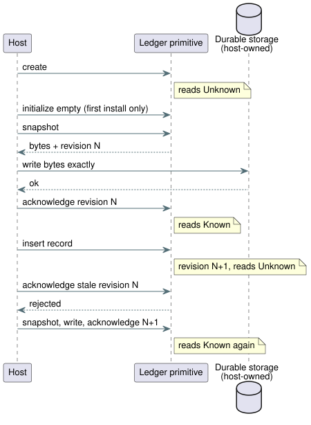

# Accounting ledger primitive ABI

This document describes how a host uses the Rust accounting ledger through
WebAssembly (WASM) and the native C ABI. The ledger tracks how long a resource
was ON (`on_time`) and how many events occurred (`count_events`), and it
supports rolling-window reservation admission.

Topics covered:

- **Scan-owned Bool stage observation**: `StageAccountingControl`, where the
  scan driver records ON time itself.
- **`AccountingRuntime`**: a source-bound ledger for one account, fed by
  caller-supplied evidence.
- **Evidence supplied by the caller**, **Persistence sequence**, and **Current
  limits**: the host's obligations.
- **Conformance sections** (REF-03-019, -022, -048, -049): fixed test cases
  that pin the arithmetic and failure behavior.

A recurring term: a value is **Known** when the ledger can answer exactly, and
**Unknown** when evidence is missing, unacknowledged, or invalid. Unknown always
fails closed.

## Scan-owned Bool stage observation

`StageAccountingControl.instantiateSource` compiles canonical source and
validates an explicit mapping from each resource to a Bool output. Resource and
output names need not match. The source-bound compiler checks the supplied
artifact against a canonical recompilation before it produces the Rust
activation packet.

Profile limits:

- up to 32 durable `on_time` accounts;
- `maxSegments` from 1 to 4096;
- admission limits and mixed event accounts are rejected.

Existing applied-ledger APIs keep their receipt contract.

`ScanDriver` owns the observer. The observer works like this:

- It records only successful scans. For the interval
  `[previous_time, current_time)` it uses the previous requested or safe value.
- A false value records coverage and contributes zero ON time.
- Queries clip intervals and require complete coverage of the requested range.
- Duplicate scan IDs and reversed clocks are rejected without changing
  accounting.
- A distinct scan at the same time changes the next value without consuming
  time.
- If publication capacity is exhausted, the accepted control scan stays intact
  and accounting becomes Unknown.
- The observer never accepts caller-supplied traces, and never records
  requested/safe intervals in the applied ledger.

`query(account, startMs, endMs, runId)` uses u64 BigInt times and returns
`{ kind: 'Known', usedMs: BigInt }` or `{ kind: 'Unknown', reason }`.
The applied stage returns `NoReceipt` and the confirmed stage returns
`NoFeedback`: this observer has no path for ingesting physical receipts or
feedback. The caller selects the bounded query interval. No default lifetime,
day boundary, or admission policy is added. `coverageGap()` drops the active
interval cursor when the host cannot attest continued observation. Coverage
after the next scan does not fill the gap.

`persist(write)` passes a detached snapshot copy and its exact BigInt revision
to the host writer. Only a `true` acknowledgement for the current revision makes
usage Known. A failure, or another scan during the write, leaves persistence
pending. The host owns the actual durable storage.

A snapshot binds:

- the module fingerprint and canonical source SHA-256;
- the account/resource/output/stage mapping;
- capacity;
- run identities; and
- covered intervals.

Its checksum detects corruption; it does not authenticate storage. Restore
requires a fresh owner with an unused run ID. It keeps historical queries under
their original run ID and resets the observation cursor. A restarted monotonic
clock may begin at zero; no interval bridges the restart. Snapshot history
supports at most 32 run identities and fails closed when those bounds or
identities do not match.

`tests/stage-accounting-control.test.mjs` compares native and WASM trace results,
queries, and complete snapshot bytes. In REF-03-021, a blocked 20s request
produces requested 20000ms, safe 0ms, applied Unknown, and confirmed Unknown.
Physical Driver behavior and storage durability are separate acceptance
evidence.

This ABI exposes the Rust accounting ledger to a host through WebAssembly.
GFB10 count Results execute inside the portable control VM using the paired
ledger. Source-bound rolling reservation admission is an explicit reference-host
operation; the ABI does not automatically bind control outputs to resources.

`AccountingRuntime.instantiateSource(wasmBytes, document, options)` compiles an
exact canonical `.ghost.md` document and selects one declared account by name.
It accepts either:

- durable `on_time` at the `applied` stage, with a caller-supplied
  `resourceId`; or
- durable `count_events` over `local_day`, with a caller-supplied `eventType`.

The instance rejects record and query calls for other IDs and operations. Its
`source` record preserves the complete source document, the source SHA-256, the
selected account and target names, the stage, and the artifact SHA-256.

The supplied numeric ID still requires a trusted host binding to the physical
resource or Event. A restored ledger snapshot has no embedded source identity,
so the host must also verify that its durable storage belongs to that binding.
The source-bound reference host can explicitly prepare, settle, and cancel
rolling reservations through this primitive. It does not automatically connect
VM output decisions to resource admission, or certify physical application
evidence.

Accounting-only sources select the accounting control-v10 profile even without
context-producing expressions. REF-03-020 executes the same checked source
binding against native Rust and WASM ledgers:

- identical ON/OFF boundaries are partitioned by 1-second observations and by
  repeating 7/13/9-second observations; and
- exact 60-second rolling overlaps agree at common logical times, including
  after snapshot restoration and fresh replay.

The native test runner loads the compiled module and a host-verified manifest;
it does not compile source on its own. These are historical calculations over
caller-validated applied intervals. They are not control admission, a live
maximum-ON cutoff, or physical receipt certification.

## Evidence supplied by the caller

The ledger trusts the caller for the following. Each item is a host
obligation.

- Applied ON records are already validated and merged by the caller, per stable
  physical resource. Each segment has a nonzero receipt ID and a positive
  monotonic interval. Receipt IDs are unique within a resource.
- The caller splits an interval at trusted local-day boundaries and supplies an
  immutable integer day key for each segment. The ledger does not resolve time
  zones or civil dates.
- Event records carry an opaque 16-byte ID and a typed event ID. Duplicate IDs
  within one Event type are idempotent. Reusing an ID with different evidence is
  an error.
- The configured interval and event capacities are hard bounds. The caller must
  treat a rejected mutation as Unknown. The WASM ABI poisons its current ledger
  after record errors.

## Persistence sequence

A ledger is Known only when its current revision is durably stored and
acknowledged:

1. Create starts Unknown.
2. On first installation, the host explicitly initializes an empty ledger.
3. The host obtains a snapshot, writes it durably, and acknowledges that exact
   revision.
4. After each inserted record, reads return Unknown until the host snapshots
   the new revision, persists it, and acknowledges it.

A write acknowledgement for a stale revision is rejected. Restored valid
snapshots are already acknowledged; missing or invalid snapshots stay Unknown.

The sequence diagram above shows when reads switch between Known and Unknown.

Rolling reservation admission uses the same durable view. If an in-memory
ledger is known but its revision is unacknowledged, admission is rejected
before it creates a reservation, advances the revision, or invokes host
persistence. This covers:

- an empty initialization whose write failed; and
- an exact retry of a pending reservation.

Missing or corrupt ledgers also fail closed. Recover explicitly with
`persistPending` after a successful durable write; only then may an exact retry
return `Duplicate`. A failed reservation write keeps its pending reservation and
Unknown reads; it neither fabricates a grant nor rolls the reservation back.
This restores protective `on_unknown = block`. Evaluating a count fault through
`case ... fault(_) => false` records no event and grants no start authority.

The native `accounting_admission_tape` example links the same production C ABI
through its Rust module/rlib for bounded conformance transport. A trusted test
host supplies the checked source manifest and explicit write acknowledgements;
counts, faults, and admission decisions still originate inside the Rust ABI. It
is not a new caller-projected decision ABI or an automatic VM/resource binding.

The ledger snapshot is a versioned binary format with a CRC-32 corruption check.
The host owns storage and must preserve the bytes exactly. The primitive does
not itself certify the storage medium or the atomicity of the host write.

## Current limits

- The caller must provide monotonic timestamps comparable with stored
  intervals. Bridging that timeline across reboot is not part of this ABI.
- The caller must also supply trusted local-day keys and split segments at
  midnight.
- No bounded event-ID retention or pruning policy is defined; exhausting the
  configured event capacity fails closed.

Because of these choices, this primitive cannot yet serve as a complete
`durable` compiler runtime binding.

## Native rolling overlap conformance

The test-only core `accounting_tape` transport accepts an optional `admission`
on a historical frame, with these fields: a nonzero integer `reservationId`,
`limitMs`, `reserveMs`, and Boolean `retry`. Before calling the actual
`AccountingLedger::reserve_rolling`, it validates the window, bound, reserve,
and `on_unknown = block` against the selected account's checked source
manifest. Results keep the native decision, unchanged-snapshot evidence, an
optional exact duplicate retry, applied usage, and outstanding reservation
usage. Existing observation-only tapes keep their previous output shape.

REF-03-019 uses applied intervals `(0,20]` and `(30,40]`, a 60-second window,
a 30-second limit, and a 5-second reserve:

| Time | Window | Usage | Admission of 5 s |
| --- | --- | --- | --- |
| 40 s | `(0,40]` | 20 + 10 = 30 s | Rejected, no mutation |
| 65 s | `(5,65]` | 15 + 10 = **25 s** | Fits exactly (5 s left) |

At 65 seconds the window is `(5,65]`: 15 seconds from the first interval plus
10 seconds from the second give **25 seconds**, leaving exactly 5 seconds for
admission. The original case's 15-second total at that time was an arithmetic
error. It is corrected in the current case, which keeps its ID, backlink, and
pinned historical original.

The same compiled source and finite records produce native/WASM parity for
calculations and known admissions. The native core transport explicitly
serializes and restores the ledger. The WASM reference adapter additionally
proves that an unacknowledged reservation stays Unknown and blocks retries until
explicit acknowledgement. Native core serialization is not that adapter's
persistence acknowledgement or physical storage certification. Neither test
transport binds VM outputs to physical resources or authenticates applied
receipts.

## Selected reboot budget profile (REF-03-022)

REF-03-022 selects the existing durable applied profile with
`on_unknown = block`. The scenario:

1. After 28 seconds of applied usage, the device reboots without its durable
   checkpoint. This creates an Unknown owner. The host must not use
   first-install `initializeEmpty` to erase that history.
2. Missing or corrupt history blocks a 5-second reservation without mutating
   the revision or snapshot and without a persistence call.
3. A valid checkpoint restores 28 seconds, which still blocks that reservation
   under a 30-second limit.
4. At comparable monotonic time 63 seconds, the 60-second window keeps 25
   seconds from `(0,28]`, so the 5-second reserve fits exactly.

The native `accounting_reboot_tape` production C ABI transport and the
source-bound WASM adapter agree on these complete snapshots and admission
outcomes. The caller owns the comparable monotonic timeline across reboot. This
selected profile does not adopt automatic reset after window expiry, or a
non-durable profile.

## Local-day conformance transport (REF-03-048)

The bounded test host resolves Seoul midnight through installed Intl time zone
data and splits final applied intervals there. It binds independent
Automatic/Manual logical pump requests to one supplied resource identity.
Requests do not prove physical application. The ledger counts overlapping
applied intervals once (as a union). For example, 23:50–00:10 contributes ten
minutes to each local day and twenty minutes to a separate rolling 24-hour
query.

The test-only `accounting_tape` supports explicit segment day tags, bounded day
queries, and optional complete record checkpoints. The test-only
`accounting_local_day_tape` links the production C ABI and compares full status,
checkpoint bytes, revisions, and Known/Unknown queries against WASM.

- Exact receipt redelivery leaves usage and checkpoints unchanged.
- An invalid applied interval does not mutate the primitive ledger, but the
  production C ABI conservatively marks its history Unknown and advances its
  revision.
- Retry requires explicitly restoring the saved trusted checkpoint; usage is
  never silently reset.

These transports supply no production clock/binding provider, receipt
authentication, or physical storage/application certification.

## Stop-delay reservation acceptance

REF-03-049 uses the authored finite expression `reserve = worst_case_on + stop_delay`, with a 5min maximum ON time and a 2min stop delay. The resulting 7min reservation cannot fit in the 6min that remain.

The native `stop_delay_reservation_tape` test transport links this production C ABI. Through fresh replay, it matches source-bound WASM statuses, revisions, complete checkpoint bytes, and rolling explanations.

- A restored outstanding reservation stays charged, even after old applied intervals leave the window.
- Missing or corrupt durable evidence is Unknown. There is no elapsed-time refund and no evidence-free settlement.
- Only a separately supplied, correlated applied receipt plus an explicit durable acknowledgement can settle the reservation.

Resource identity, monotonic-time comparability, storage acknowledgement, and receipt validation are trusted test-host inputs. This fixture does not establish physical cutoff, storage durability, or automatic output admission.
