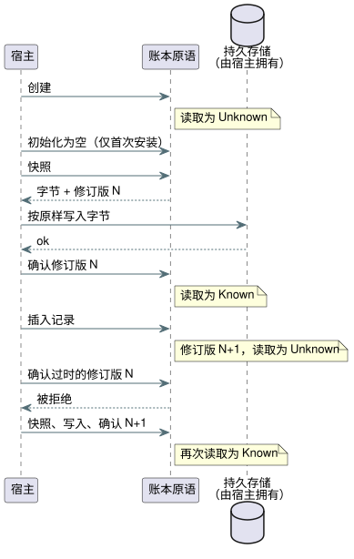

<!-- translation-source: docs/ACCOUNTING-LEDGER-ABI.md -->
[英文原文](ACCOUNTING-LEDGER-ABI.md)

# 用量核算账本原语 ABI

本文档描述宿主如何通过 WebAssembly（WASM）和原生 C ABI 使用 Rust 用量核算（accounting）账本。该账本跟踪某个资源处于 ON 状态的时长（`on_time`）以及发生的事件次数（`count_events`），并支持滚动窗口的预留准入。

涵盖的主题：

- **由扫描拥有的 Bool 阶段观测**：`StageAccountingControl`，由扫描驱动程序自行记录 ON 时间。
- **`AccountingRuntime`**：针对单个账户、与源绑定的账本，由调用方提供的证据驱动。
- **由调用方提供的证据**、**持久化顺序**和**当前限制**：宿主的义务。
- **一致性章节**（REF-03-019、-022、-048、-049）：固定算术和故障行为的固定测试用例。

一个反复出现的术语：当账本能够精确回答时，值为 **Known**；当证据缺失、未被确认或无效时，值为 **Unknown**。Unknown 始终以失败关闭（fail closed）的方式处理。

## 由扫描拥有的 Bool 阶段观测

`StageAccountingControl.instantiateSource` 编译规范源，并验证从每个资源到某个 Bool 输出的显式映射。资源名和输出名不必相同。与源绑定的编译器会先将提供的产物与一次规范的重新编译结果进行核对，然后才生成 Rust 激活包。

Profile 限制：

- 最多 32 个持久的 `on_time` 账户；
- `maxSegments` 为 1 到 4096；
- 准入限制和混合事件账户会被拒绝。

现有的已应用账本 API 保持其回执（receipt）契约。

观测器由 `ScanDriver` 拥有。观测器的工作方式如下：

- 它只记录成功的扫描。对于区间 `[previous_time, current_time)`，它使用上一个请求值或安全值。
- false 值会记录覆盖，并贡献零 ON 时间。
- 查询会裁剪区间，并要求所请求的范围被完整覆盖。
- 重复的扫描 ID 和倒退的时钟会被拒绝，且不改变用量核算。
- 同一时刻的另一个不同扫描会改变下一个值，但不消耗时间。
- 如果发布容量耗尽，已接受的控制扫描保持完整，而用量核算变为 Unknown。
- 观测器绝不接受调用方提供的追踪数据，也绝不把请求/安全区间记录到已应用账本中。

`query(account, startMs, endMs, runId)` 使用 u64 BigInt 时间，返回 `{ kind: 'Known', usedMs: BigInt }` 或 `{ kind: 'Unknown', reason }`。已应用阶段返回 `NoReceipt`，已确认阶段返回 `NoFeedback`：这个观测器没有接收物理回执或反馈的路径。查询的有界区间由调用方选择。不会添加默认的生命周期、日边界或准入策略。当宿主无法证明观测持续进行时，`coverageGap()` 会丢弃活动区间游标。下一次扫描之后的覆盖不会填补该间隙。

`persist(write)` 把一份分离的快照副本及其确切的 BigInt 修订版传给宿主的写入器。只有针对当前修订版的 `true` 确认才会使用量变为 Known。写入失败，或写入期间发生另一次扫描，都会使持久化保持待定（pending）状态。实际的持久存储由宿主拥有。

快照绑定以下内容：

- 模块指纹和规范源的 SHA-256；
- 账户/资源/输出/阶段映射；
- 容量；
- 运行身份标识；以及
- 已覆盖的区间。

其校验和用于检测损坏，但并不对存储进行认证。恢复需要一个使用未用过的运行 ID 的全新所有者。它会在原来的运行 ID 下保留历史查询，并重置观测游标。重新启动的单调时钟可以从零开始；没有任何区间跨越重启。快照历史最多支持 32 个运行身份标识，当这些边界或身份标识不匹配时，以失败关闭处理。

`tests/stage-accounting-control.test.mjs` 比较原生与 WASM 的追踪结果、查询以及完整的快照字节。在 REF-03-021 中，一个被阻止的 20s 请求得到：请求 20000ms，安全 0ms，已应用 Unknown，已确认 Unknown。物理 Driver 行为和存储持久性是单独的验收证据。

本 ABI 通过 WebAssembly 把 Rust 用量核算账本暴露给宿主。GFB11 的计数 Result 在可移植控制 VM 内部使用配对的账本执行。与源绑定的滚动预留准入是参考宿主的一项显式操作；ABI 不会自动把控制输出绑定到资源。

`AccountingRuntime.instantiateSource(wasmBytes, document, options)` 编译一个确切的规范 `.ghost.md` 文档，并按名称选择一个已声明的账户。它接受以下两者之一：

- `applied` 阶段的持久 `on_time`，并带有调用方提供的 `resourceId`；或
- 基于 `local_day` 的持久 `count_events`，并带有调用方提供的 `eventType`。

该实例会拒绝针对其他 ID 和操作的记录与查询调用。其 `source` 记录保存完整的源文档、源 SHA-256、所选账户和目标的名称、阶段以及产物 SHA-256。

提供的数字 ID 仍然需要一个可信的宿主绑定，把它与物理资源或 Event 关联起来。恢复的账本快照不包含嵌入的源身份标识，因此宿主还必须验证其持久存储属于该绑定。与源绑定的参考宿主可以通过此原语显式地准备、结算和取消滚动预留。它不会自动把 VM 的输出判定与资源准入连接起来，也不会认证物理应用证据。

仅用于用量核算的源即使没有产生上下文的表达式，也会选择用量核算 control-v10 profile。REF-03-020 针对原生 Rust 账本和 WASM 账本执行同一个已检查的源绑定：

- 相同的 ON/OFF 边界分别按 1 秒观测和按重复的 7/13/9 秒观测进行划分；以及
- 精确的 60 秒滚动重叠在共同的逻辑时间上一致，包括快照恢复和全新重放之后。

原生测试运行器加载已编译的模块和经宿主验证的清单（manifest）；它自己不编译源。这些是针对调用方已验证的已应用区间所做的历史计算。它们不是控制准入，不是实时的最大 ON 截断，也不是物理回执认证。

## 由调用方提供的证据

账本在以下方面信任调用方。每一项都是宿主的义务。

- 已应用的 ON 记录已由调用方按稳定的物理资源验证并合并。每个分段都有非零的回执 ID 和正长度的单调区间。回执 ID 在同一资源内唯一。
- 调用方在可信的本地日边界处切分区间，并为每个分段提供不可变的整数日键。账本不解析时区或民用日期。
- 事件记录携带一个不透明的 16 字节 ID 和一个带类型的事件 ID。同一 Event 类型内的重复 ID 是幂等的。以不同的证据重用同一 ID 是错误。
- 配置的区间容量和事件容量是硬性上限。调用方必须把被拒绝的修改视为 Unknown。WASM ABI 在记录出错后会使其当前账本失效（poison）。

## 持久化顺序

只有当账本的当前修订版已被持久存储并得到确认时，它才是 Known：

1. 创建时为 Unknown。
2. 首次安装时，宿主显式地初始化一个空账本。
3. 宿主获取快照，将其持久写入，并确认那个确切的修订版。
4. 每插入一条记录后，读取都返回 Unknown，直到宿主为新修订版生成快照、将其持久化并加以确认。

针对过时修订版的写入确认会被拒绝。恢复的有效快照已被确认；缺失或无效的快照保持 Unknown。

上面的时序图展示了读取何时在 Known 与 Unknown 之间切换。

滚动预留准入使用同一个持久视图。如果内存中的账本是已知的，但其修订版尚未被确认，准入会在创建预留、推进修订版或调用宿主持久化之前被拒绝。这包括：

- 写入失败的空初始化；以及
- 对待定预留的精确重试。

缺失或损坏的账本同样以失败关闭处理。在一次成功的持久写入之后，使用 `persistPending` 显式恢复；只有这样，精确重试才可能返回 `Duplicate`。预留写入失败时，会保留其待定预留和 Unknown 读取；它既不会凭空产生授权，也不会回滚该预留。这恢复了具有保护作用的 `on_unknown = block`。通过 `case ... fault(_) => false` 求值计数故障时，不会记录事件，也不会授予启动权限。

原生 `accounting_admission_tape` 示例通过其 Rust module/rlib 链接同一个生产 C ABI，用于有界的一致性传输。可信的测试宿主提供已检查的源清单和显式的写入确认；计数、故障和准入判定仍然源自 Rust ABI 内部。它不是一个新的、由调用方投影判定的 ABI，也不是 VM 与资源之间的自动绑定。

账本快照是带版本的二进制格式，使用 CRC-32 进行损坏检查。存储由宿主拥有，宿主必须按原样保存这些字节。该原语本身不认证存储介质，也不认证宿主写入的原子性。

## 当前限制

- 调用方必须提供可与已存储区间相比较的单调时间戳。跨重启衔接这条时间线不属于本 ABI 的范围。
- 调用方还必须提供可信的本地日键，并在午夜切分分段。
- 没有定义有界的事件 ID 保留或修剪策略；耗尽配置的事件容量时以失败关闭处理。

由于这些选择，该原语目前还不能作为完整的 `durable` 编译器运行时绑定。

## 原生滚动重叠一致性

仅用于测试的核心 `accounting_tape` 传输在历史帧上接受一个可选的 `admission`，包含以下字段：非零整数 `reservationId`、`limitMs`、`reserveMs` 和布尔值 `retry`。在调用实际的 `AccountingLedger::reserve_rolling` 之前，它会依据所选账户的已检查源清单验证窗口、上限、预留量和 `on_unknown = block`。结果保留原生判定、快照未变的证据、可选的精确重复重试、已应用用量以及未结预留的用量。已有的仅观测 tape 保持其原有的输出形态。

REF-03-019 使用已应用区间 `(0,20]` 和 `(30,40]`、60 秒窗口、30 秒上限和 5 秒预留：

| 时间 | 窗口 | 用量 | 5 s 的准入 |
| --- | --- | --- | --- |
| 40 s | `(0,40]` | 20 + 10 = 30 s | 拒绝，不做修改 |
| 65 s | `(5,65]` | 15 + 10 = **25 s** | 恰好容纳（剩余 5 s） |

在 65 秒时，窗口为 `(5,65]`：来自第一个区间的 15 秒加上来自第二个区间的 10 秒，共 **25 秒**，恰好为准入留下 5 秒。原用例在该时刻给出的 15 秒总计是一个算术错误。当前用例已更正该错误，同时保留其 ID、反向链接以及固定的历史原件。

相同的已编译源和有限的记录，在计算和已知准入上产生原生/WASM 一致性（parity）。原生核心传输会显式地序列化并恢复账本。WASM 参考适配器还额外证明：未确认的预留保持 Unknown，并在显式确认之前阻止重试。原生核心的序列化既不是该适配器的持久化确认，也不是物理存储认证。两个测试传输都不会把 VM 输出绑定到物理资源，也不会认证已应用回执。

## 选定的重启预算 profile（REF-03-022）

REF-03-022 选择现有的、带有 `on_unknown = block` 的持久已应用 profile。场景如下：

1. 在 28 秒的已应用用量之后，设备在没有持久检查点的情况下重启。这会产生一个 Unknown 所有者。宿主不得使用首次安装用的 `initializeEmpty` 来抹去这段历史。
2. 缺失或损坏的历史会阻止一个 5 秒的预留，且不修改修订版或快照，也不调用持久化。
3. 有效的检查点恢复了 28 秒，在 30 秒上限下这仍然会阻止该预留。
4. 在可比较的单调时间 63 秒时，60 秒窗口保留来自 `(0,28]` 的 25 秒，因此 5 秒预留恰好可以容纳。

原生 `accounting_reboot_tape` 生产 C ABI 传输与与源绑定的 WASM 适配器在这些完整快照和准入结果上保持一致。跨重启的可比较单调时间线由调用方拥有。这个选定的 profile 不采用窗口到期后的自动重置，也不采用非持久 profile。

## 本地日一致性传输（REF-03-048）

有界测试宿主通过已安装的 Intl 时区数据解析首尔的午夜，并在那里切分最终的已应用区间。它把相互独立的 Automatic/Manual 逻辑泵请求绑定到同一个提供的资源身份标识。请求并不证明物理应用。账本对重叠的已应用区间只计一次（取并集）。例如，23:50–00:10 为每个本地日各贡献十分钟，并为一个单独的滚动 24 小时查询贡献二十分钟。

仅用于测试的 `accounting_tape` 支持显式的分段日标签、有界的按日查询以及可选的完整记录检查点。仅用于测试的 `accounting_local_day_tape` 链接生产 C ABI，并将完整状态、检查点字节、修订版以及 Known/Unknown 查询与 WASM 进行比较。

- 完全相同的回执重复投递不会改变用量和检查点。
- 无效的已应用区间不会修改原语账本，但生产 C ABI 会保守地把其历史标记为 Unknown 并推进其修订版。
- 重试需要显式恢复已保存的可信检查点；用量绝不会被悄悄重置。

这些传输不提供生产用的时钟/绑定提供者、回执认证，也不提供物理存储/应用认证。

## 停止延迟预留验收

REF-03-049 使用编写的有限表达式 `reserve = worst_case_on + stop_delay`，最大 ON 时间为 5min，停止延迟为 2min。由此得到的 7min 预留无法放入剩余的 6min 中。

原生 `stop_delay_reservation_tape` 测试传输链接这个生产 C ABI。通过全新重放，它与与源绑定的 WASM 在状态、修订版、完整检查点字节和滚动解释上保持一致。

- 恢复的未结预留仍然计入，即使旧的已应用区间已经离开窗口。
- 缺失或损坏的持久证据为 Unknown。不存在基于经过时间的返还，也不存在无证据的结算。
- 只有单独提供的、相互关联的已应用回执，加上显式的持久确认，才能结算该预留。

资源身份标识、单调时间的可比较性、存储确认和回执验证都是可信测试宿主的输入。此 fixture 不能确立物理截断、存储持久性或自动输出准入。
