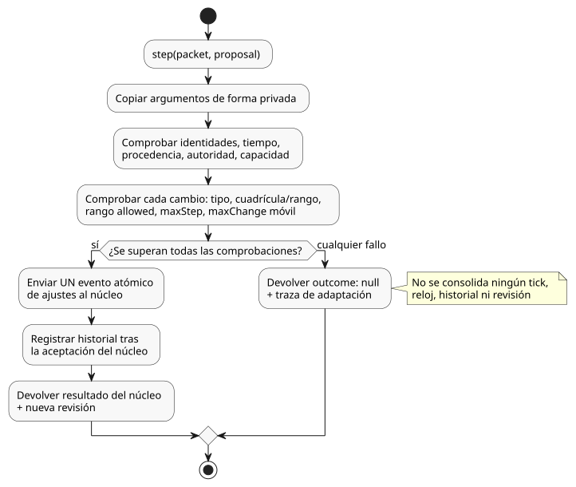

<!-- translation-source: docs/ADAPTATION-SETTINGS-HOST.md -->
[Original en inglés](ADAPTATION-SETTINGS-HOST.md)

# Host de ajustes de adaptación acotada

`runtimes/wasm/adaptation-settings-host.mjs` es un host (anfitrión) de referencia
para la [Referencia §4.14](reference/04-sensors-constraints-control.es.md)
(adaptación acotada). Realiza la *admisión de propuestas*: decide si un cambio de
ajustes propuesto, por ejemplo uno procedente de un optimizador, puede aplicarse.
El verdadero titular de los ajustes es el núcleo de contexto en Rust; el host solo
lo envuelve.

Lo que el host **no** hace:

- No evalúa expresiones de GhostFlow.
- No concede autoridad sobre las salidas.

**Los valores de la política provienen del compilador.** El compilador toma de la
fuente canónica los valores tipados `allowed`, `maxStep`, `maxChange` y `windowMs`
y los transporta en el artefacto. Los cambios de temperatura usan
`TemperatureDelta`; las demás magnitudes conservan sus unidades canónicas. La
compilación falla ante campos desconocidos, destinos duplicados (ambiguos) y
límites no válidos.

**Límite de confianza.** La activación consume un artefacto de compilador canónico
y de confianza. El resumen (digest) del bytecode por sí solo no autentica los
metadatos de la política. La validación estructural no certifica manifiestos
arbitrarios suministrados por quien llama ni la procedencia de la fuente.

**Creación de un host y envío de una propuesta**

Cree un host con `AdaptationSettingsHost.instantiate(wasm, artifact, { context,
authorities: { model: 'optimizer' }, historyCapacity: 256 })`.

- El host de confianza suministra la correspondencia entre actor y autoridad
  (`authorities`) en una activación nueva.
- Las políticas deben tener como destino configuraciones de contexto numéricas
  editables por el operador.

Llame a `step(packet, proposal)` una vez por escaneo:

- `packet` es el paquete normal de `ControlRuntime`.
- `proposal` contiene `eventId`, `actor`, `authority`, `source`, `evidence`,
  `sourceSha256`, `policySha256`, `programFingerprint`, `baseRevision`, `atMs`
  y `changes`. Cada cambio es `{ configId, type, value }`.

De dónde provienen los valores de identidad:

| Campo de la propuesta | Origen |
|---|---|
| `programFingerprint`, `baseRevision` | Identidad actual en `snapshot().core.state`. |
| `sourceSha256` | `snapshot().sourceSha256`, la identidad de la fuente canónica. |
| `policySha256` | `snapshot().policySha256`, el resumen en JSON canónico de los descriptores de política verificados. |

`sourceSha256` es importante incluso cuando el bytecode no cambia. Un cambio de la
fuente que solo afecta a la política puede mantener idénticos el bytecode y las
huellas del núcleo; aun así, el host debe rechazar las propuestas dirigidas a la
fuente de política anterior.

El host copia de forma privada los argumentos de activación y de `step` antes de
validarlos. El instante de la ocurrencia (`atMs`) debe ser igual al reloj
monotónico del paquete.

**Comprobaciones de admisión**

Cada propiedad de la propuesta debe superar todas estas comprobaciones:

1. tipo;
2. cuadrícula y rango del ajuste;
3. rango `allowed` de la política;
4. límite de un solo paso (`maxStep`);
5. autoridad;
6. límite de cambio absoluto en ventana móvil (`maxChange` por `windowMs`).

Solo cuando **todas** las propiedades las superan, el host envía **un único evento
atómico de ajustes al núcleo**. Si falla cualquier comprobación, no cambia nada.

El diagrama siguiente muestra una llamada a `step` con una propuesta: una sola
comprobación fallida rechaza la propuesta completa sin consolidar nada, mientras
que el éxito total envía al núcleo un único evento atómico de ajustes.

**Ejemplo.** Con un límite horario del 10 %, un cambio aceptado de 20 %→30 %
seguido de 30 %→25 % dentro de la misma hora excede el presupuesto: los cambios
absolutos suman 10 + 5 = 15 puntos porcentuales. Una segunda propiedad propuesta
en ese mismo evento también permanece sin cambios.

**El rechazo** devuelve `outcome: null` y una traza de adaptación que contiene:

- los valores antiguo, propuesto y efectivo;
- la procedencia y el motivo del rechazo;
- la identidad real del programa y de los ajustes;
- la siguiente posición del núcleo (base uno).

Un rechazo no consolida ningún tick, reloj, historial ni revisión.

**El éxito** devuelve la salida real del núcleo y la nueva revisión. El historial
de cambios se registra solo después de que el núcleo acepta el evento.

Detalles de los límites:

- La ventana móvil excluye su límite izquierdo exacto.
- Las cuadrículas de `Int` y `Duration` se comprueban con aritmética exacta de
  residuos.

**Alcance de este perfil de referencia**

- El host posee un núcleo privado y nuevo. Las instantáneas (snapshots) son solo
  copias. No hay API de restauración ni API de ajustes fuera de banda.
- `historyCapacity` (1–4096) acota tanto las entradas de cambios vigentes como el
  número total de identidades de eventos aceptados. Cuando se agota la capacidad,
  las propuestas se rechazan. El historial vencido nunca borra la protección
  contra eventos duplicados.
- Integrar la recuperación desde puntos de control (checkpoints) requiere
  preservar ambos estados (núcleo y host) y queda fuera de este perfil.
- Las propuestas rechazadas no son observaciones de reloj aceptadas.
- La procedencia del optimizador reside en la traza del host. El origen de
  transmisión `operatorEdit` existente significa aquí una *edición operativa
  autorizada*, no una prueba de que la edición la hiciera una persona.
- El adaptador no establece la identidad de ejecución (run) de publicación de la
  API, la aplicación en Device ni la verificación de hardware.

REF-04-064 en `tests/adaptation-settings-host.test.mjs` verifica la activación
real, el rechazo atómico, los valores aceptados y los límites de revisión.
