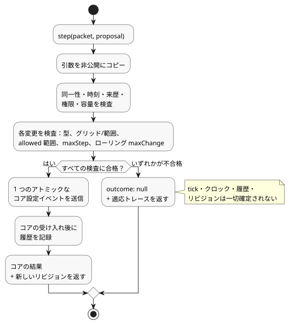

<!-- translation-source: docs/ADAPTATION-SETTINGS-HOST.md -->
[英語の原文](ADAPTATION-SETTINGS-HOST.md)

# 有界適応の設定ホスト

`runtimes/wasm/adaptation-settings-host.mjs` は、[リファレンス §4.14](reference/04-sensors-constraints-control.ja.md)（有界適応、bounded adaptation）のための参照ホストです。このホストは*提案の受け入れ（proposal admission）*を行います。つまり、たとえばオプティマイザからの設定変更の提案を適用してよいかどうかを判断します。設定の実際の所有者は Rust のコンテキストコアであり、ホストはそれをラップしているだけです。

このホストが**行わない**こと：

- GhostFlow の式は評価しません。
- 出力の権限は付与しません。

**ポリシー値はコンパイラから来ます。** コンパイラは、型付きの `allowed`、`maxStep`、`maxChange`、`windowMs` の値を正本ソースから取り出し、成果物（artifact）に含めて運びます。温度の変更には `TemperatureDelta` を使い、その他の量は正準単位のままです。未知のフィールド、重複した（曖昧な）対象、無効な範囲があるとコンパイルは失敗します。

**信頼境界。** アクティベーションは、信頼された正準のコンパイラ成果物を入力とします。バイトコードのダイジェストだけでは、ポリシーのメタデータは認証されません。構造的な検証は、呼び出し元が任意に渡したマニフェストやソースの来歴を保証するものではありません。

**ホストの作成と提案の送信**

ホストは `AdaptationSettingsHost.instantiate(wasm, artifact, { context,
authorities: { model: 'optimizer' }, historyCapacity: 256 })` で作成します。

- 信頼されたホストは、新規アクティベーション時にアクターから権限への対応（`authorities`）を渡します。
- ポリシーの対象は、オペレーターが編集可能な数値のコンテキスト設定でなければなりません。

スキャンごとに一度 `step(packet, proposal)` を呼び出します。

- `packet` は通常の `ControlRuntime` パケットです。
- `proposal` は `eventId`、`actor`、`authority`、`source`、`evidence`、`sourceSha256`、`policySha256`、`programFingerprint`、`baseRevision`、`atMs`、`changes` を持ちます。各変更は `{ configId, type, value }` です。

同一性の値の出どころ：

| 提案フィールド | 出どころ |
|---|---|
| `programFingerprint`, `baseRevision` | `snapshot().core.state` にある現在の同一性。 |
| `sourceSha256` | `snapshot().sourceSha256`。正本ソースの同一性です。 |
| `policySha256` | `snapshot().policySha256`。検査済みポリシーディスクリプタの正準 JSON ダイジェストです。 |

`sourceSha256` はバイトコードが変わらない場合でも重要です。ポリシーだけのソース変更では、バイトコードとコアのフィンガープリントが同一のままになることがあります。それでもホストは、古いポリシーソースを宛先とする提案を拒否しなければなりません。

ホストは、アクティベーションと `step` の引数を検証する前に非公開でコピーします。発生時刻（`atMs`）はパケットの単調クロックと等しくなければなりません。

**受け入れ検査**

提案内のすべてのプロパティは、次の検査をすべて通過しなければなりません。

1. 型
2. 設定のグリッドと範囲
3. ポリシーの `allowed` 範囲
4. 1 ステップあたりの上限（`maxStep`）
5. 権限
6. ローリングでの絶対変化量の上限（`windowMs` あたりの `maxChange`）

**すべての**プロパティが合格した場合にのみ、ホストは**1 つのアトミックなコア設定イベント**を送信します。いずれかの検査が失敗すると、何も変わりません。

次の図は、提案付きの `step` 呼び出し 1 回の流れを示します。検査が 1 つでも失敗すると提案全体が拒否されて何も確定されず、すべて成功すると 1 つのアトミックな設定イベントがコアに送信されます。

**例。** 1 時間あたり 10% の上限がある場合、20%→30% の変更が受け入れられた後、同じ 1 時間以内に 30%→25% を提案すると予算を超えます。絶対変化量の合計が 10 + 5 = 15 パーセントポイントになるためです。同じイベントで提案された 2 つ目のプロパティも変更されません。

**拒否**の場合は `outcome: null` と、次の内容を含む適応トレースが返ります。

- 変更前の値、提案値、有効値
- 来歴と拒否理由
- 実際のプログラムと設定の同一性
- 次のコア位置（1 始まり）

拒否では tick、クロック、履歴、リビジョンのいずれも確定されません。

**成功**の場合は、実際のコア出力と新しいリビジョンが返ります。変更履歴は、コアがイベントを受け入れた後にのみ記録されます。

境界の詳細：

- ローリングウィンドウは、その左端ちょうどの境界を含みません。
- `Int` と `Duration` のグリッドは、厳密な剰余演算で検査されます。

**この参照プロファイルの範囲**

- ホストは非公開の新しいコアを所有します。スナップショットはコピーにすぎません。復元 API も、帯域外の設定 API もありません。
- `historyCapacity`（1〜4096）は、有効な変更エントリと、受け入れたイベント同一性の総数の両方を制限します。容量を使い切ると提案は拒否されます。期限切れの履歴によって重複イベントの保護が消えることはありません。
- チェックポイント復旧を統合するには、両方の状態（コアとホスト）を保存する必要があり、このプロファイルの範囲外です。
- 拒否された提案は、受け入れられたクロック観測にはなりません。
- オプティマイザの来歴はホストのトレースに含まれます。ここでの既存の `operatorEdit` ワイヤ origin は*権限のある運用上の編集*を意味し、人間が編集したことの証明ではありません。
- このアダプタは、API による実行（run）同一性の公開、Device への適用、ハードウェア検証を確立するものではありません。

`tests/adaptation-settings-host.test.mjs` の REF-04-064 は、実際のアクティベーション、アトミックな拒否、受け入れられた値、リビジョン境界を検証します。
