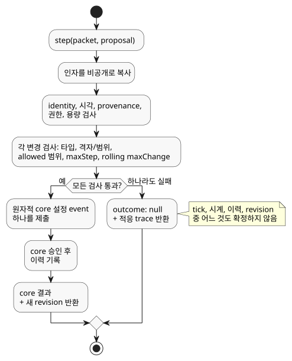

<!-- translation-source: docs/ADAPTATION-SETTINGS-HOST.md -->
[영문 원문](ADAPTATION-SETTINGS-HOST.md)

# 제한된 적응 설정 호스트

`runtimes/wasm/adaptation-settings-host.mjs`는
[Reference §4.14](reference/04-sensors-constraints-control.md)(제한된 적응,
bounded adaptation)를 위한 참조 호스트입니다. 이 호스트는 *제안 admission(수용)*을
수행합니다. 즉 최적화기(optimizer) 등이 제안한 설정 변경을 적용해도 되는지
판단합니다. 설정의 실제 소유자는 Rust context core이며, 호스트는 이를 감쌀 뿐입니다.

호스트가 하지 **않는** 일:

- GhostFlow 식을 평가하지 않습니다.
- 출력 권한을 부여하지 않습니다.

**정책 값은 컴파일러에서 옵니다.** 컴파일러는 정본 소스에서 타입이 지정된
`allowed`, `maxStep`, `maxChange`, `windowMs` 값을 가져와 산출물(artifact)에 담아
전달합니다. 온도 변화량은 `TemperatureDelta`를 쓰며, 다른 물리량은 정본 단위를
유지합니다. 알 수 없는 필드, 중복(모호한) 대상, 잘못된 경계가 있으면 컴파일이
실패합니다.

**신뢰 경계.** 활성화(activation)는 신뢰할 수 있는 정본 컴파일러 산출물을
사용합니다. bytecode digest만으로는 정책 metadata를 인증하지 않습니다. 구조 검증은
호출자가 임의로 제공한 manifest나 소스 provenance(출처)를 인증하지 않습니다.

**호스트 생성과 제안 제출**

`AdaptationSettingsHost.instantiate(wasm, artifact, { context,
authorities: { model: 'optimizer' }, historyCapacity: 256 })`로 호스트를 생성합니다.

- 신뢰된 호스트가 새 활성화 시점에 actor와 authority의 대응(`authorities`)을
  제공합니다.
- 정책 대상은 운영자가 편집할 수 있는 숫자형 context config여야 합니다.

스캔마다 `step(packet, proposal)`을 한 번 호출합니다.

- `packet`은 일반적인 `ControlRuntime` packet입니다.
- `proposal`은 `eventId`, `actor`, `authority`, `source`, `evidence`,
  `sourceSha256`, `policySha256`, `programFingerprint`, `baseRevision`, `atMs`,
  `changes`를 가집니다. 각 변경은 `{ configId, type, value }`입니다.

identity(정체성) 값의 출처는 다음과 같습니다.

| 제안 필드 | 출처 |
|---|---|
| `programFingerprint`, `baseRevision` | `snapshot().core.state`의 현재 identity. |
| `sourceSha256` | 정본 소스 identity인 `snapshot().sourceSha256`. |
| `policySha256` | 검증된 정책 descriptor의 canonical JSON digest인 `snapshot().policySha256`. |

`sourceSha256`는 bytecode가 바뀌지 않았을 때에도 중요합니다. 정책만 바뀐 소스는
bytecode와 core fingerprint가 똑같이 유지될 수 있지만, 호스트는 이전 정책 소스를
대상으로 한 제안을 여전히 거부해야 합니다.

호스트는 활성화와 step 인자를 검증하기 전에 비공개로 복사합니다. 발생 시각(`atMs`)은
packet의 단조 시계와 같아야 합니다.

**admission 검사**

제안의 모든 property는 다음 검사를 모두 통과해야 합니다.

1. 타입
2. 설정 격자와 범위
3. 정책 `allowed` 범위
4. 단일 변화량 한도(`maxStep`)
5. 권한(authority)
6. rolling 절대 변화량 한도(`windowMs`당 `maxChange`)

**모든** property가 통과할 때에만 호스트는 **하나의 원자적 core 설정 event**를
제출합니다. 하나라도 실패하면 아무것도 바뀌지 않습니다.

아래 다이어그램은 제안이 있는 `step` 호출 한 번을 보여 줍니다. 검사 하나만 실패해도
아무것도 확정하지 않고 제안 전체를 거부하며, 모두 성공하면 원자적 설정 event 하나를
core에 제출합니다.

**예시.** 시간당 10% 한도에서 20%→30% 변경이 승인된 뒤 한 시간 안에 30%→25%를
제안하면 예산을 초과합니다. 절대 변화량의 합이 10 + 5 = 15 퍼센트포인트이기
때문입니다. 같은 event에서 제안된 두 번째 property도 바뀌지 않은 채로 남습니다.

**거부**는 `outcome: null`과 다음을 담은 적응 trace를 반환합니다.

- 이전 값, 제안 값, 유효값
- provenance와 거부 사유
- 실제 프로그램과 설정의 identity
- 1부터 세는 다음 core 위치

거부는 tick, 시계, 이력, revision 중 어느 것도 확정하지 않습니다.

**성공**은 실제 core 출력과 새 revision을 반환합니다. 변경 이력은 core가 event를
승인한 뒤에만 기록됩니다.

경계 세부 사항:

- rolling window는 정확한 왼쪽 경계를 제외합니다.
- `Int`와 `Duration` 격자는 정확한 나머지 연산으로 검사합니다.

**이 참조 profile의 범위**

- 호스트는 비공개의 새 core를 소유합니다. snapshot은 복사본일 뿐입니다. restore
  API도, 별도 경로의 설정 API도 없습니다.
- `historyCapacity`(1–4096)는 활성 변경 항목 수와 승인된 event identity의 총수를
  모두 제한합니다. 용량이 소진되면 제안을 거부합니다. 만료된 이력이 중복 event
  방지를 지우는 일은 절대 없습니다.
- checkpoint 복구를 통합하려면 두 상태(core와 호스트)를 모두 보존해야 하며, 이는 이
  profile의 범위 밖입니다.
- 거부된 제안은 승인된 시계 관측이 아닙니다.
- optimizer provenance는 호스트 trace에 남습니다. 기존 wire origin인
  `operatorEdit`는 여기서 *권한이 확인된 운영 편집*을 뜻하며, 사람이 편집했다는
  증거가 아닙니다.
- 이 어댑터는 API publishing run identity, Device 적용, 하드웨어 검증을 입증하지
  않습니다.

`tests/adaptation-settings-host.test.mjs`의 REF-04-064가 실제 활성화, 원자적 거부,
승인된 값, revision 경계를 검증합니다.
