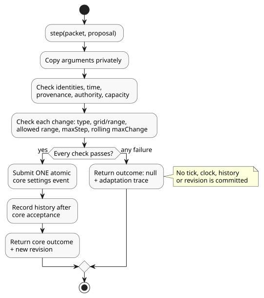

# Bounded adaptation settings host

`runtimes/wasm/adaptation-settings-host.mjs` is a reference host for
[Reference §4.14](reference/04-sensors-constraints-control.en.md) (bounded
adaptation). It performs *proposal admission*: it decides whether a proposed
settings change, for example one from an optimizer, may be applied. The actual
owner of the settings is the Rust context core; the host only wraps it.

What the host does **not** do:

- It does not evaluate GhostFlow expressions.
- It does not grant output authority.

**Policy values come from the compiler.** The compiler takes the typed
`allowed`, `maxStep`, `maxChange` and `windowMs` values from canonical source and
carries them in the artifact. Temperature changes use `TemperatureDelta`; other
quantities keep their canonical units. Compilation fails for unknown fields,
duplicate (ambiguous) targets and invalid bounds.

**Trust boundary.** Activation consumes a trusted, canonical compiler artifact.
The bytecode digest alone does not authenticate the policy metadata. Structural
validation does not certify arbitrary caller-supplied manifests or source
provenance.

**Creating a host and submitting a proposal**

Create a host with `AdaptationSettingsHost.instantiate(wasm, artifact, { context,
authorities: { model: 'optimizer' }, historyCapacity: 256 })`.

- The trusted host supplies the actor-to-authority mapping (`authorities`) at
  fresh activation.
- Policies must target operator-editable numeric context configs.

Call `step(packet, proposal)` once per scan:

- `packet` is the normal `ControlRuntime` packet.
- `proposal` has `eventId`, `actor`, `authority`, `source`, `evidence`,
  `sourceSha256`, `policySha256`, `programFingerprint`, `baseRevision`, `atMs`,
  and `changes`. Each change is `{ configId, type, value }`.

Where the identity values come from:

| Proposal field | Source |
|---|---|
| `programFingerprint`, `baseRevision` | Current identity in `snapshot().core.state`. |
| `sourceSha256` | `snapshot().sourceSha256`, the canonical source identity. |
| `policySha256` | `snapshot().policySha256`, the canonical-JSON digest of the checked policy descriptors. |

`sourceSha256` matters even when bytecode is unchanged. A policy-only source
change can keep identical bytecode and core fingerprints, yet the host must still
reject proposals addressed to the older policy source.

The host privately copies activation and step arguments before it validates
them. The occurrence time (`atMs`) must equal the packet's monotonic clock.

**Admission checks**

Every property in the proposal must pass all of these checks:

1. type;
2. setting grid and range;
3. policy `allowed` range;
4. single-step limit (`maxStep`);
5. authority;
6. rolling absolute-change limit (`maxChange` per `windowMs`).

Only when **every** property passes does the host submit **one atomic core
settings event**. If any check fails, nothing changes.

The diagram below shows one `step` call with a proposal: a single failed check
rejects the whole proposal without committing anything, while full success
submits one atomic settings event to the core.

**Example.** With a 10% hourly limit, an accepted change 20%→30% followed by
30%→25% within the hour exceeds the budget: the absolute changes add up to
10 + 5 = 15 percentage points. A second property proposed in that same event also
stays unchanged.

**Rejection** returns `outcome: null` and an adaptation trace containing:

- old, proposed and effective values;
- provenance and the rejection reason;
- the actual program and settings identity;
- the next one-based core position.

A rejection commits no tick, clock, history or revision.

**Success** returns the actual core output and the new revision. Change history is
recorded only after the core accepts the event.

Boundary details:

- The rolling window excludes its exact left boundary.
- `Int` and `Duration` grids are checked with exact remainder arithmetic.

**Scope of this reference profile**

- The host owns a private, fresh core. Snapshots are copies only. There is no
  restore API and no out-of-band settings API.
- `historyCapacity` (1–4096) bounds both the live change entries and the total
  number of accepted event identities. When capacity is exhausted, proposals are
  rejected. Expired history never erases duplicate-event protection.
- Integrating checkpoint recovery requires preserving both states (core and host)
  and is outside this profile.
- Rejected proposals are not accepted clock observations.
- Optimizer provenance lives in the host trace. The existing `operatorEdit` wire
  origin here means an *authorized operating edit*, not proof that a human made
  the edit.
- The adapter does not establish an API publishing run identity, Device
  application or hardware verification.

REF-04-064 in `tests/adaptation-settings-host.test.mjs` verifies actual
activation, atomic rejection, accepted values and revision boundaries.
