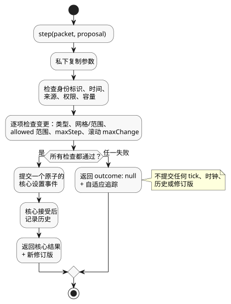

<!-- translation-source: docs/ADAPTATION-SETTINGS-HOST.md -->
[英文原文](ADAPTATION-SETTINGS-HOST.md)

# 有界自适应设置宿主

`runtimes/wasm/adaptation-settings-host.mjs` 是
[Reference §4.14](reference/04-sensors-constraints-control.zh.md)（有界自适应，bounded
adaptation）的参考宿主（host）。它执行*提案准入*（proposal admission）：判断一项提议的设置变更（例如来自优化器的变更）是否可以被应用。设置的真正所有者是 Rust 上下文核心；宿主只是对其进行封装。

宿主**不**做的事：

- 不对 GhostFlow 表达式求值。
- 不授予输出权限。

**策略值来自编译器。** 编译器从规范源中取出带类型的
`allowed`、`maxStep`、`maxChange` 和 `windowMs` 值，并将其携带在产物中。温度变化使用 `TemperatureDelta`；其他物理量保持其规范单位。遇到未知字段、重复（有歧义的）目标以及无效边界时，编译失败。

**信任边界。** 激活过程消费的是一个可信的、规范的编译器产物。仅凭字节码摘要并不能认证策略元数据。结构校验并不能为调用方任意提供的清单（manifest）或源来源（provenance）提供认证。

**创建宿主并提交提案**

使用 `AdaptationSettingsHost.instantiate(wasm, artifact, { context,
authorities: { model: 'optimizer' }, historyCapacity: 256 })` 创建宿主。

- 可信宿主在全新激活时提供 actor 到权限的映射（`authorities`）。
- 策略必须以操作员可编辑的数值型上下文配置为目标。

每次扫描调用一次 `step(packet, proposal)`：

- `packet` 是普通的 `ControlRuntime` 数据包。
- `proposal` 包含 `eventId`、`actor`、`authority`、`source`、`evidence`、
  `sourceSha256`、`policySha256`、`programFingerprint`、`baseRevision`、`atMs`
  和 `changes`。每项变更为 `{ configId, type, value }`。

身份标识值的来源：

| 提案字段 | 来源 |
|---|---|
| `programFingerprint`、`baseRevision` | `snapshot().core.state` 中的当前身份标识。 |
| `sourceSha256` | `snapshot().sourceSha256`，即规范源的身份标识。 |
| `policySha256` | `snapshot().policySha256`，即已检查策略描述符的规范 JSON 摘要。 |

即使字节码没有变化，`sourceSha256` 也很重要。仅修改策略的源变更可能使字节码和核心指纹保持完全相同，但宿主仍必须拒绝针对旧策略源的提案。

宿主在校验之前，会先私下复制激活参数和 step 参数。发生时间（`atMs`）必须等于数据包的单调时钟。

**准入检查**

提案中的每个属性都必须通过以下全部检查：

1. 类型；
2. 设置的网格与范围；
3. 策略的 `allowed` 范围；
4. 单步限制（`maxStep`）；
5. 权限；
6. 滚动绝对变化量限制（每个 `windowMs` 内的 `maxChange`）。

只有当**每一个**属性都通过时，宿主才会提交**一个原子的核心设置事件**。只要任一检查失败，就不会发生任何变更。

下图展示了一次携带提案的 `step` 调用：任何一项检查失败都会拒绝整个提案且不提交任何内容；全部成功则向核心提交一个原子设置事件。

**示例。** 在每小时 10% 的限制下，先接受一次 20%→30% 的变更，再在同一小时内提出 30%→25%，就会超出预算：绝对变化量累计为
10 + 5 = 15 个百分点。在同一事件中提出的第二个属性也保持不变。

**拒绝**时返回 `outcome: null` 以及一条自适应追踪，其中包含：

- 旧值、提议值和生效值；
- 来源（provenance）和拒绝原因；
- 实际的程序与设置身份标识；
- 下一个从 1 开始计数的核心位置。

一次拒绝不会提交任何 tick、时钟、历史或修订版。

**成功**时返回实际的核心输出和新的修订版。只有在核心接受事件之后，才会记录变更历史。

边界细节：

- 滚动窗口不包含其精确的左边界。
- `Int` 和 `Duration` 的网格使用精确的余数运算进行检查。

**本参考配置的范围**

- 宿主拥有一个私有的、全新的核心。快照只是副本。不存在恢复 API，也不存在带外设置 API。
- `historyCapacity`（1–4096）同时限制实时变更条目的数量和已接受事件身份标识的总数。容量耗尽时，提案会被拒绝。过期的历史绝不会抹除重复事件保护。
- 集成检查点恢复需要同时保存两种状态（核心与宿主），这超出了本配置的范围。
- 被拒绝的提案不算作已接受的时钟观测。
- 优化器的来源信息保存在宿主追踪中。这里现有的 `operatorEdit` 线路来源（wire origin）表示一次*经授权的运行编辑*，并不能证明编辑是由人完成的。
- 该适配器不建立发布运行身份标识的 API、设备应用或硬件验证。

`tests/adaptation-settings-host.test.mjs` 中的 REF-04-064 验证了实际激活、原子拒绝、已接受的值以及修订版边界。
