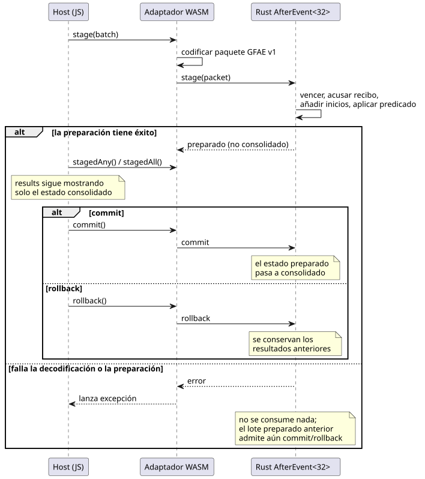
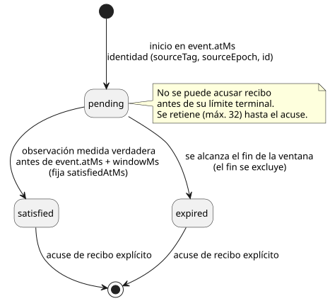

<!-- translation-source: docs/AFTER-EVENT-WASM-ABI.md -->
[Original en inglés](AFTER-EVENT-WASM-ABI.md)

# ABI de ejecución identificada de after_event

`runtimes/wasm/after-event-runtime.mjs` expone a través de WASM el motor Rust
existente `AfterEvent<32>`. El reparto del trabajo es estricto:

- **JavaScript** transporta los hechos de entrada y lee los resultados nativos de
  salida. Nunca evalúa por sí mismo las ventanas de eventos.
- **Rust** (el motor nativo) es titular de cada ventana, identidad y resultado.

`after_event_any` y `after_event_all` son proyecciones escalares explícitas:
reducen el conjunto de resultados nativos retenidos a un único valor.

En este documento:

- [Vincular un sitio desde la fuente canónica](#vincular-un-sitio-desde-la-fuente-canónica): el punto de entrada recomendado.
- [Vinculación de bajo nivel](#vinculación-de-bajo-nivel): construcción directa, lotes, capacidad y reglas de resultados.
- [Paquete GFAE versión 1](#paquete-gfae-versión-1): el formato binario de transmisión.
- [Integración con control y simulador](#integración-con-control-y-simulador): cómo usan el motor los escaneos.
- [Bloqueo de los proveedores naturales](#bloqueo-de-los-proveedores-naturales): por qué `tide_is`/`moon_is` todavía no se ejecutan.

## Vincular un sitio desde la fuente canónica

El punto de entrada `instantiateSource`, seguro para navegadores, compila un
documento `.ghost.md` completo con la cadena de herramientas pública y selecciona
una declaración `after_event` con nombre (un *sitio*). La longitud de la ventana y
las etiquetas de fuente del evento y del predicado provienen de esa declaración.
El host no vuelve a introducir esos valores ni extrae una cadena de control en
bruto.

```js
const runtime = await AfterEventRuntime.instantiateSource(wasmBytes, document, {
  filename: 'pump.ghost.md', signal: 'opened',
});
const { eventSourceTag, predicateSourceTag } = runtime.binding;
runtime.stage({
  time: { epoch: 7, nowMs: 100 },
  starts: [{ sourceTag: eventSourceTag, sourceEpoch: 2, id: 1,
    timeEpoch: 7, atMs: 100 }],
  predicate: { sourceTag: predicateSourceTag, atMs: 100,
    value: true, quality: 'measured' },
  acknowledgements: [],
});
runtime.commit();
console.log(runtime.results); // Each item retains its complete event identity.
runtime.dispose();
```

`binding` es inmutable. `source` conserva:

- el documento fuente completo e inmutable y su nombre de archivo;
- su SHA-256 y el SHA-256 del descriptor;
- la señal/sitio seleccionado;
- los nombres lógicos del evento y del predicado.

Reglas de selección:

- Seleccionar un nombre inexistente, o una declaración de otro tipo, falla antes
  de la activación de WASM.
- Si el documento tiene varios sitios, debe seleccionar uno explícitamente. No
  existe un sitio predeterminado «primero» ni «más reciente».

Alcance: este adaptador evalúa solo el sitio de evidencia seleccionado. No ejecuta
salidas, expresiones de estado ni otros sitios del documento. No certifica el
documento para su despliegue en dispositivos.

Los resultados nativos permanecen como `pending`, `satisfied` o `expired`, con
seguimiento por identidad. Preparar (stage) y luego revertir (rollback) conserva
los resultados anteriores. `any()` y `all()` leen el estado consolidado.
`stagedAny()` y `stagedAll()` exponen el agregado nativo preparado a la
transacción de control sin consolidarlo.

## Vinculación de bajo nivel

```js
const runtime = await AfterEventRuntime.instantiate(wasmBytes, {
  windowMs: 10_000, eventSourceTag: 11, predicateSourceTag: 22,
});
runtime.stage({
  time: { epoch: 7, nowMs: 100 },
  starts: [{ sourceTag: 11, sourceEpoch: 2, id: 1, timeEpoch: 7, atMs: 100 }],
  predicate: { sourceTag: 22, atMs: 100, value: true, quality: 'measured' },
  acknowledgements: [],
});
runtime.commit(); // Or rollback() before committing.
console.log(runtime.results); // [{ event: {...}, status: 'satisfied', satisfiedAtMs: 100 }]
runtime.dispose();
```

Cada instancia vincula exactamente una fuente Event declarada y una fuente de
predicado Bool. Cada etiqueta de un lote debe coincidir con la vinculación.

**Los lotes son atómicos.** En un lote, Rust hace vencer las ventanas antiguas,
acusa recibo de los resultados terminales, añade los nuevos inicios y aplica el
predicado, todo de forma atómica. El host lo dirige como una transacción
stage → commit (o rollback):



El diagrama muestra que `results` refleja solo el estado consolidado, y que un
stage fallido deja intactos tanto el estado consolidado como cualquier lote
preparado anteriormente:

- Antes del commit, `results` expone solo el estado consolidado.
- Una decodificación fallida o una preparación nativa fallida no consume nada: ni
  identidades, ni vencimientos, ni acuses de recibo, ni avance del reloj.
- Si ya hay una transacción preparada y un segundo `stage` falla, la primera
  transacción preparada sigue disponible para commit o rollback.

**Capacidad.** El motor retiene hasta 32 identidades, incluidos los resultados
completados, hasta que se acusa recibo de ellas explícitamente. El desbordamiento
rechaza el lote completo. 32 es la capacidad del adaptador WASM; el motor Rust en
sí usa una capacidad constante elegida por quien lo llama.

**Ciclo de vida de los resultados.** Cada inicio se convierte en un resultado con
su propia identidad. El diagrama de estados siguiente resume cómo pasa un
resultado de un estado a otro:



- Los estados de salida son `pending`, `satisfied` y `expired`. Solo `satisfied`
  incluye `satisfiedAtMs`.
- No se puede acusar recibo de un resultado pendiente antes de su límite terminal.
- La identidad es `(sourceTag, sourceEpoch, id)`, nunca el índice de la ranura de
  salida.
- Los nuevos ID aumentan dentro de la época de fuente vinculada.
- Un cambio de época de reloj requiere una nueva instancia del motor. Ningún
  reinicio oculto descarta resultados.

**Observaciones del predicado.**

- La calidad del predicado es `measured`, `held` o `constructed`. Solo las
  observaciones *medidas verdaderas* satisfacen las ventanas.
- `null` significa «sin observación».
- Los nuevos inicios y las observaciones del predicado deben llevar la hora del
  lote actual.
- La entrega duplicada de un evento retenido conserva su identidad y su hora
  originales.
- La satisfacción excluye el final exacto de la ventana
  `[event.atMs, event.atMs + windowMs)`: la ventana es semiabierta.

## Paquete GFAE versión 1

Todos los enteros multibyte son sin signo y little-endian. Todos los valores u64
deben ser como máximo `2^53 - 1`. El decodificador acepta como máximo 2.048 bytes
y rechaza:

- bytes sobrantes al final;
- una versión o banderas desconocidas;
- bytes booleanos no válidos;
- calidades desconocidas.

| Campo | Codificación |
|---|---|
| Número mágico, versión, banderas reservadas | `GFAE`, u16 = 1, u16 = 0 |
| Época de tiempo, ahora | u64, u64 |
| Cantidad de inicios, cantidad de acuses de recibo | u16, u16; cada uno como máximo 32 |
| Predicado presente | u8 = 0 o 1 |
| Cada inicio | etiqueta de fuente u32; época de fuente, ID, época de tiempo, atMs u64 |
| Cada acuse de recibo | etiqueta de fuente u32; época de fuente, ID u64 |
| Predicado opcional | etiqueta de fuente u32; atMs u64; valor u8; calidad u8 |

Los campos aparecen en el orden de la tabla. Los bytes de calidad son
0 = measured, 1 = held, 2 = constructed. Las etiquetas son u32 distintos de cero.

Las exportaciones `create`/`stage`/`commit`/`rollback`/`destroy` usan un
identificador (handle) de instancia opaco. Los resultados y errores son cadenas
UTF-8 expuestas mediante funciones de acceso de puntero/longitud. Los consumidores
deben copiar esas vistas antes de cualquier mutación o liberación posterior.

## Integración con control y simulador

Los controles ejecutables deben usar `after_event_any(signal)` o
`after_event_all(signal)`. Cada inicio sigue siendo un resultado independiente
cuyo titular es Rust. El agregado se calcula solo después de que se hayan
preparado el vencimiento, los inicios, los acuses de recibo y la observación
medida del predicado del escaneo actual.

- Un escaneo de la VM exitoso consolida ambos estados (rastreador y VM).
- Un escaneo de la VM rechazado revierte juntos el rastreador, la VM y el tiempo
  lógico.

`ControlRuntime` deriva las etiquetas del evento y del predicado del manifiesto
compilado. Quienes llaman a los escenarios solo suministran épocas de fuente, ID,
marcas de tiempo, acuses de recibo y una época de tiempo de activación. Las
entradas Result privadas generadas no se pueden suministrar como entradas
ordinarias.

Qué cuenta como observación del predicado: solo una muestra medida recién aceptada
cuya marca de tiempo sea igual a la hora del escaneo. Las muestras duplicadas,
retenidas (held) y más antiguas no se reutilizan ni se interpolan. Mientras no
exista un resultado nativo terminal, la proyección es `Err(NotReady)`, y el manejo
explícito de Result del programa decide qué ocurre.

Soporte y límites:

- Cada sitio tiene capacidad 32.
- La ruta de control WASM y la ruta `ghostsim` admiten este contrato.
- El ejecutor de escenarios compuestos nativo simple no tiene transporte de Event
  identificado.
- Esta ABI no afirma soporte para despliegue en dispositivos ni para E/S física.
- Una declaración `after_event` sin usar sigue siendo un descriptor verificado y
  no ejecutable.

## Bloqueo de los proveedores naturales

`tide_is` y `moon_is` necesitan un protocolo de observación tipado independiente y
un evaluador nativo de Result. La Referencia §3 suministra las clasificaciones y
exige los criterios de clasificación del proveedor, la ubicación/zona horaria, la
revisión, la cobertura, el vencimiento y la incertidumbre. El descriptor temporal
actual no transporta ninguno de ellos.

Antes de la reducción (lowering) ejecutable, defina y verifique:

1. La vinculación de la identidad del proveedor, la ubicación/zona horaria, los
   criterios de clasificación y la revisión a cada observación y consulta de
   fuente.
2. La confianza en el reloj civil, los límites de cobertura/vencimiento y cómo
   afecta la incertidumbre a la validez de la clasificación. En particular, esta
   ABI no selecciona ninguna tolerancia implícita a la incertidumbre.
3. La correspondencia de fallos con `TemporalContextFault`, conservando la
   evidencia no disponible/obsoleta mediante `case` explícito y las rutas
   Unknown/fallback de Schedule.
4. La validación y evaluación nativas, las proyecciones de Result generadas y el
   manejo atómico del tick de control y de la reproducción (replay). Un Boolean del
   host por sí solo no puede satisfacer este contrato.

Estas son decisiones de implementación e interfaz pendientes. Que la compilación
del descriptor tenga éxito no implica ninguna afirmación de conformidad en tiempo
de ejecución. Las pruebas de condiciones naturales mantienen el rechazo de la
ejecución hasta que se implemente este límite.
