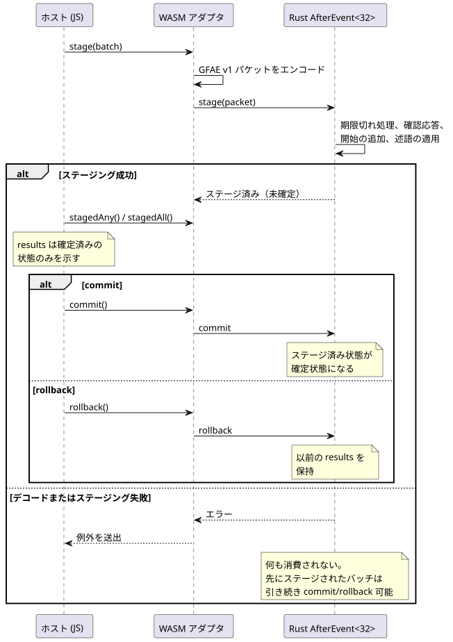
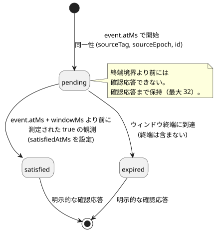

<!-- translation-source: docs/AFTER-EVENT-WASM-ABI.md -->
[英語の原文](AFTER-EVENT-WASM-ABI.md)

# 識別付き after_event 実行 ABI

`runtimes/wasm/after-event-runtime.mjs` は、既存の Rust `AfterEvent<32>` エンジンを WASM 経由で公開します。役割分担は厳密です。

- **JavaScript** は事実を渡し、ネイティブの結果を読み出すだけです。イベントウィンドウを自分で評価することは決してありません。
- **Rust**（ネイティブエンジン）が、すべてのウィンドウ、同一性、結果を所有します。

`after_event_any` と `after_event_all` は明示的なスカラー射影です。保持されているネイティブの結果集合を 1 つの値に集約します。

この文書の内容：

- [正本ソースからサイトをバインドする](#正本ソースからサイトをバインドする) — 推奨される入口です。
- [低レベルのバインディング](#低レベルのバインディング) — 直接の構築、バッチ、容量、結果の規則。
- [GFAE バージョン 1 パケット](#gfae-バージョン-1-パケット) — バイナリのワイヤ形式。
- [制御とシミュレータの統合](#制御とシミュレータの統合) — スキャンがエンジンをどう使うか。
- [自然現象プロバイダのブロッカー](#自然現象プロバイダのブロッカー) — `tide_is`/`moon_is` がまだ実行されない理由。

## 正本ソースからサイトをバインドする

ブラウザで安全に使える `instantiateSource` エントリポイントは、公開ツールチェーンで 1 つの完全な `.ghost.md` 文書をコンパイルし、名前付きの `after_event` 宣言（*サイト*）を 1 つ選択します。ウィンドウ長、イベントおよび述語のソースタグは、その宣言から取得されます。ホストはこれらの値を再入力せず、生の制御文字列を抽出することもありません。

```js
const runtime = await AfterEventRuntime.instantiateSource(wasmBytes, document, {
  filename: 'pump.ghost.md', signal: 'opened',
});
const { eventSourceTag, predicateSourceTag } = runtime.binding;
runtime.stage({
  time: { epoch: 7, nowMs: 100 },
  starts: [{ sourceTag: eventSourceTag, sourceEpoch: 2, id: 1,
    timeEpoch: 7, atMs: 100 }],
  predicate: { sourceTag: predicateSourceTag, atMs: 100,
    value: true, quality: 'measured' },
  acknowledgements: [],
});
runtime.commit();
console.log(runtime.results); // Each item retains its complete event identity.
runtime.dispose();
```

`binding` は不変です。`source` は次を保持します。

- 不変の完全なソース文書とそのファイル名
- その SHA-256 とディスクリプタの SHA-256
- 選択されたシグナル/サイト
- 論理的なイベント名と述語名

選択の規則：

- 存在しない名前や、別の種類の宣言を選択すると、WASM のアクティベーション前に失敗します。
- 文書に複数のサイトがある場合は、明示的に 1 つを選択しなければなりません。既定の「最初の」サイトや「最新の」サイトはありません。

範囲：このアダプタは、選択された証拠サイトだけを評価します。文書内の出力、状態式、その他のサイトは実行しません。また、その文書がデバイスへのデプロイに適していることを保証するものでもありません。

ネイティブの結果は同一性ごとに追跡され、`pending`、`satisfied`、`expired` のいずれかです。ステージした後にロールバックすると、以前の結果が保たれます。`any()` と `all()` は確定済みの状態を読みます。`stagedAny()` と `stagedAll()` は、ステージ済みのネイティブ集約値を、確定せずに制御トランザクションへ公開します。

## 低レベルのバインディング

```js
const runtime = await AfterEventRuntime.instantiate(wasmBytes, {
  windowMs: 10_000, eventSourceTag: 11, predicateSourceTag: 22,
});
runtime.stage({
  time: { epoch: 7, nowMs: 100 },
  starts: [{ sourceTag: 11, sourceEpoch: 2, id: 1, timeEpoch: 7, atMs: 100 }],
  predicate: { sourceTag: 22, atMs: 100, value: true, quality: 'measured' },
  acknowledgements: [],
});
runtime.commit(); // Or rollback() before committing.
console.log(runtime.results); // [{ event: {...}, status: 'satisfied', satisfiedAtMs: 100 }]
runtime.dispose();
```

各インスタンスは、宣言された Event ソース 1 つと Bool 述語ソース 1 つにだけバインドされます。バッチ内のすべてのタグはバインディングと一致しなければなりません。

**バッチはアトミックです。** 1 つのバッチの中で、Rust は古いウィンドウの期限切れ処理、終了した結果の確認応答、新しい開始の追加、述語の適用を、すべてアトミックに行います。ホストはこれを stage → commit（または rollback）のトランザクションとして駆動します。



この図は、`results` が確定済みの状態だけを反映すること、そして stage が失敗しても確定済みの状態と先にステージされたバッチがどちらも損なわれないことを示しています。

- commit の前は、`results` は確定済みの状態だけを公開します。
- デコードの失敗やネイティブのステージングの失敗は何も消費しません。同一性も、期限切れ処理も、確認応答も、クロックの前進もありません。
- すでにトランザクションがステージされている状態で 2 回目の `stage` が失敗した場合、最初にステージされたトランザクションは引き続き commit または rollback できます。

**容量。** エンジンは、完了した結果を含めて最大 32 個の同一性を、明示的に確認応答されるまで保持します。あふれるとバッチ全体が拒否されます。32 は WASM アダプタの容量であり、Rust エンジン自体は呼び出し側が選ぶ定数容量を使います。

**結果のライフサイクル。** 各開始は、それぞれ固有の同一性を持つ 1 つの結果になります。次の状態図は、結果がステータス間をどう遷移するかをまとめたものです。



- 出力ステータスは `pending`、`satisfied`、`expired` です。`satisfiedAtMs` を含むのは `satisfied` だけです。
- pending の結果は、終端境界より前には確認応答できません。
- 同一性は `(sourceTag, sourceEpoch, id)` であり、出力スロットのインデックスでは決してありません。
- 新しい ID は、バインドされたソースエポック内で増加します。
- クロックエポックが変わる場合は、新しいエンジンインスタンスが必要です。結果を捨てるような隠れたリセットはありません。

**述語の観測。**

- 述語の品質は `measured`、`held`、`constructed` のいずれかです。ウィンドウを満たすのは *measured の true* の観測だけです。
- `null` は「観測なし」を意味します。
- 新しい開始と述語の観測は、現在のバッチ時刻を持たなければなりません。
- 保持中のイベントが重複して届いた場合、元の同一性と時刻が保たれます。
- 充足判定はウィンドウ `[event.atMs, event.atMs + windowMs)` の終端ちょうどを含みません。ウィンドウは半開区間です。

## GFAE バージョン 1 パケット

すべてのマルチバイト整数は符号なしリトルエンディアンです。すべての u64 値は `2^53 - 1` 以下でなければなりません。デコーダは最大 2,048 バイトまでを受け付け、次のものを拒否します。

- 末尾の余分なバイト
- 未知のバージョンやフラグ
- 無効な Boolean バイト
- 未知の品質

| フィールド | エンコーディング |
|---|---|
| マジック、バージョン、予約フラグ | `GFAE`, u16 = 1, u16 = 0 |
| 時刻エポック、現在時刻 | u64, u64 |
| 開始の数、確認応答の数 | u16, u16。それぞれ最大 32 |
| 述語の有無 | u8 = 0 または 1 |
| 各開始 | ソースタグ u32、ソースエポック・ID・時刻エポック・atMs は u64 |
| 各確認応答 | ソースタグ u32、ソースエポック・ID は u64 |
| 任意の述語 | ソースタグ u32、atMs u64、値 u8、品質 u8 |

フィールドは表の順に並びます。品質バイトは 0 = measured、1 = held、2 = constructed です。タグは 0 以外の u32 です。

`create`/`stage`/`commit`/`rollback`/`destroy` のエクスポートは、不透明なインスタンスハンドルを使います。結果とエラーは、ポインタ/長さのゲッターを通じて UTF-8 文字列として公開されます。利用側は、その後の変更や破棄の前に、これらのビューをコピーしなければなりません。

## 制御とシミュレータの統合

実行可能な制御は `after_event_any(signal)` または `after_event_all(signal)` を使わなければなりません。各開始は、Rust が所有する独立した結果のままです。集約値は、現在のスキャンの期限切れ処理、開始、確認応答、measured の述語観測がステージされた後にのみ計算されます。

- VM スキャンが成功すると、両方の状態（トラッカーと VM）が確定されます。
- VM スキャンが拒否されると、トラッカー、VM、論理時間がまとめてロールバックされます。

`ControlRuntime` は、イベントと述語のタグをコンパイル済みマニフェストから導出します。シナリオの呼び出し側が渡すのは、ソースエポック、ID、タイムスタンプ、確認応答、アクティベーションの時刻エポックだけです。非公開で生成された Result 入力を通常の入力として渡すことはできません。

述語の観測とみなされるもの：新たに受け入れられた measured のサンプルで、そのタイムスタンプがスキャン時刻と等しいものだけです。重複したサンプル、held のサンプル、古いサンプルは再利用も補間もされません。終端のネイティブ結果が存在するまで、射影は `Err(NotReady)` であり、何が起こるかはプログラムの明示的な Result 処理が決めます。

サポートと制限：

- 各サイトの容量は 32 です。
- WASM の制御パスと `ghostsim` のパスがこの契約をサポートします。
- 素のネイティブ複合シナリオランナーには、識別付きの Event トランスポートがありません。
- この ABI は、デバイスへのデプロイや物理 I/O のサポートを主張するものではありません。
- 使われていない `after_event` 宣言は、検査済みの実行不可能なディスクリプタのままです。

## 自然現象プロバイダのブロッカー

`tide_is` と `moon_is` には、別途、型付きの観測プロトコルとネイティブの Result 評価器が必要です。リファレンス §3 は分類を定め、プロバイダの分類基準、場所/タイムゾーン、リビジョン、対象範囲、有効期限、不確実性を要求しています。現在の時間ディスクリプタは、これらのいずれも運びません。

実行可能な形に下ろす前に、次を定義して検証してください。

1. プロバイダの同一性、場所/タイムゾーン、分類基準、リビジョンを、各観測とソースクエリにバインドすること。
2. 暦時計の信頼性、対象範囲/有効期限の境界、および不確実性が分類の妥当性にどう影響するか。特に、この ABI は暗黙の不確実性許容量を一切選択しません。
3. `TemporalContextFault` への故障のマッピング。利用不能/古い証拠を、明示的な `case` と Schedule の Unknown/fallback パスを通じて保持すること。
4. ネイティブでの検証と評価、生成された Result 射影、アトミックな制御 tick/リプレイの扱い。ホストの Boolean だけではこの契約を満たせません。

これらは、残っている実装とインターフェースの決定事項です。ディスクリプタのコンパイルが成功しても、ランタイムの適合性を主張することにはなりません。自然条件のテストは、この境界が実装されるまで実行可能化の拒否を維持します。
