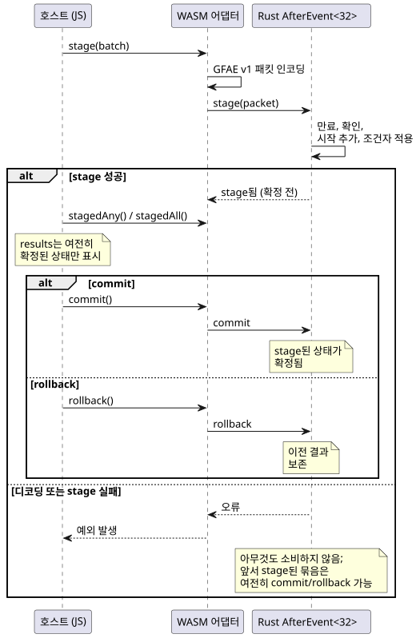
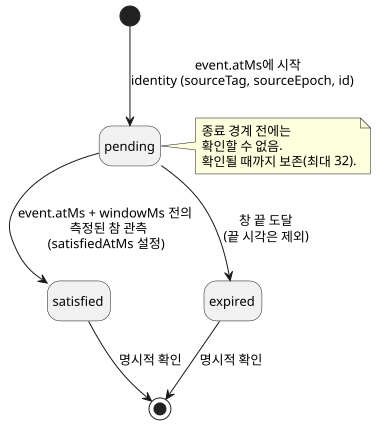

<!-- translation-source: docs/AFTER-EVENT-WASM-ABI.md -->
[영문 원문](AFTER-EVENT-WASM-ABI.md)

# 식별된 after_event 실행 ABI

`runtimes/wasm/after-event-runtime.mjs`는 기존 Rust `AfterEvent<32>` 엔진을 WASM으로
노출합니다. 작업 분담은 엄격합니다.

- **JavaScript**는 사실을 전달하고 네이티브 결과를 읽어 옵니다. 이벤트 창(window)을
  직접 평가하는 일은 절대 없습니다.
- **Rust**(네이티브 엔진)가 모든 창, identity(정체성), 결과를 소유합니다.

`after_event_any`와 `after_event_all`은 명시적인 스칼라 투영(projection)입니다. 보존된
네이티브 결과 집합을 값 하나로 축약합니다.

이 문서의 내용:

- [정본 소스에서 사이트 바인딩](#정본-소스에서-사이트-바인딩) — 권장 진입점.
- [저수준 바인딩](#저수준-바인딩) — 직접 생성, 묶음(batch), 용량, 결과 규칙.
- [GFAE 버전 1 패킷](#gfae-버전-1-패킷) — 바이너리 wire 형식.
- [제어와 시뮬레이터 통합](#제어와-시뮬레이터-통합) — 스캔이 엔진을 쓰는 방식.
- [Natural provider 차단 요인](#natural-provider-차단-요인) — `tide_is`/`moon_is`가 아직 실행되지 않는 이유.

## 정본 소스에서 사이트 바인딩

브라우저에서 안전하게 쓸 수 있는 `instantiateSource` 진입점은 공개 도구체인으로 완전한
`.ghost.md` 문서 하나를 컴파일하고, 이름이 지정된 `after_event` 선언(*사이트*) 하나를
선택합니다. 창 길이와 event·조건자(predicate) 소스 태그는 그 선언에서 가져옵니다.
호스트는 이 값들을 다시 입력하지 않으며, 원시 제어 문자열을 추출하지도 않습니다.

```js
const runtime = await AfterEventRuntime.instantiateSource(wasmBytes, document, {
  filename: 'pump.ghost.md', signal: 'opened',
});
const { eventSourceTag, predicateSourceTag } = runtime.binding;
runtime.stage({
  time: { epoch: 7, nowMs: 100 },
  starts: [{ sourceTag: eventSourceTag, sourceEpoch: 2, id: 1,
    timeEpoch: 7, atMs: 100 }],
  predicate: { sourceTag: predicateSourceTag, atMs: 100,
    value: true, quality: 'measured' },
  acknowledgements: [],
});
runtime.commit();
console.log(runtime.results); // Each item retains its complete event identity.
runtime.dispose();
```

`binding`은 변경할 수 없습니다. `source`는 다음을 보존합니다.

- 변경 불가인 전체 소스 문서와 그 파일 이름
- 소스의 SHA-256과 descriptor SHA-256
- 선택된 signal/site
- 논리 event 이름과 조건자 이름

선택 규칙:

- 존재하지 않는 이름이나 다른 종류의 선언을 선택하면 WASM 활성화 전에 실패합니다.
- 문서에 사이트가 여러 개 있으면 반드시 하나를 명시적으로 선택해야 합니다. 기본값으로
  쓰이는 "첫 번째"나 "최신" 사이트는 없습니다.

범위: 이 어댑터는 선택된 증거 사이트만 평가합니다. 문서의 출력, 상태 식, 다른
사이트는 실행하지 않습니다. 문서가 장치 배포에 적합하다고 인증하지도 않습니다.

네이티브 결과는 identity별로 추적되며 `pending`, `satisfied`, `expired` 중 하나로
유지됩니다. stage 후 rollback하면 이전 결과가 보존됩니다. `any()`와 `all()`은 확정된
상태를 읽습니다. `stagedAny()`와 `stagedAll()`은 stage된 네이티브 집계를 확정하지 않은
채 제어 트랜잭션에 노출합니다.

## 저수준 바인딩

```js
const runtime = await AfterEventRuntime.instantiate(wasmBytes, {
  windowMs: 10_000, eventSourceTag: 11, predicateSourceTag: 22,
});
runtime.stage({
  time: { epoch: 7, nowMs: 100 },
  starts: [{ sourceTag: 11, sourceEpoch: 2, id: 1, timeEpoch: 7, atMs: 100 }],
  predicate: { sourceTag: 22, atMs: 100, value: true, quality: 'measured' },
  acknowledgements: [],
});
runtime.commit(); // Or rollback() before committing.
console.log(runtime.results); // [{ event: {...}, status: 'satisfied', satisfiedAtMs: 100 }]
runtime.dispose();
```

각 인스턴스는 선언된 Event 소스 하나와 Bool 조건자 소스 하나에 정확히 바인딩됩니다.
묶음의 모든 태그는 바인딩과 일치해야 합니다.

**묶음은 원자적입니다.** 한 묶음 안에서 Rust는 오래된 창을 만료시키고, 종료된 결과를
확인(acknowledge)하고, 새 시작을 추가하고, 조건자를 적용하는 일을 모두 원자적으로
수행합니다. 호스트는 이를 stage → commit(또는 rollback) 트랜잭션으로 진행합니다.



다이어그램은 `results`가 확정된 상태만 반영하며, stage가 실패해도 확정된 상태와 앞서
stage된 묶음이 모두 그대로 남는다는 점을 보여 줍니다.

- commit 전 `results`는 확정된 상태만 노출합니다.
- 디코딩이나 네이티브 stage가 실패하면 아무것도 소비하지 않습니다. identity, 만료,
  확인, 시계 진행 어느 것도 소비되지 않습니다.
- 이미 stage된 트랜잭션이 있는 상태에서 두 번째 `stage`가 실패해도, 첫 번째로 stage된
  트랜잭션은 여전히 commit 또는 rollback할 수 있습니다.

**용량.** 엔진은 완료된 결과를 포함해 최대 32개의 identity를 명시적으로 확인될 때까지
보존합니다. 초과하면 묶음 전체를 거부합니다. 32는 WASM 어댑터의 용량이며, Rust 엔진
자체는 호출자가 선택한 const 용량을 사용합니다.

**결과 수명 주기.** 각 시작은 고유한 identity를 가진 결과 하나가 됩니다. 아래 상태
다이어그램은 결과가 상태 사이를 어떻게 이동하는지 요약합니다.



- 출력 상태는 `pending`, `satisfied`, `expired`입니다. `satisfiedAtMs`는 `satisfied`에만
  포함됩니다.
- pending 결과는 종료 경계 전에 확인할 수 없습니다.
- identity는 `(sourceTag, sourceEpoch, id)`이며, 출력 슬롯 인덱스는 절대 identity가
  아닙니다.
- 새 ID는 바인딩된 source epoch 안에서 증가합니다.
- 시계 epoch가 바뀌면 새 엔진 인스턴스가 필요합니다. 숨겨진 초기화로 결과를 버리는
  일은 없습니다.

**조건자 관측.**

- 조건자 품질은 `measured`, `held`, `constructed`입니다. *측정된 참(measured true)*
  관측만 창을 만족시킵니다.
- `null`은 "관측 없음"을 뜻합니다.
- 새 시작과 조건자 관측은 현재 묶음 시각을 가져야 합니다.
- 보존 중인 event가 중복 전달되면 원래 identity와 시각을 유지합니다.
- 만족 판정은 창 `[event.atMs, event.atMs + windowMs)`의 정확한 끝 시각을 제외합니다.
  즉 창은 반열린 구간입니다.

## GFAE 버전 1 패킷

모든 다중 바이트 정수는 부호 없는 리틀엔디안입니다. 모든 u64 값은 `2^53 - 1` 이하여야
합니다. 디코더는 최대 2,048바이트를 받아들이며 다음을 거부합니다.

- 후행 바이트
- 알 수 없는 버전 또는 플래그
- 유효하지 않은 Boolean 바이트
- 알 수 없는 품질 값

| 필드 | 인코딩 |
|---|---|
| Magic, 버전, 예약 플래그 | `GFAE`, u16 = 1, u16 = 0 |
| 시각 epoch, 현재 시각 | u64, u64 |
| 시작 수, 확인 수 | u16, u16; 각각 최대 32 |
| 조건자 존재 여부 | u8 = 0 또는 1 |
| 각 시작 | source tag u32; source epoch, ID, time epoch, atMs는 u64 |
| 각 확인 | source tag u32; source epoch, ID는 u64 |
| 선택적 조건자 | source tag u32; atMs u64; value u8; quality u8 |

필드는 표의 순서대로 나타납니다. 품질 바이트는 0 = measured, 1 = held,
2 = constructed입니다. 태그는 0이 아닌 u32입니다.

`create`/`stage`/`commit`/`rollback`/`destroy` export는 불투명한 인스턴스 핸들을
사용합니다. 결과와 오류는 포인터/길이 getter로 노출되는 UTF-8 문자열입니다. 소비자는
이후의 변경이나 해제 전에 반드시 이 뷰를 복사해야 합니다.

## 제어와 시뮬레이터 통합

실행 가능한 제어는 `after_event_any(signal)` 또는 `after_event_all(signal)`을 사용해야
합니다. 각 시작은 Rust가 소유하는 독립된 결과로 유지됩니다. 집계는 현재 스캔의 만료,
시작, 확인, 측정된 조건자 관측이 stage된 뒤에만 계산됩니다.

- VM 스캔이 성공하면 두 상태(tracker와 VM)를 모두 확정합니다.
- VM 스캔이 거부되면 tracker, VM, 논리 시간을 함께 rollback합니다.

`ControlRuntime`은 컴파일된 manifest에서 event 태그와 조건자 태그를 도출합니다.
시나리오 호출자는 source epoch, ID, 타임스탬프, 확인, 활성화 시간 epoch만 제공합니다.
비공개로 생성된 Result 입력은 일반 입력으로 제공할 수 없습니다.

조건자 관측으로 인정되는 것: 타임스탬프가 스캔 시각과 같은, 새로 승인된 측정 샘플뿐입니다.
중복 샘플, 유지(held) 샘플, 오래된 샘플은 재사용하거나 보간하지 않습니다. 종료된
네이티브 결과가 생기기 전까지 투영은 `Err(NotReady)`이며, 이후 동작은 프로그램의
명시적인 Result 처리가 결정합니다.

지원 범위와 한계:

- 각 사이트의 용량은 32입니다.
- WASM 제어 경로와 `ghostsim` 경로가 이 계약을 지원합니다.
- 일반 네이티브 복합 시나리오 실행기에는 식별된 Event 전송이 없습니다.
- 이 ABI는 장치 배포나 물리 I/O 지원을 주장하지 않습니다.
- 사용하지 않는 `after_event` 선언은 검사는 되지만 실행되지 않는 descriptor로 남습니다.

## Natural provider 차단 요인

`tide_is`와 `moon_is`에는 별도의 타입이 지정된 관측 프로토콜과 네이티브 Result 평가기가
필요합니다. Reference §3은 분류를 제공하며, provider의 분류 기준, 위치/시간대, revision,
커버리지, 만료, 불확실성을 요구합니다. 현재의 시간 descriptor는 이 중 어느 것도
전달하지 않습니다.

실행 가능한 lowering 전에 다음을 정의하고 검증해야 합니다.

1. provider identity, 위치/시간대, 분류 기준, revision을 각 관측과 소스 질의에 바인딩하는 방식.
2. 달력 시계 신뢰, 커버리지/만료 경계, 불확실성이 분류 유효성에 미치는 영향. 특히 이 ABI는 암묵적인 불확실성 허용치를 선택하지 않습니다.
3. `TemporalContextFault`로의 고장 매핑. 명시적인 `case`와 Schedule Unknown/fallback 경로를 통해 사용 불가·stale 증거를 보존해야 합니다.
4. 네이티브 검증과 평가, 생성된 Result 투영, 원자적인 제어 tick/replay 처리. 호스트의 Boolean 값만으로는 이 계약을 충족할 수 없습니다.

이는 남아 있는 구현 및 인터페이스 결정 사항입니다. descriptor 컴파일이 성공했다고 해서
런타임 적합성을 주장할 수 있는 것은 아닙니다. 이 경계가 구현될 때까지 Natural 조건
테스트는 실행 거부를 유지합니다.
