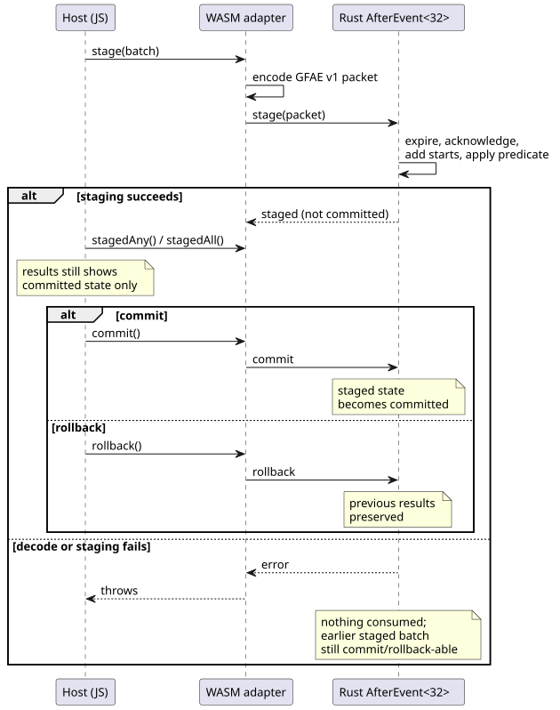
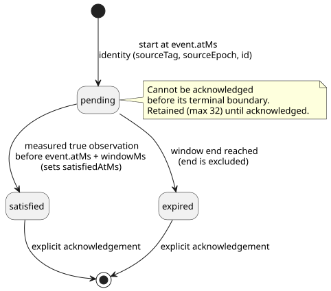

# Identified after_event execution ABI

`runtimes/wasm/after-event-runtime.mjs` exposes the existing Rust
`AfterEvent<32>` engine through WASM. The split of work is strict:

- **JavaScript** transports facts in and reads native results out. It never
  evaluates event windows itself.
- **Rust** (the native engine) owns every window, identity and result.

`after_event_any` and `after_event_all` are explicit scalar projections: they
reduce the retained native result set to one value.

In this document:

- [Bind a site from canonical source](#bind-a-site-from-canonical-source) — the recommended entry point.
- [Low-level binding](#low-level-binding) — direct construction, batches, capacity and result rules.
- [GFAE version 1 packet](#gfae-version-1-packet) — the binary wire format.
- [Control and simulator integration](#control-and-simulator-integration) — how scans use the engine.
- [Natural provider blocker](#natural-provider-blocker) — why `tide_is`/`moon_is` do not execute yet.

## Bind a site from canonical source

The browser-safe `instantiateSource` entry point compiles one complete
`.ghost.md` document with the public toolchain and selects one named
`after_event` declaration (a *site*). The window length and the event and
predicate source tags come from that declaration. The host does not re-enter
those values and does not extract a raw control string.

```js
const runtime = await AfterEventRuntime.instantiateSource(wasmBytes, document, {
  filename: 'pump.ghost.md', signal: 'opened',
});
const { eventSourceTag, predicateSourceTag } = runtime.binding;
runtime.stage({
  time: { epoch: 7, nowMs: 100 },
  starts: [{ sourceTag: eventSourceTag, sourceEpoch: 2, id: 1,
    timeEpoch: 7, atMs: 100 }],
  predicate: { sourceTag: predicateSourceTag, atMs: 100,
    value: true, quality: 'measured' },
  acknowledgements: [],
});
runtime.commit();
console.log(runtime.results); // Each item retains its complete event identity.
runtime.dispose();
```

`binding` is immutable. `source` retains:

- the complete immutable source document and its filename;
- its SHA-256 and the descriptor SHA-256;
- the selected signal/site;
- the logical event and predicate names.

Selection rules:

- Selecting an absent name, or a declaration of another kind, fails before WASM
  activation.
- If the document has several sites, you must select one explicitly. There is
  no default "first" or "latest" site.

Scope: this adapter evaluates only the selected evidence site. It does not
execute outputs, state expressions or other sites in the document. It does not
certify the document for device deployment.

Native results stay `pending`, `satisfied` or `expired`, tracked per identity.
Staging and then rolling back preserves the previous results. `any()` and
`all()` read committed state. `stagedAny()` and `stagedAll()` expose the staged
native aggregate to the control transaction without committing it.

## Low-level binding

```js
const runtime = await AfterEventRuntime.instantiate(wasmBytes, {
  windowMs: 10_000, eventSourceTag: 11, predicateSourceTag: 22,
});
runtime.stage({
  time: { epoch: 7, nowMs: 100 },
  starts: [{ sourceTag: 11, sourceEpoch: 2, id: 1, timeEpoch: 7, atMs: 100 }],
  predicate: { sourceTag: 22, atMs: 100, value: true, quality: 'measured' },
  acknowledgements: [],
});
runtime.commit(); // Or rollback() before committing.
console.log(runtime.results); // [{ event: {...}, status: 'satisfied', satisfiedAtMs: 100 }]
runtime.dispose();
```

Each instance binds exactly one declared Event source and one Bool predicate
source. Every tag in a batch must match the binding.

**Batches are atomic.** In one batch, Rust expires old windows, acknowledges
terminal results, adds new starts and applies the predicate, all atomically.
The host drives this as a stage → commit (or rollback) transaction:



The diagram shows that `results` reflects only committed state, and that a failed
stage leaves both the committed state and any earlier staged batch intact:

- Before commit, `results` exposes only committed state.
- Failed decoding or failed native staging consumes nothing: no identities, no
  expiry, no acknowledgements, no clock advance.
- If a transaction is already staged and a second `stage` fails, the first staged
  transaction is still available for commit or rollback.

**Capacity.** The engine retains up to 32 identities, including completed
results, until they are explicitly acknowledged. Overflow rejects the entire
batch. 32 is the WASM adapter's capacity; the Rust engine itself uses a const
capacity chosen by the caller.

**Result lifecycle.** Each start becomes one result with its own identity. The
state diagram below summarizes how a result moves between statuses:



- Output statuses are `pending`, `satisfied` and `expired`. Only `satisfied`
  includes `satisfiedAtMs`.
- A pending result cannot be acknowledged before its terminal boundary.
- Identity is `(sourceTag, sourceEpoch, id)`, never the output slot index.
- New IDs increase within the bound source epoch.
- A clock epoch change requires a new engine instance. No hidden reset discards
  results.

**Predicate observations.**

- Predicate quality is `measured`, `held` or `constructed`. Only *measured true*
  observations satisfy windows.
- `null` means "no observation".
- New starts and predicate observations must carry the current batch time.
- Duplicate delivery of a retained event keeps its original identity and time.
- Satisfaction excludes the exact end of the window
  `[event.atMs, event.atMs + windowMs)`: the window is half-open.

## GFAE version 1 packet

All multibyte integers are unsigned little-endian. All u64 values must be at most
`2^53 - 1`. The decoder accepts at most 2,048 bytes and rejects:

- trailing bytes;
- an unknown version or flags;
- invalid Boolean bytes;
- unknown qualities.

| Field | Encoding |
|---|---|
| Magic, version, reserved flags | `GFAE`, u16 = 1, u16 = 0 |
| Time epoch, now | u64, u64 |
| Start count, acknowledgement count | u16, u16; each at most 32 |
| Predicate present | u8 = 0 or 1 |
| Each start | source tag u32; source epoch, ID, time epoch, atMs u64 |
| Each acknowledgement | source tag u32; source epoch, ID u64 |
| Optional predicate | source tag u32; atMs u64; value u8; quality u8 |

Fields appear in the table's order. Quality bytes are 0 = measured, 1 = held,
2 = constructed. Tags are nonzero u32.

The `create`/`stage`/`commit`/`rollback`/`destroy` exports use an opaque instance
handle. Results and errors are UTF-8 strings exposed through pointer/length
getters. Consumers must copy those views before any later mutation or disposal.

## Control and simulator integration

Executable controls must use `after_event_any(signal)` or
`after_event_all(signal)`. Each start remains an independent, Rust-owned result.
The aggregate is computed only after the current scan's expiry, starts,
acknowledgements and measured predicate observation are staged.

- A successful VM scan commits both states (tracker and VM).
- A rejected VM scan rolls back the tracker, the VM and logical time together.

`ControlRuntime` derives the event and predicate tags from the compiled manifest.
Scenario callers supply only source epochs, IDs, timestamps, acknowledgements
and an activation time epoch. Private generated Result inputs cannot be supplied
as ordinary inputs.

What counts as a predicate observation: only a newly accepted measured sample
whose timestamp equals the scan time. Duplicate, held and older samples are not
reused or interpolated. Until a terminal native result exists, the projection is
`Err(NotReady)`, and the program's explicit Result handling decides what happens.

Support and limits:

- Each site has capacity 32.
- The WASM control path and the `ghostsim` path support this contract.
- The plain native composite scenario runner has no identified Event transport.
- This ABI does not claim device deployment or physical I/O support.
- An unused `after_event` declaration remains a checked, non-executable
  descriptor.

## Natural provider blocker

`tide_is` and `moon_is` need a separate typed observation protocol and a native
Result evaluator. Reference §3 supplies the classifications and requires the
provider's classification criteria, location/timezone, revision, coverage, expiry
and uncertainty. The current temporal descriptor transports none of these.

Before executable lowering, define and verify:

1. Binding of provider identity, location/timezone, classification criteria and
   revision to each observation and source query.
2. Civil-clock trust, coverage/expiry boundaries, and how uncertainty affects
   classification validity. In particular, no implicit uncertainty tolerance is
   selected by this ABI.
3. Fault mapping to `TemporalContextFault`, retaining unavailable/stale evidence
   through explicit `case` and Schedule Unknown/fallback paths.
4. Native validation and evaluation, generated Result projections, and atomic
   control tick/replay handling. A host Boolean alone cannot satisfy this contract.

These are remaining implementation and interface decisions. Successful descriptor
compilation does not imply any runtime conformance claim. Natural-condition tests
keep the executable rejection until this boundary is implemented.
