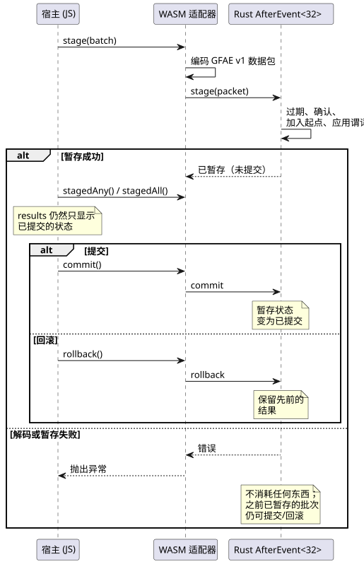
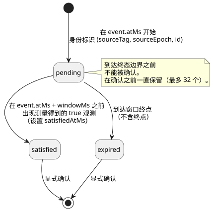

<!-- translation-source: docs/AFTER-EVENT-WASM-ABI.md -->
[英文原文](AFTER-EVENT-WASM-ABI.md)

# 带身份标识的 after_event 执行 ABI

`runtimes/wasm/after-event-runtime.mjs` 通过 WASM 暴露现有的 Rust
`AfterEvent<32>` 引擎。工作划分是严格的：

- **JavaScript** 负责把事实传入、把原生结果读出。它绝不自行对事件窗口求值。
- **Rust**（原生引擎）拥有所有窗口、身份标识和结果。

`after_event_any` 和 `after_event_all` 是显式的标量投影：它们把保留的原生结果集归约为一个值。

本文内容：

- [从规范源绑定站点](#从规范源绑定站点)——推荐的入口。
- [底层绑定](#底层绑定)——直接构造、批次、容量与结果规则。
- [GFAE 版本 1 数据包](#gfae-版本-1-数据包)——二进制线路格式。
- [控制与模拟器集成](#控制与模拟器集成)——扫描如何使用该引擎。
- [自然条件 provider 阻塞项](#自然条件-provider-阻塞项)——为什么 `tide_is`/`moon_is` 目前还不能执行。

## 从规范源绑定站点

浏览器安全的 `instantiateSource` 入口使用公开工具链编译一份完整的
`.ghost.md` 文档，并选择一个具名的
`after_event` 声明（一个*站点*，site）。窗口长度以及事件和谓词的源标签都来自该声明。宿主不会重新输入这些值，也不会提取原始的控制字符串。

```js
const runtime = await AfterEventRuntime.instantiateSource(wasmBytes, document, {
  filename: 'pump.ghost.md', signal: 'opened',
});
const { eventSourceTag, predicateSourceTag } = runtime.binding;
runtime.stage({
  time: { epoch: 7, nowMs: 100 },
  starts: [{ sourceTag: eventSourceTag, sourceEpoch: 2, id: 1,
    timeEpoch: 7, atMs: 100 }],
  predicate: { sourceTag: predicateSourceTag, atMs: 100,
    value: true, quality: 'measured' },
  acknowledgements: [],
});
runtime.commit();
console.log(runtime.results); // Each item retains its complete event identity.
runtime.dispose();
```

`binding` 是不可变的。`source` 保留：

- 完整的不可变源文档及其文件名；
- 其 SHA-256 和描述符的 SHA-256；
- 所选的信号/站点；
- 逻辑事件名和谓词名。

选择规则：

- 选择不存在的名称，或选择其他种类的声明，会在 WASM 激活之前失败。
- 如果文档中有多个站点，必须显式选择其中一个。不存在默认的“第一个”或“最新”站点。

范围：该适配器只对所选的证据站点求值。它不执行文档中的输出、状态表达式或其他站点。它也不为设备部署认证该文档。

原生结果按身份标识分别跟踪，保持为 `pending`、`satisfied` 或 `expired`。先暂存再回滚会保留先前的结果。`any()` 和
`all()` 读取已提交的状态。`stagedAny()` 和 `stagedAll()` 向控制事务暴露暂存的原生聚合值，但不提交它。

## 底层绑定

```js
const runtime = await AfterEventRuntime.instantiate(wasmBytes, {
  windowMs: 10_000, eventSourceTag: 11, predicateSourceTag: 22,
});
runtime.stage({
  time: { epoch: 7, nowMs: 100 },
  starts: [{ sourceTag: 11, sourceEpoch: 2, id: 1, timeEpoch: 7, atMs: 100 }],
  predicate: { sourceTag: 22, atMs: 100, value: true, quality: 'measured' },
  acknowledgements: [],
});
runtime.commit(); // Or rollback() before committing.
console.log(runtime.results); // [{ event: {...}, status: 'satisfied', satisfiedAtMs: 100 }]
runtime.dispose();
```

每个实例恰好绑定一个已声明的 Event 源和一个 Bool 谓词源。批次中的每个标签都必须与该绑定匹配。

**批次是原子的。** 在一个批次中，Rust 以原子方式完成以下操作：使旧窗口过期、确认终态结果、加入新的起点并应用谓词。宿主以“暂存 → 提交（或回滚）”事务的方式驱动这一过程：



该图表明，`results` 只反映已提交的状态；暂存失败时，已提交状态和之前已暂存的批次都保持不变：

- 提交之前，`results` 只暴露已提交的状态。
- 解码失败或原生暂存失败不消耗任何东西：不消耗身份标识，不发生过期，不发生确认，时钟不推进。
- 如果已有一个事务处于暂存状态，而第二次 `stage` 失败，第一个已暂存的事务仍可被提交或回滚。

**容量。** 引擎最多保留 32 个身份标识（包括已完成的结果），直到它们被显式确认。溢出会拒绝整个批次。32 是 WASM 适配器的容量；Rust 引擎本身使用由调用方选择的 const 容量。

**结果生命周期。** 每个起点都会成为一个拥有自己身份标识的结果。下面的状态图概括了结果在各状态之间如何转换：



- 输出状态为 `pending`、`satisfied` 和 `expired`。只有 `satisfied`
  包含 `satisfiedAtMs`。
- 处于 pending 的结果在到达其终态边界之前不能被确认。
- 身份标识是 `(sourceTag, sourceEpoch, id)`，绝不是输出槽位索引。
- 在绑定的源 epoch 内，新的 ID 递增。
- 时钟 epoch 的变化需要一个新的引擎实例。不存在丢弃结果的隐藏重置。

**谓词观测。**

- 谓词质量为 `measured`、`held` 或 `constructed`。只有*测量得到的 true*
  观测才能满足窗口。
- `null` 表示“没有观测”。
- 新的起点和谓词观测必须携带当前批次时间。
- 对已保留事件的重复投递会保持其原始身份标识和时间。
- 满足判定不包括窗口
  `[event.atMs, event.atMs + windowMs)` 的精确终点：窗口是半开区间。

## GFAE 版本 1 数据包

所有多字节整数均为无符号小端序。所有 u64 值都必须不大于
`2^53 - 1`。解码器最多接受 2,048 字节，并拒绝：

- 尾随字节；
- 未知的版本或标志；
- 无效的布尔字节；
- 未知的质量值。

| 字段 | 编码 |
|---|---|
| 魔数、版本、保留标志 | `GFAE`，u16 = 1，u16 = 0 |
| 时间 epoch、当前时间（now） | u64，u64 |
| 起点数量、确认数量 | u16，u16；各自最多 32 |
| 是否存在谓词 | u8 = 0 或 1 |
| 每个起点 | 源标签 u32；源 epoch、ID、时间 epoch、atMs 均为 u64 |
| 每个确认 | 源标签 u32；源 epoch、ID 均为 u64 |
| 可选谓词 | 源标签 u32；atMs u64；value u8；quality u8 |

字段按表中顺序出现。质量字节为 0 = measured，1 = held，
2 = constructed。标签是非零的 u32。

`create`/`stage`/`commit`/`rollback`/`destroy` 导出函数使用不透明的实例句柄。结果和错误是通过指针/长度 getter 暴露的 UTF-8 字符串。使用方必须在之后任何修改或释放发生之前复制这些视图。

## 控制与模拟器集成

可执行的控制必须使用 `after_event_any(signal)` 或
`after_event_all(signal)`。每个起点都保持为一个独立的、由 Rust 拥有的结果。只有在当前扫描的过期、起点、确认以及测量得到的谓词观测都已暂存之后，才会计算聚合值。

- 成功的 VM 扫描同时提交两种状态（跟踪器与 VM）。
- 被拒绝的 VM 扫描会同时回滚跟踪器、VM 和逻辑时间。

`ControlRuntime` 从已编译的清单（manifest）中推导事件标签和谓词标签。场景调用方只提供源 epoch、ID、时间戳、确认以及一个激活时间 epoch。私有生成的 Result 输入不能作为普通输入提供。

什么算作谓词观测：只有时间戳等于扫描时间、且新近被接受的测量样本。重复的、held 的以及更早的样本不会被复用或插值。在出现终态原生结果之前，该投影为
`Err(NotReady)`，由程序中显式的 Result 处理来决定接下来的行为。

支持范围与限制：

- 每个站点的容量为 32。
- WASM 控制路径和 `ghostsim` 路径支持该契约。
- 普通的原生复合场景运行器没有带身份标识的 Event 传输。
- 本 ABI 不声称支持设备部署或物理 I/O。
- 未被使用的 `after_event` 声明仍然是一个经过检查的、不可执行的描述符。

## 自然条件 provider 阻塞项

`tide_is` 和 `moon_is` 需要单独的带类型观测协议和原生 Result 求值器。Reference §3 提供了分类，并要求提供 provider 的分类标准、位置/时区、修订版、覆盖范围、过期时间和不确定性。当前的时间描述符一项都不传输。

在实现可执行的 lowering 之前，需要定义并验证：

1. 将 provider 身份标识、位置/时区、分类标准和修订版绑定到每个观测和源查询。
2. 民用时钟的可信度、覆盖范围/过期边界，以及不确定性如何影响分类的有效性。特别是，本 ABI 不选择任何隐式的不确定性容差。
3. 到 `TemporalContextFault` 的故障映射，通过显式的 `case` 以及 Schedule 的 Unknown/fallback 路径保留不可用/陈旧的证据。
4. 原生校验与求值、生成的 Result 投影，以及原子的控制 tick/重放处理。仅靠宿主提供的一个布尔值无法满足该契约。

这些是尚待完成的实现和接口决策。描述符编译成功并不意味着任何运行时一致性声明。在该边界实现之前，自然条件测试会继续保持可执行性拒绝。
