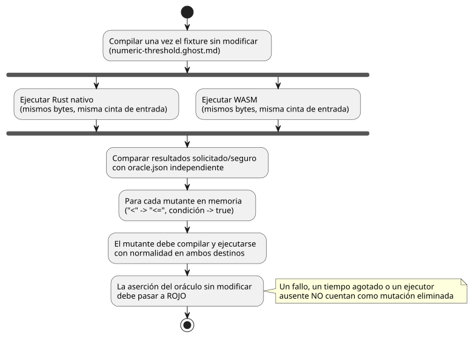

<!-- translation-source: docs/AI-CONTRIBUTION-PACKAGE.md -->
[Original en inglés](AI-CONTRIBUTION-PACKAGE.md)

# Paquete acotado de contribución con IA

[English](AI-CONTRIBUTION-PACKAGE.md) | [한국어](AI-CONTRIBUTION-PACKAGE.ko.md) | Español

Este paquete da soporte a la incidencia
[#134](https://github.com/callin2/ghostflow-language/issues/134). Proporciona a un
contribuidor (humano o IA) evidencia suficiente para investigar **una** regresión
de límite sin importar ningún historial de conversación.

Lo que el paquete **no** hace:

- No autoriza un cambio de las reglas del lenguaje.
- No autoriza la ejecución en dispositivos.

Para conocer todas las puertas de control del repositorio, siga
[CONTRIBUTING](../CONTRIBUTING.es.md) y [el flujo de trabajo](DEVELOPMENT-WORKFLOW.es.md).

## Línea base exacta y tarea

El paquete se preparó sobre dev
`5f87876a170a9e4c7da9d15f4c99a70c502e7b1a`. Para cada contribución, registre los
SHA reales de la base y del candidato, y un estado limpio del árbol de trabajo.
Esta línea base histórica no significa que una ejecución antigua verifique un
HEAD nuevo. El paquete solo añade evidencia; no cambia el comportamiento del
compilador ni de Rust.

**Tarea:** investigar una regresión en la que se permite una intención en un
límite prohibido.

- El caso fijado exige `pump=false` cuando la humedad numérica es 42.5 o mayor.
- Un cambio propuesto debe conservar el *oráculo* especificado de forma
  independiente (los resultados esperados que se fijaron fuera de la
  implementación).
- No generalice este ejemplo como una política de seguridad para toda la
  instalación.

Lectura y contratos mínimos:

- `GF-REQ-cf3758241cf74c21`: la intención solicitada y la intención segura son
  distintas; [catálogo](../contracts/requirements/catalog.json), Referencia
  [§4.7](reference/04-sensors-constraints-control.es.md#47-requested-safe-applied-confirmed).
- `GF-REQ-fe719c3299fc1258`: consolidación atómica de estado/intención;
  [Referencia §2.8](reference/02-types-expressions-state.es.md),
  [validador de requisitos](../contracts/requirements/validate.mjs).
- Selector de prueba `GF-TEST-contribution-field-boundary` en
  [conformidad del runtime](../tests/runtime-conformance.test.mjs).
- Entrada canónica exacta [numeric-threshold.ghost.md](../tests/fixtures/contribution-134/numeric-threshold.ghost.md)
  y [oracle.json](../tests/fixtures/contribution-134/oracle.json) independiente.

**De dónde procede el caso.** La fuente y el oráculo derivados de campo provienen
del caso de entrada por software y salida virtual de Device #43, en la revisión
inmutable
[`618e45046f1c8be748eeec6767d5ffe0ea997a11`](https://github.com/callin2/farm-device/tree/618e45046f1c8be748eeec6767d5ffe0ea997a11/tools/hil/cases/numeric-threshold-virtual-ro1).
La placa seleccionada es `waveshare-esp32-s3-eth-8di-8ro-r8n16`. Estas identidades
registran la procedencia; no significan que esta contribución al lenguaje haya
validado esa placa.

El oráculo es:

| Paso | Humedad | `pump` esperado |
|---|---|---|
| 1 | 42.4 | true |
| 2 | 42.5 | false |
| 3 | 42.6 | false |
| 4 | 42.4 | true |

(En resumen: 42.4→true, 42.5→false, 42.6→false, 42.4→true). Ningún valor esperado
se genera a partir de la salida del compilador ni de la concordancia entre nativo
y WASM.

## Reproducir y demostrar la sensibilidad

Una vez que estén disponibles las dependencias fijadas y los destinos nativo y
WASM, ejecute:

```sh
npm ci --ignore-scripts
cargo build --locked --offline -p ghostflow-core --release --example run
npm run build:wasm
node --test --test-name-pattern GF-TEST-contribution-field-boundary tests/runtime-conformance.test.mjs
node --test tests/runtime-conformance.test.mjs tests/requirement-catalog.test.mjs
```

Use el contenedor compacto existente si está instalado. Es posible que la
preparación de dependencias necesite primero la descarga normal y bloqueada de
Cargo del repositorio; informe por separado de los fallos de infraestructura.
`npm test` y la CI siguen siendo las puertas completas de regresión.

**Qué comprueba la prueba focalizada.** Compila una vez el fixture sin modificar y
entrega los mismos bytes y la misma cinta de entrada a Rust nativo y a WASM.
Comprueba los resultados solicitado y seguro contra el oráculo de campo.

**Caso negativo de entrada ausente (solo WASM).** El caso negativo explícito de
borrado de entrada de la ABI de WASM:

1. rechaza el escaneo con `missing input moisture`;
2. conserva las salidas consolidadas;
3. se recupera con la siguiente entrada explícita.

El ejecutor nativo de CSV omite las líneas totalmente en blanco, por lo que esta
omisión de la única entrada no se presenta como una comparación nativa. Este es un
caso negativo del *lenguaje*, no una prueba de la calidad degradada de Device: el
adaptador de Device fijado inicializaba las entradas Number a cero, conservaba los
valores anteriores en actualizaciones parciales y no tenía canal de calidad.

**Sensibilidad a mutaciones.** La prueba también demuestra que detectaría una
regresión real. Dos mutaciones temporales en memoria debilitan la regla:

- cambiar `<` por `<=`;
- sustituir la condición por `true`.

Cada mutante debe compilar y ejecutarse con normalidad en ambos destinos; solo
entonces debe fallar la aserción del oráculo sin modificar. La prueba en verde
comprueba que estas aserciones pasan a ROJO. Por tanto, un fallo del compilador,
un tiempo de espera agotado o un ejecutor ausente no pueden contar como una
mutación eliminada. Esta demostración no modifica ninguna fuente del producto.

El diagrama siguiente resume la prueba focalizada: los mismos bytes compilados se
ejecutan en ambos destinos y se comprueban contra el oráculo independiente, y cada
mutante debilitado debe ejecutarse sin errores y luego fallar contra ese mismo
oráculo.



## Cambios permitidos y evidencia para la revisión

Limite una contribución a:

- la ruta del compilador/núcleo titular demostrada;
- esta regresión focalizada;
- la documentación bilingüe de reglas y el registro de cambios pertinentes,
  **solo si** cambia el comportamiento.

No modifique el firmware de Device, las vinculaciones, los drivers, el despliegue,
la política de la interfaz de usuario ni los hashes históricos de benchmarks. El
paquete actual solo cambia evidencia; una corrección real de la regresión necesita
su propia reproducción de antes/después.

Las plantillas de incidencias y de PR piden identidades exactas, comandos con su
código de salida, resultados de antes/después, valores esperados independientes,
límites y brechas pendientes. Revise estas categorías del diff **por separado**,
porque cada una puede ocultar una comprobación debilitada:

1. Eliminación o debilitamiento de expresiones de protección, incluidos los
   operadores de límite.
2. Ediciones de valores esperados en `oracle.json` y en la constante independiente
   de la prueba.
3. Eliminación de pruebas, `.skip`/`.todo`, eliminación de selectores o de la
   lista de ejecutores, o pérdida de aserciones.
4. Cambios en `status`, `testIds`, el resumen del localizador y `pendingReason` de
   los requisitos.

Use `git diff BASE_SHA...HEAD -- tests/fixtures/contribution-134 tests/runtime-conformance.test.mjs tools/verify-language.mjs contracts/requirements/catalog.json`
e inspeccione por separado el diff de la implementación.

La validación del catálogo detecta referencias rotas y contratos de estado. No
puede saber si un oráculo debilitado es correcto. Un cambio legítimo de la
especificación necesita evidencia autorizada citada y una revisión independiente y
separada de su significado. Cambiar a la vez la implementación y los valores
esperados no demuestra, por sí solo, la corrección.

**Qué demuestra y qué no demuestra esta evidencia.**

- La concordancia nativo/WASM demuestra la portabilidad para esta cinta de
  entrada. Ambos destinos comparten Rust, por lo que pueden compartir el mismo
  malentendido.
- El oráculo de campo añade una expectativa de límite independiente. No es prueba
  de corrección universal ni de protección física.
- Nada de esto valida contactos, cargas, un canal de calidad ausente, fallos de
  driver/renderizador, reinicios, ajustes en vivo, cortes de energía ni el límite
  de confianza de HIL. Device #43/#45 conservan esos titulares y esas brechas.

Al informar de la finalización, conserve las identidades exactas de CI, informes y
artefactos, y evidencia reciente posterior a la fusión.
